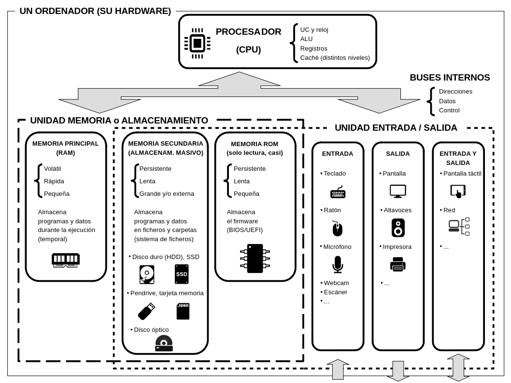
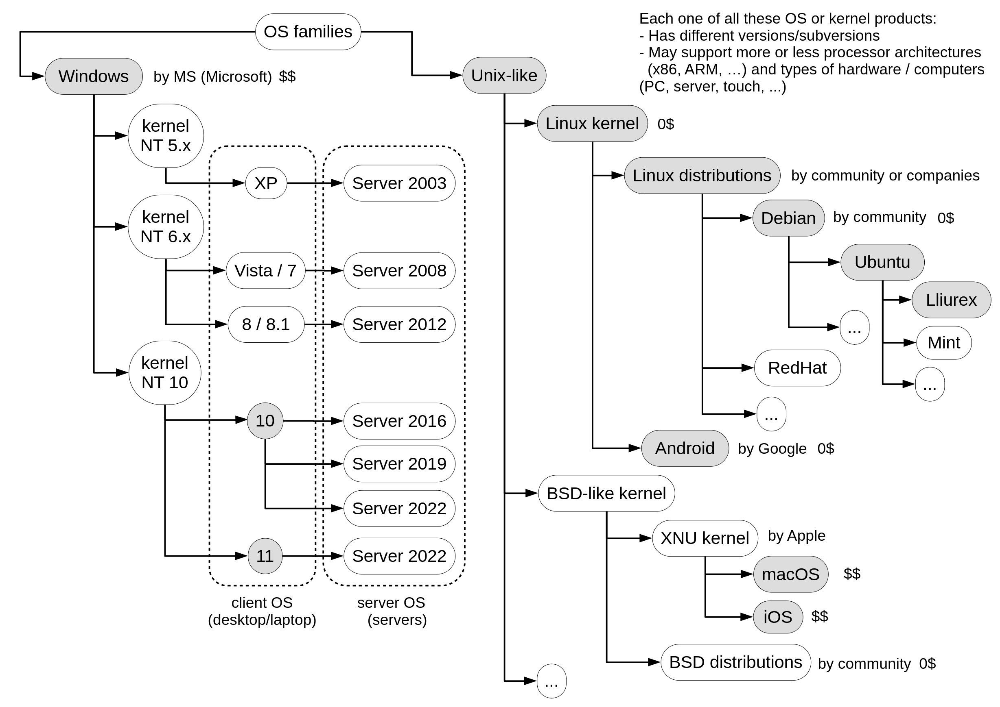
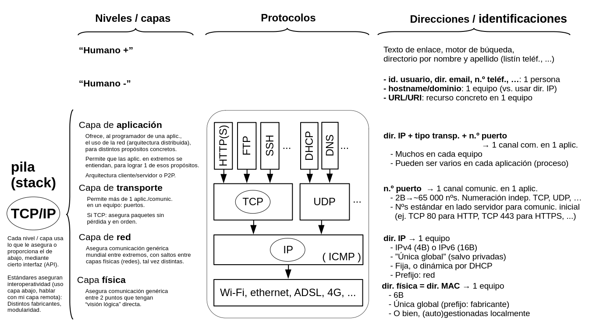
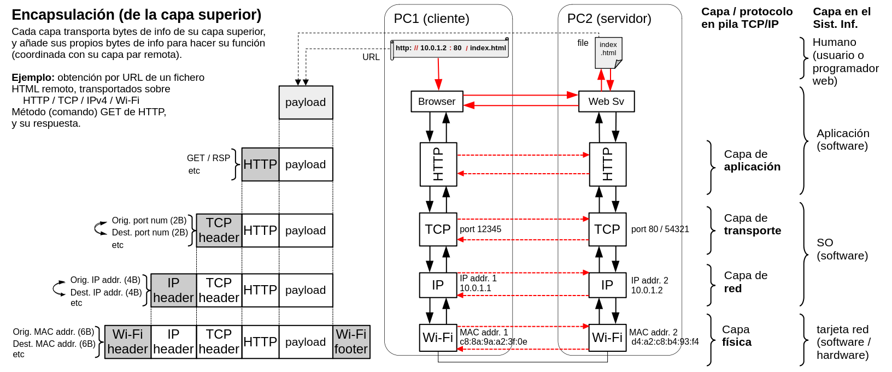
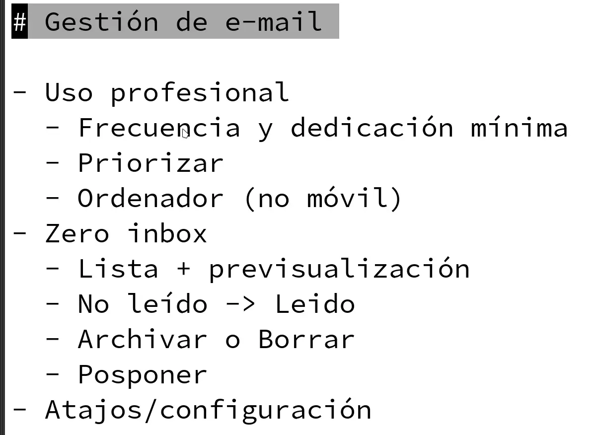

# DWEC - ALL THE THEORY (master file)

One file with everything: (I) the study guide built from the professor's style, (II) the professor's own notes and task sheets **verbatim**, (III) the textbook articles (javascript.info, English, offline copy from `jsinfo.2025-10.zip`) for the chapters he covers, (IV) his background unit, git guide and forum rules, (V) every code file in full (complete task pages, UT reference, check scripts).

> **Do not push this file to a public repository**: Parts II-IV reproduce the teacher's materials and the textbook (javascript.info content is CC BY-NC-SA).
>
> Overlap between parts is intentional. Where his notes (Part II) and the textbook (Part III) differ, **his notes win**.
>
> Not included (superseded or non-text): the older `jsinfo-lang-2-fundamentals-comments.md` (the `.new.md` is a superset), the ODP source, the five SVG mind-map renders (the `.mm` outline has the same content), the QR code image, and the rest of the jsinfo site (objects, classes, async, DOM... not yet covered).

Rebuild: `python3 -I tools/build-all.py`.

## Table of contents

- [PART I - Study guide (analysis, traps, drills)](#part-i---study-guide-analysis-traps-drills)
  - [DWEC study guide](#dwec-study-guide)
    - [Order](#order)
    - [Study method (his own advice, applied)](#study-method-his-own-advice-applied)
    - [Trust level of the content](#trust-level-of-the-content)
    - [Regenerating](#regenerating)
  - [01 - How the professor thinks](#01---how-the-professor-thinks)
    - [1. "Necessary but not sufficient"](#1-necessary-but-not-sufficient)
    - [2. The template is part of the question](#2-the-template-is-part-of-the-question)
    - [3. "Do it exactly this (unneeded) way"](#3-do-it-exactly-this-unneeded-way)
    - [4. Exact formats are graded](#4-exact-formats-are-graded)
    - [5. He tests whether you can *read* hostile code](#5-he-tests-whether-you-can-read-hostile-code)
    - [6. Technical names matter](#6-technical-names-matter)
    - [7. Style rules he will check by eye (no linter in the exam)](#7-style-rules-he-will-check-by-eye-no-linter-in-the-exam)
    - [8. Where he corrects or tightens jsinfo (exam = his version)](#8-where-he-corrects-or-tightens-jsinfo-exam--his-version)
    - [9. Process habits he grades](#9-process-habits-he-grades)
    - [10. Mental checklist for every question he writes **[inference]**](#10-mental-checklist-for-every-question-he-writes-inference)
  - [02 - Context, tooling and code quality](#02---context-tooling-and-code-quality)
    - [2.1 jsinfo naming (he asks you to use his scheme)](#21-jsinfo-naming-he-asks-you-to-use-his-scheme)
    - [2.2 How JS runs](#22-how-js-runs)
    - [2.3 Names and versions](#23-names-and-versions)
    - [2.4 The developer console (LANG1.4)](#24-the-developer-console-lang14)
    - [2.5 Code quality (LANG3)](#25-code-quality-lang3)
  - [03 - Hello world, code structure, strict mode, variables (LANG2.1-2.4)](#03---hello-world-code-structure-strict-mode-variables-lang21-24)
    - [3.1 The `<script>` tag and loading JS (2.1)](#31-the-script-tag-and-loading-js-21)
    - [3.2 Code structure (2.2)](#32-code-structure-22)
    - [3.3 Strict mode (2.3)](#33-strict-mode-23)
    - [3.4 Variables (2.4)](#34-variables-24)
    - [3.5 Task "variable with the name of our planet" **[P]**](#35-task-variable-with-the-name-of-our-planet-p)
  - [04 - Data types, interaction, type conversions (LANG2.5-2.7)](#04---data-types-interaction-type-conversions-lang25-27)
    - [4.1 The eight types](#41-the-eight-types)
    - [4.2 Interaction: `alert`, `prompt`, `confirm` (2.6)](#42-interaction-alert-prompt-confirm-26)
    - [4.3 Type conversions (2.7) **[P]**](#43-type-conversions-27-p)
    - [4.4 Conversion cheat table (all verified in chapter 09)](#44-conversion-cheat-table-all-verified-in-chapter-09)
  - [05 - Operators, precedence, assignment, comparisons (LANG2.8-2.9)](#05---operators-precedence-assignment-comparisons-lang28-29)
    - [5.1 Terms **[J]**/**[P]**](#51-terms-jp)
    - [5.2 Math operators](#52-math-operators)
    - [5.3 Precedence **[P]** (this is where he diverges from jsinfo)](#53-precedence-p-this-is-where-he-diverges-from-jsinfo)
    - [5.4 Assignment **[P]**](#54-assignment-p)
    - [5.5 Comparisons (2.9)](#55-comparisons-29)
  - [06 - Conditionals, logical operators, `??`, loops, `switch` (LANG2.10-2.14)](#06---conditionals-logical-operators--loops-switch-lang210-214)
    - [6.1 `if` / `else if` / `else` (2.10)](#61-if--else-if--else-210)
    - [6.2 Logical operators (2.11) **[J]**](#62-logical-operators-211-j)
    - [6.3 Nullish coalescing `??` (2.12) **[J]**](#63-nullish-coalescing--212-j)
    - [6.4 Loops (2.13)](#64-loops-213)
    - [6.5 `switch` (2.14) **[J]** + his hack tasks](#65-switch-214-j--his-hack-tasks)
  - [07 - Functions (LANG2.15-2.17) and "JavaScript specials"](#07---functions-lang215-217-and-javascript-specials)
    - [7.1 Function declaration (2.15)](#71-function-declaration-215)
    - [7.2 Function expressions (2.16) and callbacks **[J]**](#72-function-expressions-216-and-callbacks-j)
    - [7.3 Arrow functions (2.17)](#73-arrow-functions-217)
    - [7.4 "JavaScript specials" (jsinfo 2.18; his file labels it 2.16)](#74-javascript-specials-jsinfo-218-his-file-labels-it-216)
  - [08 - The assigned tasks, dissected (dwec1p2 and dwec1p3)](#08---the-assigned-tasks-dissected-dwec1p2-and-dwec1p3)
    - [math1.html - four numbers, product 48, even test](#math1html---four-numbers-product-48-even-test)
    - [math2.html - shorthand, toFixed, typeof](#math2html---shorthand-tofixed-typeof)
    - [math3.html - tests as booleans](#math3html---tests-as-booleans)
    - [conditionals1.html - season](#conditionals1html---season)
    - [conditionals2.html - worth 3 points: the big one](#conditionals2html---worth-3-points-the-big-one)
    - [conditionals3.html - single-line "not if-else"](#conditionals3html---single-line-not-if-else)
    - [loops3.html - primes backwards, three loops](#loops3html---primes-backwards-three-loops)
    - [Delivery of dwec1p2](#delivery-of-dwec1p2)
  - [dwec1p3 - refactoring + unit testing of conditionals2 (and git)](#dwec1p3---refactoring--unit-testing-of-conditionals2-and-git)
    - [The ten commits (titles verbatim)](#the-ten-commits-titles-verbatim)
    - [Output format (be exact)](#output-format-be-exact)
    - [Designing the test cases (his hints)](#designing-the-test-cases-his-hints)
    - [Refactor #7 / #8 (ternaries)](#refactor-7--8-ternaries)
    - [The `switch` hack (#9) and why it's reverted](#the-switch-hack-9-and-why-its-reverted)
    - [Delivery of dwec1p3](#delivery-of-dwec1p3)
  - [09 - Drills: "what does this print?"](#09---drills-what-does-this-print)
    - [typeof](#typeof)
    - [Numbers](#numbers)
    - [Type conversions](#type-conversions)
    - [Truthy / falsy](#truthy--falsy)
    - [Comparisons and equality](#comparisons-and-equality)
    - [Operators, precedence, assignment](#operators-precedence-assignment)
    - [&&  ||  ??  !](#------)
    - [Conditional (ternary) operator](#conditional-ternary-operator)
    - [Strings and literals](#strings-and-literals)
    - [Variables, const, scope, strict mode](#variables-const-scope-strict-mode)
    - [Semicolons (ASI)](#semicolons-asi)
    - [Functions](#functions)
    - [Loops](#loops)
    - [switch](#switch)
  - [10 - Process: git "no excuses", SemVer, Conventional Commits, forum, delivery](#10---process-git-no-excuses-semver-conventional-commits-forum-delivery)
    - [10.1 Git, no excuses (his philosophy)](#101-git-no-excuses-his-philosophy)
    - [10.2 Better commits](#102-better-commits)
    - [10.3 SemVer (`MAJOR.MINOR.PATCH`)](#103-semver-majorminorpatch)
    - [10.4 Conventional Commits](#104-conventional-commits)
    - [10.5 Delivery rules (all tasks)](#105-delivery-rules-all-tasks)
    - [10.6 The forum rules (marks exist for it)](#106-the-forum-rules-marks-exist-for-it)
  - [11 - Background unit "dwec0-prev": hardware, OS, networks, web](#11---background-unit-dwec0-prev-hardware-os-networks-web)
    - [11.1 Computer hardware (functional units diagram)](#111-computer-hardware-functional-units-diagram)
    - [11.2 Memory hierarchy (pyramid) and latency](#112-memory-hierarchy-pyramid-and-latency)
    - [11.3 Processor architectures (ISA)](#113-processor-architectures-isa)
    - [11.4 OS families](#114-os-families)
    - [11.5 Client-server architecture and networks (mind map)](#115-client-server-architecture-and-networks-mind-map)
    - [11.6 The web: browsers, servers, URLs](#116-the-web-browsers-servers-urls)
  - [12 - Mock exam, written the way he writes them **[inference]**](#12---mock-exam-written-the-way-he-writes-them-inference)
    - [Part A - What does each snippet produce? (1 point each)](#part-a---what-does-each-snippet-produce-1-point-each)
    - [Part B - Find the bugs (2 points each)](#part-b---find-the-bugs-2-points-each)
    - [Part C - Short theory (1-2 points each)](#part-c---short-theory-1-2-points-each)
    - [Part D - Write code (4 points each)](#part-d---write-code-4-points-each)
  - [13 - One-page cheatsheet + pre-exam checklist](#13---one-page-cheatsheet--pre-exam-checklist)
    - [Falsy (8)](#falsy-8)
    - [typeof](#typeof-1)
    - [To number](#to-number-1)
    - [Comparison](#comparison)
    - [Precedence (high -> low)](#precedence-high---low)
    - [Short-circuit](#short-circuit)
    - [Statements vs expressions](#statements-vs-expressions)
    - [Loops](#loops-1)
    - [switch](#switch-1)
    - [Functions](#functions-1)
    - [Scope & declarations](#scope--declarations)
    - [ASI danger](#asi-danger)
    - [Style (he checks by eye)](#style-he-checks-by-eye)
    - [Process](#process)
    - [Pre-exam checklist](#pre-exam-checklist)
- [PART II - The professor's notes and task sheets (verbatim)](#part-ii---the-professors-notes-and-task-sheets-verbatim)
  - [Course overview: jsinfo as textbook, naming, how to read his comments (jsinfo-readme-first.md)](#course-overview-jsinfo-as-textbook-naming-how-to-read-his-comments-jsinfo-readme-firstmd)
    - [javascript.info aka jsinfo](#javascriptinfo-aka-jsinfo)
  - [LANG 1: Intro (comments)](#lang-1-intro-comments)
    - [jsinfo LANG 1: Intro (comments)](#jsinfo-lang-1-intro-comments)
  - [LANG 2: JavaScript Fundamentals (comments)](#lang-2-javascript-fundamentals-comments)
    - [jsinfo LANG 2: JavaScript Fundamentals (comments)](#jsinfo-lang-2-javascript-fundamentals-comments)
  - [LANG 3: Code Quality (comments)](#lang-3-code-quality-comments)
    - [jsinfo LANG 3: Code Quality (comments)](#jsinfo-lang-3-code-quality-comments)
  - [Task sheet dwec1p2 (MDN Learn tasks)](#task-sheet-dwec1p2-mdn-learn-tasks)
    - [MDN Learn tasks for js fundamentals: task instructions](#mdn-learn-tasks-for-js-fundamentals-task-instructions)
  - [Task sheet dwec1p3 (refactoring + unit tests + git)](#task-sheet-dwec1p3-refactoring--unit-tests--git)
    - [Refactoring and unit testing of MDN Conditionals 2 task: task instructions](#refactoring-and-unit-testing-of-mdn-conditionals-2-task-task-instructions)
- [PART III - Textbook: javascript.info (chapters covered)](#part-iii---textbook-javascriptinfo-chapters-covered)
  - [LANG 1 - An introduction](#lang-1---an-introduction)
    - [An Introduction to JavaScript](#an-introduction-to-javascript)
    - [Manuals and specifications](#manuals-and-specifications)
    - [Code editors](#code-editors)
    - [Developer console](#developer-console)
  - [LANG 2 - JavaScript Fundamentals](#lang-2---javascript-fundamentals)
    - [Hello, world!](#hello-world)
    - [Code structure](#code-structure)
    - [The modern mode, "use strict"](#the-modern-mode-use-strict)
    - [Variables](#variables)
    - [Data types](#data-types)
    - [Interaction: alert, prompt, confirm](#interaction-alert-prompt-confirm)
    - [Type Conversions](#type-conversions-1)
    - [Basic operators, maths](#basic-operators-maths)
    - [Comparisons](#comparisons)
    - [Conditional branching: if, '?'](#conditional-branching-if-)
    - [Logical operators](#logical-operators)
    - [Nullish coalescing operator '??'](#nullish-coalescing-operator-)
    - [Loops: while and for](#loops-while-and-for)
    - [The "switch" statement](#the-switch-statement)
    - [Functions](#functions-2)
    - [Function expressions](#function-expressions)
    - [Arrow functions, the basics](#arrow-functions-the-basics)
    - [JavaScript specials](#javascript-specials)
  - [LANG 3 - Code quality (he asks for 3.5 only up to "BDD")](#lang-3---code-quality-he-asks-for-35-only-up-to-bdd)
    - [Debugging in the browser](#debugging-in-the-browser)
    - [Coding Style](#coding-style)
    - [Comments](#comments-2)
    - [Ninja code](#ninja-code)
    - [Automated testing with Mocha](#automated-testing-with-mocha)
    - [Polyfills and transpilers](#polyfills-and-transpilers)
  - [Flash-forward articles he points to (numbers, strings, arrays)](#flash-forward-articles-he-points-to-numbers-strings-arrays)
    - [Numbers](#numbers-1)
    - [Strings](#strings)
    - [Arrays](#arrays)
- [PART IV - Background unit, git guide, forum rules](#part-iv---background-unit-git-guide-forum-rules)
  - [Memory hierarchy (02-memory-hierarchy.html)](#memory-hierarchy-02-memory-hierarchyhtml)
    - [La jerarquía de memoria](#la-jerarquía-de-memoria)
  - [Processor architectures (03-arquitecturas-procesador.html)](#processor-architectures-03-arquitecturas-procesadorhtml)
    - [Arquitecturas de procesador](#arquitecturas-de-procesador)
  - [Client-server architecture and networks: mind map (00.redes-arqu-cl-sv.mm)](#client-server-architecture-and-networks-mind-map-00redes-arqu-cl-svmm)
  - [IP addresses and more (04.dir-ip-y-otros.pdf, slide text)](#ip-addresses-and-more-04dir-ip-y-otrospdf-slide-text)
  - [End-to-end communication examples (diagram scenarios)](#end-to-end-communication-examples-diagram-scenarios)
    - [Preview set (`01.e2e-examples-prev.pdf`)](#preview-set-01e2e-examples-prevpdf)
    - [Full set (`05.e2e-examples.pdf`)](#full-set-05e2e-examplespdf)
    - [Figure transcriptions (images in his unit)](#figure-transcriptions-images-in-his-unit)
  - [Git, no excuses (git-noexcuses.minimal.html)](#git-no-excuses-git-noexcusesminimalhtml)
    - [Git, no excuses minimal (by DM)](#git-no-excuses-minimal-by-dm)
    - [1 Introducción](#1-introducción)
    - [2 Git initial setup](#2-git-initial-setup)
    - [3 Minimal workflow (no excuses): monouser, local, unibranch, all-tracked, no-staging, always-forward, unaimed-commits](#3-minimal-workflow-no-excuses-monouser-local-unibranch-all-tracked-no-staging-always-forward-unaimed-commits)
    - [4 Workflow improvement: amending last, reset or stashing ongoing](#4-workflow-improvement-amending-last-reset-or-stashing-ongoing)
    - [5 Workflow improvement: better commits (diff with commited, atomic commits, better messages)](#5-workflow-improvement-better-commits-diff-with-commited-atomic-commits-better-messages)
    - [6 Workflow so far using vscode](#6-workflow-so-far-using-vscode)
  - [Forum rules (foro-reglas.html)](#forum-rules-foro-reglashtml)
    - [Foro de colaboración y ayuda: reglas](#foro-de-colaboración-y-ayuda-reglas)
    - [1 ¿Qué puede ir al foro?](#1-qué-puede-ir-al-foro)
    - [2 ¿Cómo usar el foro?](#2-cómo-usar-el-foro)
    - [3 Esencia del foro](#3-esencia-del-foro)
- [PART V - Complete code (every file in full)](#part-v---complete-code-every-file-in-full)
  - [Task files (complete: template verbatim + solution)](#task-files-complete-template-verbatim--solution)
    - [`reference/tasks/math1.html`](#referencetasksmath1html)
    - [`reference/tasks/math2.html`](#referencetasksmath2html)
    - [`reference/tasks/math3.html`](#referencetasksmath3html)
    - [`reference/tasks/conditionals1.html`](#referencetasksconditionals1html)
    - [`reference/tasks/conditionals2.html`](#referencetasksconditionals2html)
    - [`reference/tasks/conditionals3.html`](#referencetasksconditionals3html)
    - [`reference/tasks/loops3.html`](#referencetasksloops3html)
  - [dwec1p3 reference (ut-refactor/)](#dwec1p3-reference-ut-refactor)
    - [`reference/ut-refactor/conditionals2.html`](#referenceut-refactorconditionals2html)
    - [`reference/ut-refactor/scripts/get-response/main.js`](#referenceut-refactorscriptsget-responsemainjs)
    - [`reference/ut-refactor/scripts/get-response/uts.js`](#referenceut-refactorscriptsget-responseutsjs)
    - [`reference/ut-refactor/scripts/get-response/uts.html`](#referenceut-refactorscriptsget-responseutshtml)
  - [Check scripts (run with node)](#check-scripts-run-with-node)
    - [`tools/html-run.js`](#toolshtml-runjs)
    - [`tools/tasks-check.js`](#toolstasks-checkjs)
    - [`tools/run-ut.js`](#toolsrun-utjs)
    - [`tools/mock-check.js`](#toolsmock-checkjs)

# PART I - Study guide (analysis, traps, drills)

## DWEC study guide

Built from the files in the teacher's shared folder (`dwec-shared`,
synced into `sync/dwec-shared-onedrive/`): his `jsinfo-*-comments.md`, task
sheets `dwec1p2`/`dwec1p3`, the git guide, the forum rules and the
`dwec0-prev` background unit.

The goal is not to repeat the textbook but to prepare for **how he asks**:
exact formats, traps hidden in templates, prescribed "unneeded" constructs,
dense expressions to read, and precise terminology.

### Order

| File | What |
|---|---|
| `01-professor-mindset.md` | **Read first.** How he thinks, writes code and tests |
| `02-context-and-tooling.md` | jsinfo structure, JIT, ES versions, SOP, console, code quality (LANG1, LANG3) |
| `03-basics-scripts-variables.md` | script tags, statements/expressions, ASI, strict mode, variables (LANG2.1-2.4) |
| `04-types-and-conversions.md` | types, typeof, prompt/alert, conversions (LANG2.5-2.7) |
| `05-operators-and-comparisons.md` | precedence, assignment, comparisons (LANG2.8-2.9) |
| `06-control-flow.md` | if, `?:`, `&&`/`\|\|`/`??`, loops, switch (LANG2.10-2.14) |
| `07-functions.md` | declarations, expressions, arrows, defaults, return (LANG2.15-2.17) |
| `08-tasks-walkthrough.md` | dwec1p2 and dwec1p3 dissected, with the hidden bugs |
| `09-drills.md` | **241 executed "what does this print" drills** (generated) |
| `10-process-git-forum.md` | git, SemVer, Conventional Commits, forum, delivery |
| `11-hardware-os-network-web.md` | the `dwec0-prev` background unit |
| `12-mock-exam.md` | an exam in his style, with answers |
| `13-cheatsheet.md` | one page + pre-exam checklist |

`reference/tasks/` has the **complete** HTML file of every dwec1p2 task
(his template verbatim + the solution in the marked zone) and
`reference/ut-refactor/` the complete UT/refactor files. `ALL-THEORY.md` is
the single file with all the theory **and** every complete code file
(Part V).

### Study method (his own advice, applied)

1. Read a chapter **alongside** the matching jsinfo article and his comments
   file (his comments win).
2. Do the jsinfo tasks **written on paper** before reading solutions.
3. Do the drills in chapter 09 with an **answer committed on paper first**.
4. Redo dwec1p2/dwec1p3 from scratch under exam conditions (no linter, no
   browser), then compare with chapter 08.
5. Take the mock exam, then attack your own answers: boundaries, types,
   `NaN`, `null`.
6. Last day: chapter 13 only.

### Trust level of the content

- **Executed**: every drill answer (`node tools/verify.js`), the task
  solutions and hostile test grid (`node tools/tasks-check.js`), the UT
  reference against a mutant, and the mock-exam Part A (`node
  tools/mock-check.js`). Node v20; behaviour is standard ES, not Node-only,
  except where it says "strict"/"sloppy".
- **Quoted/derived** from his files: marked **[P]**.
- **jsinfo content he did not comment** (logical operators, `??`, `switch`,
  parts of functions): marked **[J]**; written from the textbook's known
  content, not from his notes.
- **[inference]**: my reading of his style about what an exam will look like.
  Not a promise.
- I did not open the full `jsinfo.2025-10.zip` (the offline textbook, 14 MB):
  open the matching articles to confirm wording and to do its tasks.
- Spots where his own material has small slips (not errors in this guide):
  the `ut.js`/`uts.js` filename, `math2`'s `<title>math3`, the missing `?` in
  one ternary example, a missing `)` in `console.log(aliasFunc(1, 2);`, the
  Windows hosts path, a few `\\'` Markdown escapes in the task text.

### Regenerating

```bash
cd tools
node verify.js        # run every drill against Node
node gen.js           # rebuild 09-drills.md from bank.js
node tasks-check.js
node mock-check.js
node html-run.js      # executes the complete HTML task files
python3 -I build-all.py   # rebuilds ../ALL-THEORY.md
```

Edit `tools/bank.js` to add drills (each entry carries its expected result,
so a wrong claim fails verification).

## 01 - How the professor thinks

Everything here is **derived from his own files** (task sheets, templates,
`*-comments.md`, the git guide, the forum rules). Where I am extrapolating
to what an exam will look like, it says **[inference]**.

His own rule, from `jsinfo-readme-first.md`: *"puede que matice, añada o
incluso contradiga lo que dice jsinfo. Por supuesto, lo que diga yo es lo
que va a misa."* In an exam, **his comments beat the textbook**. Where they
differ, this guide follows him (see the list at the end).

---

### 1. "Necessary but not sufficient"

> "for sure you can do an incorrect implementation that also shows this
> message. The message is a necessary but not sufficient condition for
> correctness." (math1)

> "(spoiler: we should find some [bugs] if we look deep enough)" (UT task)

> "Note: if none of your UT's fail, think twice before commiting"

He builds exercises where the **visible check passes on a wrong answer**.
Your job is to ask "what input would make my code lie?", not "does it print
the expected text?".

Habit: after you finish any task, attack it:

- boundary values (0, 19, 20, 100, 101, -1)
- values **between** the integers (19.5, 39.9) - closed intervals such as
  `<= 19` / `>= 20` leave a gap
- wrong types (`"75"`, `null`, `undefined`, `NaN`, `true`)
- `prompt()` returns `string | null` (`""` for OK with nothing, `null` for
  Cancel), so `Number(null) === 0` makes a cancelled prompt look like a
  terrible score
- "any crazy programmer (possibly yourself in two weeks in the middle of the
  night after 24h without sleeping)" calling your function

### 2. The template is part of the question

Read the **"Don't edit the code below here!"** part first. It encodes the
contract. Real traps from his templates:

| Template detail | What it forces |
|---|---|
| math1 prints "even" only if `evenOddResult === 0` | `evenOddResult` must be `finalResult % 2` (the remainder). Storing `finalResult % 2 === 0` (a boolean `true`) prints "odd. Hrm." |
| math1 pre-declares `let finalResult; let evenOddResult;` | Do not `let` them again: SyntaxError (already declared) |
| math2 checks `isNaN(finalNumber) === false` | `finalNumber` must exist at top level. If you declare it with `let` inside an `if { }` block it is out of scope below. If never assigned, it is `undefined` -> `NaN` -> fail |
| math2 `<title>math3</title>` | He copy-pasted. Do not "fix" things outside your zone; mention it in a comment if you like |
| math2 says "assignment shorthand" and "`typeof`" | Use `result *= result2` and an actual `typeof finalResult === 'string'` check. The method is graded, not only the number |
| math3: expected paragraphs "False", "True", "False" | The *statements* are phrased to mislead: "elephant weighs **less** than the mouse" -> `eleWeight < mouseWeight` is **false**. You test the statement, not the truth you wish |
| math3 passwords `'stromboli'` vs `'stROmBoLi'` | `===` is case-sensitive -> `false`. No `toLowerCase()` |
| conditionals1 "add **another** test for winter" | Use `else if`. Two independent `if`s make the second `else` overwrite the summer message |
| conditionals2 text contains `it\\'s` | The double backslash is a Markdown artefact. In JS write `'it\'s'` or `"it's"`. The UT later expects the real sentence `That's a great score, ...` |
| conditionals3 "in a **single line**, using something that isn't an `if...else`" | The conditional (ternary) operator. Note that `pwdResult` only applies **if the machine is on** |
| loops3 `isPrime(num)` uses its own `let i` | It **shadows** the global `i = 500`. Good: it does not clobber yours. And `isPrime(1)` is `true` (so "1 is not counted" -> start at 2) |
| loops3 "three different types of loop", "newline separation" | `while`, `do..while`, `for`. And `\n` inside `textContent` renders as a space in HTML unless `white-space` is `pre`/`pre-line` (see chapter 08) |
| UT task "`uts.js`" vs "loads `main.js` then `ut.js`" | The sheet is inconsistent; the **Deliver tree** says `uts.js`. Use the file that exists |

### 3. "Do it exactly this (unneeded) way"

His instructions often prescribe the **construct**, not just the result:

- "use assignment shorthand" -> `*=`
- "Check the data type using `typeof`" -> do not skip it because "toFixed
  always returns a string"
- "Do the loop three times using three different types of loop"
- "nest another `if...else`" inside the first
- "in a single line, using something that isn't an `if...else`"
- "use ternary for score" / "as a single expression" / "use `switch` for
  score (a hacky use)"
- "Store the result in a variable called `finalResult`" (exact names!)
- "Call the variables something sensible" (the name is judged)

Rule: **follow the prescribed construct literally**, even when you know a
shorter way. The point of the exercise is the construct. He even says the
switch version "for sure is a **really bad** practice. But, hey! We are
having fun here, with our safety net." Do it, then revert it.

### 4. Exact formats are graded

- File and folder names, case, ASCII only: `dwec1p2.nunez-de-balboa.jose-luis.zip`
  (first surname, then name; compound surnames and names kebab-cased;
  accents/ñ removed; second surname dropped).
- Content **directly under the ZIP root**, not inside an extra folder.
- **Only** requested files (extra notes -> code comments, or a lowercase
  English `readme.md` at the ZIP root).
- Up to **-5 points** for wrong formats, names or structure (that is half a
  10-point task).
- Console output: "exactly 5 lines", header separator `|-|-|-|-|-|-|` has one
  more `|-|` once a field is added, `Fails: ` + number after a blank line,
  `Pass`/`Fail` capitalised, expected/actual **only printed on failure**.
- Commit titles verbatim, in Conventional Commits style, ending in `(#n)`,
  branch `main`, HTML `<title>` prefixed with `first-surname.name`.

### 5. He tests whether you can *read* hostile code

From `jsinfo-lang-3-code-quality-comments.md`:

> "Cojo-expresiones y código en un solo statement: aquí lo hago para
> forzaros a entenderlas ... y comprobar si, con dedicación, sois capaces de
> seguir ese código. Porque otros escribirán (y mucho) así en la vida real."

**[inference]** Expect "what does this evaluate to" questions on dense code:
nested template literals (`` `a ${`b ${`c`} d`} e` ``), `+apples + +oranges`,
the comma operator, chained ternaries, `x = y = 2 + 1`, short-circuit
`a || b && c`, `typeof typeof 0`, `null >= 0`, `[] == ![]`. Chapter 09 trains
exactly this, with 204 executed examples.

He also admits he commits some "sins" in class (one-letter names, reused
variables, `num1`/`num2`): **in an answer sheet use the good version**.

### 6. Technical names matter

He keeps inserting "now I'm showing their **technical names**". Learn the
exact term:

- *template literal* (backticks), *string / numeric / boolean / null /
  object / array / regular-expression literal*
- *expression* vs *statement*, *expression statement*, *block statement*
- *conditional operator* (the ES name) = "ternary"; *unary / binary / ternary*
- *falsy / truthy*; *type conversion* = casting = coercion (MDN: coercion =
  implicit only)
- *function declaration* vs *function expression* vs *arrow function*;
  *callback*; *hoisting*; *shadowing*; *global / local / outer variable*
- *modal window* (alert/prompt/confirm)
- *JIT compilation*, *transpilation*, *polyfill*, *linter*, *minifier*
- *Same Origin Policy*, *Web APIs* (browser) vs *Web API* (HTTP/REST)
- *ECMA-262 / ECMAScript (ES)*, *WHATWG living standards*, *SemVer*,
  *Conventional Commits*, *atomic commit*, *regression test*, *UT*

### 7. Style rules he will check by eye (no linter in the exam)

- **80 columns**, **2-space indentation**, consistent style (or consistent
  with the code you touch).
- Choose one quote style and keep it (single quotes is the popular JS
  choice; JSON needs double). Exception: the other quote to avoid escaping.
- Semicolons: use them (SemistandardJS). No `;` after a block `}`.
- `'use strict';` at the top of scripts (he asks to be reminded when he
  forgets).
- `const` by default, `let` only when reassigned. No `var`.
- `lowerCamelCase` for variables/functions. **Not** `UpperCamelCase` (classes
  only), **not** `snake_case`.
- Names: semantic, with unit if not SI/obvious (`alturaCm`, `pesoKg`), not
  `data`/`value`/`num` (unless truly generic like `num1`, `num2` in a
  generic sum), one meaning per variable (never reuse a variable for
  something else), consistent vocabulary (user vs visitor).
- Real booleans: `true`/`false`, never `"true"`, `"yes"`, `"si"`.
- `null` = a programmer deliberately put "empty"; `undefined` = never set.
  Do not assign `undefined` yourself.
- Strict equality `===`/`!==`. The only coercion he accepts: truthy/falsy in
  a condition, and explicit conversion (`Number()`, `String()`, `Boolean()`).
- Comments say **intent** (why / what for), not a narration of the loop. As
  a junior, too many > too few. Use *functions as comments* (good names).
- No deactivated code left in committed code (version control remembers).
- Prefer line comments `//` for multi-line comments because `/* */` cannot
  nest.
- Avoid nesting when you can (flat `else if`, early `return`/`continue`).
- If you needed something not taught yet: **comment that you did, and the
  source**.

### 8. Where he corrects or tightens jsinfo (exam = his version)

| Topic | jsinfo says | Professor says |
|---|---|---|
| Operator order | "same precedence -> left to right" | **Wrong**: `**`, assignments, `? :`, `=>`, spread are right-to-left |
| `else if` | looks like a keyword | Not extra syntax: just `else { if ... }` written flat |
| `NaN` | "not a number" | `NaN` **is** a number (`typeof NaN === 'number'`) |
| "Script never dies" | numeric errors give NaN | Convenient short term, hides bugs; you can still make it die |
| null vs undefined | similar | undefined = not set by programmer; null = set on purpose |
| Ternary for side effects | "not recommended" | Agrees, but the jsinfo example is bad: it should be `alert(cond ? 'Right!' : 'Wrong.')` |
| Ternary | "conditional/question mark operator, sometimes ternary" | Often called ternary; ES name is conditional operator; it is an *expression* equivalent of `if` |
| `;` | "recommended" | Yes, but console may omit; never after block `}`; StandardJS omits; use **SemistandardJS** |
| `alert` | used everywhere | Bad practice in real apps; use `console.log` (also works in node) |
| Everything is an object | "almost" | Primitives have wrappers but behave very differently; arrays, regex, functions are objects with special syntax |
| `const` | for known-constant | **By default**; `let` only if needed (even for arrays/objects) |
| Quotes | mixed | Pick one and be consistent; jsinfo is inconsistent, "do not imitate" |
| Code in a comment | "temporarily disable" | Never commit it |

### 9. Process habits he grades

- **Atomic commits** with a testable state; `fix:` per failing test, separate
  commits (`#3.1`, `#6.1`, ...).
- UT before refactor: a **regression safety net** is what makes it safe to
  "play" with refactors.
- Revert by naming the reverted commit: `revert: "refactor: use switch for
  score in getResponse (#9)" (#10)`.
- Forum: title `etiqueta: keywords` (e.g. `dwec1p2: 4. ...`), one issue per
  thread, code as **text** not screenshots, quote + attribute anything not
  yours, a screenshot is not a phone photo (<= ~1000 px wide).
- Do the jsinfo tasks **written down**, not in your head, before reading the
  solution. "Better not doing a task than reading it and immediately the
  solution."

### 10. Mental checklist for every question he writes **[inference]**

1. What is the *type* of each thing here? (string from `prompt`? number?)
2. Is there a hidden conversion? (`+` with a string, `==`, a comparison of
   strings, `if (x)` with `"0"`/`[]`)
3. Which operator wins? Which side is evaluated first / skipped
   (short-circuit)?
4. What if the input is on the boundary or **between** boundaries?
5. What if it is `null`, `undefined`, `NaN`, empty, wrong case?
6. Is it a statement where an expression is needed (or vice versa)?
7. Does a newline change meaning (`return`, ASI)?
8. Which scope does each name live in? Hoisted? In its temporal dead zone?
9. Is the exact requested construct and exact requested output format used?
10. Would a linter / strict mode have caught this?

## 02 - Context, tooling and code quality

Sources: `jsinfo-readme-first.md`, `jsinfo-lang-1-intro-comments.md`,
`jsinfo-lang-3-code-quality-comments.md`.

### 2.1 jsinfo naming (he asks you to use his scheme)

- Parts: **LANG** (the language, ECMAScript), **BROW** (browser: documents,
  events, interfaces; W3C/WHATWG, not ES), **ADD** (additional articles).
- Chapters are numbered **per part**: `LANG2` = "JS fundamentals",
  `BROW2` = "Introduction to events", `ADD2` = "Binary data, files".
- `LANG2.4` = chapter 2, article 4 (Variables). A bare "2.4" is ambiguous:
  ask which part.
- His files: `jsinfo-<part>-<n>-<name>-comments.md`; h1 = chapter, h2 = article;
  quoted headings refer to the literal jsinfo text.
- jsinfo does **not** cover tooling (node/npm, Rollup/Vite) nor 3rd-party
  libraries/frameworks (jQuery, React).
- English version is **canonical**; the Spanish one may lag, mistranslate
  technical terms. Know the English terms.
- YDKJS (You Don't Know JS) is for *after* the course.

### 2.2 How JS runs

- **Interpreted vs JIT-compiled.** JS was purely interpreted; engines now
  use **Just-In-Time compilation** (V8 in Chrome, **2008**). Gives the
  immediacy of interpreted + good performance (on par with Java).
- Consequence: **errors appear only when execution passes through that
  line** (only global-structure syntax errors appear up front). Not
  testing a branch = not finding its bug. Answers: **linter**, thorough
  unit tests, explicit typing.
- Typing options: **TypeScript** (superset: any valid JS is valid TS, needs a
  build/transpile step) or **JSDoc** types in comments (vanilla JS, no build
  step). A TC39 *type annotations* proposal exists (2023).
- Front-end = **very little control of the environment** (many engines and
  versions) -> *cross-browser compatibility* (affects JS, HTML, CSS).
- Engines: **SpiderMonkey** (Firefox), **V8** (Chrome/Chromium/Edge/Opera,
  node, Electron, deno), **JavaScriptCore** (Safari, bun). Rendering engines:
  Gecko, WebKit, Blink.
- **node.js** (2009) lets JS run outside the browser: one language for the
  full stack ("a language to rule them all"). **WebAssembly** (2015; ~96% of
  browsers as of 2023) is a possible future competitor.

#### What browser JS can / cannot do

- Browser abilities (DOM, fetch, storage...) come from **Web APIs / browser
  APIs**, *not* from the language. **Do not confuse** with "Web API" meaning
  an HTTP/REST API.
- Security limits: no free file access, etc. It never fully avoids exploits
  / social engineering.
- **Same Origin Policy.** Same origin = identical *protocol + domain + port*.
  - `http://a.com` != `http://b.com`, `a.org`, `a.es`
  - `http://a.com` != `https://a.com` (protocol)
  - `http://a.com` != `http://www.a.com` != `http://mail.a.com` (subdomain)
  - `http://a.com/www/` and `http://a.com/mail/` **are** the same origin
    (path does not matter)
  - `http://a.com` == `http://a.com:80` != `http://a.com:81`
  - A look-alike domain (`mybeautifuldomainname.com` vs
    `mybeautifuldomainame.com`) is a different origin.
- The limit is on **JS receiving** data from other origins. **HTML** may
  statically load other origins' resources (`<script src>`, CSS, fonts,
  images, media).

#### Languages "over" JS (transpiled **ahead of time**, not in the browser)

CoffeeScript (2010s, mostly absorbed), **TypeScript**, Flow (less popular),
Dart (Google; Flutter), Brython (Python -> JS), Kotlin (JVM; Google's
Android choice 2019; can target JS).

### 2.3 Names and versions

- "JavaScript" is a **trademark of Oracle** -> many say "JS".
- Standard: **ECMA-262 / ECMAScript (ES)**. Browsers implement *features*,
  not whole versions, sometimes before standardisation.
- Versions: ES1-ES3 (1997 on, yearly), ES4 abandoned, **ES5 = 2009**,
  **ES6 = ES2015** and then one per year. From 2015: version number - 1 =
  year in the 2010s (ES7 = 2016, ES8 = 2017...). Big changes: **ES5 and ES6**.
- Synonyms: ECMAScript 2015 = ES6 = ES2015. "JavaScript 6/JS2015" is loose
  and not strictly correct (ES has formal versions, JS doesn't).
- "Modern JS" = ES2015+ / ES6+ / ES Next. "ES2016+" excludes ES2015.
- **WHATWG** specs ("living standards", no versions) define DOM, fetch, XHR...
  and also HTML. Check **caniuse.com** and **MDN compatibility tables**
  before using a feature.
- Availability: not everyone has JS working (Kryogenix "Everyone has JS,
  right?"). The excluded 1% is a **different 1% of visits** each time.
  **Progressive enhancement**: HTML/CSS first, JS on top.
- **SPA / CSR** (client-side rendering, Angular/React/Vue) problems: slow
  first load, usability, accessibility, SEO. Trend back to **SSR**
  (server-side rendering) for the first render.

### 2.4 The developer console (LANG1.4)

- The console is **not identical** to a `<script>`: some code works in one
  and not the other, differs between browsers. Handy, less reliable.
- It is interpreted line by line; **Shift+Enter** = continue the same input
  (multi-line, then JIT-compiled as a block).
- It shares the **global scope of the page** (can pollute your test): open it
  in an empty new tab for a clean state.
- Shortcuts (Firefox): `ctrl+shift+k` open; `ctrl+shift+j` (Chrome); `F12`
  toggles devtools (last used tab, not necessarily console); `clear()` /
  `ctrl+shift+L` clear; `ctrl+R` resets (and reloads the page);
  `F9`/`shift+F9` history search; `ctrl+B` multi-line editor mode,
  `ctrl+Enter` runs there. `ctrl+c` is *copy* (no abort-line shortcut:
  `ctrl+a, Del`, or comment it `//`).
- Showing objects:
  - `console.log('x: ' + obj)` -> **stringifies** (`[object Object]`)
  - `console.log('x: ', obj)` -> multiple arguments, keeps the object
  - `console.log({obj})` -> name + value (shorthand property trick)
  - `console.dir(obj)`, `console.table(obj)` (one level), `JSON.stringify(obj)`
    (compact, **loses** some types), `JSON.stringify(obj, null, 2)` (indented)

### 2.5 Code quality (LANG3)

- **Debugging** (3.1): he will not ask directly but you need it. Devtools
  Sources panel, breakpoints, `debugger;`.
- **Style** (3.2) in his exams: **80 columns, 2-space indent, consistency**.
  A linter would hide whether you know it; there is none in the exam.
- **Comments** (3.3): explain intent, not mechanics; junior -> comment more.
- **Ninja code** (3.4): jsinfo's sarcastic list of what NOT to do (brevity
  as wit, one-letter names, abbreviations, vague names, reusing names, side
  effects hidden in `isXxx()`, functions doing too much, overlapping outer
  names...). Read it as "the opposite is right". He does *some* of these in
  class demos; you do not in answers.
- **Automated testing** (3.5): read only up to **BDD**. His approach: "¿sabes
  hacer un `if` y llamar a una función? Pues ya sabes hacer tests unitarios
  automáticos: *Unit Test it, no excuses!*" (see the UT task, chapter 08).
- **Polyfills and transpilers** (3.6): how modern code runs on old browsers.
  - *Transpiler* (e.g. Babel) rewrites **syntax** to older syntax before
    production.
  - *Polyfill* adds a missing **function/feature** at runtime (written in
    JS).
  - Same for CSS (transpile where possible, JS polyfills otherwise).
  - Most frameworks do this for you: you forget it (good) but lose control
    and understanding (bad).

## 03 - Hello world, code structure, strict mode, variables (LANG2.1-2.4)

Legend: **[P]** = the professor's comment. **[J]** = jsinfo content he did not
comment (still examinable). Executable proofs of the claims are in chapter 09.

### 3.1 The `<script>` tag and loading JS (2.1)

- Three ways to add JS to a page **[P]** (MDN names):
  1. **External JS** - `<script src="file.js"></script>`
  2. **Internal JS** - code as the content of `<script>`
  3. **Inline JS (handlers)** - `<button onclick="alert('Hi!')">`: bad
     practice, seen in old code. Not the same as modern component
     frameworks (JSX) that co-locate HTML+CSS+JS on purpose.
- A `<script>` with `src` **ignores its content**: use two tags
  (`<script src="x.js"></script>` then `<script> ... </script>`).
- `src` takes any valid URL: absolute (CDN) or relative.
- **One shared global scope** for all scripts, internal or external,
  *in document order*, as if concatenated **[P]**:
  - declare `let message = 'Hello!'` in `a.js`, load it, then use `message`
    in a later internal script: works.
  - Load them in the **opposite order**: fails.
  - The console shares that scope too.
  - Advanced **[P]**: `async` scripts lose order guarantees; ES modules
    (`type="module"`) have **separate scopes**; function *hoisting* works
    within a single script only, not across scripts.
- `alert()` is blocking and browser-bound: use `console.log()` for
  learning. DOM alternative: `element.textContent = '...'` **[P]**.
- Quotes **[P]**: `'a'` and `"a"` are equivalent; backticks are *template
  literals*. Choose one style, be consistent (JSON needs double quotes).

### 3.2 Code structure (2.2)

#### Statement vs expression **[P]** (he says: learn this early, not late)

- **Expression**: code that *produces a value* (or is a value). It can go
  in an expression "slot" (right of `=`, a function argument, an `if` guard,
  inside `${}`).
- **Statement**: an instruction (`let`, `if`, `for`, `return`, `break`...).
  You cannot put a statement where an expression is required.
- An expression can stand alone as an **expression statement**; its value is
  lost (only the console prints it). Pointless unless it has side effects.
- Statements are chained with `;` and grouped with `{}` (**block
  statement**). Expressions are chained with `,` (the last value wins) and
  grouped with `()`.
- `{}`, `()` and `,` have many other meanings in JS. `;` is almost only
  the statement separator. **Exception:** the two `;` inside
  `for (init; condition; step)`. The init may be an expression **or** a
  declaration (`let`), nothing else.
- `=` is an operator (produces a value), `let` is **not**:

```js
alert(let a = 3);   // SyntaxError
let a; alert(a = 3); // works: prints 3 and a is 3
```

#### Semicolons **[P]**

- Use them. A newline is **not always** a statement end (ASI = automatic
  semicolon insertion only when the code would be invalid otherwise).
  Classic danger: a line starting with `(` or `[`.

```js
const v = function () { return 1 }
(2);                // called! v === 1
let a = "abc"
[1, 2].length;      // a === 1, not "abc"
```

- Console: you may skip `;` (Enter ends the input).
- Block statements are **not** followed by `;` (`if (...) { } ;` is wrong).
  A function **expression** assigned to a variable *is* a statement and
  needs it.
- StandardJS never uses `;`; **SemistandardJS** is the same style with `;`.
  His default when nothing else is imposed. StandardJS is a *style guide*,
  not an ES standard.

#### Comments **[P]**

- `// line comment` (a.k.a. one-line), `/* block comment */` (multiline).
- Block comments **do not nest**:
  ```js
  /* outer /* inner */ still-outer */   // SyntaxError
  ```
  -> use `//` for commenting out code you may later nest.
- Comment toggle trick (teaching only, never in production):
  `/*` ... `// */`  vs  `//*` ... `// */`; with a `/*/` middle to switch
  A/B.
- Do not commit deactivated code; version control remembers it.
- VS Code: fold block comments `ctrl+k ctrl+/`, unfold `ctrl+k ctrl+j`.
- Minifiers strip comments, so comments cost nothing in production.

### 3.3 Strict mode (2.3)

- `'use strict';` at the **very top** of a script or function. Before any
  other statement (comments before it are fine). Wrong place = ignored
  silently.
- Why it exists **[P]**: JS keeps backward compatibility. New syntax is
  harmless to old code, but changing the behaviour of the *same* code needs
  an opt-in.
- Classes and ES modules are strict by default. Bundlers often insert it.
- In LANG2 it matters for: assigning to an undeclared variable
  (`num = 5` -> `ReferenceError` in strict mode, silent global in sloppy
  mode), and later for writes to read-only things (`"abc"[0] = 'z'` ->
  `TypeError` in strict, silently ignored otherwise).
- All of jsinfo assumes strict mode. **Remind yourself to add it in every
  test file** (he even suggests a VS Code snippet `use`).
- The console does not have strict mode by default.

### 3.4 Variables (2.4)

- A variable = named storage. Not persistent: lives in RAM only
  (persistence: browser storage, files, DBs - other chapters).
- Declaration: `let message;` / `let message = 'Hello';`.
  Redeclaring with `let` in the same scope is a **SyntaxError**
  (`var` allows it - one reason to avoid `var`).
- Several in one line: `let a = 1, b = 2;` - allowed, "personal taste".
  Follow the project's style guide; if none, SemistandardJS.
- Copying **[P]**: assigning a primitive copies the **value**; assigning an
  array/object copies the **reference** (both names point at the same thing).
- Functional-language remark: pure functional languages forbid changing a
  variable. Modern JS leans that way (`const`, pure functions). He wants you
  to be able to **read** that style.

#### Naming **[P]**/**[J]**

- Letters, digits, `$` and `_`; cannot start with a digit; **case
  sensitive** (`apple` != `APPLE`). Non-Latin letters are legal but not
  recommended.
- Reserved words can't be names: `let let = 5` and `let return = 5` are
  syntax errors. Memorise or use a linter; remember the error only appears
  when that line is **parsed/reached**.
- `lowerCamelCase`, not `UpperCamelCase` (classes/constructors), not
  `snake_case`.
- Real-life rules (jsinfo + him): human-readable (`userName`,
  `shoppingCart`); no `a`,`b`,`c`; not `data`/`value`; one vocabulary per
  concept (`currentUser`, not `currentVisitor`); **never reuse** a variable
  for something else; local > global; longer beats shorter; refactor names
  when needed.
- Hard-coded constants known before execution may be `UPPER_CASE`
  (`const COLOR_RED = '#F00'`); values calculated at run time use camelCase
  **[J]** (this clashes slightly with his "no snake_case": the UPPER_CASE
  exception is jsinfo's; when in doubt use camelCase).
- Undeclared assignment (`num = 5`) works in sloppy mode, error in strict.

#### `const` **[P]**

- Default to `const`; change to `let` only if you must reassign. Protects the
  *binding*, **not** the contents (`const a = []; a.push(1)` is fine).
- `const x;` (no initial value) is a SyntaxError.
- Reassigning: `TypeError: Assignment to constant variable.`
- `for (const i = 0; i < 3; i++)` fails (the step reassigns).

#### Hoisting and the temporal dead zone (earlier than the course gets to it
but examinable) **[J]**/**[P]**

- `var` is hoisted and initialised with `undefined`.
- `let`/`const` exist from the block start but are unusable until their
  declaration line: **TDZ**. Even `typeof x` throws there.
- Function declarations are fully hoisted (usable before the line).

### 3.5 Task "variable with the name of our planet" **[P]**

He criticises the textbook exercise: it should be a **constant**; `planet`
is too vague; `ourPlanet` is probably enough (the implicit "Name"), and
`ourPlanetName` is also fine ("in doubt, tend to long"); if later it
becomes an object, `ourPlanet.name`. That is how he judges names.

## 04 - Data types, interaction, type conversions (LANG2.5-2.7)

### 4.1 The eight types

7 primitives + object:

| Type | Notes |
|---|---|
| `number` | integers **and** floats in one type (key difference vs Java **[P]**). Specials `Infinity`, `-Infinity`, `NaN`. Safe integers up to 2**53 - 1 |
| `bigint` | `123n`, arbitrary size |
| `string` | `'..'`, `".."`, `` `..` `` |
| `boolean` | `true`, `false` |
| `null` | "nothing / empty / unknown", a **separate type** of its own |
| `undefined` | "value not assigned" |
| `symbol` | unique identifiers (later) |
| `object` | everything else: collections of data |

#### Number **[P]**

- `NaN` = result of an incorrect/undefined math operation. It **propagates**
  (`NaN + 1`, `NaN * 0`...). **One exception: `NaN ** 0 === 1`.**
- `NaN` **is a number**: `typeof NaN === 'number'`.
- `NaN === NaN` is `false`. Detect with `Number.isNaN(x)` or `Object.is`.
  (`isNaN("abc")` is `true` because the *global* one converts first.)
- Division by zero does not throw: `1/0` is `Infinity`.
- "The script will never die" is an oversimplification **[P]**: convenient,
  but errors hide and show up late in production. And some operations do
  throw.
- Floats are binary: `0.1 + 0.2 !== 0.3`; `(1.005).toFixed(2)` is `"1.00"`.
- Literals: decimal, `0xff`, `0b101`, `0o17`, `1e3`, `1_000_000`, `.5`,
  `5.`; `5..toString()` but `5.toString()` is a SyntaxError.
- Number parsing in strings uses `.` as decimal separator only.

#### String **[P]**

- Three notations. Backticks = **template literal**: `${expression}`
  interpolation (any expression, including nested template literals and
  function calls) and real newlines.
- Only backticks interpolate: `"${1+2}"` stays literal.
- Strings are immutable: `s[0] = 'z'` does nothing (sloppy) or throws
  (strict).
- Escapes (`\n`, `\t`, `\'`, `\\`, `©`, `\x41`) are part of the string
  literal syntax.

#### Literals - the full list **[P]**

string literals (3 notations), numeric literals (number or bigint; bases,
exponent), boolean `true`/`false`, `null`, **object literal** `{...}`,
**array literal** `[...]`, **regular-expression literal** `/.../` (a RegExp
object, **not** a string: `/^[0-9]/` vs `"^[0-9]"`). The "literal notation"
is also the base of JSON.

#### Boolean **[P]**

Use real booleans. Not `"true"`/`"false"` (strings), never
`"yes"`/`"no"`/`"si"`. The text shown to humans must not contaminate your
data model.

#### `null` vs `undefined` **[P]**

- `undefined`: default for anything never assigned (`let x;`, missing
  parameter, missing property, function without `return`).
- `null`: put there **by the programmer** to say "empty/unknown".
- Do **not** assign `undefined` yourself (even if legal).

#### Objects and "everything is an object" **[P]**

- Primitives (except `null`, `undefined`) have **wrapper objects** (that is
  where `"abc".length`/`.toUpperCase()` come from) but behave very
  differently from real objects. Do not mix them up.
- Three object subtypes with special syntax:
  - **Array**: `[6, 7, 8]`, index from 0, `arr[2]`.
  - **RegExp**: `/pattern/`.
  - **Function**: a function is also an object (class `Function`),
    `typeof` reports `'function'`.
- Objects can be created directly, **no class required** (unlike Java).
- `new String('a')` is an object, `String('a')` a primitive.

#### `typeof` **[P]**/**[J]**

| Expression | Result | Why |
|---|---|---|
| `typeof 0` / `typeof NaN` | `'number'` | |
| `typeof 10n` | `'bigint'` | |
| `typeof ''` | `'string'` | not undefined/null |
| `typeof true` | `'boolean'` | |
| `typeof undefined` | `'undefined'` | |
| `typeof null` | `'object'` | officially recognised historical **error** |
| `typeof Math`, `typeof []`, `typeof {}` | `'object'` | |
| `typeof alert`, `typeof function(){}` | `'function'` | functions are objects; typeof treats them specially |
| `typeof typeof 0` | `'string'` | typeof returns a string |
| `typeof neverDeclared` | `'undefined'` | no error, but TDZ names do throw |

- `typeof x` and `typeof(x)` are the same thing (it is an operator, the
  parentheses just group).
- `"object"` is **not conclusive**; other answers are more conclusive
  (except `NaN`: `=== NaN` can't detect it).

### 4.2 Interaction: `alert`, `prompt`, `confirm` (2.6)

| Call | Returns |
|---|---|
| `alert(msg)` | `undefined` |
| `prompt(title, [default])` | the typed **string**; `""` if OK with empty input; **`null`** if cancelled (Esc) |
| `confirm(question)` | `true` (OK) / `false` (Cancel) |

- All are **modal windows**: the page is blocked until closed; position and
  look are decided by the browser (the price of simplicity).
- Bad practice for production: annoying and blocking **[P]**. Fine for
  demos. Prefer `console.log`.
- Because `prompt` returns a string, anything arithmetic needs conversion.

### 4.3 Type conversions (2.7) **[P]**

Vocabulary: *automatic* = *implicit*; *explicit* = you wrote the conversion.
"Type casting / coercion" are synonyms in common usage (MDN reserves
*coercion* for the implicit one).

#### To string
`String(value)`; also implicit via `alert`, `+` with a string, template
literals. Obvious: `false` -> `"false"`, `null` -> `"null"`,
`[1,2]` -> `"1,2"`, `[]` -> `""`, `{}` -> `"[object Object]"`.

#### To number
Explicit: `Number(value)`; shorthand: unary `+value`.
Implicit: in every math operator **except binary `+` with a string**, and in
comparisons (`>`, `<`, `==` between different types).

| Value | Becomes |
|---|---|
| `undefined` | `NaN` |
| `null` | `0` |
| `true` / `false` | `1` / `0` |
| string | trimmed; `""` (or only whitespace) -> `0`; else parsed; failure -> `NaN` |
| `[]` -> `0`, `[5]` -> `5`, `[1,2]` -> `NaN`, `{}` -> `NaN` | via string |

- Parsing is wider than you think: `Number("0xa")` = 10, `"4e8"/2` works,
  `Number("1.5")` = 1.5, `Number("1,5")` = `NaN`.
- `-` has no string meaning: `"12" - 2` = 10 (it does not "unconcatenate").
- Typical sources needing conversion: HTML form fields, `prompt()`, parsed
  text files.
- `parseInt`/`parseFloat` read as far as they can (`parseInt("12px")` = 12);
  `Number("12px")` = `NaN`.

#### To boolean
`Boolean(value)` / `!!value`; implicit in `if`, `while`, `?:`, `!`, `&&`,
`||`.

**Falsy (8)**: `false`, `0`, `-0`, `0n`, `""`, `null`, `undefined`, `NaN`.
**Everything else is truthy**, including `"0"`, `" "`, `"false"`, `[]`, `{}`,
`new Boolean(false)`, `function(){}`.

#### `+` is polysemic
Binary `+`: if either operand is a string -> concatenation, else numeric
addition. Evaluated left to right: `1 + 2 + "3"` = `"33"`,
`"1" + 2 + 3` = `"123"`. Unary `+x` = `Number(x)`.

> He closes this chapter with: "Unexpected type conversions will byte you
> soon or later... the more you learn in your long term memory the behaviour
> summarized here, the best." Expect conversion questions.

### 4.4 Conversion cheat table (all verified in chapter 09)

| Expression | Result |
|---|---|
| `"5" + 2` | `"52"` |
| `"5" - 2` | `3` |
| `"5" * "2"` | `10` |
| `true + false` | `1` |
| `"" + 1 + 0` | `"10"` |
| `"" - 1 + 0` | `-1` |
| `"4px" - 2` | `NaN` |
| `" -9 " + 5` | `" -9 5"` |
| `" -9 " - 5` | `-14` |
| `null + 1` | `1` |
| `undefined + 1` | `NaN` |
| `"b" + "a" + +"a" + "a"` | `"baNaNa"` |
| `[] + {}` | `"[object Object]"` |
| `[1] + [2]` | `"12"` |
| `+[]` / `+{}` | `0` / `NaN` |

## 05 - Operators, precedence, assignment, comparisons (LANG2.8-2.9)

### 5.1 Terms **[J]**/**[P]**

- **Operand**: what an operator is applied to. **Unary** (1 operand, `-x`,
  `+x`, `typeof x`, `!x`, `++x`), **binary** (2, `a + b`), **ternary** (3,
  `c ? a : b`; the ES name is *conditional operator*).
- Operators live inside expressions and combine them.

### 5.2 Math operators

`+  -  *  /  %  **` and the unary `+ -`, `++ --`.

- `%` is the **remainder** (not the mathematical modulo): the sign follows
  the dividend. `-5 % 3` = `-2`, `5 % -3` = `2`, `5.5 % 2` = `1.5`.
  Parity test: `n % 2 === 0` (never `=== 1`: negative odds give `-1`).
- `**` supports fractional exponents (`4 ** (1/2)` = 2). It works only in
  modern ES; compatible alternative `Math.pow()` **[P]**.
- `-2 ** 2` is a **SyntaxError**; write `(-2) ** 2` or `-(2 ** 2)`.
- `++`/`--` need a variable: `5++` is a SyntaxError.
  - Postfix `a++` returns the **old** value; prefix `++a` the **new** one.
  - `let a = 1; a++ + ++a` = `1 + 3` = `4`; `i = i++` leaves `i` unchanged.
- Bitwise: `& | ^ ~ << >> >>>` (exist; not deep in this course).

### 5.3 Precedence **[P]** (this is where he diverges from jsinfo)

jsinfo: "same precedence -> left to right". **Wrong.** Right-to-left ones:
`**`, all assignments, `? :`, `=>`, spread **[P]**.

Order, highest to lowest (summary he wrote):

1. Grouping `( )` (18)
2. Member access `.`, `[]`, calls `f()`, `new x()` (17)
3. Postfix `x++ x--` (15)
4. Prefix/unary: `++x --x ! ~ + - typeof void delete await` (14)
5. `**` (13, right-to-left)
6. `* / %` (12)
7. `+ -` (11)
8. Shifts (10)
9. Relational `< <= > >= in instanceof` (9)
10. Equality `== != === !==` (8)
11. `&`, `^`, `|` (7, 6, 5)
12. `&&` (4)
13. `||` and `??` (3)
14. Assignments, `? :`, `=>`, `...`, `yield` (2, right-to-left)
15. Comma `,` (1)

Facts to pin down:

- Unary `+` (14) binds tighter than binary `+` (11): `+apples + +oranges`
  adds numbers: `+"2" + +"3"` = `5`.
- `*` before `+`: `2 + "3" * 4` = `14`.
- `2 ** 3 ** 2` = `2 ** 9` = `512`.
- `!` > `&&` > `||`: `true || false && false` = `true`;
  `null || 2 && 3 || 4` = `3`.
- Relational is **above** equality: `a < b == c < d` groups the `<` first.
- `??` cannot be mixed with `||`/`&&` without parentheses (SyntaxError).
- Advice: do not memorise everything; **use parentheses** and intermediate
  variables, but do not go crazy. When reading someone else's code,
  verify by adding parentheses.

### 5.4 Assignment **[P]**

- `=` is an **operator**: it returns the assigned value, precedence 2,
  right-to-left. `x = y = 2 + 1` assigns `3` to both (declare both first).
- `let` is **not** an expression (`alert(let a = 3)` fails).
- Modify-in-place: `+= -= *= /= %= **=` (and `&&= ||= ??=` in modern ES):
  `n += 5` is `n = n + 5`.
- `let a += 3;` is a SyntaxError. `let a; a += 3;` gives `NaN`
  (`undefined + 3`).
- The comma operator: `(1 + 2, 3 + 4)` is `7`; evaluates all, returns the
  last. In `for` heads: `for (let i = 0, j = 3; i < j; i++, j--)`.

### 5.5 Comparisons (2.9)

- Result is a boolean. Operators `> < >= <= == != === !==`.
- **Strings** are compared **code unit by code unit** (Unicode), "not a real
  dictionary":
  - `"a" > "A"` (lowercase has a higher code), `"Z" < "a"`
  - `"apple" < "apple pie"` (prefix is smaller)
  - `"2" > "12"` (first characters decide)
  - `"ñ"`, `"á"` sort **after** `z` **[P]** -> wrong for Spanish users; use
    a locale-aware library. Same for accent-insensitive searching.
- **Different types** -> both converted to numbers:
  `"2" > 1` -> true; `"01" == 1` -> true; `true == 1`; `false == 0`.
  - `0 == false`, `"" == false`, **but** `0 == ""`... and `"" == "0"` is
    `false` while `0 == ""` and `0 == "0"` are `true` (`==` is not
    transitive).
- `==` cannot tell `0` from `""` or `false`; `===` (strict) does no
  conversion: different type -> `false`.
- **`null`/`undefined`**:
  - `null == undefined` is `true`; `null === undefined` is `false`.
  - `==` with them converts to nothing else: `null == 0` is `false`.
  - `>`, `<`, `>=`, `<=` convert to number (`null` -> `0`,
    `undefined` -> `NaN`): `null >= 0` **true**, `null > 0` false,
    `undefined > 0`, `< 0` and `== 0` all false.
- **Objects** compare by reference: `[] === []`, `{} == {}` are `false`.
- **His rule**: use `===`/`!==`. The only coercion allowed: the implicit
  truthy/falsy in a condition and explicit `Number()/String()/Boolean()`.
  Do not "fix" `==` in someone else's code lightly.
- Treat any comparison with `null/undefined` other than `===` with extreme
  care; never use `> < >= <=` on a variable that may be `null/undefined` -
  check separately.
- Chained comparisons are not math: `3 > 2 > 1` is `false`
  (`true > 1`); `1 < 2 < 3` is `true` (`true < 3`).
- `NaN` in any comparison -> `false` (`NaN != NaN` is `true`).
- `Object.is(a, b)`: like `===` but `NaN` equals `NaN`, and `+0` differs
  from `-0`.

## 06 - Conditionals, logical operators, `??`, loops, `switch` (LANG2.10-2.14)

His comment files leave 2.11 (logical), 2.12 (`??`) and 2.14 (`switch`)
empty: they are plain jsinfo **[J]** and still examinable. Everything marked
as claimed is executed in chapter 09.

### 6.1 `if` / `else if` / `else` (2.10)

- The condition is converted to boolean (truthy/falsy). `if (0)`, `if ("")`,
  `if (null)` never run; `if ("0")`, `if ([])` always run.
- **`else if` is not extra syntax** **[P]**: it is `else { if ... }` written
  flat. Use it: deep nesting hurts maintainability. Avoid nesting generally.
- Braces are optional for a single statement, but use them (style).
- **Never write `;` right after the condition**: `if (x);` is an empty
  statement; the block below always runs.
- `if (pwd = 'cheese')` **assigns** (and is always truthy). Use `===`.
- Use `if` when you need to execute different **branches of code**.

#### The conditional operator `? :` **[P]**

- `condition ? valueIfTruthy : valueIfFalsy`. ES name: *conditional
  operator*; everybody says *ternary* (the only JS operator with 3 operands).
- It is the **expression equivalent of `if`**: use it wherever an expression
  fits:
  ```js
  console.log((age < 18) ? 'under-age' : 'adult');
  totalPrice = price + (premium ? 0 : shippingCosts);
  ```
- If the condition is already boolean you do not need it:
  `let accessAllowed = age > 18;` (not `age > 18 ? true : false`).
- Right-associative chain (multiple `?`): `a ? x : b ? y : z`.
  `true ? false ? 1 : 2 : 3` is `2`.
- **Non-traditional use** (executing statements/side effects in the
  branches) is not recommended. He agrees but adds that jsinfo's `Netscape`
  example is poor: it should be `alert(company == 'Netscape' ? 'Right!' :
  'Wrong.')`. (Also note the example in his comments has a typo,
  `alert((company == 'Netscape') 'Right!' : 'Wrong.')`, missing the `?`.)
- `break`/`continue`/`return` are statements: they cannot appear inside the
  branches of `? :` (SyntaxError).
- Writing chains: put each `? :` on its own line, 2-space indent, keep <= 80
  columns. (His UT task asks you to do the whole `getResponse` as one
  expression with combined ternaries - it is for fun, with the test safety
  net. "it is not clear this refactoring is always a good practice for
  readability".)

### 6.2 Logical operators (2.11) **[J]**

- `||` (OR), `&&` (AND), `!` (NOT). In JS `||` and `&&` do **not** return
  booleans: they return one of the **operands**.
- **`a || b || c`**: evaluates left to right and returns the **first truthy**
  value; if none, the **last** operand. Stops (short-circuits) as soon as it
  finds one: later operands are **not evaluated**.
- **`a && b && c`**: returns the **first falsy** value; if none, the last.
  Also short-circuits.
- `&&` has higher precedence than `||`. `!` is higher than both.
- `!!x` = `Boolean(x)`.
- Use for default values: `name = input || 'anonymous'` (but see `??`).
- jsinfo advice: don't use `||`/`&&` as a replacement for `if`
  (`cond && alert(...)`); it works but is less readable.
- Interesting results:
  - `alert(alert(1) || 2 || alert(3))` -> shows 1, then 2 (`alert` returns
    `undefined`, so the chain continues to `2`, and `alert(3)` never runs).
  - `alert(alert(1) && alert(2))` -> 1, then `undefined`.
  - `null || 2 && 3 || 4` -> `3`.
  - "age between 14 and 90 inclusive": `age >= 14 && age <= 90`; outside:
    `!(age >= 14 && age <= 90)` or `age < 14 || age > 90`.
  - `if (-1 || 0)` runs (`-1` truthy); `if (-1 && 0)` doesn't;
    `if (null || -1 && 1)` runs.

### 6.3 Nullish coalescing `??` (2.12) **[J]**

- `a ?? b` = `a` if `a` is not `null`/`undefined`, otherwise `b`.
- Difference with `||`: `||` treats **every falsy** value as missing
  (`0`, `""`, `NaN`, `false`); `??` only `null` and `undefined`.
  `0 ?? 5` is `0`; `0 || 5` is `5`; `"" ?? "x"` is `""`.
- Precedence is as low as `||` (but above `?:` and `=`).
- **Forbidden to mix with `||`/`&&` without parentheses** (SyntaxError):
  `a || b ?? c`; write `(a || b) ?? c`.
- `a ??= b` (assign only if nullish). Related `||=`, `&&=`.
- In parameters **[P]**: the default-parameter syntax covers only
  `undefined`; `??` also covers `null`. Pick the right one for the case, and
  **document** which parameters are optional when not using defaults.

### 6.4 Loops (2.13)

- `while (cond) body` - condition checked **before** each iteration (may run
  0 times).
- `do body while (cond);` - checked **after** (runs at least once; `;`
  after the `)`).
- `for (begin; condition; step) body` - `begin` once; `condition` before
  each iteration; `step` after each body.
  - Any part may be omitted: `for (;;)` infinite; `for (; i < 3;)`.
  - Inline `let` is scoped to the loop; with `var` or an outer `let` it
    survives.
  - Comma allowed in begin/step.
  - `const` in the head fails if the step reassigns.
- **Equivalence** **[P]**: you can always rewrite any loop with another of
  the three; choose the clearest. (He asks exactly this in loops3.)
- Infinite loops: `while (true)` + `break` is legitimate ("the while-true
  pride"); flag-variable alternatives are fine, **but** make sure nothing
  else runs in that iteration after setting the flag.
- `break` leaves the loop. `continue` jumps to the **next iteration**.
  **In a `for`, `continue` still runs the step; in `while`/`do..while` it
  jumps straight to the condition**, so a decrement placed after the
  `continue` never happens -> infinite loop. Put the update **before** the
  `continue` (or use `for`).
- Is `break`/`continue` bad practice? **[P]** Some call it "goto
  considered harmful". He says: flat code with early `continue`s is often
  clearer than nesting, **but** don't leave things in a dirty state when
  exiting early (clean up before). Same discussion for early `return`.
- `break`/`continue` cannot be used to the right of `?` (they're
  statements).
- **Labels**: `outer: for (...) { ... break outer; }` /
  `continue outer`. The only way to leave/advance an **outer** loop from an
  inner one (other than controlling the conditions, less clear). You can
  jump only to an enclosing loop, not anywhere. Also "goto-ish": use only if
  the alternative is worse.
- Prefix/postfix questions: `let i = 3; while (i--)` runs for 2, 1, 0;
  `while (--i)` for 2, 1. `i++` vs `++i` in a `for` step: same result.
- Typical exercises: print primes up to n (the loops3 shape): outer loop,
  `continue` on non-primes.

### 6.5 `switch` (2.14) **[J]** + his hack tasks

- `switch (x) { case v1: ...; break; case v2: ...; default: ... }`.
- Comparison is **strict (`===`)**: `switch ("2") { case 2: ... }` does not
  match. (Typical trap with `prompt` input: it is a string.)
- Without `break` execution **falls through** to the next case (even into
  `default`, wherever `default` is placed).
- Grouping: consecutive `case` labels share code (`case 3: case 5: ...`).
- `default` is optional and may be anywhere.
- The `case` value may be any **expression**, evaluated at run time.
- The whole `switch` body is one block scope: `let` in a case needs `{ }`
  to be safe.
- **His #9 refactor**: `switch (true) { case score < 0 || score > 100: ...
  case score < 20: ... default: ... }`. It works because every `case`
  expression yields a boolean compared with `===` against `true`. Order
  matters (first match wins). He calls it a really bad practice, and wants
  you to **revert** it afterwards.
- Rewriting exercises: `if/else if` <-> `switch` (watch `==` vs `===`!):
  `if (a == 0)` and `if (a == 1)` become two `case`s; a combined
  `a == 2 || a == 3` becomes grouped cases.

## 07 - Functions (LANG2.15-2.17) and "JavaScript specials"

### 7.1 Function declaration (2.15)

```js
function showMessage() {
  alert('Hello everyone!');
}
showMessage();   // call: parentheses!
```

- Purpose: avoid duplication; change in one place.
- **Ambiguity warning** **[P]**: "function declaration" is *specifically* the
  `function name() {}` form. Some people use "declare" loosely for all three
  syntaxes (declaration, expression, arrow). The 1% of cases where this
  matters will bite. JS functions look like Java/C functions but are a
  **false friend**.
- A function named with a **verb** that says what it does; one action per
  function; `show...`, `get...`, `calc...`, `create...`, `check...`. The
  function must do exactly what its name says (and nothing else).

#### Variables and scope

- **Local** (declared inside), **outer** (declared outside, visible
  inside), **global** (outside any function; "minimise them; modern code has
  few or no globals").
- Outer variables may belong to an outer **function**, not necessarily
  global **[P]**: that is why jsinfo says *outer*.
- A local with the same name **shadows** the outer one (outer untouched). If
  there is no local declaration, assigning modifies the outer one.
- A **parameter** also shadows an outer variable of the same name. A local
  `let` with the parameter's name -> SyntaxError **[P]**.

#### Parameters vs arguments **[J]**

- *Parameter*: the name in the declaration. *Argument*: the value passed in
  the call. Terms get asked.
- Extra arguments are ignored; missing ones are `undefined`.
- Optional parameters go **last**. You cannot skip one "in the middle"
  (nothing between commas) **[P]**; order by "least likely to be omitted".
- Primitive arguments are copied; objects/arrays are passed by reference.

#### Default values

- `function f(from, text = 'no text given')`.
- The default applies when the argument is **strictly `undefined`**
  (omitted or passed `undefined`). **Not** for `null`, `""`, `0`.
- Defaults are expressions evaluated **at each call**, may use earlier
  parameters (`b = a * 2`) and even call functions.
- Old code alternatives (you will see them):
  - `if (text === undefined) text = '...';`
  - `text = text || '...'` -> replaces **any falsy** (0, "" too!)
  - `text = text ?? '...'` -> only `null`/`undefined`
  Pick the right one; `||` assumes `""` means "nothing" **[P]**.
- When not using the default-parameter syntax, **document** which
  parameters are optional.
- `f.length` counts parameters before the first default.

#### Return

- `return value;` ends the function. Many `return`s are fine; early return is
  often clearer than nesting (clean up before leaving) **[P]**.
- A function with no `return`, or an empty `return;`, gives **`undefined`**.
- **Never put a newline between `return` and the value** (ASI inserts `;`
  -> returns `undefined`). To split a long expression, open a parenthesis
  on the `return` line:
  ```js
  return (
    a + b
  );
  ```
- **Three kinds of functions** **[P]** - decide it when designing, document
  it:
  1. **Pure value-returners** (`add(a, b)`): only purpose is the result;
     ignoring the result makes no sense. Functional programming loves them.
  2. **Doers / side-effect only** (`addToA(b)`, `alert`): return
     `undefined`; using their result makes no sense.
  3. **Both** (`arr.pop()`, `return a += b`): result optional. Functional
     programming dislikes types 2 and 3.
  Ask of every function you meet: "which of the 3?".

### 7.2 Function expressions (2.16) and callbacks **[J]**

```js
let sayHi = function () { alert('Hello'); };   // note the ;
```

- A function is a **value**: you can assign it, copy it (`let f = sayHi`),
  pass it. `sayHi` (no parentheses) is the function; `sayHi()` calls it.
  `alert(sayHi)` prints the source.
- **Callback**: passing a function as an argument to be called later by the
  receiver (`ask(question, yes, no)`). Used **a lot** **[P]**.
- Declaration vs expression:
  - A **declaration** is processed before execution (**hoisted**): you can
    call it above its definition (within the same script).
  - An **expression** exists only once execution reaches it. With
    `const f = function(){}` calling before -> `ReferenceError` (TDZ); with
    `var f` -> `TypeError: f is not a function`.
  - In strict mode a declaration inside a block is visible only in that
    block.
- When to use: prefer declarations (readable, callable before). Use
  expressions when a function is needed as a value (callbacks) or when a
  condition decides which to create.
- A named function expression `let f = function g() {}`: `g` visible only
  inside.

### 7.3 Arrow functions (2.17)

```js
const sumFuncArrow = (a, b) => a + b;
```

- Forms: `(a, b) => expr` (implicit return), `a => expr` (one param),
  `() => expr` (none), `(a, b) => { statements; return x; }` (block body
  needs explicit `return`, otherwise returns `undefined`).
- Returning an **object literal** needs parentheses: `() => ({ a: 1 })`;
  `() => { a: 1 }` is a block with a label -> `undefined`.
- Multiline body: braces and `return`.
- Typical use: short callbacks.
- His **summary of function syntaxes** **[P]**:
  ```js
  function sumFuncDecl(a, b) { return a + b; }             // declaration
  const sumFuncExpr = function (a, b) { return a + b; };    // expression
  const sumFuncArrow = (a, b) => a + b;                     // arrow
  // all called the same way:
  sumFuncDecl(1, 2) + sumFuncExpr(1, 2) + sumFuncArrow(1, 2);  // 9
  const aliasFunc = sumFuncDecl;  // no call: alias to the same function
  aliasFunc(1, 2);                // 3
  ```
  A function stored in an object property works like a callback too.
  (Note: his example line `console.log(aliasFunc(1, 2);` in the .md is
  missing a `)`.)

### 7.4 "JavaScript specials" (jsinfo 2.18; his file labels it 2.16)

Quick recall list (all covered above):

- Code structure: statements separated by `;`; ASI exists; no `;` after
  blocks.
- Strict mode: `'use strict'` at top.
- Variables: `let`, `const` (constant), `var` (old). Dynamic types.
- 8 types; `typeof`'s two quirks (`null`, functions).
- Interaction: `prompt` / `confirm` / `alert`.
- Operators: arithmetic (`**`, `%`), assignment, bitwise, `? :`, logical
  (`||` `&&` with short-circuit, `??`), comparison (strict vs loose,
  `null`/`undefined` special), comma.
- Loops: `while`, `do..while`, `for`, `break`/`continue`, labels.
- `switch`.
- Functions: declaration, expression, arrow; local/outer variables;
  parameters with defaults; return.
- More to come: objects, arrays (LANG5.4 is a prerequisite of dwec1p3),
  regexes, classes, modules.

## 08 - The assigned tasks, dissected (dwec1p2 and dwec1p3)

**Complete, runnable files** (template verbatim + solution in the marked
zone) are in `reference/tasks/*.html` and `reference/ut-refactor/`; they are
also printed in full in Part V of `ALL-THEORY.md`. `node tools/html-run.js`
executes every page against a stub DOM and checks what it prints (38
checks); the logic of every task is also asserted in `tools/tasks-check.js`.
The snippets below show only the inserted zone, so you can focus on it. These are
**study references**: write your own first, in exam conditions, then compare.

Rules of the game (from `dwec1p2-instr.md`):

- Insert code **only** between the `//{{----` and `//}}----` markers.
- If you need something not yet taught: **comment that you did, and the
  source**.
- "Try hard to do them for yourself, in exam's conditions." Ask if something
  doesn't fit.
- Marking (10): math1 1, math2 1, math3 1, conditionals1 1, **conditionals2
  3**, conditionals3 1.5, loops3 1.5, and **up to -5** for wrong
  formats/names/structure.

### math1.html - four numbers, product 48, even test

Steps: four sensible-named variables; `a + b`; `c - d`; product into
`finalResult` (48); `evenOddResult` to say whether it's even.

```js
const firstAddend = 3;
const secondAddend = 5;
const minuend = 10;
const subtrahend = 4;
const sum = firstAddend + secondAddend;          // 8
const difference = minuend - subtrahend;         // 6
finalResult = sum * difference;                  // 48  (no `let`!)
evenOddResult = finalResult % 2;                 // 0 means even
```

Traps:
- `finalResult`/`evenOddResult` are pre-declared: assign, don't `let`.
- The template tests `evenOddResult === 0`. `finalResult % 2 === 0` stores
  `true`, and `true === 0` is false -> prints "odd. Hrm.".
- "Use your logic": 48 = 8 * 6; choose inputs deliberately.
- Names like `a1`, `num` lose points ("something sensible").
- Printing the right text is *necessary but not sufficient*.

### math2.html - shorthand, toFixed, typeof

```js
result *= result2;                              // assignment shorthand
const finalResult = result.toFixed(2);          // STRING '4633.33'
let finalNumber;
if (typeof finalResult === 'string') {
  finalNumber = Number(finalResult);            // 4633.33 (number)
}
```

Traps:
- The template defines `result`/`result2` with `let`; `finalResult` and
  `finalNumber` are **not** declared in the template: declare them yourself,
  at top level, **not inside the `if` block** (the code below reads
  `finalNumber`; block scope would make it a ReferenceError).
- `7 + 13 / 9 + 7` -> division first (15.4444...). `100 / 2 * 6` = 300
  (left to right).
- `toFixed` returns a string; `+finalResult` or `Number(finalResult)`
  converts. `parseFloat` also works, but `Number` is what he teaches.
- `<title>math3</title>` in the math2 template is just his copy-paste.

### math3.html - tests as booleans

```js
const weightComparison = eleWeight < mouseWeight;  // false
const heightComparison = ostrichHeight > duckHeight; // true
const pwdMatch = pwd1 === pwd2;                      // false
```

Traps: statement 1 is **false** ("elephant weighs *less*"); passwords differ
by case, so `===` gives false; do not lowercase them. Strict equality, not
`==`. Expected paragraphs: "False", "True", "False".

### conditionals1.html - season

```js
if (season === 'summer') {
  response = 'It is summer: enjoy the sun!';
} else if (season === 'winter') {
  response = 'It is winter: wrap up warm.';
} else {
  response = 'I do not know what season it is.';
}
```

Trap: two separate `if`s with their own `else` -> the second `else`
overwrites the summer answer (see `season1Bug` in `tasks-check.js`).
Assert both seasons plus a non-season value.

### conditionals2.html - worth 3 points: the big one

Requirements: outer `if...else` on `machineActive` (message if off), inner
nested `if...else` on `score`:

| Score | Response (exact text!) |
|---|---|
| < 0 or > 100 | `This is not possible, an error has occurred.` |
| 0-19 | `That was a terrible score - total fail!` |
| 20-39 | `You know some things, but it's a pretty bad score. Needs improvement.` |
| 40-69 | `You did a passable job, not bad!` |
| 70-89 | `That's a great score, you really know your stuff.` |
| 90-100 | `What an amazing score! Did you cheat? Are you for real?` |
| machine off | `Please switch the machine on.` |

Original-task shape (nested, as the sheet demands):

```js
if (!machineActive) {
  response = 'Please switch the machine on.';
} else {
  if (score < 0 || score > 100) {
    response = 'This is not possible, an error has occurred.';
  } else if (score < 20) {
    response = 'That was a terrible score - total fail!';
  } else if (score < 40) {
    response = "You know some things, but it's a pretty bad score. " +
      'Needs improvement.';
  } else if (score < 70) {
    response = 'You did a passable job, not bad!';
  } else if (score < 90) {
    response = "That's a great score, you really know your stuff.";
  } else {
    response = 'What an amazing score! Did you cheat? Are you for real?';
  }
}
```

The hidden bugs (the UT task says "we should find some if we look deep
enough"):

1. **Gaps with closed integer intervals.** `score >= 0 && score <= 19`
   then `>= 20 && <= 39` leaves 19.5, 39.5, 69.5, 89.5 falling through to
   the final `else` -> "What an amazing score!". Use ascending **upper
   bounds only** (`< 20`, `< 40`, ...).
2. **`NaN`** (e.g. `Number('abc')`) makes every comparison false -> lands in
   the *last* branch, the best message. Guard it explicitly.
3. **Wrong types**: `prompt()` gives `'75'` (works by coercion), `''` (->
   `0`, "terrible"), `null` on cancel (-> `0`), `'abc'` (-> `NaN`). Decide
   (and test) what the function does for non-numbers. The reference rejects
   non-number types.
4. **`machineActive`**: `=== false` would treat `undefined`/`null` as "on";
   `!machineActive` treats them as off. The string `'false'` is truthy either
   way, so decide the contract (boolean only) and test it.
5. **Exact text/punctuation**: the sheet shows `it\\'s` (Markdown escaping).
6. Order: check the machine first, then range, then bands.
7. Infinity, `-0`, decimals like `100.5` and `-0.1`.

`score` being obtained with `prompt()`: convert with `Number(...)`, treat
`null` (cancel) separately before converting.

### conditionals3.html - single-line "not if-else"

```js
machineResult = machineActive ? 'The machine is on.' : 'The machine is off.';
if (machineActive) {
  pwdResult = pwd === 'cheese' ? 'Login successful.' : 'Login failed.';
}
```

Traps: `pwdResult` should only be set when the machine is on (the second
conditional only runs "if the machine is on"); the ternary is the "single
line, not if...else" tool (`&&`/`||` abuse is worse); `pwd = 'cheese'`
(assignment!) vs `===`; case-sensitive; the template there uses double
quotes (his style is not uniform: **you** stay consistent).

### loops3.html - primes backwards, three loops

`i = 500` is global; `isPrime` has its own `let i`, so it's safe. 2..500
backwards. Three equivalent loops, each printing the primes, with a newline
between lines.

```js
// 1) while: decrement BEFORE continue or it loops forever
while (i >= 2) {
  if (!isPrime(i)) {
    i--;
    continue;
  }
  text += i + ' ';
  i--;
}
text += '\n';

// 2) do..while: reset the shared counter first!
i = 500;
do {
  if (isPrime(i)) {
    text += i + ' ';
  }
  i--;
} while (i >= 2);
text += '\n';

// 3) for: continue still runs the step
for (i = 500; i >= 2; i--) {
  if (!isPrime(i)) {
    continue;
  }
  text += i + ' ';
}
```

Traps:
- The counter `i` is shared and ends at 1 after loop 1: **reset it** for the
  next loop.
- `continue` in `while`/`do..while` skips your decrement -> infinite loop.
  In a `for` it doesn't.
- `isPrime(1)` and `isPrime(0)` return `true`: that is why the range stops
  at 2.
- A trailing separator remains (`'2 '`); accept it or build with an array
  and `join`, but keep the three loops equivalent.
- `\n` in `textContent` is collapsed by HTML (shows as a space). The
  template (not editable) builds one `<p>`. To *see* separate lines put
  `document.body.style.whiteSpace = 'pre-line';` in your zone (inherited by
  the `<p>`), or comment the limitation.
- All three outputs must be identical; the "different types of loop" is the
  point.

### Delivery of dwec1p2

```text
01-math/math1.html math2.html math3.html
02-conditionals/conditionals1.html conditionals2.html conditionals3.html
03-loops/loops3.html
```

at the **root of the zip** `dwec1p2.first-surname.name.zip`
(ASCII, lowercase, kebab-case). No extra folders, no extra files. Notes ->
code comments or a lowercase English `readme.md` at the root.
`José Luís  NÚÑEZ DE BALBOA  GARCÍA` -> `nunez-de-balboa.jose-luis`.

---

## dwec1p3 - refactoring + unit testing of conditionals2 (and git)

Prerequisites (his words): LANG2 + LANG5.4 (arrays); you have tried the
conditionals2 task.

Goal: practise **atomic commits + Conventional Commits** while refactoring,
adding UTs, fixing bugs, and rolling back. Directory `ut-refactor/`, git
branch `main`.

### The ten commits (titles verbatim)

| # | Commit title | Content |
|---|---|---|
| 1 | `feat: initial from original conditionals2 (#1)` | copy `conditionals2.html`; **`<title>` starts with `first-surname.name `** e.g. `nunez-de-balboa.jose-luis Conditionals: Task 2` |
| 2 | `refactor: move code to function and external file (#2)` | `scripts/get-response/main.js` declares `getResponse(score, machineActive)`; HTML loads it **before** the script element; call it in the allowed slot; same output as before |
| 3 | `test: first 3 UT's with manual verification (#3)` | `uts.js` (empty at first) + `uts.html` (Emmet template, title `first-surname.name UT: getResponse()`, loads `main.js` then `uts.js`, relative paths). Log a Markdown-like table of **5 lines** |
| 3.1.. | `fix: pass UT number X (#3.1)` | **after** #3, only if your function failed; one commit per fix |
| 4 | `test: first 3 UT's with autoverification (#4)` | extra `Pass/Fail` field 2nd; expected/actual only on failures; blank line + `Fails: N` |
| 4.1 | `test: first 3 UT's with autoverification, more expandable (#4.1)` | optional: refactor `uts()` (array of cases + loop) *before* adding tests |
| 5 | `test: complete autoverified UT's. Fails: X (#5)` | many more tests; **do not fix bugs here**; X = number of failures |
| 6.n | `fix: pass UT number X (#6.1)` , `(#6.2)`... | one fix per commit; multiple tests fixed by one change -> `number 8, 10 and 11` |
| 7 | `refactor: use ternary for score in getResponse (#7)` | chain of ifs -> ternaries (score part) |
| 8 | `refactor: getResponse as a single expression (#8)` | body is one `return` of combined ternaries (machine check too) |
| 9 | `refactor: use switch for score in getResponse (#9)` | from the code of #6/#7: the `switch (true)` hack |
| 10 | `revert: "refactor: use switch for score in getResponse (#9)" (#10)` | rollback; mention the **reverted commit's title** |

Why the order: normally UT comes before refactoring, but the starting code
(inline in the HTML) can't be tested, so step 2 is the *enabling*
refactoring. The UT battery is the **safety net** for the rest ("have fun
and refactor, play, explore, with the safety net").

### Output format (be exact)

Step 3 (manual):

```text
| testNum | score | machineActive | expectedResponse | response |
|-|-|-|-|-|
| 1 | 75 | false | Please switch the machine on. | Please switch the machine on. |
```

Exactly 5 lines for 3 tests (2 header + 3). **Even if a line wraps on
screen it is one line**: one `console.log` per line, no `\n` inside.

Step 4+:

```text
| testNum | Pass/Fail | score | machineActive | [expectedResponse] | [response] |
|-|-|-|-|-|-|
| 1 | Fail | 75 | false | Please switch the machine on. | That's a great ... |
| 2 | Pass | 75 | true
| 3 | Fail | 150 | true | This is not possible, an error has occurred. | What an ... |

Fails: 2
```

- The separator row has **one more `|-|`** (6 fields).
- A passing row stops after `machineActive` (no trailing `|`).
- Blank line, then `Fails: ` + number.
- Capital `Pass` / `Fail`.
- Check that the UT works when tests **fail**: temporarily make the function
  `return 'hello'`, observe `Fails: N`, then roll that back.

A version of all this passes in Node
(`reference/ut-refactor/scripts/get-response/uts.js`; run through a tiny VM
harness that loads `main.js` and `uts.js` in one shared global scope, as
the browser does). A mutant that ignores `machineActive` and the `> 100` check
reproduces exactly the "Fail / Pass / Fail" output of the task sheet.

### Designing the test cases (his hints)

1. First imagine the score comes **directly from `prompt()`**; the machine
   state is known internally.
2. Then drop the assumptions: "called by any crazy programmer".
3. Cover: each band at its both edges (0, 19, 20, 39, 40, 69, 70, 89, 90,
   100), outside (-1, 101), **between** edges (19.5, 39.9), `NaN`, string
   numbers, `''`, `null`, `undefined`, `Infinity`, machine off with weird
   scores.
4. If none fails: "think twice before committing".

### Refactor #7 / #8 (ternaries)

```js
function getResponse(score, machineActive) {
  return !machineActive ? 'Please switch the machine on.'
    : (typeof score !== 'number' || Number.isNaN(score) ||
        score < 0 || score > 100)
      ? 'This is not possible, an error has occurred.'
      : score < 20 ? 'That was a terrible score - total fail!'
        : score < 40 ? "You know some things, but it's a pretty bad score. " +
          'Needs improvement.'
          : score < 70 ? 'You did a passable job, not bad!'
            : score < 90 ? "That's a great score, you really know your stuff."
              : 'What an amazing score! Did you cheat? Are you for real?';
}
```

(Compare with the `if` version in `tasks-check.js`: tested equal over a
grid of inputs.) Remember: 80 columns; the arrow function in the checker is
shorter, a declaration is what the task asks for.

### The `switch` hack (#9) and why it's reverted

```js
switch (true) {
  case score < 20: return '...';
  case score < 40: return '...';
  ...
  default: return '...';
}
```

Works because `switch` compares with `===` and each `case` expression is a
boolean. First matching case wins -> order matters. Revert it (new commit,
not history rewriting; `git revert <hash>` then reword the message to his
format).

### Delivery of dwec1p3

```text
ut-refactor/
  .git/
  conditionals2.html
  scripts/get-response/
    main.js
    uts.js
    uts.html
```

**Folder directly under the zip root, `.git/` included** (hidden folder!),
file `dwec1p3.first-surname.name.zip`. Only requested files.

## 09 - Drills: "what does this print?"

Every answer below was **executed in Node v20.20.2** (`node tools/verify.js`), none comes from memory.

How to use: read the snippet, commit to an answer ON PAPER, then open the answer. Snippets marked *(strict)* run under `"use strict"`. `Error:X` means "throws X". Snippets that are function bodies are shown as such.

### typeof

**1.**

```js
typeof null
```
<details><summary>Answer</summary>

`'object'` - Historical bug kept for compatibility. null is NOT an object.

</details>

**2.**

```js
typeof NaN
```
<details><summary>Answer</summary>

`'number'` - NaN is a (special) numeric value.

</details>

**3.**

```js
typeof typeof 0
```
<details><summary>Answer</summary>

`'string'` - typeof always returns a string, so the outer one gives "string".

</details>

**4.**

```js
typeof undeclaredAnywhere
```
<details><summary>Answer</summary>

`'undefined'` - typeof on a never-declared name does NOT throw. Reading it would.

</details>

**5.**

```js
typeof []
```
<details><summary>Answer</summary>

`'object'` - Arrays are objects. Use Array.isArray() to tell them apart.

</details>

**6.**

```js
typeof function () {}
```
<details><summary>Answer</summary>

`'function'` - Functions are objects, but typeof reports "function" (convenient, technically inconsistent).

</details>

**7.**

```js
typeof new String("a")
```
<details><summary>Answer</summary>

`'object'` - The wrapper object is not the primitive. typeof String("a") is "string".

</details>

**8.**

```js
typeof 10n
```
<details><summary>Answer</summary>

`'bigint'` - BigInt literal.

</details>

**9.**

```js
typeof Symbol()
```
<details><summary>Answer</summary>

`'symbol'` - Symbol.

</details>

**10.**

```js
typeof ""
```
<details><summary>Answer</summary>

`'string'` - Empty string is still a string (not undefined, not null).

</details>

**11.**

```js
typeof Math
```
<details><summary>Answer</summary>

`'object'` - Math is a built-in object, not a function.

</details>

**12.**

```js
typeof /a/
```
<details><summary>Answer</summary>

`'object'` - A regular expression literal produces a RegExp object.

</details>

### Numbers

**13.**

```js
0.1 + 0.2
```
<details><summary>Answer</summary>

`0.30000000000000004` - Binary floating point. Never compare floats with ===.

</details>

**14.**

```js
0.1 + 0.2 === 0.3
```
<details><summary>Answer</summary>

`false` - See above.

</details>

**15.**

```js
(0.1 + 0.2).toFixed(2)
```
<details><summary>Answer</summary>

`'0.30'` - toFixed returns a STRING (math2 task trap).

</details>

**16.**

```js
1 / 0
```
<details><summary>Answer</summary>

`Infinity` - No error on division by zero.

</details>

**17.**

```js
0 / 0
```
<details><summary>Answer</summary>

`NaN` - Undefined operation.

</details>

**18.**

```js
-1 / 0
```
<details><summary>Answer</summary>

`-Infinity` - Negative infinity.

</details>

**19.**

```js
NaN === NaN
```
<details><summary>Answer</summary>

`false` - NaN is the only value not equal to itself.

</details>

**20.**

```js
NaN == NaN
```
<details><summary>Answer</summary>

`false` - Same with ==.

</details>

**21.**

```js
Object.is(NaN, NaN)
```
<details><summary>Answer</summary>

`true` - Object.is treats NaN as equal to itself.

</details>

**22.**

```js
NaN ** 0
```
<details><summary>Answer</summary>

`1` - The one exception to "NaN propagates".

</details>

**23.**

```js
isNaN("abc")
```
<details><summary>Answer</summary>

`true` - Global isNaN converts to number first.

</details>

**24.**

```js
Number.isNaN("abc")
```
<details><summary>Answer</summary>

`false` - Number.isNaN does NOT convert: "abc" is not the value NaN.

</details>

**25.**

```js
isNaN(undefined)
```
<details><summary>Answer</summary>

`true` - undefined converts to NaN. (The math2 template uses isNaN(finalNumber): an undefined finalNumber "fails" the check.)

</details>

**26.**

```js
2 ** 53 === 2 ** 53 + 1
```
<details><summary>Answer</summary>

`true` - Beyond 2**53 integers lose precision (that is why BigInt exists).

</details>

**27.**

```js
-0 === 0
```
<details><summary>Answer</summary>

`true` - -0 exists, === ignores it.

</details>

**28.**

```js
Object.is(-0, 0)
```
<details><summary>Answer</summary>

`false` - Object.is does not.

</details>

**29.**

```js
0xff + 0b101 + 0o17
```
<details><summary>Answer</summary>

`275` - 255 + 5 + 15. Hex, binary, octal literals.

</details>

**30.**

```js
1_000 + 1e3
```
<details><summary>Answer</summary>

`2000` - Numeric separators and scientific notation are literals.

</details>

**31.**

```js
5..toString()
```
<details><summary>Answer</summary>

`'5'` - 5. is a number, then .toString(). "5.toString()" is a SyntaxError.

</details>

**32.**

```js
5.toString()
```
<details><summary>Answer</summary>

`Error:SyntaxError` - The parser reads "5." as a decimal literal.

</details>

**33.**

```js
(255).toString(16)
```
<details><summary>Answer</summary>

`'ff'` - Base conversion.

</details>

**34.**

```js
(1.005).toFixed(2)
```
<details><summary>Answer</summary>

`'1.00'` - 1.005 is really 1.00499999999999989... Rounding follows the real binary value.

</details>

**35.**

```js
12.34.toFixed(1)
```
<details><summary>Answer</summary>

`'12.3'` - Number literal followed by a method works when the literal already has a dot.

</details>

**36.**

```js
Math.round(2.5) + Math.round(-2.5)
```
<details><summary>Answer</summary>

`1` - round(2.5)=3 and round(-2.5)=-2 (ties go toward +Infinity).

</details>

**37.**

```js
Math.max()
```
<details><summary>Answer</summary>

`-Infinity` - Empty max is -Infinity, empty min is Infinity.

</details>

**38.**

```js
7 + 13 / 9 + 7
```
<details><summary>Answer</summary>

`15.444444444444445` - math2 template: division before additions.

</details>

**39.**

```js
((7 + 13 / 9 + 7) * (100 / 2 * 6)).toFixed(2)
```
<details><summary>Answer</summary>

`'4633.33'` - math2: result *= result2, then toFixed(2). It is a string; Number() it for finalNumber.

</details>

**40.**

```js
Number((4633.3333).toFixed(2))
```
<details><summary>Answer</summary>

`4633.33` - String -> number again.

</details>

### Type conversions

**41.**

```js
"5" + 2
```
<details><summary>Answer</summary>

`'52'` - + with a string concatenates.

</details>

**42.**

```js
"5" - 2
```
<details><summary>Answer</summary>

`3` - - only means subtraction.

</details>

**43.**

```js
"5" * "2"
```
<details><summary>Answer</summary>

`10` - * converts both to numbers.

</details>

**44.**

```js
1 + 2 + "3"
```
<details><summary>Answer</summary>

`'33'` - Left to right: 3 first, then "33".

</details>

**45.**

```js
"1" + 2 + 3
```
<details><summary>Answer</summary>

`'123'` - Left to right: "12" then "123".

</details>

**46.**

```js
"12" - 2
```
<details><summary>Answer</summary>

`10` - Not "unconcatenation".

</details>

**47.**

```js
+"" + +" " + +"\n"
```
<details><summary>Answer</summary>

`0` - Whitespace-only strings convert to 0.

</details>

**48.**

```js
+"abc"
```
<details><summary>Answer</summary>

`NaN` - Unary + = Number().

</details>

**49.**

```js
+true + +null
```
<details><summary>Answer</summary>

`1` - true=1, null=0.

</details>

**50.**

```js
+undefined
```
<details><summary>Answer</summary>

`NaN` - null->0 but undefined->NaN.

</details>

**51.**

```js
+[]
```
<details><summary>Answer</summary>

`0` - [] -> "" -> 0.

</details>

**52.**

```js
+[5]
```
<details><summary>Answer</summary>

`5` - [5] -> "5" -> 5.

</details>

**53.**

```js
+[1, 2]
```
<details><summary>Answer</summary>

`NaN` - "1,2" -> NaN.

</details>

**54.**

```js
+{}
```
<details><summary>Answer</summary>

`NaN` - "[object Object]" -> NaN.

</details>

**55.**

```js
Number("12px")
```
<details><summary>Answer</summary>

`NaN` - Number is strict about the WHOLE string.

</details>

**56.**

```js
parseInt("12px")
```
<details><summary>Answer</summary>

`12` - parseInt reads while it can.

</details>

**57.**

```js
parseFloat("3.14abc")
```
<details><summary>Answer</summary>

`3.14` - Same idea.

</details>

**58.**

```js
Number("0xa") + Number("4e8") / 2
```
<details><summary>Answer</summary>

`200000010` - Hex and scientific notation are parsed (teacher note).

</details>

**59.**

```js
Number("1,5")
```
<details><summary>Answer</summary>

`NaN` - Only "." is the decimal separator.

</details>

**60.**

```js
Number("  12  ")
```
<details><summary>Answer</summary>

`12` - Trims whitespace.

</details>

**61.**

```js
Number(null) + Number(false) + Number("")
```
<details><summary>Answer</summary>

`0` - All three are 0.

</details>

**62.**

```js
String(null) + String(undefined)
```
<details><summary>Answer</summary>

`'nullundefined'` - String conversion is obvious.

</details>

**63.**

```js
String([1, 2]) + String([]) + String({})
```
<details><summary>Answer</summary>

`'1,2[object Object]'` - [] gives "" (empty).

</details>

**64.**

```js
[] + {}
```
<details><summary>Answer</summary>

`'[object Object]'` - Both to strings, then concatenated.

</details>

**65.**

```js
[1] + [2]
```
<details><summary>Answer</summary>

`'12'` - No array merging with +.

</details>

**66.**

```js
"b" + "a" + +"a" + "a"
```
<details><summary>Answer</summary>

`'baNaNa'` - Classic: +"a" is NaN, then concatenated.

</details>

**67.**

```js
"5" + + "5"
```
<details><summary>Answer</summary>

`'55'` - Unary + makes 5, but then the binary + concatenates.

</details>

**68.**

```js
// function body
let a = "1", b = "2";
return [a + b, +a + +b];
```
<details><summary>Answer</summary>

`[ '12', 3 ]` - The unary + trick (prompt values!).

</details>

**69.**

```js
[Number(undefined), Number(null), Number(true), Number("")]
```
<details><summary>Answer</summary>

`[ NaN, 0, 1, 0 ]` - The ToNumber table: undefined -> NaN, null -> 0.

</details>

**70.**

```js
"" + 1 + 0
```
<details><summary>Answer</summary>

`'10'` - String first.

</details>

**71.**

```js
"" - 1 + 0
```
<details><summary>Answer</summary>

`-1` - "" - 1 = -1, + 0.

</details>

**72.**

```js
true + false
```
<details><summary>Answer</summary>

`1` - 1 + 0.

</details>

**73.**

```js
"4" - 2
```
<details><summary>Answer</summary>

`2` - Numeric.

</details>

**74.**

```js
"4px" - 2
```
<details><summary>Answer</summary>

`NaN` - Whole string must be numeric.

</details>

**75.**

```js
7 / 0
```
<details><summary>Answer</summary>

`Infinity` - No error.

</details>

**76.**

```js
" -9 " + 5
```
<details><summary>Answer</summary>

`' -9 5'` - Concatenation: spaces kept.

</details>

**77.**

```js
" -9 " - 5
```
<details><summary>Answer</summary>

`-14` - Spaces trimmed for numbers.

</details>

**78.**

```js
null + 1
```
<details><summary>Answer</summary>

`1` - null -> 0.

</details>

**79.**

```js
undefined + 1
```
<details><summary>Answer</summary>

`NaN` - undefined -> NaN.

</details>

**80.**

```js
" \t \n" - 2
```
<details><summary>Answer</summary>

`-2` - Whitespace-only -> 0.

</details>

### Truthy / falsy

**81.**

```js
Boolean("0")
```
<details><summary>Answer</summary>

`true` - Any non-empty string is truthy, including "0" and "false".

</details>

**82.**

```js
Boolean(" ")
```
<details><summary>Answer</summary>

`true` - A space is not empty.

</details>

**83.**

```js
Boolean([]) && Boolean({})
```
<details><summary>Answer</summary>

`true` - Empty array and object are truthy.

</details>

**84.**

```js
Boolean(NaN) || Boolean(-0) || Boolean(0n) || Boolean("")
```
<details><summary>Answer</summary>

`false` - The full falsy list: false, 0, -0, 0n, "", null, undefined, NaN.

</details>

**85.**

```js
Boolean(new Boolean(false))
```
<details><summary>Answer</summary>

`true` - Any object is truthy, even a wrapper around false.

</details>

**86.**

```js
!!"false"
```
<details><summary>Answer</summary>

`true` - !! is Boolean().

</details>

**87.**

```js
[] == false
```
<details><summary>Answer</summary>

`true` - [] -> "" -> 0 and false -> 0. But [] is truthy in an if!

</details>

**88.**

```js
[] == ![]
```
<details><summary>Answer</summary>

`true` - ![] is false, then as above.

</details>

### Comparisons and equality

**89.**

```js
null == undefined
```
<details><summary>Answer</summary>

`true` - Special rule.

</details>

**90.**

```js
null === undefined
```
<details><summary>Answer</summary>

`false` - Different types.

</details>

**91.**

```js
null == 0
```
<details><summary>Answer</summary>

`false` - == with null/undefined does no numeric conversion.

</details>

**92.**

```js
null >= 0
```
<details><summary>Answer</summary>

`true` - >= converts null to 0, while == does not. Inconsistent but true.

</details>

**93.**

```js
null > 0
```
<details><summary>Answer</summary>

`false` - 0 > 0 is false.

</details>

**94.**

```js
undefined == 0
```
<details><summary>Answer</summary>

`false` - Rule above.

</details>

**95.**

```js
undefined > 0 || undefined < 0 || undefined >= 0
```
<details><summary>Answer</summary>

`false` - undefined -> NaN: every comparison is false.

</details>

**96.**

```js
0 == ""
```
<details><summary>Answer</summary>

`true` - "" -> 0.

</details>

**97.**

```js
0 == "0"
```
<details><summary>Answer</summary>

`true` - "0" -> 0.

</details>

**98.**

```js
"" == "0"
```
<details><summary>Answer</summary>

`false` - Both strings: no conversion. == is not transitive!

</details>

**99.**

```js
false == "0"
```
<details><summary>Answer</summary>

`true` - Both to 0.

</details>

**100.**

```js
false == undefined
```
<details><summary>Answer</summary>

`false` - Rule above.

</details>

**101.**

```js
"1" == 1
```
<details><summary>Answer</summary>

`true` - String to number.

</details>

**102.**

```js
"2" > "12"
```
<details><summary>Answer</summary>

`true` - Both strings: lexicographic ("2" > "1").

</details>

**103.**

```js
2 > "12"
```
<details><summary>Answer</summary>

`false` - One number: numeric.

</details>

**104.**

```js
"a" > "A"
```
<details><summary>Answer</summary>

`true` - Lowercase has a greater Unicode code.

</details>

**105.**

```js
"Z" < "a"
```
<details><summary>Answer</summary>

`true` - All uppercase < lowercase.

</details>

**106.**

```js
"ñ" > "z" && "á" > "z"
```
<details><summary>Answer</summary>

`true` - Non-ASCII letters sort AFTER z (not a dictionary order).

</details>

**107.**

```js
"apple" < "apple pie"
```
<details><summary>Answer</summary>

`true` - A prefix is smaller.

</details>

**108.**

```js
"10" < "9"
```
<details><summary>Answer</summary>

`true` - Strings again.

</details>

**109.**

```js
[10, 9, 1].sort().join()
```
<details><summary>Answer</summary>

`'1,10,9'` - Default sort compares as strings.

</details>

**110.**

```js
"stromboli" === "stROmBoLi"
```
<details><summary>Answer</summary>

`false` - Case-sensitive (math3 password).

</details>

**111.**

```js
[1] == 1
```
<details><summary>Answer</summary>

`true` - [1] -> "1" -> 1.

</details>

**112.**

```js
({}) == ({})
```
<details><summary>Answer</summary>

`false` - Objects compare by reference.

</details>

**113.**

```js
[] === []
```
<details><summary>Answer</summary>

`false` - Two different arrays.

</details>

**114.**

```js
3 > 2 > 1
```
<details><summary>Answer</summary>

`false` - (3>2)=true, true>1 is false.

</details>

**115.**

```js
1 < 2 < 3
```
<details><summary>Answer</summary>

`true` - (1<2)=true, true<3 is true.

</details>

**116.**

```js
3 > 2 >= 1
```
<details><summary>Answer</summary>

`true` - true >= 1.

</details>

**117.**

```js
5 > 4
```
<details><summary>Answer</summary>

`true` - jsinfo comparison task.

</details>

**118.**

```js
"apple" > "pineapple"
```
<details><summary>Answer</summary>

`false` - "a" < "p".

</details>

**119.**

```js
"2" > "12"
```
<details><summary>Answer</summary>

`true` - Strings.

</details>

**120.**

```js
undefined == null
```
<details><summary>Answer</summary>

`true` - Special rule.

</details>

**121.**

```js
undefined === null
```
<details><summary>Answer</summary>

`false` - Strict.

</details>

**122.**

```js
null == "\n0\n"
```
<details><summary>Answer</summary>

`false` - null == only undefined.

</details>

**123.**

```js
null === +"\n0\n"
```
<details><summary>Answer</summary>

`false` - null !== 0.

</details>

### Operators, precedence, assignment

**124.**

```js
2 ** 3 ** 2
```
<details><summary>Answer</summary>

`512` - ** is right-to-left: 2 ** 9.

</details>

**125.**

```js
-2 ** 2
```
<details><summary>Answer</summary>

`Error:SyntaxError` - Ambiguous unary minus before **: parentheses required.

</details>

**126.**

```js
(-2) ** 2
```
<details><summary>Answer</summary>

`4` - With parentheses.

</details>

**127.**

```js
-5 % 3
```
<details><summary>Answer</summary>

`-2` - The result has the sign of the dividend.

</details>

**128.**

```js
5 % -3
```
<details><summary>Answer</summary>

`2` - Same rule.

</details>

**129.**

```js
5.5 % 2
```
<details><summary>Answer</summary>

`1.5` - % works with floats.

</details>

**130.**

```js
-48 % 2 === 0
```
<details><summary>Answer</summary>

`true` - -48 % 2 is -0 and -0 === 0. Parity: use % 2 === 0, never === 1 (negative odds give -1).

</details>

**131.**

```js
2 + "3" * 4
```
<details><summary>Answer</summary>

`14` - * before +.

</details>

**132.**

```js
+"2" + +"3"
```
<details><summary>Answer</summary>

`5` - +apples + +oranges.

</details>

**133.**

```js
(1, 2, 3)
```
<details><summary>Answer</summary>

`3` - Comma operator: last value.

</details>

**134.**

```js
(1 + 2, 3 + 4)
```
<details><summary>Answer</summary>

`7` - Same.

</details>

**135.**

```js
// function body
let a = 1;
return a++ + ++a;
```
<details><summary>Answer</summary>

`4` - 1 (a becomes 2) + 3 (a becomes 3).

</details>

**136.**

```js
// function body
let i = 0;
i = i++;
return i;
```
<details><summary>Answer</summary>

`0` - Postfix returns the old value, which is then assigned back.

</details>

**137.**

```js
// function body
let x, y;
x = y = 2 + 1;
return [x, y];
```
<details><summary>Answer</summary>

`[ 3, 3 ]` - = is an operator, right-to-left. (y declared first.)

</details>

**138.** *(strict)*

```js
// function body
let x = y = 3;
return x;
```
<details><summary>Answer</summary>

`Error:ReferenceError` - y was never declared; strict mode forbids creating it.

</details>

**139.**

```js
// function body
let a;
a += 3;
return a;
```
<details><summary>Answer</summary>

`NaN` - undefined + 3 is NaN. (let a += 3 on one line is a SyntaxError.)

</details>

**140.**

```js
// function body
let a = 1;
return (a = 3) + a;
```
<details><summary>Answer</summary>

`6` - Assignment is an expression returning 3.

</details>

**141.**

```js
// function body
let n = 2;
n += 5;
n *= 2;
return n;
```
<details><summary>Answer</summary>

`14` - Modify-in-place.

</details>

**142.**

```js
4 ** (1 / 2) + 8 ** (1 / 3)
```
<details><summary>Answer</summary>

`4` - ** works with non-integers: square root 2 + cube root 2.

</details>

**143.**

```js
2 + 2 + "1"
```
<details><summary>Answer</summary>

`'41'` - Left to right.

</details>

**144.**

```js
"1" + 2 + 2
```
<details><summary>Answer</summary>

`'122'` - Left to right.

</details>

**145.**

```js
6 - "2" + "6" / "2"
```
<details><summary>Answer</summary>

`7` - 4 + 3.

</details>

**146.**

```js
"$" + 4 + 5 + 4 * "2"
```
<details><summary>Answer</summary>

`'$458'` - "$4", "$45", then 4*"2" = 8 appended.

</details>

**147.**

```js
1 + 2 + "3" + 4 * 5
```
<details><summary>Answer</summary>

`'3320'` - 3, "33", then 20 appended.

</details>

### &&  ||  ??  !

**148.**

```js
1 && 2
```
<details><summary>Answer</summary>

`2` - && returns the first falsy or the last.

</details>

**149.**

```js
0 && 2
```
<details><summary>Answer</summary>

`0` - Short-circuit returns 0, not false.

</details>

**150.**

```js
1 && null && 2
```
<details><summary>Answer</summary>

`null` - First falsy.

</details>

**151.**

```js
null || "x"
```
<details><summary>Answer</summary>

`'x'` - || returns the first truthy or the last.

</details>

**152.**

```js
"" || 0 || null
```
<details><summary>Answer</summary>

`null` - All falsy: the last.

</details>

**153.**

```js
undefined || null
```
<details><summary>Answer</summary>

`null` - The last one.

</details>

**154.**

```js
null ?? 5
```
<details><summary>Answer</summary>

`5` - ?? only skips null/undefined.

</details>

**155.**

```js
0 ?? 5
```
<details><summary>Answer</summary>

`0` - 0 is not nullish.

</details>

**156.**

```js
0 || 5
```
<details><summary>Answer</summary>

`5` - || skips every falsy.

</details>

**157.**

```js
"" ?? "x"
```
<details><summary>Answer</summary>

`''` - Empty string is kept.

</details>

**158.**

```js
true || false && false
```
<details><summary>Answer</summary>

`true` - && binds tighter than ||.

</details>

**159.**

```js
(true || false) && false
```
<details><summary>Answer</summary>

`false` - Parentheses.

</details>

**160.**

```js
!!"" + !!"0"
```
<details><summary>Answer</summary>

`1` - false + true = 1.

</details>

**161.**

```js
null || undefined ?? 1
```
<details><summary>Answer</summary>

`Error:SyntaxError` - Mixing || and ?? needs parentheses.

</details>

**162.**

```js
// function body
let a = 0;
a ||= 5;
a ??= 9;
return a;
```
<details><summary>Answer</summary>

`5` - ||= replaces falsy, ??= only nullish.

</details>

**163.**

```js
// function body
let log = [];
(log.push(1), 0) && log.push(2);
return log;
```
<details><summary>Answer</summary>

`[ 1 ]` - Right side not evaluated (short-circuit).

</details>

**164.**

```js
null || 2 && 3 || 4
```
<details><summary>Answer</summary>

`3` - && first: 2 && 3 -> 3; then null || 3 || 4 -> 3.

</details>

**165.**

```js
// function body
let log = [];
const f = (n) => {
  log.push(n);
  return undefined;
};
const r = f(1) || 2 || f(3);
return [r, log];
```
<details><summary>Answer</summary>

`[ 2, [ 1 ] ]` - jsinfo "alert(alert(1) || 2 || alert(3))": f(1) logs, undefined is falsy, 2 is truthy and stops the chain. f(3) never runs.

</details>

**166.**

```js
// function body
let log = [];
const f = (n) => {
  log.push(n);
  return undefined;
};
const r = f(1) && f(2);
return [r, log];
```
<details><summary>Answer</summary>

`[ undefined, [ 1 ] ]` - && stops at the first falsy value.

</details>

**167.**

```js
// function body
const age = 15;
return !(age >= 14 && age <= 90);
```
<details><summary>Answer</summary>

`false` - Inside range -> NOT -> false.

</details>

**168.**

```js
// function body
let h;
h = h ?? 100;
return h;
```
<details><summary>Answer</summary>

`100` - Same as h ??= 100.

</details>

**169.**

```js
(null || undefined) ?? "ok"
```
<details><summary>Answer</summary>

`'ok'` - With parentheses mixing is allowed.

</details>

### Conditional (ternary) operator

**170.**

```js
true ? false ? 1 : 2 : 3
```
<details><summary>Answer</summary>

`2` - Right-associative nesting.

</details>

**171.**

```js
0 ? "a" : "" ? "b" : "c"
```
<details><summary>Answer</summary>

`'c'` - Chained: a ? x : b ? y : z.

</details>

**172.**

```js
(() => {a: 1})()
```
<details><summary>Answer</summary>

`undefined` - {a: 1} is a BLOCK with a label, not an object.

</details>

**173.**

```js
(() => ({a: 1}))()
```
<details><summary>Answer</summary>

`{ a: 1 }` - Parentheses make it an object literal.

</details>

### Strings and literals

**174.**

```js
`a ${`b ${`c`} d`} e`
```
<details><summary>Answer</summary>

`'a b c d e'` - Nested template literals.

</details>

**175.**

```js
"the result is ${1 + 2}"
```
<details><summary>Answer</summary>

`'the result is ${1 + 2}'` - Only backticks interpolate.

</details>

**176.**

```js
`1 + 2 = ${1 + 2}`
```
<details><summary>Answer</summary>

`'1 + 2 = 3'` - Any expression.

</details>

**177.**

```js
`${[1, 2]}${{}}${null}${undefined}`
```
<details><summary>Answer</summary>

`'1,2[object Object]nullundefined'` - String conversion inside ${}.

</details>

**178.**

```js
`l1
l2`.split("\n").length
```
<details><summary>Answer</summary>

`2` - Template literals allow real newlines.

</details>

**179.**

```js
// function body
let s = "abc";
s[0] = "z";
return s;
```
<details><summary>Answer</summary>

`'abc'` - Strings are immutable: silently ignored in sloppy mode.

</details>

**180.** *(strict)*

```js
// function body
let s = "abc";
s[0] = "z";
return s;
```
<details><summary>Answer</summary>

`Error:TypeError` - In strict mode the same line throws.

</details>

**181.**

```js
"abc".length
```
<details><summary>Answer</summary>

`3` - Property, no parentheses.

</details>

**182.**

```js
"It's" === `It's` && "a\tb".length === 3
```
<details><summary>Answer</summary>

`true` - Quote styles are equivalent; \t is one character.

</details>

### Variables, const, scope, strict mode

**183.**

```js
let let = 5
```
<details><summary>Answer</summary>

`Error:SyntaxError` - "let" cannot be a let-bound name.

</details>

**184.**

```js
let return = 5
```
<details><summary>Answer</summary>

`Error:SyntaxError` - Reserved word. (No error until that line is parsed/reached: a linter would warn earlier.)

</details>

**185.**

```js
// function body
const a = 1;
a = 2;
```
<details><summary>Answer</summary>

`Error:TypeError` - Assignment to constant variable.

</details>

**186.**

```js
// function body
const a = [1];
a.push(2);
return a;
```
<details><summary>Answer</summary>

`[ 1, 2 ]` - const protects the binding, not the contents.

</details>

**187.**

```js
// function body
const a;
```
<details><summary>Answer</summary>

`Error:SyntaxError` - const needs an initializer.

</details>

**188.**

```js
// function body
let a = 1;
let a = 2;
```
<details><summary>Answer</summary>

`Error:SyntaxError` - No redeclaration with let/const.

</details>

**189.**

```js
// function body
var a = 1;
var a = 2;
return a;
```
<details><summary>Answer</summary>

`2` - var allows redeclaration (one reason to avoid it).

</details>

**190.**

```js
// function body
let a = [1];
let b = a;
b.push(2);
return a;
```
<details><summary>Answer</summary>

`[ 1, 2 ]` - Only the reference is copied.

</details>

**191.**

```js
// function body
let a = 1;
let b = a;
b++;
return a;
```
<details><summary>Answer</summary>

`1` - Primitives are copied by value.

</details>

**192.**

```js
// function body
typeof x;
let x = 1;
```
<details><summary>Answer</summary>

`Error:ReferenceError` - typeof is only "safe" for names that were never declared. Inside the temporal dead zone it throws too.

</details>

**193.**

```js
// function body
x;
let x = 1;
```
<details><summary>Answer</summary>

`Error:ReferenceError` - Temporal dead zone.

</details>

**194.**

```js
// function body
return typeof x;
var x = 1;
```
<details><summary>Answer</summary>

`'undefined'` - var is hoisted (undefined until assigned).

</details>

**195.** *(strict)*

```js
// function body
num = 5;
return num;
```
<details><summary>Answer</summary>

`Error:ReferenceError` - Strict mode: num is not defined.

</details>

**196.**

```js
// function body
num = 5;
return num;
```
<details><summary>Answer</summary>

`5` - Sloppy mode silently creates a global.

</details>

### Semicolons (ASI)

**197.**

```js
// function body
let a = "abc"
[1, 2].length; return a;
```
<details><summary>Answer</summary>

`1` - No ; inserted before "[": parsed as "abc"[(1, 2)].length, i.e. "c".length. So a is 1, not "abc".

</details>

**198.**

```js
// function body
const v = function () { return 1 }
(2); return typeof v;
```
<details><summary>Answer</summary>

`'number'` - The "(" continues the line: the function is CALLED and v is 1.

</details>

**199.**

```js
// function body
let a = 1
let b = 2
return a + b
```
<details><summary>Answer</summary>

`3` - Newlines usually do act as ;.

</details>

**200.**

```js
// function body
return
5
```
<details><summary>Answer</summary>

`undefined` - ASI puts ; after return: never newline after return.

</details>

**201.**

```js
// function body
return (
5
)
```
<details><summary>Answer</summary>

`5` - Open parenthesis on the same line fixes it.

</details>

### Functions

**202.**

```js
// function body
return f();
function f() {
  return 1;
}
```
<details><summary>Answer</summary>

`1` - Function declarations are hoisted.

</details>

**203.**

```js
// function body
return f();
const f = function () {
  return 1;
};
```
<details><summary>Answer</summary>

`Error:ReferenceError` - Function expression in a const: temporal dead zone.

</details>

**204.**

```js
// function body
return f();
var f = function () {
  return 1;
};
```
<details><summary>Answer</summary>

`Error:TypeError` - var is hoisted as undefined: "f is not a function".

</details>

**205.**

```js
// function body
function f(a, b = "d") {
  return b;
}
return [f(1), f(1, undefined), f(1, null), f(1, "")];
```
<details><summary>Answer</summary>

`[ 'd', 'd', null, '' ]` - Defaults only for strictly undefined.

</details>

**206.**

```js
// function body
function f(a, b = a * 2) {
  return b;
}
return f(4);
```
<details><summary>Answer</summary>

`8` - Defaults may use earlier parameters.

</details>

**207.**

```js
// function body
function f(t) {
  t = t || "empty";
  return t;
}
return [f(0), f(""), f(null)];
```
<details><summary>Answer</summary>

`[ 'empty', 'empty', 'empty' ]` - || treats every falsy as missing, even 0.

</details>

**208.**

```js
// function body
function f(t) {
  return t ?? "unknown";
}
return [f(0), f(""), f(null), f()];
```
<details><summary>Answer</summary>

`[ 0, '', 'unknown', 'unknown' ]` - ?? only null/undefined.

</details>

**209.**

```js
// function body
function f() {}
return f();
```
<details><summary>Answer</summary>

`undefined` - No return -> undefined.

</details>

**210.**

```js
// function body
function f() {
  return;
}
return f() === undefined;
```
<details><summary>Answer</summary>

`true` - Empty return -> undefined.

</details>

**211.**

```js
// function body
function f(a, b) {}
return f.length;
```
<details><summary>Answer</summary>

`2` - Declared parameters.

</details>

**212.**

```js
// function body
function f(a, b = 1, c) {}
return f.length;
```
<details><summary>Answer</summary>

`1` - length stops at the first default.

</details>

**213.**

```js
// function body
function f(a) {
  return a;
}
return f(1, 2, 3);
```
<details><summary>Answer</summary>

`1` - Extra arguments are ignored; missing ones are undefined.

</details>

**214.**

```js
// function body
let a = 1;
function f(a) {
  a = 2;
}
f(5);
return a;
```
<details><summary>Answer</summary>

`1` - The parameter shadows the outer variable.

</details>

**215.**

```js
// function body
return new Function("a", "let a = 1; return a;")
```
<details><summary>Answer</summary>

`Error:SyntaxError` - A local let cannot redeclare a parameter (teacher note).

</details>

**216.**

```js
// function body
let n = 1;
function f() {
  let n = 2;
  return n;
}
f();
return n;
```
<details><summary>Answer</summary>

`1` - Local variable shadows outer one; the outer is untouched.

</details>

**217.**

```js
// function body
let n = 1;
function f() {
  n = 2;
}
f();
return n;
```
<details><summary>Answer</summary>

`2` - No local declaration: modifies the outer.

</details>

**218.**

```js
// function body
const f = (a, b) => a + b;
return f(1, 2) + f.name.length;
```
<details><summary>Answer</summary>

`4` - Arrow assigned to const takes the name "f" (length 1).

</details>

**219.**

```js
// function body
function g(cb) {
  return cb(2);
}
return g(x => x * 3);
```
<details><summary>Answer</summary>

`6` - Callback: a function passed as argument.

</details>

**220.**

```js
// function body
function f() {}
const alias = f;
return alias === f;
```
<details><summary>Answer</summary>

`true` - Same object: no call, no parentheses.

</details>

### Loops

**221.**

```js
// function body
for (let i = 0; i < 3; i++) {}
return typeof i;
```
<details><summary>Answer</summary>

`'undefined'` - let is block-scoped to the for.

</details>

**222.**

```js
// function body
for (var i = 0; i < 3; i++) {}
return i;
```
<details><summary>Answer</summary>

`3` - var leaks out; ends at 3.

</details>

**223.**

```js
// function body
let n = 0;
do {
  n++;
} while (false);
return n;
```
<details><summary>Answer</summary>

`1` - do..while runs at least once.

</details>

**224.**

```js
// function body
let n = 0;
while (false) {
  n++;
}
return n;
```
<details><summary>Answer</summary>

`0` - while may run zero times.

</details>

**225.**

```js
// function body
let i = 3, out = [];
while (i--) out.push(i);
return out;
```
<details><summary>Answer</summary>

`[ 2, 1, 0 ]` - i-- is tested BEFORE the decrement takes effect on the body.

</details>

**226.**

```js
// function body
let out = [];
for (let i = 0; i < 6; i++) {
  if (i % 2) continue;
  if (i > 3) break;
  out.push(i);
}
return out;
```
<details><summary>Answer</summary>

`[ 0, 2 ]` - continue skips odds; break at 4.

</details>

**227.**

```js
// function body
let out = [], i = 0;
for (; i < 3;) out.push(i++);
return out;
```
<details><summary>Answer</summary>

`[ 0, 1, 2 ]` - Any of the three for-parts can be omitted.

</details>

**228.**

```js
// function body
let out = [];
for (let i = 0, j = 3; i < j; i++, j--) out.push([i, j].join("-"));
return out;
```
<details><summary>Answer</summary>

`[ '0-3', '1-2' ]` - Comma in the init and step parts.

</details>

**229.**

```js
// function body
for (const i = 0; i < 2; i++) {}
```
<details><summary>Answer</summary>

`Error:TypeError` - The step i++ assigns to a const.

</details>

**230.**

```js
// function body
let out = [];
outer: for (let i = 0; i < 3; i++) {
  for (let j = 0; j < 3; j++) {
    if (j === 1) continue outer;
    if (i === 2) break outer;
    out.push(`${i}${j}`);
  }
}
return out;
```
<details><summary>Answer</summary>

`[ '00', '10' ]` - Labels reach the outer loop.

</details>

**231.**

```js
// function body
let t = "", i = 5;
while (i >= 2) {
  if (i % 2) {
    i--;
    continue;
  }
  t += i + ",";
  i--;
}
return t;
```
<details><summary>Answer</summary>

`'4,2,'` - In while, decrement BEFORE continue or it loops forever. Note the trailing separator.

</details>

**232.**

```js
// function body
let i = 3, out = [];
while (--i) out.push(i);
return out;
```
<details><summary>Answer</summary>

`[ 2, 1 ]` - Prefix: decrement first, 0 stops before the body runs.

</details>

**233.**

```js
// function body
let out = [];
for (let i = 0; i < 3; ++i) out.push(i);
let out2 = [];
for (let i = 0; i < 3; i++) out2.push(i);
return out.join() === out2.join();
```
<details><summary>Answer</summary>

`true` - i++ vs ++i in the step part makes no difference (value unused).

</details>

**234.**

```js
new Function("let i = 0; (i > 0) ? break : i++;")
```
<details><summary>Answer</summary>

`Error:SyntaxError` - break/continue are statements; ? : needs expressions.

</details>

**235.**

```js
new Function("5++")
```
<details><summary>Answer</summary>

`Error:SyntaxError` - ++ needs a variable (assignment target).

</details>

### switch

**236.**

```js
// function body
function f(x) {
  switch (x) {
    case 2: return "num";
    default: return "other";
  }
}
return f("2");
```
<details><summary>Answer</summary>

`'other'` - switch compares with ===.

</details>

**237.**

```js
// function body
let out = "";
switch (1) {
  case 1: out += "a";
  case 2: out += "b";
  break;
  case 3: out += "c";
}
return out;
```
<details><summary>Answer</summary>

`'ab'` - Fall-through without break.

</details>

**238.**

```js
// function body
let out = "";
switch (5) {
  default: out += "d";
  case 1: out += "1";
  break;
  case 2: out += "2";
}
return out;
```
<details><summary>Answer</summary>

`'d1'` - default can be in the middle; it falls through too.

</details>

**239.**

```js
// function body
function f(s) {
  switch (true) {
    case s < 0 || s > 100: return "err";
    case s < 20: return "low";
    default: return "high";
  }
}
return [f(-1), f(19.5), f(50), f(NaN)];
```
<details><summary>Answer</summary>

`[ 'err', 'low', 'high', 'high' ]` - switch(true) hack (#9 of the UT task). NaN ends in default.

</details>

**240.**

```js
// function body
let out = "";
switch (1) {
  case 1: let a = 5;
  out += a;
  break;
  case 2: out += typeof a;
}
return out;
```
<details><summary>Answer</summary>

`'5'` - The whole switch body is ONE block scope (let in a case needs {} to be safe).

</details>

**241.**

```js
// function body
function f(v) {
  switch (v) {
    case "1": case 1: return "one";
    default: return "?";
  }
}
return [f(1), f("1"), f(true)];
```
<details><summary>Answer</summary>

`[ 'one', 'one', '?' ]` - Grouped cases share code; === means 1 and "1" need separate cases.

</details>

## 10 - Process: git "no excuses", SemVer, Conventional Commits, forum, delivery

Source: `git-noexcuses.minimal.html`, `foro-reglas.html`, task sheets.

### 10.1 Git, no excuses (his philosophy)

- Version control is like backups: **do them, however**; learn restore when
  you need it. "Just git it!" / "**Just comm-it!**"
- Minimal workflow: monouser, local, single branch, **all tracked**, **no
  staging area**, only forward, unaimed commits with minimal messages. Then
  improve step by step; "donde uno se quede, uno se queda".

#### Setup

```bash
git config -l                                   # check current config
git config --global user.name "NAME"
git config --global user.email "USER@DOMAIN"    # or nobody@example.com
git config --global init.defaultBranch main     # best effort
```

- `--global` = for **this user** (file `~/.gitconfig`), not for the whole
  system. Without `--global` it's per repo (inside `.git/`) and wins.
- name/email are stored **permanently in the commits**; changing config
  affects only new commits.
- Git has no command abbreviations -> **aliases** (`git config --global
  alias.s 'status -sb'`): `s` status -sb, `l` log --oneline --decorate,
  `i` init + `checkout -b main`, `aac` add-all-commit, `d` diff, `dt`
  difftool (meld), `alias` list them.

#### Workflow facts

- `git i` inside the folder only after checking it's **not already under
  git** (`git s` should say *not a git repository*; mind **ancestors**).
  **No nested repos**; decide the repo root carefully (multirepo vs
  monorepo).
- `git aac '<msg>'` = add everything + commit. Before it: `git s` (what),
  `git l` (previous messages, stay consistent).
- Git commands act on the **whole working tree**, but `git s` shows paths
  relative to your cwd.
- When/where to start a repo: anywhere, now; if the file will live > 2 days;
  in the closest folder that you'd open as a VS Code workspace.
- Safety: `cp -a .git/ .git.sav/` before risky actions; restore with
  `rm -r .git; mv .git.sav/ .git/`.
- Lazy messages ladder: `v0`, `v1`...; or `.`, `-`, `WIP`, `…` ("…" =
  ongoing). Empty message is not allowed. Never skip committing because you
  can't think of a message.

#### Fixing things

| Need | Command |
|---|---|
| Fix last commit (not pushed): code and/or message | `git commit -a --amend` (`--no-edit` keeps message). Only message: `git commit --amend` |
| Discard all uncommitted changes | `git reset --hard` (untracked files stay: `git clean -f`). Without `--hard`: just *unstage* |
| Park changes, come back later | `git stash` (`-u` includes untracked), `git stash list`, `git stash pop` (re-apply + forget), `git stash apply` (re-apply, keep), `git stash drop` |
| Stash pop conflict | output says CONFLICT, stash not dropped; files `both modified` (`UU` in `git s`; VS Code shows `!`); markers `<<<<<<<`, `=======`, `>>>>>>>`: edit/resolve (3-way merge) |

### 10.2 Better commits

- `git d` (diff of tracked unstaged changes; `-` removed/red, `+`
  added/green; each block is a **chunk** with context). Untracked files do
  **not** appear in `git d`: look at `git s` first.
- **Aimed / atomic commits**: decide the minimal meaningful, stable,
  testable change *before* coding; provisional message; code, test; then
  `git s`, `git d`, `git l`, commit. Benefits: easy rollback, easy to
  cherry-pick/merge, meaningful history. Even the **initial commit** should
  be early (a minimum viable first commit).
- Message advice (Chris Beams): blank line between subject and body; subject
  <= 50 chars (72 hard); capitalised; no final period; imperative mood; body
  wrapped at 72; body says **what and why**, not how. **But** Conventional
  Commits overrides the capitalisation ("choose one popular convention for
  life; do what you see in the project").

### 10.3 SemVer (`MAJOR.MINOR.PATCH`)

- **PATCH**: backwards-compatible bug fixes.
- **MINOR**: backwards-compatible new functionality (reset PATCH).
- **MAJOR**: incompatible API changes (reset MINOR and PATCH).
- Numbers can exceed 9 (`15.29.53`). Tags (`git tag`) mark versions;
  branches float, tags don't.
- Reading it as risk (forward): `HIGH.MEDIUM.LOW`; backwards:
  `HIGH.HIGH.LOW`. You may **over-increase**, never **under-increase**.
- Major `0` = unstable/rapid development. Pre-releases:
  `1.0.0-alpha.1 < -alpha.2 < -beta.1 < -rc.1 < 1.0.0` (alphabetic listing
  puts `1.0.0` first, chronology doesn't).
- Ranges (npm): `~2.1.4` / `2.1.x` -> patch updates of 2.1 (>= .4);
  `^2.1.4` / `2.x` -> minor+patch of 2 (>= 2.1.4) **the most usual**;
  `*`/`x` anything; `>=2.1.4` allows breaking majors; combine with `||`,
  ranges `-`.
- Worked example he gives: `greet(name)` typo fix -> 1.0.1; add
  `surname=''` -> 1.1.0; swap params -> **2.0.0**; space fix -> 2.0.1;
  default `surname='guest'` -> 2.1.0. A backported fix to v1 -> 1.1.1.
- Alternative: **CalVer** (calendar; Ubuntu, Windows).
- UI changes can also be "breaking" for humans (gray area).

### 10.4 Conventional Commits

```text
type(scope)!: description
```

- `fix:` -> PATCH, `feat:` -> MINOR, `!` before `:` (or a
  `BREAKING CHANGE:` footer) -> MAJOR. e.g. `feat!: blah`,
  `feat(lang): add Polish language`.
- Types he mentions (Angular): `refactor` (same behaviour/interfaces),
  `perf`, `docs`, `style` (formatting), `test`, `build`/`chore`/`ci`,
  `revert`. Lowercase after the type and after `:`.
- One thing per commit.
- His minimal advice: use at least `feat:`/`fix:`; add `!` when pertinent;
  if you can't say more, add ` …`; when committing many things, mark the most
  serious (`feat` > `fix`, `!` > none); in doubt, `feat!`.
- Issue numbers at the end (`(#3)`); the steps of the task act as issue ids.
- `revert:` has no definitive Conventional Commits rule (open issue); he asks
  to mention the reverted commit title/hash, not the state you return to.

### 10.5 Delivery rules (all tasks)

- ZIP name: `task-id.first-surname.name.zip`, standard **ASCII**, lowercase,
  kebab-case; contents **directly at the zip root**.
- Only the requested files; extras -> code comments or `readme.md`
  (lowercase, English) at the root.
- Deliver the way the teacher says (usually the virtual classroom task).
- Wrong names/structure: **up to -5 points**.

### 10.6 The forum rules (marks exist for it)

- Any doubt about the module (theory or practice) goes to the forum. "No
  hay preguntas tontas" in good faith. It is **not a real-time chat**:
  answers take hours/days -> start early.
- Ask in the forum (not privately): your doubt helps others; the teacher
  rewards it with points. A question creates a **debt of minimal
  consideration**: give feedback to answers, even partial.
- Answering: add value (clarify, ask info, partial route, rule something
  out); **no spoilers** of task solutions - hints only. Self-answer when you
  progress, to save others' time. Re-read before sending ("efecto
  metralleta").
- **Thread title format**: `"label": "keywords"` where the label is the short
  id of the unit (`dwec1:`) or of the practice (`dwec1p2:`) (module id if
  unsure `dwec:`, `otros:` if off-module). Include the section if it's about
  a practice: `dwec1p2: 4. How do I ...`. Keywords must make the content
  guessable without opening, avoid ambiguity with past/future threads;
  better more words than fewer. Write the title **last**.
- One topic per thread; split off-topic drift into a new thread with a
  cross-reference. Contextualise at the start of a new thread.
- Quote and attribute anything not yours (short -> double quotes in the
  sentence; long -> block quote; add the source/link; use `[…]` for omitted
  text). Inline replies: mark your words.
- Screenshots **support** text, never replace it; annotated, readable, minimal
  whitespace; **not a phone photo of the screen** (unless BIOS/hardware);
  max ~1000 px wide; inline in context.
- Code: as **text** (monospace), never as an image (accessibility, copyable).
  Exception: Aules forum limitations. Extra: attachment + the relevant
  fragments inline; or pastebin/Etherpad/Gist/JSBin (needs >= 1 year
  persistence).
- The essence: good faith, follow the moderator's corrections, practise.
  Asynchronous written communication is a professional skill (and applies to
  AI prompts too).

## 11 - Background unit "dwec0-prev": hardware, OS, networks, web

Source: `dwec0-prev/` (images, memory hierarchy, processor architectures,
network PDFs/mind map). Less "language-trap" material, but it is his
contextual layer ("lo que hay debajo") and fair game for theory questions.

### 11.1 Computer hardware (functional units diagram)

- **CPU**: control unit + clock, **ALU**, **registers**, **cache** (levels).
- **Internal buses**: addresses, data, control.
- **Memory/storage unit**:
  - **Main memory (RAM)**: volatile, fast, small; programs and data during
    execution.
  - **Secondary memory** (mass storage): persistent, slow, large and/or
    external; files and folders (file system). HDD, SSD, USB sticks, memory
    cards, optical discs.
  - **ROM** (read-only, "almost"): persistent, slow, small; firmware
    (BIOS/UEFI).
- **Input/Output**: input (keyboard, mouse, microphone, webcam, scanner),
  output (screen, speakers, printer), both (touch screen, **network**).

### 11.2 Memory hierarchy (pyramid) and latency

- Order of capacity: registers (tens of bytes) -> cache (kB/MB) -> RAM (GB)
  -> SSD/HDD (GB/TB+) -> **network access** (even slower, bigger, cheaper,
  "pay per use"; added by him as the base).
- **Persistence**: nothing is persistent from the top down to and **including
  RAM**.
- Peter Norvig, *Teach Yourself Programming in Ten Years*: latency numbers
  every programmer should know. RAM reference ~100 ns (flat since 2000);
  transatlantic round trip ~150 ms (flat).
- His scaling trick (x 1,000 million, so a CPU cycle ~ 1 second):

| Real | Scaled | Analogy |
|---|---|---|
| 1 CPU cycle 0.3 ns | 1 s | a heartbeat |
| CPU/cache 1-10 ns | seconds | watching a TikTok |
| RAM ~120 ns | ~5 min | a short YouTube video |
| SSD 50-150 us | 2 days - a week | online order delivery |
| HDD 1-10 ms | 1 month - 1 year | next season of a show |
| Network 40-200 ms | 4-20 years | your age |
| Network timeout 30 s | ~3 millennia | |
| Reboot 4 s - 5 min | centuries/millennia | |

- Lesson for high-level programmers: you don't control CPU<->RAM, but
  choosing local disk vs RAM vs network is a **brutal** performance decision.

### 11.3 Processor architectures (ISA)

- **ISA** = Instruction Set Architecture: how programs are encoded for a CPU.
- **x86 / "PC" / "IBM PC"** (Intel and AMD, compatible; 64-bit, backwards
  compatible with 32-bit): desktop, laptop, servers. Often called "Intel
  architecture" because they were first.
- **ARM**: one designer, many manufacturers; far lower power; **SoC**
  (CPU+RAM+most I/O in one chip, nothing swappable); 32/64-bit. Mobiles,
  tablets, smartwatches, TVs, routers, embedded; recently Apple's Macs and
  some servers.
- Impact: availability/compatibility of OS and software per architecture
  (necessary, not sufficient, unless emulated).
- Cross-platform languages: **bytecode** (Java, WebAssembly) or
  **interpreted/JIT** (JavaScript, Python); both need a software layer
  (VM/interpreter/engine).

### 11.4 OS families

- **Windows** (Microsoft, paid): NT kernels 5.x (XP; Server 2003), 6.x
  (Vista/7; Server 2008; 8/8.1; Server 2012), 10 (10; Server 2016/2019/2022),
  11. Client (desktop/laptop) vs server OS.
- **Unix-like**:
  - **Linux kernel** (free): distributions by communities/companies
    (Debian -> Ubuntu -> Lliurex/Mint; RedHat); **Android** (Google).
  - **BSD-like kernels**: Apple **XNU** -> macOS, iOS (paid); BSD
    distributions (community, free).
- Each OS has versions and supports different architectures/hardware.

### 11.5 Client-server architecture and networks (mind map)

#### Architectures
- **Non-distributed**: monolithic. **Distributed**: client(s)-server (server
  offers services/resources; **who initiates**: client; the server **listens**,
  open and exposed), chains client -> server/client -> ... -> server,
  **peer to peer** (all are clients and servers, no central point of
  failure).
- "Server" is **ambiguous**: a whole machine (and its OS), a program offering
  a service, or an abstract role.
- Interface when distributed: same machine -> **IPC** or via the
  `localhost` network (127.0.0.1; **not** the same as local network); or a
  real network.

#### Scope and media
- **LAN** (wired Ethernet/RJ45, local fibre; wireless Wi-Fi = WLAN) - you
  control it. **WAN/Internet access** (ADSL, fibre, mobile data 2G-5G,
  satellite) - you contract it.
- Wireless: cheap and flexible, but robustness, speed and security are
  harder.

#### Application protocols (level)
HTTP(S) (Web; has "cannibalised" many uses: HTML+CSS+JS pages, REST APIs with
JSON, tunnelling other protocols because those ports are open), (S)FTP,
SMB/CIFS/NFS, telnet/SSH, SMTP/POP3/XMPP, RTSP, RDP, DNS, DHCP...

#### TCP/IP stack
Application (many) -> Transport (TCP, UDP) -> Network (IP) -> Physical.
**Protocols** (transmission) vs **file formats** (storage): similar
conventions for bit meanings (data, metadata, text/binary, compressed,
encrypted, public/closed spec, de facto/legal standard).

#### Network devices (by TCP/IP level reached)
- Top: **hosts** (end systems; client or server), **proxy / reverse proxy**,
  **gateway** (OSI sense: protocol translation above IP).
- Network level: **router**, **(IP) default gateway** (next hop for traffic
  not matched by the routing table).
- Physical: **switch**, cabling, **AP** (wireless access point).

#### Addresses
- **MAC**: 48 bits / 6 bytes, hex separated by `:` (`3a:f4:97:aa:d5:72`);
  broadcast `ff:ff:ff:ff:ff:ff`. **Globally administered** (24-bit vendor +
  24-bit unique) vs **locally administered**; changeable by software (many
  OSs randomise them for privacy). **ARP**: broadcast "who has this IP?" ->
  owner answers with its MAC; cached.
- **IPv4** (1981): 32 bits / 4 bytes, dot notation `0.0.0.0`-
  `255.255.255.255` (~4,000 million; exhausted). **IPv6** (1998): 128 bits,
  8 groups of 4 hex digits separated by `:`, abbreviable, not backwards
  compatible.
- **Network + host** parts: prefix = network, suffix = host. Prefix length
  `/24` or **netmask** `255.255.255.0` (1s = network bits, 0s = host bits);
  not carried in the packet, must be configured consistently, else weird
  failures.
- Reserved per network: host bits all **0** = **network address**
  (`192.168.1.0/24`); all **1** = **broadcast** (`192.168.1.255`).
  Hosts per network = **2^(32 - prefix) - 2** (`/24` -> 254; first
  `.1`, last `.254`).
- **Subnetting**: lengthen the prefix: `10.0.0.0/8` -> 256 x `/16`
  (`10.0.0.0/16` ... `10.255.0.0/16`) or ~65,000 x `/24`.
- **Public** addresses: unique worldwide. **Private** ranges:
  `10.0.0.0/8`, `192.168.0.0/16`, `172.16.0.0/12` (**172.16.x.x - 172.31.x.x**
  only, not 172.15 or 172.32), **CGNAT** `100.64.0.0/10`
  (**100.64.x.x - 100.127.x.x**), **loopback** `127.0.0.0/8` (host-local;
  `127.0.0.1` = localhost).
- **NAT** router: maps internal IP:port <-> external IP:port, caches the
  mapping for replies; inbound-initiated traffic is blocked unless you **open
  ports** (static mapping). It rescued IPv4. **CGNAT**: the ISP puts you
  behind its own NAT, so you can't expose a server.
- "1 NIC = 1 MAC = 1 IP = 1 machine" is a **simplification**: several IPs per
  interface, several NICs per host, shared/changeable MACs, NAT.
- **Hostnames**: map to IPs via `/etc/hosts`
  (`C:\Windows\System32\drivers\etc\hosts`; takes priority; malware can abuse
  it), LAN mechanisms, or **DNS**.
- **DNS**: hierarchical, distributed client/server; client is configured with
  a DNS server IP (`8.8.8.8`/`8.8.4.4` Google, `1.1.1.1` Cloudflare); queries
  escalate up to root servers (UDP or TCP); names read **right to left**
  separated by `.` (TLD `.com`, `.org`, `.es`...), unlike paths (left to
  right, `/`). A subdomain needs the parent's consent (`user.blogspot.com`
  vs `github.com/user`). IANA at the top.
- **DHCP** (UDP): a client without IP broadcasts, first server to answer
  wins; gets IP + prefix + default gateway + DNS, with a **lease**
  (expiry/renewal); server remembers IP <-> MAC and keeps a static range.
  Dynamic = flexible; servers prefer static. Home routers are DHCP **server**
  inwards and DHCP **client** outwards.
- **Firewall** (router/host; allow-lists vs deny-lists), **proxy**
  (server one side, client the other), **VPN** (remote machines behave as the
  same private network), **VLAN** (virtual separate networks over shared
  switches/cables).
- Diagnostics: `ip a`, `ip r`, `ifconfig -a`, `ipconfig /all` (Windows),
  `ping` (IP level), `telnet` (TCP level), `curl ip.me` (public IP).

### 11.6 The web: browsers, servers, URLs

- Browser = web client (user agent). Engines: **layout/rendering** (Gecko,
  WebKit, Blink since 2013; dead: Trident, EdgeHTML, Presto) vs **JS engine**
  (SpiderMonkey, V8, JavaScriptCore). Firefox channels: standard (~monthly),
  **ESR** (1-year LTS), Developer Edition. Edge 2019+ and Opera 2013+ are
  Chromium. Other clients: text browsers (Lynx), screen readers (NVDA, JAWS,
  VoiceOver), search/AI bots, download tools (wget, curl, HTTrack), HTTP API
  clients (`XHR`, `fetch`, axios).
- Electron = installable cross-platform apps; node.js/deno/bun = JS runtimes
  outside the browser (Express.js for web servers).
- HTTP is request/response: the request carries a **URL**; the response
  carries files (HTML, CSS, JS, images, JSON...).
- `https://localhost` (network loopback) vs `file://` (local file system).
- URLs: avoid spaces, `_`, CamelCase in names; use `-`; avoid accents/ñ in
  file names ("pides guerra"). Percent-encoding; `data:` URIs; URL vs URI.
- **Web server**: program answering URL requests over HTTP(S)/TCP/IP.
  **Static** (prepared files; emulable locally with `file://` except things
  like async JS and modules) vs **dynamic** (generated on the fly with PHP,
  Python, Ruby, Java, node; usually with SQL/NoSQL DBs; output is always
  HTML/CSS/JS or data like JSON). Nginx is the example of a fast free one.

## 12 - Mock exam, written the way he writes them **[inference]**

Conditions: paper or a plain text file, **no editor help, no linter, no
browser**, 80 columns, 2-space indent, `'use strict'`, `===`. Time yourself:
60-90 minutes. Part A answers were executed (`node tools/mock-check.js`).

---

### Part A - What does each snippet produce? (1 point each)

Write the **exact** value (a string with quotes, `undefined`, or the error
name). Each is a function body; `return` shows the result.

```js
// A1
return typeof typeof null + typeof NaN;
// A2
let x = "5"; return x + 1 - 1;
// A3
return `${1 + 1}${"1" + 1}${+"1" + 1}`;
// A4
return null ?? undefined ?? 0 || "z";
// A5
const o = [1, 2]; const p = o; p.length = 0; return o;
// A6
function f(a, b = a + 1, c = b * 2) { return [a, b, c]; }
return f(1, undefined, null);
// A7
let n = 0;
for (let i = 0; i < 5; i++) {
  if (i % 2 === 0) continue;
  n += i;
}
return n;
// A8
let a = 1; { let a = 2; } return a;
// A9
return !!"0" + !![] + !!{} + !!NaN + !!null;
// A10
let a = 2, b = 3; return a + b * a ** 2 % b;
// A11
let i = 0; return i++ + i++ * ++i;
// A12
function f(x) {
  switch (x) { case 1: return "one"; case "1": return "str"; }
  return "none";
}
return [f(1), f("1"), f(true)];
// A13
let s = 0; for (let i = 10; i > 0; i -= 3) s += i; return s;
// A14
let c = 0; do { c++; } while (c < 3 && c !== 2); return c;
// A15
return [1 < 2 < 3, 3 > 2 > 1, "10" > "9", 10 > "9", null >= 0,
  undefined == null];
// A16
let r; function g() { r = "set"; } const v = g(); return [r, v];
// A17
const h = () => { v: 1 }; return h();
// A18
return (() => {
  return
  42;
})();
// A19
let t = "x"; t += 1 + 2; t += "1" + 2; return t;
// A20
return [typeof null, typeof undefined, typeof (() => 1),
  typeof class {}, typeof 1n];
```

<details><summary>Answers</summary>

| | |
|---|---|
| A1 | `'stringnumber'` (`typeof null` -> `"object"`, `typeof "object"` -> `"string"`) |
| A2 | `50` (`"51" - 1`) |
| A3 | `'2112'` (`2`, `"11"`, `2`) |
| A4 | `SyntaxError` (`??` mixed with `||` without parentheses) |
| A5 | `[]` (same array via two names) |
| A6 | `[ 1, 2, null ]` (`null` does not trigger the default) |
| A7 | `4` (1 + 3) |
| A8 | `1` (block scope) |
| A9 | `3` (`"0"`, `[]`, `{}` truthy) |
| A10 | `2` (`a ** 2` = 4; `3 * 4 % 3` = 0; 2 + 0) |
| A11 | `3` (`0 + 1 * 3`) |
| A12 | `[ 'one', 'str', 'none' ]` (strict comparison) |
| A13 | `22` (10 + 7 + 4 + 1) |
| A14 | `2` (stops at `c === 2`) |
| A15 | `[ true, false, false, true, true, true ]` |
| A16 | `[ 'set', undefined ]` |
| A17 | `undefined` (`{ v: 1 }` is a block with label `v:`) |
| A18 | `undefined` (ASI after `return`) |
| A19 | `'x312'` (`1 + 2` is 3, then `"1" + 2` = "12") |
| A20 | `[ 'object', 'undefined', 'function', 'function', 'bigint' ]` |

</details>

---

### Part B - Find the bugs (2 points each)

**B1** - Required: print "Even"/"Odd" for any integer, including negatives.

```js
function parity(n) {
  return n % 2 === 1 ? 'Odd' : 'Even';
}
```

**B2** - Required: the grade bands 0-4 fail, 5-6 pass, 7-8 notable, 9-10
excellent.

```js
if (grade >= 0 && grade <= 4) { r = 'fail'; }
else if (grade >= 5 && grade <= 6) { r = 'pass'; }
else if (grade >= 7 && grade <= 8) { r = 'notable'; }
else { r = 'excellent'; }
```

**B3** - Required: ask the user's age and print "adult" if >= 18.

```js
const age = prompt('Age?');
if (age >= 18) { alert('adult'); }
```

**B4** - Required: print the even numbers from 10 down to 1.

```js
let i = 10;
while (i > 0) {
  if (i % 2 !== 0) continue;
  console.log(i);
  i--;
}
```

**B5** - Required: default the page size to 10 only when it is not provided
(`0` is a valid value).

```js
function load(pageSize) {
  pageSize = pageSize || 10;
  return pageSize;
}
```

**B6**

```js
function area(r) {
  return
    3.14159 * r ** 2;
}
```

**B7**

```js
'use strict';
let total = 0;
function add(x) { totl += x; }
add(5);
```

**B8** - Required: "if the user typed `cheese`, say OK".

```js
if (pwd = 'cheese') { console.log('OK'); }
```

<details><summary>Answers</summary>

- **B1**: `-3 % 2` is `-1`, so negative odd numbers print "Even". Use
  `n % 2 === 0 ? 'Even' : 'Odd'` (and think about non-integers).
- **B2**: gaps. `4.5` is neither `<= 4` nor `>= 5`... it falls to the last
  `else` -> "excellent". Also values over 10/under 0/`NaN` get "excellent".
  Use ascending upper bounds and an explicit invalid branch.
- **B3**: `prompt` returns a **string** or `null`. `"20" >= 18` works through
  coercion (which he doesn't love); `null >= 18` is `false` but `""` -> `0`;
  `"abc"` -> `NaN` -> false silently. Convert explicitly:
  `const age = Number(prompt(...))` after handling `null`; validate `NaN`.
- **B4**: 10 is even: it prints and `i--` gives 9. At 9 the `continue` skips
  `i--`, so `i` stays 9 forever: **infinite loop**. Decrement before
  `continue` (or use a `for`, whose step always runs).
- **B5**: `||` replaces every falsy value, so `load(0)` returns `10`. Use
  `pageSize ?? 10` (also covers `null`) or a default parameter
  `load(pageSize = 10)` (only `undefined`). Choose by whether `null` must
  also mean "not provided".
- **B6**: ASI: `return;` then the expression is dead code -> returns
  `undefined`. Put the value (or an opening parenthesis) on the `return`
  line.
- **B7**: typo `totl`: in strict mode `ReferenceError` when `add` runs
  (sloppy mode would silently create a global). Also `total` is never
  updated; the bug only appears when the line **executes** (the JIT point:
  a linter/test catches it earlier).
- **B8**: `=` assigns (always truthy). `===`.

</details>

---

### Part C - Short theory (1-2 points each)

1. Give the three ways of adding JS to an HTML page and which is bad
   practice.
2. Explain statement vs expression. Which of these is **not** an
   expression: `a = 3`, `let a = 3`, `a ? b : c`, `f()`, `` `${x}` ``?
3. Why is `typeof null` `"object"`? Why does `typeof function(){}` return
   `"function"` if functions are objects?
4. List all falsy values. Is `"0"` truthy? Is `[]`?
5. Difference between `||` and `??`. Give an input where they differ.
6. Difference between function declaration, function expression and arrow
   function. Which can be called before its definition?
7. What are `null` and `undefined` for? Which one do you assign yourself?
8. Why do we use `===`? What coercion do we still accept?
9. What is a modal window? Which function returns `null` on Cancel?
10. Same Origin Policy: which of these are the same origin as
    `http://a.com/x`? `https://a.com`, `http://a.com:80/y`,
    `http://www.a.com`, `http://a.com/www/`.
11. What is JIT compilation and what practical consequence does it have for
    finding errors?
12. Transpiler vs polyfill.
13. SemVer: which number changes for (a) a bug fix, (b) a new backwards
    compatible function, (c) renaming a public function?
14. Name the Conventional Commits types you know and what `!` means.
15. Why do we write unit tests *before* a refactoring? What did the #9 `switch`
    teach?

<details><summary>Answers</summary>

1. External (`<script src>`), internal (`<script>` content), inline handlers
   (`onclick="..."`). Inline handlers = bad practice (outside modern
   component frameworks).
2. Expression produces a value; statement is an instruction. `let a = 3` is
   the only non-expression.
3. Historical bug kept for compatibility (`null` was tagged as an object
   pointer). Functions are objects, but `typeof` special-cases them as a
   convenience (also historical).
4. `false`, `0`, `-0`, `0n`, `""`, `null`, `undefined`, `NaN`. `"0"` and
   `[]` are **truthy**.
5. `||` skips every falsy; `??` only `null`/`undefined`. `0 || 5` -> 5,
   `0 ?? 5` -> 0. Mixing needs parentheses.
6. Declaration (`function f(){}`) is hoisted -> callable earlier.
   Expression (`const f = function(){}`) and arrow (`const f = () => {}`)
   exist only after execution reaches them (before: ReferenceError/TDZ with
   `const`). Arrows have concise syntax and implicit return.
7. `undefined`: never assigned (default). `null`: deliberately empty/unknown.
   You assign `null`, not `undefined`.
8. No conversion surprises (`0 == ""`, `"" == "0"`...). Accepted: truthy/falsy
   in conditions and explicit `Number()`, `String()`, `Boolean()`.
9. A window that blocks the page until dealt with (`alert`, `prompt`,
   `confirm`). `prompt` returns `null` on cancel (`confirm` returns false).
10. `http://a.com:80/y` and `http://a.com/www/` are the same origin; `https`
    and `www.` are not.
11. Compiled just-in-time while running; errors in a branch are discovered
    only when execution reaches that line -> linter/typing/thorough unit
    tests.
12. Transpiler rewrites newer syntax to older before production; polyfill
    adds missing features at run time in JS.
13. (a) PATCH, (b) MINOR, (c) MAJOR.
14. `feat`, `fix`, `refactor`, `perf`, `docs`, `style`, `test`, `build`,
    `chore`, `ci`, `revert`. `!` = breaking change (MAJOR).
15. UTs are a regression safety net that let you refactor (even playfully)
    without fear. The `switch(true)` hack works by comparing booleans with
    `===` but is bad practice -> keep it out of the final code (revert).

</details>

---

### Part D - Write code (4 points each)

Style is graded: names, 80 columns, 2 spaces, `===`, `const`, comments of
**intent**, no leftovers.

**D1.** Write `bmi(alturaM, pesoKg)` that returns the body-mass index
(kg / m^2) rounded to **one decimal as a number** (not a string). Reject
non-positive or non-number inputs by returning `null`. Then write three UT
cases in his table format (with a `Pass`/`Fail` summary).

**D2.** Write `describeNumber(n)` using **a single expression** (nested
conditional operators, no `if`): `"not a number"` if `n` is not a number or
`NaN`, `"negative"`, `"zero"`, `"even"`, `"odd"`. Then rewrite it with
`switch (true)`, and say which version you'd keep and why.

**D3.** Print the multiplication table of 7 (7 x 1 ... 7 x 10) with **three
different loops** with identical output, one line per product, using template
literals.

**D4.** Given `let log = [];` and a function `f(msg)` that pushes `msg` to
`log` and returns `undefined`, what is `log` after
`f('a') || f('b') && f('c') ?? f('d')`? (Careful: is it even valid?)

<details><summary>Notes for self-marking</summary>

- **D1**: `Number((peso / (altura ** 2)).toFixed(1))`; validate with
  `typeof ... === 'number'`, `Number.isFinite`, `> 0`. Names with units are
  the point. Test: `bmi(1.75, 70)` -> `22.9`; `bmi(0, 70)`, `bmi('1.7', 70)`,
  `bmi(1.7, NaN)` -> `null`. Beware `toFixed` returning a string and float
  rounding.
- **D2**: `typeof n !== 'number' || Number.isNaN(n) ? 'not a number' : n < 0
  ? 'negative' : n === 0 ? 'zero' : n % 2 === 0 ? 'even' : 'odd'`. Think about
  `Infinity` and non-integers (`2.5 % 2` is `0.5` -> "odd": a hidden bug;
  decide and document). The `switch(true)` version is the hack; you'd keep
  the `if`/ternary one.
- **D3**: `for (let i = 1; i <= 10; i++)`, `while`, `do..while` (reset the
  counter between loops!). Identical output.
- **D4**: SyntaxError - `??` can't be mixed with `||`/`&&` without
  parentheses. Without the `?? f('d')`: `f('a')` returns `undefined`
  (falsy) so the `&&` group runs `f('b')` -> `undefined` stops it; `f('c')`
  never runs: `log` is `['a', 'b']`.

</details>

## 13 - One-page cheatsheet + pre-exam checklist

### Falsy (8)
`false  0  -0  0n  ""  null  undefined  NaN` - everything else is truthy
(`"0"`, `" "`, `"false"`, `[]`, `{}`).

### typeof
`number` (incl. NaN) · `bigint` · `string` · `boolean` · `undefined` ·
`symbol` · `function` · `object` (incl. **null**, arrays, regex, Math).

### To number
`undefined`->NaN · `null`->0 · `true`->1 · `false`->0 · `""`/blank->0 ·
`"12px"`->NaN · `[]`->0 · `[5]`->5 · `{}`->NaN. **`+` with any string =
concat**, every other math op = numeric.

### Comparison
- different types -> numbers (`"2" > 1`); both strings -> code order
  (`"2" > "12"`, `"a" > "A"`, `"ñ" > "z"`).
- `null == undefined` yes; `null == 0` no; `null >= 0` yes; undefined vs
  anything numeric -> false. `NaN` never equals anything (not even itself).
- Objects by reference. **Use `===`.**

### Precedence (high -> low)
`()` · `. [] f()` · `x++ x--` · `! ~ + - ++x --x typeof` · **`**` (R-to-L)** ·
`* / %` · `+ -` · `< <= > >=` · `== != === !==` · `&&` · `|| ??` ·
**assignment, `?:`, `=>` (R-to-L)** · `,`.
`-2 ** 2` is an error. `a || b ?? c` is an error.

### Short-circuit
`||` first truthy (else last) · `&&` first falsy (else last) ·
`??` first non-nullish.

### Statements vs expressions
Expression gives a value (`a = 3`, `c ? x : y`, `f()`, `` `${x}` ``,
`a, b`). **Not** expressions: `let`, `if`, `for`, `while`, `switch`,
`return`, `break`, `continue`.

### Loops
`while` (check before) · `do..while` (check after, `;`) · `for(;;)`.
`continue` in `for` runs the step; in `while`/`do..while` it does **not** run
your own decrement. Label: `outer: for (...) { break outer; }`.
`let` in `for` head is local; `const` there breaks on `i++`.

### switch
Strict `===`; fall-through without `break`; `default` anywhere; grouped
`case`; `switch(true)` hack.

### Functions
- Declaration: hoisted, callable before. Expression/arrow: only after the
  line (`const` -> ReferenceError, `var` -> TypeError).
- Parameters (declaration) vs arguments (call). Extra args ignored; missing
  = `undefined`. Default only for **`undefined`**.
- No `return` -> `undefined`. **No newline after `return`.**
- `() => ({a: 1})` for an object; `() => {a: 1}` is `undefined`.
- Local shadows outer; local `let` with a parameter's name = SyntaxError.
- Three kinds: returns-only, does-only, both.

### Scope & declarations
`const` default; `let` when reassigned; no `var`. TDZ (even `typeof`).
One global scope across scripts in document order; modules isolate.
`'use strict'` first statement; undeclared assignment -> ReferenceError;
writing to string index -> TypeError.

### ASI danger
A line starting with `(`, `[` or a template literal continues the previous
line. No `;` after block `}`; `;` after function **expressions** and
`do..while`.

### Style (he checks by eye)
80 cols · 2 spaces · consistent quotes · semicolons · lowerCamelCase ·
semantic names with units · `const` first · no commented-out code ·
intent comments · `===` · real booleans · `null` set by you, `undefined`
never.

### Process
Atomic commits; `feat:`/`fix:`/`refactor:`/`test:`/`revert:`; `(#n)`; branch
`main`; zip `task.first-surname.name.zip` (ASCII, lowercase, kebab-case,
contents at the root, `.git/` included when asked); only requested files;
`readme.md` lowercase English; forum title `dwec1p2: 4. keywords`.

### Pre-exam checklist
- [ ] Re-read each task statement for **prescribed constructs** (shorthand,
      typeof, single line, three loops, nested if, ternary, switch).
- [ ] Read the template's untouchable part: what exactly does it test?
- [ ] Exact variable/function/file names from the statement.
- [ ] Exact output strings and format (copy them; punctuation!).
- [ ] Boundaries, **between** boundaries, `NaN`, `null`, `""`, wrong types.
- [ ] `=` vs `===`; `;` after `if (...)`; `return` + newline.
- [ ] `continue`/`break` vs your own counter update.
- [ ] Shared counters reset between loops.
- [ ] 80 columns, 2 spaces, quotes, `'use strict'`.
- [ ] No leftover debug/commented code. Comments say *why*.
- [ ] Zip name, structure, only requested files.

# PART II - The professor's notes and task sheets (verbatim)

## Course overview: jsinfo as textbook, naming, how to read his comments (jsinfo-readme-first.md)

### javascript.info aka jsinfo

#### jsinfo, nuestro "libro de texto"

- El sitio Web

  [javascript.info](https://javascript.info)

  ("The Modern JavaScript Tutorial")

  será nuestro "libro de texto de referencia" sobre JS (JavaScript).
- Le llamaremos también **jsinfo**, por brevedad.
- Inglés vs español:
  - La versión original está en inglés.
  - Tiene una versión en español (con pinta de ser traducida por
    humanos):

    [es.javascript.info](https://es.javascript.info)

  - Las traducción siempre pueden estar más desactualizada, cometer
    errores, pasarse de celo en traducir términos técnicos (hay que
    conocer como poco como se dicen en inglés las cosas), ...
  - En clase, para maximizar comprensión, miraré a menudo la española.
  - Pero hay que tener siempre presente la versión inglesa, que es la
    "canónica".
  - Hay botón para cambiar el idioma, y pero también se puede (¿debe?)
    poner "lado a lado" las dos versiones.
- (Suficientemente) buenas prácticas:
  - jsinfo da unas buenas prácticas e indicaciones para usar JS moderno
    (de entre las muchísimas maneras de usarlo y de abusarlo). Yo las
    completaré. Pero hay que recordar que todo esto (jsinfo y lo que
    completo) no es más que una (bastante buena) versión simplificada de
    la realidad, por razones pedagógicas.
  - Si quieres aprender de verdad JS, y no una versión simplificada,
    **cuando acabes este curso** y tengas más soltura, está el excelente
    libro online gratuito "You Don't Know JavaScript" (YDKJS).
    - En 2020 empezó una segunda edición, YDKJSY (JDKJS Yet), que nunca
      ha acabado. Pero [está disponibles en GitHub](https://github.com/getify/You-Dont-Know-JS),
      que sería lo que yo leería (los primeros sublibros/capítulos
      están, y es suficiente para empezar).

#### estructura y denominaciones (naming) en jsinfo

- Tiene tres partes
  - LANG: The JS language (Part 1)
    - Cubre los aspectos más clave del lenguage JS en sí (el estándar
      ECMAScript), no vinculados a la ejecución en un navegador.
  - BROW: Browser: Documents, Events, Interfaces (Part 2)
    - Cubre las APIs clave disponibles en en entorno de ejecución de un
      navegador (estandarizadas por W3C, no por ECMAScript).
  - ADD: Additional articles (Part 3)
    - Cubre aspectos adicionales de las dos temáticas anteriores.
  - Son parte 1, 2 y 3, pero no uso esos números para referirme a ellas,
    sino las abreviaturas LANG, BROW, ADD.
- Cada parte tiene distintos "capítulos". Los capítulos se numeran
  independendientemente para cada parte for each part: 1, 2, 3, 4, ...
  se usan dentro de cada parte. P.ej.:
  - 2. JS fundamentals (dentro de la Part 1: The JS language)
  - 2. Introduction to events (dentro de la Part 2: Browser: etc)
  - 2. Binary data, files (dentro de la Part 3: Additional articles)
- Cada capítulo tiene distintos artículos (cada artículo es una
  página/documento Web HTML). P.ej.:
  - 2.4 Variables (dentro del capítulo 2. de Part 1 LANG).
  - 2.4 Browser default actions (dentro del capítulo 2. de Part 2 BROW).
  - 2.4 File and FileReader (dentro del capítulo 2. de Part 3 ADD)
- Así que nos intentaremos referir a ellos así: LANG2 (capítulo 2 en la
  parte LANG, que es la parte 1, pero no pongo el número de parte por no
  meter más números), BROW2.4 (artículo 4 en el capítulo 2 en parte
  BROW), ...
  - Si ves p.ej. "2." or "2.4" "solos": pregúntate, si no queda claro
    por contexto, a qué parte de jsinfo se refieren (si LANG, BROW, o
    ADD).
- Nota: jsinfo ni intenta cubrir otras temáticas más allá del
  "vanilla JS" estandarizado. Usaremos otros materiales de referencia
  para esas temáticas:
  - "Tooling": node/npm, Rollup/Vite, ...
  - 3rd party libraries and frameworks: jQuery, React, ...

#### navegación en jsinfo

- Index:
  - El índice entero está en la página de inicio del sitio Web, dando
    acceso directo a cualquiera de los capítulos, o a cualquiera de los
    artículos de cada capítulo: índice "plano".
  - Aparte, en todas las páginas, hay un botón "Tutorial Map" para
    mostrar el índice. Pero:
    - Si el ancho del navegador no es suficiente, el botón se va al
      final del artículo.
    - Ese botón no funciona en la versión offline que os pasaré de
      jsonfo.
- Dentro de una página/artículo particular:
  - Navegación "intra-artícule":
    - En la columna de la izquierda (solo si hay ancho suficiente).
    - Muestra enlaces a las secciones de la página/artículo (sus cabeceras),
      y resalta en la que estamos posicionados.
    - El hamburger button conmuta su visibilidad.
  - Navegación "página a página":
    - Usa los botones "`>`" y "`<`".
    - Atajos de teclado: `ctrl+dcha` y `ctrl+izqda`.

#### Mis ficheros `jsinfo-*-comments.md`

- En esos ficheros, añado comenarios a los distintos capítulos de
  jsinfo.
- Por lo general, un fichero `jsinfo-*-comments.md` cubre un capítulo de
  una de las partes.
  - P.ej. `jsinfo-lang-1-intro-comments.md` es para el capítulo "LANG 1"
    (primera parte LANG, su primer capítulo).
- El h1 de mi fichero refleja el nombre del capítulo:
  - P.ej. `"LANG 1: Intro (comments)"`
- Cada h2 cubre una página/artículo de ese capítulo.
  - P.ej. `"1.4 Developer console"`
- Una cabecera o texto entrecomillado o citado típicamente se referirá a
  literalmente ese texto (título de artículo/de sección/texto de
  párrafo) en jsinfo, para ayudaros a saber en qué contexto menciono
  algo.
- En estos ficheros de comentarios, puede que matice, añada o incluso
  contradiga lo que dice jsinfo. Por supuesto, lo que diga yo es lo que
  va a misa.

## LANG 1: Intro (comments)

### jsinfo LANG 1: Intro (comments)

#### "1.1 An introduction to JavaScript"

##### "How do engines work?"

- Interpreted vs JIT compiled language:
  - JS used to be an purely "interpreted language" (as the CLI shell for
    example), as oposed to a "compiled language": text instructions are read
    and executed inmediately one by one (REPL), without any compilation of the
    whole file of instructions.
  - But this laked performance, and was drastically improved by the JS
    engines by doing what is described in this section, that is called "Just
    In Time Compilation". Something similar is used by other modern
    languages, e.g. by Python.
  - JIT Compilation provides advantages of the two worlds (compiled and
    interpreted languages):
    - Immediacy and interactivity of an interpreted language when
      conveniente or neede.
    - Not excessive performance sacrifice.
- Convenience of thorough unit testing and/or linters and/or explicit typing:
  - Errors are seen only when running. Only the ones that violate the basic
    global structure are detected then. Any other, even during this JIT
    compilation, is not discovered ahead of time: it will only be seen
    **when the code happens to pass through that line**. And this only
    happens if this branch of code is tested explicitly, not by just
    "running the application".
  - So you are not "bothered" with compiler messages... but you tend to
    discover many errors quite late (or even they pass through to
    production).
  - A way to reduce this risk is to use a JS **linter**, that warns you
    before hand of many potential errors and code smells: a linter supplies
    the that advantage of a "traditional" compiler. Unfortunately, install
    and configure a JS linter in e.g. VSCode is less straightforward than
    for other languages (markdown, CSS, HTML, ...). We will address that
    later in this course.
  - For even more help from the linter/language to prevent even more errors
    and pitfalls, many use a static typing superset of JS: TS (see later
    section). Another alternative that still uses vanilla JS is using
    [JSDoc](https://jsdoc.app/): the types are specified in a certain way in
    comments, and it gets almost all the benefits of TS but without
    forcing to a building (transcompilation) step. As of 2023, there is
    already a [proposal for allowing type annotations in the JavaScript
    standard
    commitee](https://github.com/tc39/proposal-type-annotations), that is a
    subset of the TS superset. Not sure if it will arrive or when, but it
    may.
- High lack of control on the environment:
  - In typical development of applications or for BE (server-side), the
    developper has a relatively high control on the environment/platform
    where the code is compiled/run:
    what is installed, which versions, when to upgrade, ...
  - However, when developing for the Web client side (FE development), the
    JS code we provide in the webpage goes to a extremely diverse range of
    JS engines and versions of them.
  - This produces a lot of difficulties that are in part mitigated with
    methodologies and tools that we will address in this course, under the
    term "cross-browser compatibility", that affects not only JS but also
    HTML and CSS.
  - In spite of this help/mitigations, this is still a huge practic
    difficulty in FE development with respect to e.g. BE development
    (including with respecto to BE development made in JS).

##### "What can in-browser JavaScript do?"

- "For instance, in-browser JavaScript is able to:"
  - These actions are not made with features of the JS language itself, but
    with functions/objects that are (natively) available in the browser
    environment.
  - This is what is usually called JS "client-side Web APIs" or "browser
    APIs" or "Web API". These are functions/methods calls, that happen
    inside the browser.
    - Note: do not confuse this term/concept with the term "Web API" when it
      refers to an HTTP API o RESTfull API. These are network requests
      that request something to the network using HTTP.

##### "What CAN’T in-browser JavaScript do?"

- Limitations on the security:
  - As said, for security, JS cannot do certain things without user consent...
  - But as with any programming language, it may exploit the JS engine
    (specially if not patched, or even with zero-day exploits) or there are
    ways to lure or deceive the user. Browsers evolve and improve to reduce
    the security issues (sometimes at the expense of "nagging" the user),
    but this is a neverending fight.
- Non-"Same Origin Policy" examples:
  - "different sites" == "different domain, protocol or port" == "different
    schema or authority in the URL".
  - All that stuff has to be exactly equal to be "same origin":
    - For sure, http://a.com != http://b.com, but more subtly:
    - http://a.com != http://a.org != http://a.es
    - http://mybeautifuldomainname.com != http://mybeautifuldomainame.com
    - http://a.com != https://a.com
    - http://a.com != http://www.a.com != http://mail.a.com
      - However: http://a.com/www/ and http://a.com/mail/ are on the same
        domain.
    - http://a.com == http://a.com:80 != http://a.com:81
- External code loading is limited from JS, not from HTML:
  - "JavaScript [...] ability to receive data from other sites/domains is
    crippled.": this concerns the code inside JS "blocks" (`<script>` tags
    or `.js` loaded files).
  - However, the HTML code itself can statically load ressources from
    different sites/domains: the URL's specified on an src attribute of a
    `<script>` for loading external code often points to different
    sites/domains (the same as for other ressources loading, such as CSS,
    fonts, images, multimedia, ...).

##### "What makes JavaScript unique?"

- The only native in browser:
  - For a long time, JS was the only native way of executing code in
    different browsers (cross-browser available), so you had to learn some
    of it if you wanted to do something special there.
  - Note: in 2015, started WebAssembly (WASM) support on browser engines:
    you can compile to it from different languages. As of 2023, it has
    reached 96% coverage. It may become a threat to JS at some time).
- And also available outside the browser:
  - Starting from 2009 node.js allowed to use it outside a browser, e.g. in
    the server (BE).
  - This allowed to learn and use a **single** language for the FULL web
    stack (and even outside the Web world):

    "A language to rule them all" (® Lord of the Rings).

- And also performant enough:
  - In 2008, JIT compilation was introduced by Google in the then
    launched Chrome with V8 engine: this made a huge improvement in
    performance, making on-par with other high level general purpose
    languages (e.g. Java).
- This has made JS extremely popular.
  - With different metrics, JS is one of the most used/popular general
    purpose languages nowadays (not restricted to web development). Some
    claim that it is the most used.
  - We will have a look at this in our "state of the art of web development"
    document.

##### "Languages “over” JavaScript"

- Transpilation is made ahead of time:
  - "new languages appeared, wich are transpiled": this transpilation is for
    sure not typically done "JIT" or in real time in the browser/JS engine:
    it is normaly done before hand on the developpers environement, the same
    as traditional compilations.
- More on the examples of languages:
  - CoffeScript: had is glory in the 2010's. Now quite covered by the new JS
    standard versions and when not, by the more popular TypeScript.
  - TypeScript (TS):
    - It is a JS superset (untouched JS code is a valid TS code).
    - Addresses one of the stronger weakness that makes JS difficult to scale
      for complex applications: makes (optionally) possible the explicit data
      typing.
    - Many FE JS frameworks use it (or allow to use it) and also outside
      of that, it has also become very popular.
  - Flow: much less popular than TS.
  - Dart: by Google. Compilable to JS and to WebAssembly, besides to native.
    Used in Flutter for developing multiplatform mobile apps.
  - Brython: Python is another extremely popular general purpose language
    (among other things, specially fueled since it is probably the most used
    in scientific research and in AI development). It's interesting to know
    that it can be transpiled to JS thus its result being portably
    executable in a JS environment (more ubicuous) instead of needing the
    python environment or compiled to native binaries.
  - Kotlin: compiles to the JVM (JVM), and has been the language of choice
    by Google in 2019 to supersede Java for Android apps development (and
    curiously, not their own Dart). As jsinfo tells us, it can also compile
    to JS instead of to JVM.

#### "1.2 Manuals and specifications"

##### JS names and versions

- Trademark:
  - JavasScript is a registered trademark by Oracle. For this, many places
    prefer to use its unregistered abreviation JS.
- Standard for the language:
  - JS language follows the standard called formally ECMA-262 or ECMAScript,
    abbreviated ES.
  - It comes with several versions, with many forward incompatibilities,
    although with a strong aim to preserve backwards compatibility.
  - JS engines / browsers implement (or not) particular features, more than
    "complete ES versions", and sometimes even before they arrive
    to the standard.
  - We are ignoring for the moment all this complexity. But it is good to be
    aware that it exists, and we provide here a minimum contextualization
    for when we will see versions mentioned.
- ES versions:
  - v1, v2 y v3: since 1997, one per year.
  - (v4 abandoned)
  - v5: 2009
  - v6, v7, ...: since 2015, one per year.
    - Substract one to the version number and one gets the year under the 2010's.
    - They are also called with the name of the year.
  - Big changes: v5 (2009) and v6 (2015). Since then, progressive changes.
- Versions synonyms:
  - Example:
    - ECMAScript 2015 = ECMAScript 6 = ES2015 = ES6
  - Sometimes you will see in this context JS instead of ES:
    - ES2015 = JavaScript 2015 = JavaScript 6 = JS2015 = JS6
    - Try if possible to avoid using it this way, since it's not strictly
      correct: EcmaScript has formal specification and versions, but
      JavaScript doesn't.
    - When jsinfo talks about "the language" (e.g. for part 1), it is
      refering to "ECMAScript", although it uses the loose term "JavaScript"
      also there.
  - "Modern JS":
    - You will also see ES2015+ or ES6+ or ES Next or JS Next, referring to
      the "rolling version" of ES/JS since the big change of 2015.
    - This can be interpreted currently as refering to "modern JS" (vs
      ES5/ES2009 and below).
    - You will also see ES2016+ or ES7+ for referring to these, but
      excluding the "initial" one (ES6/ES2015).
    - We will see later how it is possible to lightly put all these many
      versions in the same "bag" as if they were a single thing.
- WHATWG specs ("standards") complement ES for the browser environment:
  - As said in the previous chapter, a good amount of what we use in our JS
    code is not defined by the ES standard: e.g. things only available in
    browser and/or in standalone runtime environments.
  - For the things available in the browser, the JS "client-side Web APIs",
    there are also "standards", and modern browsers tend to use them as a
    reference to enhance cross-compatibility. The most importants are are

    [WHATWG specifications](https://spec.whatwg.org/)

  - It is the same group that officially defines currently HTML (aka HTML5).
  - These are "living standards", with no versions (for good and for bad),
    as for HTML. You can find there the specs for DOM manipulation, AJAX
    (fetch and XHR APIs), ...
  - Major modern browser vendors tend to implement these. But, as for
    implementing the HTML/CSS/ES standards, they do not do it not forcedly
    for all or all at the same time.
  - So caniuse.com and MDN Reference compatibility tables are our friends
    here to help to deciding to use something.

- Sobre JS availability en los navegadores
  - JS or not JS (that is the question): razones por las que que alguien
    "no tenga JS" en el navegador no son solo porque su user-agent no lo
    soporte o porque él lo haya querido deshabilitar:

    [Everyone has JS, right? (by Kryogenix)](https://kryogenix.org/code/browser/everyonehasjs.html)

    Es algo antiguo (seguramente 2013), pero muchas cosas siguen muy
    probablemente vigentes.

  - Del mismo autor, damos un paso más para entender visualmente lo
    siguiente esencial:

    [Why availability? (by Kryogenix)](https://kryogenix.org/code/browser/why-availability/)

    Ese 1% que marginas no es siempre el mismo usuario, ... es el 1% de
    visitas (y enseguida se puede volver un montón más de usuarios
    insatisfechos).

  - Por lo general, hay muchas cosas que se pueden hacer en HTML/CSS sin
    requerir JS, y funcionar con un progressive enhancement con JS sobre
    eso.
  - El uso intensivo de JS fue creciendo durante los años 2000. Hubo un
    boom en los años 2010, y que aún sigue, de que todo sea JS en
    cliente. Las aplicaciones web (e incluso páginas que no son
    realmente aplicaciones) se crean de tipo SPA (usando frameworks
    estilo Angular/React/Vue): todo es JS en el cliente (lo que se
    llaman CSR -client side rendering-), que toma el control absoluto y
    conforme entramos en enlaces del sitio no se cargan distintas páginas
    web. Esa filosofía abusada conlleva varios problemas (prestaciones
    -especialmente carga inicial muy lenta-, dificultades de usabilidad,
    accesibilidad, SEO, ...). Hay en parte una tendencia en esta década
    a devolver al menos el renderizado inicial (creación de la página)
    al servidor, con lo que se llama SSR (server side rendering), y sin
    sacrificar las ventajas de usar FE React (u otros FE frameworks
    similares).

#### "1.3 Code Editors"

- We cover this subject in our `writing-code-and-documents.md`.

#### "1.4 Developer console"

- JS Console != JS code in `<script>` or in `.js` file
  - Warning: the JS console in a browser is an special environment when you
    write code on it. Some code may work on it and not on a script, and
    viceversa. Also some code may work differently in different browser's
    consoles (acording to decisions of each browser vendor). Testing on the
    console is less reliable to draw conclusions than testing on a script...
    but it is very handy.
  - The console is really interpreted, not so JIT compiled globally: it reads
    and executes line by line, unless we press "shift+Enter" instead of
    "Enter". In that case, it takes everything up to the following "Enter" and
    that code is indeed JIT compiled.
- Console interacts with all JS loaded in current page:
  - The console has everything defined so far in the web page (variables,
    functions, objects, ...), not only what we have written on it. We may
    want touse these things and test them for that particular web page, but
    this stuff can be polluting the environment if we want a clean test of
    something unrelated to the web page loaded in the tab.
  - To have a clean fresh state for a Console (not polluted by your
    previous actions and/or a loaded page), you can open it in an empty
    new tab.
- Tips for the console (at least FF):
  - Open/close:
    - ctrl+shift+k: show (FF)
    - ctrl+shift+j: toggle (Chrome)
    - F12: toggle (but the tab that was previously used in the devtools,
      not necessarily the console).
  - Multi-line command:
    - shift+enter
  - Clear screen:
    - clear() or botón trash or ctrl+shift+L
  - Reset:
    - ctrl+R (clears all declarations... if a web page is loaded, it
      also reloads it).
  - "Abort/delete" the current line:
    - No direct shortcut for this (typical ctrl+c used in terminal here
      is for "copy").
    - Workarounds:
      - Delete it:
        - ctrl+a, Del
      - Comment it (for possible later recall):
        - Begin, //, Enter
  - Search history:
    - F9 (F9 to previous, shift+F9 to next, use Enter to execute or
      arrows to edit before executing).
    - History is shared between all windows/tabs.
  - Show non-primitives (obj/arr):
    - console.log(objArr);
    - For adding a text, don't use '+' since it will stringify it:
      - `console.log('objArr: ' + objArr);`
    - Better use multiple arguments:
      - `console.log('objArr: ', objArr);`
    - For adding the object name, we can use this hack (uses unstructured
      assignment + property value shorthand):
      - `console.log({objArr});`
    - For showing obj/arr directly expanded, alternatives:
      - `console.dir(objArr)`: "Unfolds" one level (only in FF).
        - Cannot unfold more. In principle, alt+click on the arrow would
          unfold all childs on Chrome, but does not work in Linux.
        - We can use the horizontal space quite well.
          - `console.dir('Before: ', objArr, 'After: ', objArr2)`:
      - `console.table(ojbArr)`:
        - Display as table (one level only). Some structures work better
          than others.
        - Falls back to normal logging when no table is possible.
      - `JSON.stringify(ojbArr)`
        - All expanded. Ultra compact (one liner, no spaces).
        - Warning: JSON stringification "loses" some info (converts some
          types).
      - `JSON.stringify(ojbArr, null, 2)`
        - Same but indented (all expanded).
    - [More tips for the console](https://bugfender.com/blog/javascript-console-log-for-developers/)
  - Multiline editor:
    - Works more like a code Playground.
    - Toggle this mode:
      - ctrl+B to toggle this mode.
      - Or use button at the right end of the line, then button X to come back.
    - When current line has contents (or multiline contents) it is passed
      between the 2 views.
    - Inside this mode: ctrl+Intro to execute (as in typical Playgrounds).
    - Warning: good for quick tests, but remember to "save" your
      relevant work somewhere, for your future-self.

## LANG 2: JavaScript Fundamentals (comments)

### jsinfo LANG 2: JavaScript Fundamentals (comments)

#### "2.1 Hello, world!"

##### "The "script" tag"

JavaScript programs can be inserted almost anywhere into an HTML document using the `<script>` tag.

For instance:

```html run height=100
<!DOCTYPE HTML>
<html>
<body>
  <p>Before the script...</p>
  <script>
    alert( 'Hello, world!' );
  </script>
  <p>...After the script.</p>
</body>
</html>
```

> [!t] t: alert() is bad practice, but forgiven here
>
> - js.info uses the straighforward `alert()` a lot. We will use them happily
>   for immediateness in learning.
> - But keep in mind that in Web pages in the real world, it isn't
>   currently a good practice to use them (for reasons not detailed
>   here): you should use HTML elements inside the page itself.
> - Besides: for quickly showing info for learning/examples, instead of
>   `alert()` (blocking and tied to the browser environment),
>   we can use `console.log()` (permits also executing in node most of the
>   examples of the Part I of jsinfo on JS language).
> - Apart from `alert()` and `console.log()`, another typical JS "Hello world"
>   for browser is to do some DOM manipulation (using e.g. `textContent`
>   property to write the text inside an HTML element that is shown in
>   the page).

[...]

##### "External scripts"

[...]

We can give a full URL as well. For instance:

```html
<script src="https://cdnjs.cloudflare.com/ajax/libs/lodash.js/4.17.11/lodash.js"></script>
```

> [!t] t: Possible URL's
>
> - When loading external JS file (script element with src attribute),
>   we can use any type of valid URL there that resolves to the file:
>   as seen in these examples it can be absolute (with possible implicit
>   parts), but it can also be relative.
> - We cover elsewhere the details on possible URLs and their resolution.

To attach several scripts, use multiple tags:

[...]

The example above can be split into two scripts to work:

```html
<script src="file.js"></script>
<script>
  alert(1);
</script>
```

> [!t] t: 3 ways of adding JS to HTML
>
> There are [3 ways of adding JS to your page (from MDN Learn)](https://developer.mozilla.org/en-US/docs/Learn/JavaScript/First_steps/What_is_JavaScript#how_do_you_add_javascript_to_your_page).
> Their names are:
> - **External JS**: external .js file loaded with a script element (src
>   attribute).
> - **Internal JS**: JS specified as contents of a script element.
> - **Inline JS -handlers-**: JS specified as the value of some particular
>   attributes on different HTML elements.
>   - E.g.:
>
>     ```html
>     <button onclick="alert('Hi!');">Click to greet</button>
>     ```
>
>   - This possibility is not mentioned by jsinfo: it is a bad practice, but
>     you may see this used in bad or old code. Do not confuse it with modern
>     FE frameworks that tend to specify HTML+CSS+JS as componentes,
>     all-in-one place (e.g. with the JS extension named JSX). If done that
>     way, it is a modern good practice.

> [!t] t: Single shared global scope by default:
> - For now: no matter how you load JS code of the 3 ways, the code sees and
>   shares a unique global scope.
> - This is for good (quick and dirty), and for bad (not scaling).
> - It can be avoided with some techniques. The modern one is with ES6 modules
>   specified somehow with the "type" attribute, as mentioned in section above
>   "Modern markup".

> [!t] t: Quotes and double quotes in JS. Equivalent, but... Consistency?
> - In this Hello wolrd page in jsinfo, you will see examples of strings
>   using 'single quotes' and others using "double quotes".
> - Other languages allow only one of the two ways, or reserve a different
>   meaning for them. But in JS, they are equivalent.
> - I would recommend to choose a convention between the two, and stick to
>   it for consistency.
>   - If you are collaborating in a project, just follow the convention
>     specified by their chosen (programming) style guide. If not known,
>     just follow the convention you see used (or more used) in its
>     codebase.
>   - If it is our own code, you can choose your convention:
>     - Double quotes: are typically more familiar when you come from other
>       languages. Also JSON does not allow single quotes, so when writing
>       directly JSON, you don't have to change your mindset.
>     - Single quotes: are maybe more popular in JS world.
>   - You may use the alternate one as an exception for the convenience of
>     avoid escaping possible included quotes in the text.
> - In ES6+, there is a third option with nuances, the \`backticks\`, that
>   we will cover later in the course.
> - jsinfo is absolutely inconsistent in its use of single vs double quotes
>   (as you will see all over the course). Do not imitate this.

#### "2.2 Code structure"

##### "Statements"

[...]

Usually, statements are written on separate lines to make the code more readable:

```js run no-beautify
alert('Hello');
alert('World');
```

> [!t] t: Statement vs expression:
>
> - TODO: maybe place this comment later in the course... but **not too
>   late**. Lots of stuff in JS and modern practices (e.g. tending to
>   functional programming) is facilitated by acquiring this basic
>   knowledge.
> - There is a distinction in programming languages between "statements" and
>   "expressions" (each language may have some nuance on this).
> - You can sort of survive without knowing the details/distinctions, but
>   getting into this at some point will help support a lot of JS knowledge,
>   and better understanding code made by others (that may result too
>   magic otherwhise), and producing code that mimmics this kind of code
>   (for example, if coding using functional programming style, that we
>   will address later in this document).
> - You can have a look to this
>   [short and gentle introduction to statements vs. expressions in JS](https://www.joshwcomeau.com/javascript/statements-vs-expressions/).
>   These are the key takeaways:
>   - Expression is a bit of code that produces a value (or directly
>     represents a value), usable in some particular "slots" of an statement
>     (places where they can be).
>   - In the "slot" for an expression, you cannot place a complete
>     statement: only an expression.
>   - But an expression can be the only thing that is placed in an
>     statement (they are called then "expression statement") in which
>     case they returned value is "lost" (except if executed in the
>     console, where it is printed). It may make sense doing this
>     when they are doing something colateral besides returning their
>     value, it makes no sense otherwise (but it's not a syntactic
>     error, only semantic).
>   - Statements:
>     - Can be chained (even in the same line) with ";".
>     - Can be (nestedly) grouped in blocks with `{}`.
>       - These are called
>         [block statements in JS](https://developer.mozilla.org/en-US/docs/Web/JavaScript/Reference/Statements/block).
>   - Expressions:
>     - Can be chained (even in the same line) with ",". In that case, the
>       last one is the one generating the whole value.
>     - Can be (nestedly) grouped with `()`.
>   - Warning:
>     - `{}`, `()` and "," are also used in JS in many other contexts
>       with other meanings. Can you thing of some of them?
>     - Fortunately, `;` is almos only used in JS as statements
>       separator (and can be ommited in many cases when there is no
>       ambiguity).
>     - Only exception to the previous is the `;` used as separation of
>       the 3 guards of a normal `for` loop (we talk about loops later
>       in this document):
>
>       `for (expr_or_declaration_1; expr2; expr3) { ... }`
>
>       - These are 3 expressions, but are not separated with `,` since this
>         would lead to a single expression, and the `for` needs 3
>         independent expressions for 3 independent goals.
>       - The first expression is "special": it can be an expression
>         or a variable declaration (with `let` typically). But cannot
>         be any other type of statement that is not a declaration.

##### "Semicolons"

[...]

We recommend putting semicolons between statements even if they are separated by newlines. This rule is widely adopted by the community. Let's note once again -- *it is possible* to leave out semicolons most of the time. But it's safer -- especially for a beginner -- to use them.

> [!t] t: Exceptions to the ";": console, block statements, and StandardJS style.
>
> - "We recommend putting semicolons between statements even if they are
>   separated by newlines.".
> - This is a perfectly valid general advice, and jsinfo justifies with an
>   example the risk of not doing so. Having more ";" than strictly
>   necessary is generally safer than having less (the same happens with
>   parentheses).
> - But some exceptions can be seen.
> - Can be (optionally) avoided in the interactive console:
>   - The risk is less big there: the "Enter" key ends an statement input
>     (contrary to the source code, where, as shown, a statement can be
>     divided with new lines anywhere we could place a space).
>   - So you can afford in the console to ommit the ";" for inmmediateness.
>   - Just don't get used to it for code elsewhere!
> - Block statements do not end with ";":
>   - We will see later that there are statements that typically allow for
>     block statements: e.g. if's, loops, function declarations, ... specify
>     blocks of statements between `{}`. Inside these, each statement has its
>     ";"...
>   - ... But don't put ";" after the `{}` when you use them. In some cases it
>     will raise an error. Not in other cases, but it is still incorrect.
> - A famous JS style guide called
>   ["JS Standard Style" (StandardJS)](https://standardjs.com/) never uses
>   unnecessary ";" (after statements):
>   - StandardJS is a style guide that tries to end the "styling guide"
>     fights, proposing a standard reasonable way of styling JS, not
>     dependent on the project or the tastes of the programmers.
>   - It also provides a JS linter: extremely useful.
>   - But, among other things, it asks to never use the ";" unless in the
>     quite rare cases where it is needed (an example could be the one shown
>     by jsinfo). This decision was quite polemical.
>   - It arguments quite convincingly the reasons. In fact I completely
>     agree with them... But they would apply only for a fresh new
>     world.
>   - You may encounter code with this style adopted by very clever and
>     competent people.
>   - But it is true that the use of ";" is de facto overwhemly adopted by
>     the JS community: it is used by the majority of style guides and
>     JS usage in the wild.
>   - StandarJS finally granted this fact, and they produced a variant
>     called **Semi**standardJS: exactly the same style guide, but using ";"
>     (**semi**colons). Benefits of a unique style, without the unpopular
>     drawback of removing the ";".
>   - As with any attempt to standardize, here also may apply
>     ["how standards proliferate" (by XKCD)](https://m.xkcd.com/927/).
>   - Nonetheless, SemistandardJS can be a very sensible default to use in our
>     code when there is not a requirement to follow another specific guide (or
>     the code to which you contribute to does not use a clear and consistent
>     style). The argument for use it on a new contexts is: let's not loose
>     time deciding or arguing on this.
>   - A StandardJS/SemiStanardJS linter helps to follow these style guides
>     and also to catch some programming errors early. We'll see how we can
>     install and use it.
>   - **Warning:** do not confuse "StandardJS" (it's a **styling guide**) with
>     ES standards (the standardization of **the JS language** by standards
>     organizations)

##### "Comments"

[...]

The content of comments is ignored, so if we put code inside <code>/&#42; ... &#42;/</code>, it won't execute.

> [!t] t: Alternative names
>
> - "One-line comments" = line comments
> - "Multiline comments" = block comments

Sometimes it can be handy to temporarily disable a part of code:

```js run
/* Commenting out the code
alert('Hello');
*/
alert('World');
```

> [!t] t: Don't leave "deactivated" code in commited real code (professionally)
>
> - Imagine that you have this:
>
>   ```js
>   alert('A');
>
>   alert('B');
>
>   // A perfectly valid comment on the purpose of the following line:
>   alert('C');
>   ```
>
> - Then you "deactivate" some code:
>
>   ```js
>   alert('A');
>
>   // I used this once, I leave it here commented, just in case I may need
>   // it some day again:
>   //alert('B');
>
>   // A perfectly valid comment on the purpose of the following line:
>   alert('C');
>   ```
>
> - Before commiting to version control (production code), it should be
>   better deleted:
>
>   ```js
>   alert('A');
>
>   // A perfectly valid comment on the purpose of the following line:
>   alert('C');
>   ```
>
> - If you ever need again the deleted code, you have the version control to
>   come back to the past. If you correctly used the commit messages, it
>   should be easy to locate the particular version that deleted it.

Nested comments are not supported!

There may not be `/*...*/` inside another `/*...*/`.

Such code will die with an error:

```js
/*
  /* nested comment ?!? */
*/
alert( 'World' );
```

> [!t] t: Advice: use line comments for comments spanning multiple lines
>
> - This is because they can be safely nested when needed (e.g. to
>   temporarily comment some code for troubleshooting or for testing
>   something).
> - By hand this can be painful: that's why it's recommend to learn your
>   editor's shortcuts for this.

Please, don't hesitate to comment your code.

> [!t] t: ¿More or less comments?
>
> - I fully agree with this advice, and specially while learning: your sin
>   will typically be insufficient comments and not too much comments.
> - However, too much comments may interfere with code legibility (break its
>   "reading flow", by puting related code too separated).
> - In these cases, you can use vscode's "Fold all block comments"
>   (`ctrl+k ctrl+/`).
> - It also works for line comments spanning multiple lines.
> - Unfold all if needed with `ctrl+k ctrl+j`.
> - There is an extension "Hide comments" to hide comments even more. But it
>   works somehow like CSS's `visibility: hidden;`: they still ocuppy their
>   place. It would be good a way of producing something like CSS's
>   `display: none;` (really disapearing).
> - As you gain good programming experience, you can produce code that speaks
>   better for itself (with the structure and naming decisions). Few comments
>   are needed in this case. But currently you are probably yet too far from
>   this nirvana. So: don't hesitate to comment your code.

Comments increase the overall code footprint, but that's not a problem at all. There are many tools which minify code before publishing to a production server. They remove comments, so they don't appear in the working scripts. Therefore, comments do not have negative effects on production at all.

Later in the tutorial there will be a chapter <info:code-quality> that also explains how to write better comments.

> [!t] t: Comment toggle trick (extra)
>
> - There is a hack/trick to toggle the activation of a block of code by
>   inserting/deleting a single character.
> - Deactivated:
>
>   ```js
>   /*
>
>    alert('A');
>
>    // */
>    ```
>
> - Add a `/` before the `/*` to activate (remove again to deactivate):
>
>   ```js
>   //*
>
>    alert('A');
>
>    // */
>    ```
>
> - There is also a variant to toggle between "A" and "B" versions of code.
> - "B" activated:
>
>   ```js
>   /*
>
>    alert('A');
>
>    /*/
>
>    alert('B');
>
>    // */
>    ```
>
> - Switch to "A" activated by preceding with a single `/` character:
>
>   ```js
>   //*
>
>    alert('A');
>
>    /*/
>
>    alert('B');
>
>    // */
>    ```
>
> - I may pesonally use this for teaching purposes: prepared demos/quick
>   proofs of concept/etc.
> - But, as seen in general for deactivating code with comments: don't use
>   this for real (production professional) code.

#### "2.3 The modern mode, "use strict""

##### "Should we "use strict"?"

[...]

**So, for now `"use strict";` is a welcome guest at the top of your scripts. Later, when your code is all in classes and modules, you may omit it.**

> [!t] t: JS backwards compatibility:
>
> - JS really tries hard to mantain backwards compatibility.
> - Things are added to the language/environments, but it tries that any old
>   code still works on a modern engine.
> - If you add a new syntax, this makes no problem: the old code will have
>   never used this.
> - But the changes that occur with "use strict" are changes of behavior of
>   the **same code**. This is why this had to be marked for the engines.
> - Since strict mode is better for new code, they enabled this mode by default
>   on new contexts incorporated later to the language (classes and modules).
>   Also, many bundlers (webpack, rollup, ...) may by default insert it in
>   our code when "bundling it".

As of now, we've got to know about `use strict` in general.

In the next chapters, as we learn language features, we'll see the differences between the strict and old modes. Luckily, there aren't many and they actually make our lives better.

All examples in this tutorial assume strict mode unless (very rarely) specified otherwise.

> [!t] t: "Should we “use strict”?": Sure! But we may forget!
>
> - **"All examples in this tutorial assume strict mode unless (very rarely)
>   specified otherwhise"**
>   - That means that when we do any test in a `.js` file or inside a
>     `<script>` tag, we **should also remember ourselves** to place
>     `'use strict';` at the start.
>   - When I forget this in this course: **please help me** (warn me)!
>   - You can make quicker the insertion of this by
>     [adding a custom JS snippet to vscode](https://code.visualstudio.com/docs/editor/userdefinedsnippets#_create-your-own-snippets).
>     In particular:
>
>     ```json
>     "Use strict mode": {
>       "prefix": "use",
>       // Assuming single quote and semicolon style guide:
>       "body": [ "'use strict';" ]
>     } // Place a "," here if not the last snippet.
>     ```
>
>     Then, by writing `use{Tab}` in a JS context, it will expand to
>     `'use strict';`.

#### "2.4 Variables"

##### "A variable"

A [variable](https://en.wikipedia.org/wiki/Variable_(computer_science)) is a "named storage" for data. We can use variables to store goodies, visitors, and other data.

> [!t] t: Stores information", but **not persistently**!
>
> - This is stored in registers/RAM (volatile memory).
> - For persistence, we need quite other more advanced mechanisms:
>   - For browsers these are seen in chapter "ADD 4 Storing data in the
>     browser".
>   - For server side/node, see chapter "ADD 2 Binary data, files", and its
>     article "2.4 File and FileReader".
>   - And for sure, we may store persistently stuff in DB's with a variety
>     of mechanisms completely out of the scope of this FE course.

To create a variable in JavaScript, use the `let` keyword.

[...]

To be concise, we can combine the variable declaration and assignment into a single line:

```js
let message = 'Hello!'; // define the variable and assign the value

alert(message); // Hello!
```

> [!t] t: Shared global scope (including the console) and order test
>
> - Do this test: declare a variable with a given value in a .js file:
>
>   `let message = 'Hello!';`
>
>   Load it in an .html, then use it with alert in the contents of a
>   following internal `<script>` element:
>
>   `alert(message);`
>
> - You will see that it is available in that other context that is executed
>   later: this works because there is a global scope.
> - If you load the external script after the internal one, this will not work.
>   the same as if we had put these two statements in the inverse order.
> - Also open the console, and check that this variable is also available
>   there (e.g. doing an `alert(message);` from the console).
> - So, the console also shares the global scope. And we execute things after
>   the internal and external scripts of the `html` are executed.
> - In summary: every internal and external script is read and executed
>   in the order they appear in the `html` as if they were a single script:
>   global scope.
> - Advanced (you can come back here and re-read when we know more of JS):
>   - For now, we are loading scripts synchronously (the default behavior).
>     We will see that we can also load scripts asynchronously, and in that
>     case:
>     - The order inter-scripts may not be ensured.
>     - The console may be opened and used before the external script is
>       downloaded and executed (so may not have available things at that
>       moment, but will have them later).
>   - We will also see that scripts can be loaded as modules, and in that
>     case, scopes are separated (modules are precisely made for this).
>   - When declaring functions, we will see the concept of `hositing`: they
>     can be declared **after** their usage... But limited to a single script
>     (we cannot declare them in an independent script that is loaded/executed
>     later). So strictly speaking, puting in serveral consecutive scripts is
>     not exactly as puting everything in a single script.

We can also declare multiple variables in one line:

[...]

Technically, all these variants do the same thing. So, it's a matter of personal taste and aesthetics.

> [!t] t: ... unless you are collaborating
>
> - When working with others, follow the style guides agreed or in use.
> - If none are used, use SemiStandardJS (with a linter), and forget about it.

[...]

##### "A real-life analogy"

[...]

We can also declare two variables and copy data from one into the other.

> [!t] t: Only "copies data" for primitive data types (number, string, boolean, ...).
>  - For non-primitive (array, object, ...), only the reference is copied when
>    asigning with `=`, then both variables point to the same place.

Functional languages

It's interesting to note that there exist so-called [pure functional](https://en.wikipedia.org/wiki/Purely_functional_programming) programming languages, such as [Haskell](https://en.wikipedia.org/wiki/Haskell), that forbid changing variable values.

In such languages, once the value is stored "in the box", it's there forever. If we need to store something else, the language forces us to create a new box (declare a new variable). We can't reuse the old one.

Though it may seem a little odd at first sight, these languages are quite capable of serious development. More than that, there are areas like parallel computations where this limitation confers certain benefits.

> [!t] t: Functional programming on non pure functional languages:
>
> - Why does jsinfo talk about strange "functional languages"?
> - It is because there is a huge trend in some "non pure functional
>   languages" (like JS and others) to use them increasingly in a
>   "functional way": that is restrict oneself to (or favoring) the ways of
>   doing things in that way.
> - This has been increasingly adopted since ES6 and in the way that many JS
>   frameworks and libraries work and are used.
> - Forbiding changing variable values is only one of the typical aspects of
>   functional programming. There are many others, that we will address
>   during this course.
> - When comming from "classical" languages, it may get some time to be used
>   to this programming style. But it has some benefits. And in any case,
>   **many people** program nowadays in this way, so we'd better be able
>   to **understand** their code!

##### "Variable naming"

[...]

When the name contains multiple words, [camelCase](https://en.wikipedia.org/wiki/CamelCase) is commonly used. That is: words go one after another, each word except first starting with a capital letter: `myVeryLongName`.

> [!t] t: use lowerCamelCase, but **not** UpperCamelCase **nor** snake_case
>
> - Don't use UpperCamelCase (even if you can)
>   - Nor for variables names, nor for normal function names.
>   - Convention reserves this for class names (and its alternative in JS
>     "constructor functions").
> - Don't use snake_case (even if you can):
>   - Convention is lowerCamelCase.

[...]

The code below gives a syntax error:

```js
let let = 5; // can't name a variable "let", error!
let return = 5; // also can't name it "return", error!
```

> [!t] t: Memorize all the forbidden words... Or better use a linter
>
> - We may want the help of a linter here to warn us on time.
> - Remember that, otherwhise, until that line of code is stimulated, you
>   will not get any error. Do you have a thorough regression unit test
>   battery?
> - The alternative is to memorize every reserved word (and hope it does not
>   change with new additions to the standard).

[...]

This is a bad practice and would cause an error in strict mode:

```js
"use strict";

num = 5; // error: num is not defined
```

> [!t] t: Once warned...
>
> - We may want to use undeclared variables for quick tests on the console.
> - But don't get used to it in your code, or it will byte you someday
>   unexpectedly in the future.

##### "Constants"

[...]

When a programmer is sure that a variable will never change, they can declare it with `const` to guarantee and clearly communicate that fact to everyone.

> [!t] t: To const or not to const?
>
> - Some style guides/linters recommend to use `const` always by default for
>   variables...
>   - ... Then only change to `let` if it happens to be needed (defensive
>     programming). This is an easy to follow rule and systematic, and we will
>     adhere to it
>   - `const` on non-primitive types (arrays, objects, ...):
>     - The variable may be typically constant, even if what is pointed to can
>       be altered in its fields ("not semantically constant").
> - Some other prefer to use const only when semantically constant (which in
>   any case the language is not able to ensure for the contents of
>   non-primitive types).

[...]

##### "Name things right"

[...]

Some good-to-follow rules are:

- Use human-readable names like `userName` or `shoppingCart`.
- Stay away from abbreviations or short names like `a`, `b`, `c`, unless you really know what you're doing.
- Make names maximally descriptive and concise. Examples of bad names are `data` and `value`. Such names say nothing. It's only okay to use them if the context of the code makes it exceptionally obvious which data or value the variable is referencing.
- Agree on terms within your team and in your own mind. If a site visitor is called a "user" then we should name related variables `currentUser` or `newUser` instead of `currentVisitor` or `newManInTown`.

> [!t] t: "Stay away from abbreviations or short names"
>
> - I will sometimes skip this rule for inmmediateness: on demos and
>   examples, specially orally explained or out of a real program context.

Sounds simple? Indeed it is, but creating descriptive and concise variable names in practice is not. Go for it.

> [!t] t: It's difficult to name things right, but **EXTREMELY IMPORTANT**
>
> - Many things here also applies not only to variable names, but also to
>   functions, classes, modules, files, folders, whole projects, whole
>   companies, web sites, ...
> - The more limited is the scope (the more local variable), the less ambigüity.
>   And also the less risk of name clash. Go for local!
> - Too long names also reduce legibility: use the necessary and sufficient
>   words in this context/scope.
>   - But better too long than too short.
>   - Your editor completion may be your friend here.
> - "Sounds simple?" In practice, it is one of the [two hard things in
>   programming](https://martinfowler.com/bliki/TwoHardThings.html).
>   - But it is very important: at least, pay attention to it to start
>     improving.
> - Not easy to preview all the future. Refactor names when needed!
>   - Modern Agile development practices recommend this (counting on a good
>     regression test battery).

"Reuse or create?"

And the last note. There are some lazy programmers who, instead of declaring new variables, tend to reuse existing ones.

As a result, their variables are like boxes into which people throw different things without changing their stickers. What's inside the box now? Who knows? We need to come closer and check.

Such programmers save a little bit on variable declaration but lose ten times more on debugging.

> [!t] t: Not only them...
>
> ... but also any collaborator or future mantainer.

An extra variable is good, not evil.

Modern JavaScript minifiers and browsers optimize code well enough, so it won't create performance issues. Using different variables for different values can even help the engine optimize your code.

##### "Summary"

[...]

> [!t] t: On task "Create a variable with the name of our planet"
>
> (spoiler alert: don't read this until you have tried the task yourself)
>
>
> - Not sure if this is a good exercise/example... but it is quite
>   interesting to think about it with a critic mind.
> - Shouldn't this be a constant? Unless we go multilingual.
> - "planet" here is for sure not good enough.
> - But maybe "ourPlanet" (without "Name") could be enough and maybe
>   sufficient (implicit).
> - If more things are added later, they can take "ourPlanetSize", ...
> - And if some day we refactor to an object "ourPlanet", then it will
>   for sure get a "name" attribute in that context.
> - "ourPlanetName" is in any case also good. In doubt, tend to long.

#### "2.5 Data types"

##### "Number"

[...]

The *number* type represents both integer and floating point numbers.

> [!t] t: This is a key difference of JS with other languages like Java
>
> - This "fusion" of integer+float is handy and cool for starting, but
>   has non trivial drawbacks when code becomes complex.

[...]

- `NaN` represents a computational error. It is a result of an incorrect or an undefined mathematical operation, for instance:

  [...]

  So, if there's a `NaN` somewhere in a mathematical expression, it propagates to the whole result (there's only one exception to that: `NaN ** 0` is `1`).

> [!t] t: In JS, "NaN" (**not** a number) **is** indeed a number
>
> - It is a number, with a "special numeric value".
> - This nuance is sometimes important.

[...]

The script will never stop with a fatal error ("die"). At worst, we'll get `NaN` as the result.

> [!t] t: It will not crash/die... Good, but...
>
> - It's a short term convenience not to be nagged, but errors may pass more
>   easily hidden and maybe be detected quite late, in production. Not good
>   at all.
> - "will never die": never say never. You can make it die with some
>   Mathematical operations... And for the previous paragraph, in fact you
>   will be lucky: when programming, you normally want to detect
>   problems as early as possible in development stages. And for sure
>   not in production (with 3 billion users and witnesses using your
>   -broken- software to make your company rich, or with a bunch of doctors
>   using your -broken- software to do brain surgeries).

[...]

##### "String"

[...]

The expression inside `${…}` is evaluated and the result becomes a part of the string. We can put anything in there: a variable like `name` or an arithmetical expression like `1 + 2` or something more complex.

> [!t] t: It can be any expression
>
> - Another typical example is the execution of a function, returning a value.
> - Or it can contain other template literals nested:
>
>   ```js
>   alert(`a ${`b ${`c`} d`} e`); // Output?
>   ```
>
> - Or any combination. Any expression (or series of expressions) can go
>   inside the `${...}`.
> - The same applies e.g. for what we put on the right of a `=`
>   assignment, or as a function parameter, or at an if or loop guard, or
>   at many other places that accept an expression: they all accept an
>   (arbitrarily complex) expression.
> - So it is very good to know what can be an expression in JS (and what
>   cannot be).
> - Specially since functional programming style and many programmers use
>   extensively complex expressions: we need at least this to understand the
>   code.

Please note that this can only be done in backticks. Other quotes don't have this embedding functionality!

```js
alert( "the result is ${1 + 2}" ); // the result is ${1 + 2} (double quotes do nothing)
```

> [!t] t: Backticks \`...\` are called "template literal".
>
> - Good to know this technical name.
> - ES6+.
> - Also it allows normal newlines inside, contrary to the other two string
>   notations. In the other notations, you can specify a newline with "\n".

> [!t] t: Other JS literals
>
> - There are many JS literals producing primitives (we see them in this
>   chapter, but now I'm showing their **technical names**):
>   - string literals (`'...' ` and `"..."` and templete literals \``...`\`):
>     - Specification of a particular strings with single and double quotes.
>     - We will see details on escaping, inserting more special characters,
>       inserting unicode, ...
>   - numeric literals:
>     - Specification of a particular number or bigint.
>     - We will see that they can be expressed in different ways (e.g. different
>       bases, with scientific notation, ...).
>   - boolean literal: `true` or `false`.
>   - null literal: `null`.
> - Other JS literals, not producing primitives (we will see them later in the
>   course):
>   - object literal (`{...}`) and array literal (`[...]`):
>     - Permit specifying directly an object or an array.
>     - Not many languages provide this for creating objects.
>   - regular expression literal (`/.../`):
>     - Produces directly an object of the class RegExp.
> - All these literals are the powerful JS "literal notation", also the basis
>   of the ubiquous JSON format (JSON stands for JS Object Notation... since
>   almost everything in JS ends up being an Object).

[...]

##### "Boolean (logical type)"

[...]

We'll cover booleans more deeply in the chapter <info:logical-operators>.

> [!t] t: If it's boolean, use a boolean for good
>
> - Please use a boolean when something is semantically a boolean.
> - Use `true` and `false` (reserved words), and **not** `"true"` and
>   `"false"` (strings... and JS will not complain, remember that it is
>   dinamically typed).
> - And for sure don't use for a semantic boolean something like `"yes"` and
>   `"no"`, or `"si"` and `"no"`. The way it is showed later (if needed) to a
>   human end users should not contaminate all your code.

##### "The "undefined" value"

[...]

...But we don't recommend doing that. Normally, one uses `null` to assign an "empty" or "unknown" value to a variable, while `undefined` is reserved as a default initial value for unassigned things.

> [!t] t: null or undefined?
>
> - Nuance between "null" and "undefined" is tricky. Stick to the good advice:
>   - Leave "undefined" for something not put by the programmer.
>   - "null" is something at some point explicitly placed by a programmer.

##### "Objects and Symbols"

The `object` type is special.

All other types are called "primitive" because their values can contain only a single thing (be it a string or a number or whatever). In contrast, objects are used to store collections of data and more complex entities.

Being that important, objects deserve a special treatment. We'll deal with them later in the chapter <info:object>, after we learn more about primitives.

> [!t] t: Some say that "in JS, everything are objects"
>
> - The primitive types in JS (except null and undefined) have also "object
>   wrappers".
>   - E.g.  methods for a string or for a number.
>   - One can test this by using completion in the console.
> - But be careful: primitives (even with their "object wrapper") behave
>   very differently non primitives. It is critical to distinguish them.
> - And it is true that all non-primitives are all Objects.
>   - But there are some particularly important sub-types, that are not
>     typically thought as "objects".
>   - They are subtypes that can be used alternatively with special
>     syntax for them (besides being treatable as as objects, since they
>     are objects, but they deserve the possibility of a special syntax
>     for convenience).
>   - I mention 3 important sub-types of objects:
>     - **Arrays**
>       - They are objects of class "Array" (independently of the
>         type(s) of their members.
>       - One normally uses the bracket notation with them (index
>         start counting at 0, as with other languages). E.g.:
>
>         ```js
>         const numbers = [6, 7, 8, 9];
>         console.log numbers[2]; // 8
>         ```
>
>       - jsinfo does not treat (even mention) Arrays in this LANG 2
>         chapter. It introduces them only in the LANG 5 chapter, at
>         article 5.4. However, in our case we will flash forward to
>         that article during our LANG 2 covering (they are essential
>         for doing interesting stuff).
>     - **Regular expressions**
>       - Regular expressions are a special sublanguage used inside many
>         languages. It is specialized in searching or specifying
>         patterns inside text.
>       - They are objects of class "RegExp".
>       - They can be directly defined with a special literal notation
>         reserved for them `/ /`. E.g.:
>
>         ```js
>         const startsWithDigit = /^[0-9]/;
>         // Note that there are not quotes. It is **not** a string
>         // as would have been if declared like this:
>         const notARegExprButAString = "/^[0-9]/";
>         const neitherARegExprButAString = "^[0-9]";
>         ```
>
>       - jsinfo covers regular expressions at the very end of the last
>         part of the course (at an extensive chapter ADD 7). In our
>         case, we will flash forward before (when covering strings in
>         more detail at LANG 5.3).
>     - **Functions**
>       - They have special syntax for declaring and invoquing them (we
>         will cover the syntax soon).
>       - But keep in mind that in JS, a declared function is **also**
>         an object, of class "Function". In many contexts, a declared
>         functions can later be used as an object (we will see use cases
>         of this during the course).
>       - Curiously, even if they are objects, when we apply the
>         `typeof` operator on a function (see next section), it answers
>         "function" instead of "object".
> - No explicit class needed for creating objects in JS
>   - Contrary to other more "pure" OO languages like Java, JS permits
>     creating objects on the fly by different means, without having
>     previously declared a particular class for them.

The `symbol` type is used to create unique identifiers for objects. We have to mention it here for the sake of completeness, but also postpone the details till we know objects.

##### "The typeof operator"

[...]

The last three lines may need additional explanation:

1. `Math` is a built-in object that provides mathematical operations. We will learn it in the chapter <info:number>. Here, it serves just as an example of an object.
2. The result of `typeof null` is `"object"`. That's an officially recognized error in `typeof`, coming from very early days of JavaScript and kept for compatibility. Definitely, `null` is not an object. It is a special value with a separate type of its own. The behavior of `typeof` is wrong here.
3. The result of `typeof alert` is `"function"`, because `alert` is a function. We'll study functions in the next chapters where we'll also see that there's no special "function" type in JavaScript. Functions belong to the object type. But `typeof` treats them differently, returning `"function"`. That also comes from the early days of JavaScript. Technically, such behavior isn't correct, but can be convenient in practice.

> [!t] t: Some other interesting `typeof` examples
>
> ```js
> typeof typeof 0 // "string": typeof returns a string describing the type
> typeof undefined // "undefined"
> typeof NaN // "number"
> typeof '' // "string" (empty string: not undefined, not null, ...)
> typeof "" // The same
> ```
>
> In summary:
>
> - When typeof returns "object", it is not conclusive.
> - When it returns a different thing, it is more conclusive.
>   - Except for NaN that is a number: if we want to differentiate it, we
>     will see there are ways of doing it... but they are not straighforward,
>     because checking a `NaN` with `=== NaN` gives false (ouch!).
> - There are (sophisticated) ways to overcome the limitation that too many
>   things return "object" when applying "typeof".

#### "2.6 Interaction: alert, prompt, confirm"

##### "alert"

[...]

The mini-window with the message is called a *modal window*. The word "modal" means that the visitor can't interact with the rest of the page, press other buttons, etc, until they have dealt with the window. In this case -- until they press "OK".

> [!t] t: Don't abuse modals
>
> Modals (be them be alerts or not), in real applications increase annoyance
> to the user, even if it makes your life easier as programmer.

##### "prompt"

[...]

The call to `prompt` returns the text from the input field or `null` if the input was canceled.

> [!t] t: If user presses "OK" without writing anything: returns empty string.

[...]

##### "Summary"

[...]

That is the price for simplicity. There are other ways to show nicer windows and richer interaction with the visitor, but if "bells and whistles" do not matter much, these methods work just fine.

> [!t] t: Not a good practice
>
> - We will use alert/prompt/confirm in the course for interaction in our
>   demos and prototypes, but they are not modern good practices for
>   production code.
> - They are blocking/annoying. For showing messages on quick learning code
>   examples and tests, consider using `console.log()` instead of `alert()`
>   (and besides it also works on `node` runtime).

#### "2.7 Type Conversions"

[...]

> [!t] t: More on type conversions
>
> - "automatic" = implicit
> - "explicit" = indicated by the programmer with some syntax.
> - type conversion synonyms: (type) casting, (type) cohercion
>   - Note:
>     [type coertion in MDN glossary](https://developer.mozilla.org/en-US/docs/Glossary/Type_coercion)
>     says that coercion is only the implicit one. The
>     [type coercion in WP](https://en.wikipedia.org/wiki/Type_conversion)
>     does not make this restriction.
> - Conversions (implicit and the need for explicit) may give many headaches
>   in programming: you better learn about them (and even so they may byte you).

##### "String Conversion"

[...]

String conversion is mostly obvious. A `false` becomes `"false"`, `null` becomes `"null"`, etc.

> [!t] t: Also in concatenation
>
> - Conversion to string also happens when using "+" and one of the operands
>   is string: concatenation.
> - E.g.: `"a"+2`, but also `"12"+2`
> - More details in the basic operators article.

##### "Numeric Conversion"

[...]

We can use the `Number(value)` function to explicitly convert a `value` to a number:

```js
let str = "123";
alert(typeof str); // string
let num = Number(str); // becomes a number 123
alert(typeof num); // number
```

> [!t] t: Parsing can be more advanced (can detect more number literal notations)
>
> - Parse decimal numbers.
>   - E.g.: `Number("1.5")`
>   - Warning: "." is decimal separator in english. If UI is in other locales
>     (languages): it's more tricky (convenience of libraries to handle that).
> - Also tries to parse from strings when indicating base or scientific
>   notation.
>   - E.g.: `Number("0xa")`, `"4e8"/2`
>   - We will see later in the course that this is because these are valid
>     number literal notations (e.g. `let n=0xa`)

> [!t] t: Warning: the "-" is not polysemic as the "+"
>
> - It tries to convert to number.
>   - E.g.: `"12"-2` does not try to "unconcatenate the 2".
>   - More details in the basic operators article.

> [!t] t: Unary `+`
>
> - In the basic operators article, we will see that the unary operator `+` is
>   a shorter way for `Number()`.

Explicit conversion is usually required when we read a value from a string-based source like a text form but expect a number to be entered.

> [!t] t: Typical cases
>
> - Text form from an UI (an HTML web form).
> - prompt()
> - Extracted by parsing a text file.
> - ...

[...]

##### "Boolean Conversion"

Boolean conversion is the simplest one.

It happens in logical operations (later we'll meet condition tests and other similar things) but can also be performed explicitly with a call to `Boolean(value)`.

> [!t] t: "It happens in logical operations..."
>
> - I.e. in if/loop/... clauses.
> - E.g.: `if (0)`, `while (1)`, ...

The conversion rule:

- Values that are intuitively "empty", like `0`, an empty string, `null`, `undefined`, and `NaN`, become `false`.
- Other values become `true`.

> [!t] t: "falsy" and "truthy" values
>
> - [Falsy values (MDN)](https://developer.mozilla.org/en-US/docs/Glossary/Falsy)
>   is the generic name for values converted to false (implicity or explicitly).
> - [Truthy values (MDN)](https://developer.mozilla.org/en-US/docs/Glossary/Truthy)
>   is the generic name for the rest (the non-falsy values), that are majority.

[...]

##### "Summary"

[...]

> [!t] t: Unexpected type conversions will byte you soon or later
>
> - The more you learn in your long term memory the behaviour summarized
>   here, the best for reducing pain in your JS journey.
> - Having this JS behaviour in mind at all times, allows you to write
>   code with more possibilities to be robust and to work as expected in
>   any situation. If you don't remember this stuff, you will for sure
>   write code that will byte you in the future (and maybe that pain
>   will help you to remember for the next time).

#### "2.8 Basic operators, maths"

We know many operators from school. They are things like addition `+`, multiplication `*`, subtraction `-`, and so on.

In this chapter, we’ll start with simple operators, then concentrate on JavaScript-specific aspects, not covered by school arithmetic.

> [!t] t: Operators happen inside expressions or concatenate them
>
> - Most (all?) of the operators (in general) happen inside expresions: they
>   evaluate producing a result, and they may be combined/concatenated.

##### "Terms: "unary", "binary", "operand""

[...]

> [!t] t: There are also "ternary" operators
>
> - In fact "ternary operator" is a common name of the "conditional operator"
>   (`...?...:...`), that we will see later in the course.

##### "Maths"

The following math operations are supported:

- Addition `+`,
- Subtraction `-`,
- Multiplication `*`,
- Division `/`,
- Remainder `%`,
- Exponentiation `**`.

> [!t] t: `**` works only on modern ES. Compatible alternative: `Math.pow()`.

The first four are straightforward, while `%` and `**` need a few words about them.

##### "Operator precedence"

[...]

There are many operators in JavaScript. Every operator has a corresponding precedence number. The one with the larger number executes first. If the precedence is the same, the execution order is from left to right.

> [!t] t: Wrong: for some operators it is right to left (see below).

Here's an extract from the [precedence table](https://developer.mozilla.org/en-US/docs/Web/JavaScript/Reference/Operators/Operator_Precedence) (you don't need to remember this, but note that unary operators are higher than corresponding binary ones):

> [!t] t: "you don’t need to remember this"
>   - But the more you know, the more you will correctly read when no
>     parentheses are used by others...
>   - And the less redundant parentheses you will need to put in your code.
>     But...
>   - Not all your readers will be as proficient with this as you. You
>     shouldn't write only for noobs, but neither only for elite
>     hackers... A reasonable compromise may be good here. Readability
>     is important.
>   - Bugs difficult to find may occur when we remove parenthesis or do
>     complex expressions "beyond our means" (as precedence is not
>     always intuitive).
>   - So, in doubt:
>     - When writing, better put too many parenthesis than too few (but don't
>       go crazy). An you can use intermediate steps with intermediate
>       variables to make things clearer.
>     - When reading alien code, confirm if needed if your assumptions are
>       correct (revise the precedence table, and/or put temporarily more
>       parenthesis and/or use intermediate steps/variables to check
>       that the result is the same).

| Precedence | Name | Sign |
|------------|------|------|
| ... | ... | ... |
| 14 | unary plus | `+` |
| 14 | unary negation | `-` |
| 13 | exponentiation | `**` |
| 12 | multiplication | `*` |
| 12 | division | `/` |
| 11 | addition | `+` |
| 11 | subtraction | `-` |
| ... | ... | ... |
| 2 | assignment | `=` |
| ... | ... | ... |

As we can see, the "unary plus" has a priority of `14` which is higher than the `11` of "addition" (binary plus). That's why, in the expression `"+apples + +oranges"`, unary pluses work before the addition.

> [!t] t: Full operator precedence table from MDN
>
> The "precedence table" article linked above has before the table a
> very pegagogic explanation about operators precedence.
>
> The full table does an spoiler of things we will see later in the
> course, but this is a good place to have it.
>
> I'm transcribing next the full section regarding the precedence table,
> in order to have it here at hand:
>
> ### Table
>
> The following table lists operators in order from highest precedence (18) to lowest precedence (1).
>
> Several general notes about the table:
>
> 1. Not all syntax included here are "operators" in the strict sense. For example, spread `...` and arrow `=>` are typically not regarded as operators. However, we still included them to show how tightly they bind compared to other operators/expressions.
> 2. Some operators have certain operands that require expressions narrower than those produced by higher-precedence operators. For example, the right-hand side of member access `.` (precedence 17) must be an identifier instead of a grouped expression. The left-hand side of arrow `=>` (precedence 2) must be an arguments list or a single identifier instead of some random expression.
> 3. Some operators have certain operands that accept expressions wider than those produced by higher-precedence operators. For example, the bracket-enclosed expression of bracket notation `[ … ]` (precedence 17) can be any expression, even comma (precedence 1) joined ones. These operators act as if that operand is "automatically grouped". In this case we will omit the associativity.
>
> <table>
>   <tbody>
>     <tr>
>       <th>Precedence</th>
>       <th>Associativity</th>
>       <th>Individual operators</th>
>       <th>Notes</th>
>     </tr>
>     <tr>
>       <td>18: grouping</td>
>       <td>n/a</td>
>       <td>Grouping<br><code>(x)</code></td>
>       <td>[1]</td>
>     </tr>
>     <tr>
>       <td rowspan="6">17: access and call</td>
>       <td rowspan="2">left-to-right</td>
>       <td>Member access (dot notation)<br><code>x.y</code></td>
>       <td rowspan="2">[2]</td>
>     </tr>
>     <tr>
>       <td>Optional chaining<br><code>x?.y</code></td>
>     </tr>
>     <tr>
>       <td rowspan="4">n/a</td>
>       <td>Computed member access (bracket notation)<br><code>x[y]</code></td>
>       <td>[3]</td>
>     </tr>
>     <tr>
>       <td>new<br><code>new x(y)</code></td>
>       <td rowspan="3">[4]</td>
>     </tr>
>     <tr>
>       <td>Function call<br><code>x(y)</code></td>
>     </tr>
>     <tr>
>       <td>import(x)</td>
>     </tr>
>     <tr>
>       <td>16: new</td>
>       <td>n/a</td>
>       <td>new without argument list<br><code>new x</code></td>
>     </tr>
>     <tr>
>       <td rowspan="2">15: postfix operators</td>
>       <td rowspan="2">n/a</td>
>       <td>Postfix increment<br><code>x++</code></td>
>       <td rowspan="2">[5]</td>
>     </tr>
>     <tr>
>       <td>Postfix decrement<br><code>x--</code></td>
>     </tr>
>     <tr>
>       <td rowspan="10">14: prefix operators</td>
>       <td rowspan="10">n/a</td>
>       <td>Prefix increment<br><code>++x</code></td>
>       <td rowspan="2">[6]</td>
>     </tr>
>     <tr>
>       <td>Prefix decrement<br><code>--x</code></td>
>     </tr>
>     <tr>
>       <td>Logical NOT<br><code>!x</code></td>
>     </tr>
>     <tr>
>       <td>Bitwise NOT<br><code>~x</code></td>
>     </tr>
>     <tr>
>       <td>Unary plus<br><code>+x</code></td>
>     </tr>
>     <tr>
>       <td>Unary negation<br><code>-x</code></td>
>     </tr>
>     <tr>
>       <td>typeof x</td>
>     </tr>
>     <tr>
>       <td>void x</td>
>     </tr>
>     <tr>
>       <td>delete x</td>
>       <td>[7]</td>
>     </tr>
>     <tr>
>       <td>await x</td>
>     </tr>
>     <tr>
>       <td>13: exponentiation</td>
>       <td>right-to-left</td>
>       <td>Exponentiation<br><code>x ** y</code></td>
>       <td>[8]</td>
>     </tr>
>     <tr>
>       <td rowspan="3">12: multiplicative operators</td>
>       <td rowspan="3">left-to-right</td>
>       <td>Multiplication<br><code>x * y</code></td>
>     </tr>
>     <tr>
>       <td>Division<br><code>x / y</code></td>
>     </tr>
>     <tr>
>       <td>Remainder<br><code>x % y</code></td>
>     </tr>
>     <tr>
>       <td rowspan="2">11: additive operators</td>
>       <td rowspan="2">left-to-right</td>
>       <td>Addition<br><code>x + y</code></td>
>     </tr>
>     <tr>
>       <td>Subtraction<br><code>x - y</code></td>
>     </tr>
>     <tr>
>       <td rowspan="3">10: bitwise shift</td>
>       <td rowspan="3">left-to-right</td>
>       <td>Left shift<br><code>x &#x3C;&#x3C; y</code></td>
>     </tr>
>     <tr>
>       <td>Right shift<br><code>x >> y</code></td>
>     </tr>
>     <tr>
>       <td>Unsigned right shift<br><code>x >>> y</code></td>
>     </tr>
>     <tr>
>       <td rowspan="6">9: relational operators</td>
>       <td rowspan="6">left-to-right</td>
>       <td>Less than<br><code>x &#x3C; y</code></td>
>     </tr>
>     <tr>
>       <td>Less than or equal<br><code>x &#x3C;= y</code></td>
>     </tr>
>     <tr>
>       <td>Greater than<br><code>x > y</code></td>
>     </tr>
>     <tr>
>       <td>Greater than or equal<br><code>x >= y</code></td>
>     </tr>
>     <tr>
>       <td>x in y</td>
>     </tr>
>     <tr>
>       <td>x instanceof y</td>
>     </tr>
>     <tr>
>       <td rowspan="4">8: equality operators</td>
>       <td rowspan="4">left-to-right</td>
>       <td>Equality<br><code>x == y</code></td>
>     </tr>
>     <tr>
>       <td>Inequality<br><code>x != y</code></td>
>     </tr>
>     <tr>
>       <td>Strict equality<br><code>x === y</code></td>
>     </tr>
>     <tr>
>       <td>Strict inequality<br><code>x !== y</code></td>
>     </tr>
>     <tr>
>       <td>7: bitwise AND</td>
>       <td>left-to-right</td>
>       <td>Bitwise AND<br><code>x &#x26; y</code></td>
>     </tr>
>     <tr>
>       <td>6: bitwise XOR</td>
>       <td>left-to-right</td>
>       <td>Bitwise XOR<br><code>x ^ y</code></td>
>     </tr>
>     <tr>
>       <td>5: bitwise OR</td>
>       <td>left-to-right</td>
>       <td>Bitwise OR<br><code>x | y</code></td>
>     </tr>
>     <tr>
>       <td>4: logical AND</td>
>       <td>left-to-right</td>
>       <td>Logical AND<br><code>x &#x26;&#x26; y</code></td>
>     </tr>
>     <tr>
>       <td rowspan="2">3: logical OR, nullish coalescing</td>
>       <td rowspan="2">left-to-right</td>
>       <td>Logical OR<br><code>x || y</code></td>
>     </tr>
>     <tr>
>       <td>Nullish coalescing operator<br><code>x ?? y</code></td>
>       <td>[9]</td>
>     </tr>
>     <tr>
>       <td rowspan="21">2: assignment and miscellaneous</td>
>       <td rowspan="16">right-to-left</td>
>       <td>Assignment<br><code>x = y</code></td>
>       <td rowspan="16">[10]</td>
>     </tr>
>     <tr>
>       <td>Addition assignment<br><code>x += y</code></td>
>     </tr>
>     <tr>
>       <td>Subtraction assignment<br><code>x -= y</code></td>
>     </tr>
>     <tr>
>       <td>Exponentiation assignment<br><code>x **= y</code></td>
>     </tr>
>     <tr>
>       <td>Multiplication assignment<br><code>x *= y</code></td>
>     </tr>
>     <tr>
>       <td>Division assignment<br><code>x /= y</code></td>
>     </tr>
>     <tr>
>       <td>Remainder assignment<br><code>x %= y</code></td>
>     </tr>
>     <tr>
>       <td>Left shift assignment<br><code>x &#x3C;&#x3C;= y</code></td>
>     </tr>
>     <tr>
>       <td>Right shift assignment<br><code>x >>= y</code></td>
>     </tr>
>     <tr>
>       <td>Unsigned right shift assignment<br><code>x >>>= y</code></td>
>     </tr>
>     <tr>
>       <td>Bitwise AND assignment<br><code>x &#x26;= y</code></td>
>     </tr>
>     <tr>
>       <td>Bitwise XOR assignment<br><code>x ^= y</code></td>
>     </tr>
>     <tr>
>       <td>Bitwise OR assignment<br><code>x |= y</code></td>
>     </tr>
>     <tr>
>       <td>Logical AND assignment<br><code>x &#x26;&#x26;= y</code></td>
>     </tr>
>     <tr>
>       <td>Logical OR assignment<br><code>x ||= y</code></td>
>     </tr>
>     <tr>
>       <td>Nullish coalescing assignment<br><code>x ??= y</code></td>
>     </tr>
>     <tr>
>       <td>right-to-left</td>
>       <td>Conditional (ternary) operator<br><code>x ? y : z</code></td>
>       <td>[11]</td>
>     </tr>
>     <tr>
>       <td>right-to-left</td>
>       <td>Arrow<br><code>x => y</code></td>
>       <td>[12]</td>
>     </tr>
>     <tr>
>       <td rowspan="3">n/a</td>
>       <td>yield x</td>
>     </tr>
>     <tr>
>       <td>yield* x</td>
>     </tr>
>     <tr>
>       <td>Spread<br><code>...x</code></td>
>       <td>[13]</td>
>     </tr>
>     <tr>
>       <td>1: comma</td>
>       <td>left-to-right</td>
>       <td>Comma operator<br><code>x, y</code></td>
>     </tr>
>   </tbody>
> </table>
>
> Notes:
>
> 1. The operand can be any expression.
> 2. The "right-hand side" must be an identifier.
> 3. The "right-hand side" can be any expression.
> 4. The "right-hand side" is a comma-separated list of any expression with precedence > 1 (i.e. not comma expressions). The constructor of a `new` expression cannot be an optional chain.
> 5. The operand must be a valid assignment target (identifier or property access). Its precedence means `new Foo++` is `(new Foo)++` (a syntax error) and not `new (Foo++)` (a TypeError: (Foo++) is not a constructor).
> 6. The operand must be a valid assignment target (identifier or property access).
> 7. The operand cannot be an identifier or a [private property](/en-US/docs/Web/JavaScript/Reference/Classes/Private_properties) access.
> 8. The left-hand side cannot have precedence 14.
> 9. The operands cannot be a logical OR `||` or logical AND `&&` operator without grouping.
> 10. The "left-hand side" must be a valid assignment target (identifier or property access).
> 11. The associativity means the two expressions after `?` are implicitly grouped.
> 12. The "left-hand side" is a single identifier or a parenthesized parameter list.
> 13. Only valid inside object literals, array literals, or argument lists.
>
> The precedence of groups 17 and 16 may be a bit ambiguous. Here are a few examples to clarify.
>
> - Optional chaining is always substitutable for its respective syntax without optionality (barring a few special cases where optional chaining is forbidden). For example, any place that accepts `a?.b` also accepts `a.b` and vice versa, and similarly for `a?.()`, `a()`, etc.
> - Member expressions and computed member expressions are always substitutable for each other.
> - Call expressions and `import()` expressions are always substitutable for each other.
> - This leaves four classes of expressions: member access, `new` with arguments, function call, and `new` without arguments.
>   - The "left-hand side" of a member access can be: a member access (`a.b.c`), `new` with arguments (`new a().b`), and function call (`a().b`).
>   - The "left-hand side" of `new` with arguments can be: a member access (`new a.b()`) and `new` with arguments (`new new a()()`).
>   - The "left-hand side" of a function call can be: a member access (`a.b()`), `new` with arguments (`new a()()`), and function call (`a()()`).
>   - The operand of `new` without arguments can be: a member access (`new a.b`), `new` with arguments (`new new a()`), and `new` without arguments (`new new a`).
>

> [!t] t: Summary of operators precedence
>
> - I'm omiting here some less used operators, to make a summary.
> - Evaluation order:
>   - Most are left to right (or n/a).
>   - I note only the exceptions.
> - From higher to lower priority:
>   - Grouping (parentheses)
>   - Object members and function calls.
>   - Most unary operators:
>     - Postfix
>     - Prefix
>   - Mathematical:
>     - `**` (**right to left**)
>     - `*`, `/`, `%`
>     - `+`, `-`
>   - Relations: `<`, `>`, etc
>   - Equality/inequality: `===`, `!==`, etc
>   - Logical:
>     - AND: `&&`
>     - OR: `||`
>   - Assignments (`=`, `+=`, etc), ternary `? : `, arrow `=>`,
>     spread `...x` (all these are **right to left**)
>   - Comma (concatenation): `, `
> - Different operators can be at the same priority level,
>   so when mixed at the same level they have the same strength,
>   and their evaluation order wins there.

##### "Assignment"

Let's note that an assignment `=` is also an operator. It is listed in the precedence table with the very low priority of `2`.

> [!t] t: "= is also an operator"
>
> - I.e. `=` **produces an expression**.
> - But `let` is a pure statement, **does not produce an expression**.
>
>   ```js
>   // Error!:
>   alert(let a=3);
>   // Error!:
>   alert(let a=3;);
>   // But this does work:
>   let a;
>   alert(a=3);
>   // And sets the value besides returning it:
>   alert(a);
>   ```

That's why, when we assign a variable, like `x = 2 * 2 + 1`, the calculations are done first and then the `=` is evaluated, storing the result in `x`.

```js
let x = 2 * 2 + 1;
alert( x ); // 5
```

> [!t] t: "`=` is evaluated", but right to left
>
> - As we mentioned above.
> - E.g.: `x = y = 2 + 1;` (see also section below)

##### "Modify-in-place"

[...]

This notation can be shortened using the operators `+=` and `*=`:

```js run
let n = 2;
n += 5; // now n = 7 (same as n = n + 5)
n *= 2; // now n = 14 (same as n = n * 2)
alert( n ); // 14
```

> [!t] t: Warning
>
> - Even if e.g. `+=` is an operator (produces an expression), it cannot be
>   used if the variable is not already defined/set with something.
> - So this doesn't work:
>
>   ```js
>   // Error!:
>   let a+=3;
>   ```
>
> - But this "works" (although possibly not nice):
>
>   ```js
>   let a;
>   a+=3;
>   // Gives NaN: adding 3 to "undefined".
>   ```

[...]

#### "2.9 Comparisons"

##### "String comparison"

[...]

Not a real dictionary, but Unicode order

The comparison algorithm given above is roughly equivalent to the one used in dictionaries or phone books, but it's not exactly the same.

For instance, case matters. A capital letter `"A"` is not equal to the lowercase `"a"`. Which one is greater? The lowercase `"a"`. Why? Because the lowercase character has a greater index in the internal encoding table JavaScript uses (Unicode). We'll get back to specific details and consequences of this in the chapter <info:string>.

> [!t] t: Native string comparison if non ASCII standard will puzzle users
>
> - E.g. in Spanish, accented vowels ("á", "ü", ...) and "ñ" (uppercase or
>   not) go after any ASCII standard letter or symbol (uppercase or not). But
>   normally a user would expect that "á" is together with "a" and before "b".
> - We should use a library for this correctly.
> - In spite of this, native string comparison is very usual for programmers:
>   - They ignore the internationalization/localization issues (i18n and L10n).
>   - So in any alien software/code we use, we should check if this is covered
>     or not.
>   - The same happens with "accent sensitive" searchs or not. User will surely
>      prefer generally "accent insensitive", but this does not happen if the
>      programmer has done special things on this. Also a library here may
>      be a good idea.

##### "Comparison with null and undefined"

###### "Avoid problems"

Why did we go over these examples? Should we remember these peculiarities all the time? Well, not really. Actually, these tricky things will gradually become familiar over time, but there's a solid way to avoid problems with them:

- Treat any comparison with `undefined/null` except the strict equality `===` with exceptional care.
- Don't use comparisons `>= > < <=` with a variable which may be `null/undefined`, unless you're really sure of what you're doing. If a variable can have these values, check for them separately.

> [!t] t: Use **strict** (un)equality as much as possible
>
> Until we grow up (and maybe forever):
>
> - In our code:
>   - We use `===`/`!==` (vs `==`/`!=`).
>   - The only cohertion we afford here (and knowing well what we are doing):
>     - Implicit, this one:
>
>       `if (/* Something truthy or falsy */)`
>
>       (or in while, ternary, ...)
>     - Explicit.
> - In alien code not following this:
>   - **Don't change it lightly!**

#### "2.10 Conditional branching: if, '?'"

##### "Several conditions: "else if""

Sometimes, we'd like to test several variants of a condition. The `else if` clause lets us do that.

For example:

```js run
let year = prompt('In which year was the ECMAScript-2015 specification published?', '');

if (year < 2015) {
  alert( 'Too early...' );
} else if (year > 2015) {
  alert( 'Too late' );
} else {
  alert( 'Exactly!' );
}
```

In the code above, JavaScript first checks `year < 2015`. If that is falsy, it goes to the next condition `year > 2015`. If that is also falsy, it shows the last `alert`.

There can be more `else if` blocks. The final `else` is optional.

> [!t] t: "else if" is not a different or added syntax.
>
> - "if" and "else" are the only things provided.
> - But using them this way is much clearer than nesting the if's in their
>   preceding "else".
>
>   ```js
>   if (year < 2015) {
>     alert( 'Too early...' );
>   } else {
>     if (year > 2015) {
>       alert( 'Too late' );
>     } else {
>       alert( 'Exactly!' );
>     }
>   }
>   ```
>
>   And imagine if there were more "else if": more nesting!
> - This is a particular case of a broader advice: try avoid nesting if
>   you can do it easily: this leads to more readable and mantainable
>   code.

##### "Conditional operator '?'"

[...]

The so-called "conditional" or "question mark" operator lets us do that in a shorter and simpler way.

[...]

The operator is represented by a question mark `?`. Sometimes it's called "ternary", because the operator has three operands. It is actually the one and only operator in JavaScript which has that many.

> [!t] t: "sometimes it's called ternary"
>
> - In my experience, more than sometimes, it is quite often called
>   "ternary operator". Even if the name in the ES standard is
>   "conditional operator".

[...]

In the example above, you can avoid using the question mark operator because the comparison itself returns `true/false`:

```js
// the same
let accessAllowed = age > 18;
```

> [!t] t: Conditional operator is expression equivalent of an "if" statement
>
> - jsinfo talks about a particular use case for the conditional
>   operator:
>
>   "we need to assign a variable depending on a condition."
>
> - But we can generalize this to "generate an expression depending
>   on a condition". That is: it is used when a condition is made to
>   obtain a result (conditionally), and we want to use (chain)
>   elsewhere this result. This result can be assigned to a variable
>   (as with any expression), but can also be used wherever an
>   expression fits.
> - E.g. it can be used directly as a function parameter:
>
>   ```js
>   console.log( (age < 18) ? "under-age" : "adult" );
>   ```
>
> - Or it can be used to be combined as any operand for any more complex
>   expression:
>
>   ```js
>   totalPrice = price + ( premium ? 0 : shippingCosts );
>   ```
>
> - We will see other ways of doing other things with expressions instead of
>   with statements. This is an aspect of functional programming, that
>   is a trendy way of programming JS that we should we get used to.

##### "Non-traditional use of '?'"

Sometimes the question mark `?` is used as a replacement for `if`:

```js run no-beautify
let company = prompt('Which company created JavaScript?', '');

*!*
(company == 'Netscape') ?
   alert('Right!') : alert('Wrong.');
*/!*
```

Depending on the condition `company == 'Netscape'`, either the first or the second expression after the `?` gets executed and shows an alert.

We don't assign a result to a variable here. Instead, we execute different code depending on the condition.

**It's not recommended to use the question mark operator in this way.**

The notation is shorter than the equivalent `if` statement, which appeals to some programmers. But it is less readable.

Here is the same code using `if` for comparison:

```js run no-beautify
let company = prompt('Which company created JavaScript?', '');

*!*
if (company == 'Netscape') {
  alert('Right!');
} else {
  alert('Wrong.');
}
*/!*
```

Our eyes scan the code vertically. Code blocks which span several lines are easier to understand than a long, horizontal instruction set.

The purpose of the question mark operator `?` is to return one value or another depending on its condition. Please use it for exactly that. Use `if` when you need to execute different branches of code.

> [!t] t: I agree, but that particular example is not a good one...
>
> - This is because that code could be easily refactored to use a
>   conditional operator that returns something. And in that case
>   it will be used "correctly" as intended for conditional operators:
>
>   ```js
>   let company = prompt('Which company created JavaScript?', '');
>
>   alert((company == 'Netscape') 'Right!' : 'Wrong.');
>   ```
>
> - I would have chosen a better example that just **really** needs an
>   "if", instead of one that is crying for using (correctly) a
>   conditional operator.

#### "2.11 Logical operators"

#### "2.12 Nullish coalescing operator '??'"

#### "2.13 Loops: while and for"

##### "Continue to the next iteration"

[...]

But as a side effect, this created one more level of nesting (the `alert` call inside the curly braces). If the code inside of `if` is longer than a few lines, that may decrease the overall readability.

> [!t] t: Is break/continue bad practice?
>
> - Some strict persons claim that is bad programming to use "break" or
>   "continue", since it breaks the "pure flow". It reminds them of a
>   "sort-of-goto", and there is a long tradition (cliché) saying that
>   [the goto statement is **considered harmful**](https://en.wikipedia.org/wiki/Considered_harmful).
>   (that is extended to "X considered harmful").
> - It is true that one can organize the loop body to avoid breaks/continues.
>   But this may lead to artificially more complex/difficult to mantain code.
> - Example:
>
>   ```js
>   while (blah) { /* Or for(blah) */
>     if (!quickVerificationForBreak()) break;
>     if (!quickVerificationForContinue1()) continue;
>     if (!quickVerificationForContinue2()) continue;
>     if (!quickVerificationForContinue3()) continue;
>     doStuff();
>   }
>   ```
>
> - Is possibly clearer (more flat, followed step-by-step) than:
>
>   ```js
>   while (blah) { /* Or for(blah) */
>     if (quickVerificationForBreak()) {
>       if (quickVerificationForContinue1() &&
>         quickVerificationForContinue2() &&
>         quickVerificationForContinue3()) {
>         // And let's not talk about doing this
>         // with independent nested if's...
>         doStuff();
>       }
>     else {
>       // Act on loop guards to finish prematurely
>       // or act so that next iterations are not done
>       // with a guard that deactivates them since
>       // this momment.
>     }
>   }
>   ```
>
> - And the more verifications and more stuff done, the more the code gets
>   more innecessarily nested and difficult.
> - The thing to take into account is: if we are in the middle of
>   something when we "break/continue", we should not leave stuff in a dirty
>   state: we clean stuff if needed before.
> - Something very similar applies to the use of "return". Some say
>   "use of return in the middle of a function considered harmful". But this
>   is again quite debatable.

[...]

##### "Labels for break/continue"

[...]

> [!t] t: Is label use bad practice?
>
> - Again, using labels remind to some persons to the "goto considered
>   harmful" (even more than when using break/continue without labels).
> - Again, their use may be justified for clarity if the alternative is
>   worst. Just double check that using them is not a code smell.

##### "Summary"

We covered 3 types of loops:

- `while` -- The condition is checked before each iteration.
- `do..while` -- The condition is checked after each iteration.
- `for (;;)` -- The condition is checked before each iteration, additional settings available.

> [!t] t: Equivalence of the 3 types of loops
>
> In JS you can always refactor any loop to use one of the other two. But in
> some cases, some of them are clearer than the others for a specific use.

To make an "infinite" loop, usually the `while(true)` construct is used. Such a loop, just like any other, can be stopped with the `break` directive.

> [!t] t: Or put a condition that you act on
>
> Some are afraid of `while(true)` and do a more sophisticated (disguised)
> infinite loop:
>
> ```js
> let loop = true;
> while (loop) {
>   // Do stuff and set `loop = false;` when needing to break the loop.
>   // And take care on the flow that when setting `loop` to false,
>   // nothing else is done in this loop iteration.
> }
>
> If they want so, let's say that this is a free country... But many others
> will very legitimately use a `while(true)` loop (call it
> "the while-true pride").

If we don't want to do anything in the current iteration and would like to forward to the next one, we can use the `continue` directive.

`break/continue` support labels before the loop. A label is the only way for `break/continue` to escape a nested loop to go to an outer one.

> [!t] t: Not the only way...
>
>  You could do it by controlling the loop conditions. But surely with much
>  less clear code.

#### "2.14 The "switch" statement"

#### "2.15 Functions"

##### "Function Declaration"

[...]

For instance:

```js run
function showMessage() {
  alert( 'Hello everyone!' );
}

*!*
showMessage();
showMessage();
*/!*
```

The call `showMessage()` executes the code of the function. Here we will see the message two times.

This example clearly demonstrates one of the main purposes of functions: to avoid code duplication.

If we ever need to change the message or the way it is shown, it's enough to modify the code in one place: the function which outputs it.

> [!t] t: There are other ways to "declare" a function
>
> - I prefer to do a small spoiler alert here, to know since the start
>   the possible ambiguity when saying "declare a function" in JS
>   context.
> - Besides this syntax called "function declaration" that we cover
>   in this article, in JS there are other different syntaxes for
>   "declaring" a function (i.e. for specifying the code for a
>   function): see the following articles on "function expressions" and
>   on "arrow functions".
> - In all the cases, the later usage of the function (i.e., "calling
>   the function"), is typically quite similar. But depending on the way
>   that a function has been "declared" (the syntax used for it), there
>   will be nuances and possible different behaviors in some details.
> - So, warning on ambiguity with the word "declaration":
>   "function declaration" should be very specific and corresponds to
>   the "declaration" of a function in the particular way explained in
>   this article. But, in some contexts, some may use the term loosely
>   also for refering to any way of "declaring" a function (and they
>   also refer with it to function expressions and arrow functions).
>   This ambigüity does not matter on the 99% of the cases, but the
>   remaining 1% may byte you hardly.
> - In fact, functions in JS are very familiar with many other languages
>   (Java and other C-descendent languages). But this is a "false
>   friend": they have very specific characteristics in JS, and
>   knowing/understanding them is one of the difficulties of this
>   language. But investing in this learning will pay off (taking
>   control, instead of being a hopeless victim of the language).

##### "Outer variables"

[...]

Global variables

Variables declared outside of any function, such as the outer `userName` in the code above, are called *global*.

Global variables are visible from any function (unless shadowed by locals).

It's a good practice to minimize the use of global variables. Modern code has few or no globals. Most variables reside in their functions. Sometimes though, they can be useful to store project-level data.

> [!t] t: Nested functions scopes
>
> - A function can be declared inside another function, and so on.
> - So the "outer" variables may not be global, but local (or parameter) of
>   an outer function. That's why they use in this section the concept
>   "outer" variable instead of the particular case global variable.

##### "Parameters"

[...]

> [!t] t: A parameter also "shadows" an outer variable with same name
>
> - On the other hand, a local variable that would "shadow" a parameter,
>   will give a syntax error when declaring the function.

##### "Default values"

[...]

The default value also jumps in if the parameter exists, but strictly equals `undefined`, like this:

```js
showMessage("Ann", undefined); // Ann: no text given
```

> [!t] t: There may be several optional parameters, and must be at the end
>
> - The user **cannot** omit one "in the middle" (nothing before a comma).
> - If he omits one, he has to omit the rest. So put them in the
>   order of less unlikely omission.

[...]

Default parameters in old JavaScript code

Several years ago, JavaScript didn't support the syntax for default parameters. So people used other ways to specify them.

Nowadays, we can come across them in old scripts.

For example, an explicit check for `undefined`:

```js
function showMessage(from, text) {
*!*
  if (text === undefined) {
    text = 'no text given';
  }
*/!*

  alert( from + ": " + text );
}
```

...Or using the `||` operator:

```js
function showMessage(from, text) {
  // If the value of text is falsy, assign the default value
  // this assumes that text == "" is the same as no text at all
  text = text || 'no text given';
  ...
}
```

> [!t] t: The previous note is somewhat reduntant with the next section

###### "Alternative default parameters"

[...]

...Or we could use the `||` operator:

```js
function showMessage(text) {
  // if text is undefined or otherwise falsy, set it to 'empty'
  text = text || 'empty';
  ...
}
```

> [!t] t: Remember that this checks for falsy, not for undefined.

Modern JavaScript engines support the [nullish coalescing operator](info:nullish-coalescing-operator) `??`, it's better when most falsy values, such as `0`, should be considered "normal":

> [!t] t: And sometimes "" (another falsy) is also "normal".
>
> - Nullish adds "null" to undefined, so covers this in comparison to default
>   parameter.
> - One can use the most appropiate in each case.
> - Not always you want to asign something to the omited parameter: you
>   may just have a different behaviour when omited.
> - When not using the "default parameter" syntax, you should document
>   which parameters are considered optional.

```js run
function showCount(count) {
  // if count is undefined or null, show "unknown"
  alert(count ?? "unknown");
}

showCount(0); // 0
showCount(null); // unknown
showCount(); // unknown
```

##### "Returning a value"

[...]

There may be many occurrences of `return` in a single function. For instance:

```js run
function checkAge(age) {
  if (age >= 18) {
*!*
    return true;
*/!*
  } else {
*!*
    return confirm('Do you have permission from your parents?');
*/!*
  }
}

let age = prompt('How old are you?', 18);

if ( checkAge(age) ) {
  alert( 'Access granted' );
} else {
  alert( 'Access denied' );
}
```

> [!t] t: Some incorrectly state that "return in the middle considered harmful"
>
> See my comments on this at the section on "break/continue" at the loops
> article. Extrapolate the code example shown there (body of a loop) to the
> body of a function: use return in the middle (or even better the start) if
> it makes things clearer (but when prematurely leaving, clean before
> your stuff).

It is possible to use `return` without a value. That causes the function to exit immediately.

[...]

**A function with an empty return or without it returns undefined**

If a function does not return a value, it is the same as if it returns undefined:

```js run
function doNothing() { /* empty */ }

alert( doNothing() === undefined ); // true
```

An empty return is also the same as return undefined:

```js run
function doNothing() {
  return;
}

alert( doNothing() === undefined ); // true
```

> [!t] t: 3 main kinds of functions
>
> - There are functions with only purpose in life is to return a value
>   for its caller, without affecting anything else from the world.
>   - Not using their result does no make sense.
>   - Examples:
>
>     ```js
>     // Declaration:
>     function add(a, b) { return a + b; }
>
>     // Usage:
>     let c = add(2, 3); // Makes sense
>     console.log(`2 plus 3 is: ${add(2, 3)}`); // Makes sense
>     add(4,5); // Does not make sense: value is "lost", only wasting
>               // ressources (CPU, RAM, ...).
>               // Only makes sense if used in the console to visually
>               // check the returned value (the console shows this
>               // automatically).
>     let d = Math.random();  // Makes sense
>     Math.random();  // Does not make sense (except in the console)
>     // ...
>     ```
>
>   - This is the kind of functions that functional programming love.
> - Other functions do no return anything (well, we now know that they
>   return `undefined`). Their only purpose in life is doing something
>   that affects the world.
>   - Using their result makes no sense.
>   - Examples:
>
>     ```js
>     // Declaration:
>     function addToA(b) { a += b; }
>
>     // Usage:
>     let a = 2; // Global variable
>     addToA(3); // Makes sense. Now "a" is 5.
>
>     let c = addToA(3); // Does not make sense.
>                        // If you want "c" to be undefined,
>                        // just assign undefined to it...
>                        // or just define it without assigning:
>                        //   let c;
>
>     alert('Hello'); // Makes sense: something happened in the world.
>     let d = alert('Hello'); // Does not make sense
>                             // (same reasons than before)
>     // ...
>     ```
>
>   - Functional programming does not like these.
>
> - And other functions do **both** things.
>   - Using their result is optional.
>   - Examples:
>
>     ```js
>     // Declaration:
>     function addToAReturning(b) { return a += b; }
>
>     // Usage:
>     let a = 2; // Global variable
>     addToAReturning(3); // Makes sense. Now "a" is 5.
>     let c = addToAReturning(1);
>                         // Makes sense. Now "a" is 6,
>                         // and "c" is also 6.
>     console.log(2+addToAReturning(1));
>                         // Makes sense. Now "a" is 7, and
>                         // also we used its new value on the fly,
>                         // logging 9 in total.
>
>     // What is affected is not necesarrily what is returned.
>     // Real example (with spoiler of arrays and its methods):
>     let arr = [3, 4, 5, 6];
>     arr.pop(); // Remove the last element.
>                // Makes sense: "arr" is now [3, 4, 5]
>     let last = arr.pop();
>                // Makes sense: "arr" is now [3, 4],
>                // and "last" contains its former last element (5)
>                // so that it is not lost.
>     // ...
>     ```
>
>   - Functional programming neither like these.
>
> - When one sees a new function (or object method), a first key thing
>   to figure out before using it is:
>
>   "Of which of these 3 kinds is it?".
>
> - When one creates a function (of object method), a first key thing
>   to decide when designing it is:
>
>   "Of which of these 3 kinds will it be?"
>
>   (and stick to this decition and document it for the future useres,
>   onself included)

**Never add a newline between return and the value**

[...]

#### "2.16 Function expressions"

[...]

#### "2.17 Arrow functions, the basics"

[...]

> [!t] t: small summary of ways of using a function after its creation
>
> - After "declaration/specification" of a function by any means
>   (function declaration, function expression, arrow function), they
>   are typically used similarly: invoquing ("calling") the function by
>   specifying its name followed by parentheses (and possible parameters).
> - But, as explained what has been defined can be also used as a variable/object for
>   some purposes.
> - Example summarizing:
>
>   ```js
>   // Different types of "declarations"
>
>   // "Function declaration":
>   function sumFuncDecl(a, b) {
>     return a + b;
>   }
>   // "Function expression":
>   const sumFuncExpr = function (a, b) {
>     return a + b;
>   };
>   // "Arrow function":
>   const sumFuncArrow = (a, b) => a + b;
>
>   // Typically, invoqued ("called") similarly:
>   const number =
>     sumFuncDecl(1, 2) + sumFuncExpr(1, 2) + sumFuncArrow(1, 2);
>   console.log(number); // (1+2)+(1+2)+(1+2) = 9
>
>   // Use the name (identifier) of a function **without** invoking
>   // its code (without "calling" the function):
>   const aliasFunc = sumFuncDecl; // Could be also done with the other 2
>   console.log(sumFuncDecl, sumFuncExpr, sumFuncArrow, aliasFunc);
>
>   // One can also "call" (invoke) the alias:
>   console.log(aliasFunc(1, 2); // 3
>
>   // One can pass the variable (object) pointing to a function as
>   // parameter of another function, and the body of that other
>   // function may decide to execute it inside (by using the
>   // name of the parameter, and placing parenthesis and optional
>   // arguments). This concept, called "callback", is a key
>   // concept in JS (and it is used **A LOT**).
>
>   // Also, similarly to the "alias" example above, we can assign
>   // a function to a property of an object, so having an object
>   // that, as property, has a "pointer" to call a configurable
>   // function (¿maybe from inside of one of its own methods). It is
>   // quite similar to the "callback" concept, but strictly talking,
>   // the word "callback" is used by many for only the case where the
>   // function is passed as parameter of another function.
>   ```

#### "2.16 JavaScript specials"

[...]

## LANG 3: Code Quality (comments)

### jsinfo LANG 3: Code Quality (comments)

En jsinfo, justo después de dar los fundamentos más básicos de
JavaScript (LANG2), y antes de avanzar nada más, nos dan este tema LANG3
sobre calidad del código. Me quito el sombrero. Muchos
libros/profesores/etc "sacrifican" esto, o lo dejan para el final,
cuando ya es demasiado tarde. Es algo a incorporar **desde el
principio**, no un parche que se pueda aplicar luego.

Hago aquí una pequeña guía de lectura.

#### "3.1 Debugging in the browser"

Lo abordamos por otro lado nosotros un poco por encima con un ejemplo en
una práctica, pero está aquí bien completada una guía básica del uso del
"devtools" para debugear. Está para Chrome, pero Firefox es bastante
equivalente.

Este artículo es un tutorial: sugiero fuertemente abrir como dice en
"example page" en Chrome, y también en Firefox, e intentar ver lo que
van diciendo en ambos.

No voy a preguntar "directamente" sobre debugear en mis exámenes o
prácticas, pero indirectamente lo necesitarás cuando tengas cualquier
problema. Puedes malvivir sin saber debuggear (más bien "fatalvivir"),
pero todo lo que aprendas de esto, tiempo que ahorrarás en desarrollo
y eficacia eficiencia.

#### "3.2 Coding Style"

Léelo.

En mis exámenes/prácticas os pido lo siguiente:

- Ceñirse a 80 columnas.
- Indentación 2 espacios.
- Consistencia en el estilo en tu propio código. O, si se está
  modificando código preexistente, consistencia con el estilo de lo que
  se toca.

La mejor manera de seguir sin errores una guía de estilo es con un
linter (te pone inmediatamente en rojo/amarillo lo que no esté bien
según la "guía de estilo" elegida), pero:

- Si te lo hace el linter, camufla totalmente que no sepas hacerlo tú
  para nada.
- Tradicionalmente en VScode no era trivial lo que hay detrás de poner
  un linter para JS (requiere instalar Node, y dentro cierto paquete).

En algún momento lo haremos (cuando veamos node, como uno de sus
primeros ejemplos), pero en el examen no tendréis en principio eso:
mejor por ahora acostumbraros a fijaros en esto "a mano".

En proyectos reales, es imprescindible ponerse el linter en cada
proyecto distinto según el estilo potencialmente distinto que pueda
tener cada proyecto al que contribuyamos.

Haré una sugerencia de qué estilo (y linter) usar en vuestro código
cuando no haya otros condicionantes (y no será "el que te apetezca").

#### "3.3 Comments"

Léelo.

Estoy muy de acuerdo con esta sección respecto al "ideal" para un
programador Senior. Pero mientras seas Junior (y no digamos en clase),
veo muy razonable que añadas comentarios de más que que te quedes corto.

No dudes en poner comentarios de tipo "la intención" de cierto código
cuando pueda no estar muy clara o evidente para "tu nivel de
conocimiento". La intención del código no es reproducir con palabras lo
que está haciendo ("Con un bucle recorremos blah blah"), sino
globalmente para qué es cierto bloque de código o cierta expresión
compleja. Por supuesto, usa lo que puedas el "functions as comments"
(eligiendo buenos nombres para esas funciones y en general para las
variables), pero hay veces que no te dará margen a hacerlo todo "tan
bien", y puede convenir algún comentario preventivo.

#### "3.4 Ninja code"

Léelo. Deliciosa sabiduría condensada (y super ácida-sarcástica:
recuerda que piden en cada caso en el fondo hacer lo contrario de lo que
dice).

Disclaimer: yo haré en clase a menudo **algunos** de los pecados que
denuncia ahí. Por ejemplo:

- Reusar variables para distintas cosas en demos rápidas en consola o
  ejemplos rápidos.
- Variables/funciones de una letra o super abreviadas: porque son de
  usar y tirar para prueba rápida y explicar rápidamente algo. No son
  para código que vaya a perdurar. También matizo que hay abreviaturas
  muy expandidas y que las veo razonables de usar en código real.
- Usar malos nombres no semánticos tipo "num", etc. También porque sean
  ejemplos de código genéricos, mini demos, etc. O porque sean para
  algún ejercicio donde realmente no hay mucha más semántica. Si te
  piden una función que devuelva la suma de dos números, es razonable
  que los argumentos sean "num1" y "num2". Pero si piden una función que
  con altura y peso de una persona te diga el índice de masa corporal,
  los parámetros no debieran llamarse "num1" y "num2" sino "altura" y
  "peso". Y diría que si el contexto no lo deja super claro y/o no se
  usan unidades del sistema internacional (medidas en metros, peso en
  kilogramos), puede ser incluso razonable explicitar la unidad en el
  nombre.  P.ej.  "alturaCm" y "pesoKg". La clave es intentar ser lo más
  semántico que te permita la situación.
- Cojo-expresiones y código en un solo statement: aquí lo hago para forzaros a
  entenderlas en este aprendizaje y comprobar si, con dedicación, sois
  capaces de seguir ese código. Porque otros escribirán (y mucho) así en
  la vida real y tengo que entrenaros un poco a ello y comprobar vuestra
  capacidad lectora. Y, especialmente en programación moderna en
  frameworks, es una costumbre muy expandida hacer cosas así.

#### "3.5 Automated testing with Mocha"

Lee solo los dos primeros puntos (hasta "BDD" incluido).

Para el resto, yo he preferido que veamos el asunto de los Unit Tests
automatizados hechos "a mano por nosotros". Aquí hablan de Mocha, uno de
los "test frameworks" populares en mundo JS, pero para mí es más
difícil, menos "desnudo" y menos reutilizable enfocarlo así. Usaréis
test frameworks para estas cosas (tal vez Mocha, pero posiblemente otro
por estar en otro entorno). Conmigo lo vemos minimalista en su esencia:
¿sabes hacer un if y sabes llamar a una función en un lenguage? Pues con
solo eso, ya sabes hacer tests unitaros automáticos: Unit Test it, no
excuses!

#### "3.6 Polyfills and transpilers"

Léelo.

Super bien de nuevo por parte de jsinfo de lo antes posible responder a
la pregunta muy razonable: ¿porqué vamos a aprender a codificar con
código moderno sin miedo y no por ello estamos dejando atrás a
navegadores antiguos? Nos da la esencia de cómo eso es algo que se puede
"resolver" aparte, en paso posterior antes de poner en producción, y de
las dos grandes maneras de abordarlo: transcompilación y de polyfills.

Por cierto, algo muy parecido ocurre a la hora de poner no solo JS sino
CSS en producción (también ahí hay transcompilación cuando se puede, en
ese caso de CSS moderno a CSS antiguo, y polyfills hechos en JS cuando
no se puede).

No lo vamos a ver ahora en la práctica más que lo poco que explica aquí
(tal vez más adelante en el curso). Lo que os queda ahora es que esto es
una parte importante del dearrollo real: un paso anterior a la hora de
poner código en producción de verdad. Comento también ya que la mayoría
de los frameworks front-end se encargan de esto por nosotros (para bien
-olvidarnos- y para mal -pérdida de control, entendimiento, decisiones
y estar más desvalidos cuando las cosas no son como debieran-).

## Task sheet dwec1p2 (MDN Learn tasks)

### MDN Learn tasks for js fundamentals: task instructions

#### jsinfo tasks

- jsinfo's chapter "LANG: 2. JS Fundamentals":
  - Read the chapter, alongside the teacher's comments published.
  - Try every proposed task in jsinfo at the end of the articles,
    without looking at the solution.
    - Don't answer only in your head: **write down your answer** (in a
      paper or in a text file). Some are very short, but others are longer:
      avoid the temptation of doing it lightly only in your head: write
      down.
    - Then, compare your answer with the proposed solution.
    - You can ask any doubt you may have then (in class or in the
      forums).
    - If you don't have time, skip tasks and you may try them in the future
      for real as a refreshment.
      - It is better not doing at all a task for the moment than reading it
        and inmediately the solution.
- You don't deliver anything to the teacher in this section.

#### MDN Learn tasks

The following are some tasks extracted from the "MDN Learn" course on JS
fundamentals.

- Try hard to do them for yourself, in exam's conditions.
- If there is something in the task description that you don't understand or
  that does not fit, ask for it.
- If you need something for resolving the task that has not been addressed
  until now in the jsinfo guides and had to look elsewhere for it (e.g. in
  next jsinfo chapters or in Google):
  - You must comment in your code that you had to do it, and you source.
  - You may comment this at the forum (with spoiler alert if needed to
    warn others that you are providing a solution).

##### math1.html

In this task you will have to create four numeric values, then add
the first two together, then subtract the fourth from the third, then
multiply the two secondary results together to get a result that has to
be 48.

Finally, you will need to write a test that proves that this value is an
even number.

You will add your code only in the specified place of a provided
template (see below), and your code will follow these steps:

1. Create four variables that contain numbers. Call the variables
   something sensible.
2. Add the first two variables together and store the result in another
   variable.
3. Subtract the fourth variable from the third and store the result in
   another variable.
4. Multiply the results from the last two steps together, storing the
   result in a variable called `finalResult`. The product should be 48.
   If it isn't, you'll have to adjust some of the initial input values.
   Use your logic so that you are not trying numbers randomly.
5. Finally, write a calculation that checks whether `finalResult` is an
   even number. Store the result in a variable called `evenOddResult`.

For implementing this task, create a file

`math1.html`

starting with the following template:

```html
<!DOCTYPE html>
<html lang="en">
  <head>
    <meta charset="utf-8"/>
    <title>math1</title>
  </head>
  <body>
  </body>
  <script>
    let finalResult;
    let evenOddResult;

    // Add your code here
    //{{-------------------------------------------------------

    //}}-------------------------------------------------------
    // Don't edit the code below here!

    const body = document.querySelector('body');
    const para1 = document.createElement('p');
    const finalResultCheck = finalResult === 48 ?
      `Yes, well done!` : `No, it is ${ finalResult }`;
    para1.textContent = `Is the finalResult 48? ${ finalResultCheck }`;
    const para2 = document.createElement('p');
    const evenOddResultCheck = evenOddResult === 0 ?
      'The final result is even!' : 'The final result is odd. Hrm.'
    para2.textContent = evenOddResultCheck;
    body.appendChild(para1);
    body.appendChild(para2);
  </script>
</html>
```

Insert your code at the specified place.

As you can see and test, the provided template code at the end prints
some text that confirms or denies that your inserted code is obtaining
the expected result.

When your implementation is correct, the printed text will be:

```txt
Is the finalResult 48? Yes, well done!

The final result is even!
```

Note: for sure you can do an incorrect implementation that also shows this
message. The message is a necessary but not sufficient condition for
correctness.

##### math2.html

You are provided with two calculations with the results stored in the
variables `result` and `result2`.

You need to take the calculations, multiply them, and format the result
to two decimal places.

You have to follow these steps in your code:

1. Multiply `result` and `result2` and assign the result back to
   `result` (use assignment shorthand).
2. Format `result` so that it has two decimal places and store it in a
   variable called `finalResult`.
3. Check the data type of `finalResult` using `typeof`. If it's a
   `string`, convert it to a `number` type and store the result in a
   variable called `finalNumber`.

To pass this test, `finalNumber` should have a result of `4633.33`.

For implementing this task, create a file

`math2.html`

starting with the following template where you insert your code at the
specified place:

```html
<!DOCTYPE html>
<html lang="en">
  <head>
    <meta charset="utf-8"/>
    <title>math3</title>
  </head>
  <body>
  </body>
  <script>
    let result = 7 + 13 / 9 + 7;
    let result2 = 100 / 2 * 6;

    // Add your code here
    //{{-------------------------------------------------------

    //}}-------------------------------------------------------
    // Don't edit the code below here!

    const body = document.querySelector('body');
    const para1 = document.createElement('p');
    para1.textContent = `Your finalResult is ${ finalResult }`;
    const para2 = document.createElement('p');
    const finalNumberCheck = isNaN(finalNumber) === false ?
      'finalNumber is a number type. Well done!'
      : `Ooops! finalNumber is not a number.`;
    para2.textContent = finalNumberCheck;
    body.appendChild(para1);
    body.appendChild(para2);
  </script>
</html>
```

#### math3.html

We want you to write some tests.

There are three groups, each consisting of a statement and two
variables.

For each group, write a test that proves or disproves the statement made.

Store the results of those tests in variables called `weightComparison`,
`heightComparison`, and `pwdMatch`, respectively.

When implemented successfully, there will be 3 printed paragraphs
starting respectively with "False", "True", "False".

For implementing this task, create a file

`math3.html`

starting with the following template where you insert your code at the
specified place:

```html
<!DOCTYPE html>
<html lang="en">
  <head>
    <meta charset="utf-8"/>
    <title>math3</title>
  </head>
  <body>
  </body>
  <script>
    // Statement 1: The elephant weighs less than the mouse
    const eleWeight = 1000;
    const mouseWeight = 2;

    // Statement 2: The Ostrich is taller than the duck
    const ostrichHeight = 2;
    const duckHeight = 0.3;

    // Statement 3: The two passwords match
    const pwd1 = 'stromboli';
    const pwd2 = 'stROmBoLi';

    // Add your code here
    //{{-------------------------------------------------------

    //}}-------------------------------------------------------
    // Don't edit the code below here!

    const body = document.querySelector('body');
    const para1 = document.createElement('p');
    const para2 = document.createElement('p');
    const para3 = document.createElement('p');
    const weightTest = weightComparison ?
      'True — elephants do weigh less than mice!?'
      : 'False — of course an elephant is heavier than a mouse!';
    const heightTest = heightComparison ?
      'True — an ostrich is indeed taller than a duck!'
      : 'False — apparently a duck is taller than an ostrich!?';
    const pwdTest = pwdMatch ?
      'True — the passwords match.'
      : 'False — the passwords do not match; please check them';
    para1.textContent = weightTest;
    body.appendChild(para1);
    para2.textContent = heightTest;
    body.appendChild(para2);
    para3.textContent = pwdTest;
    body.appendChild(para3);
  </script>
</html>
```

#### conditionals1.html

In this task you are provided with two variables:

- `season` — contains a string that says what the current season is.
- `response` — begins uninitialized, but is later used to store a
  response that will be printed to the output panel.

We want you to create a conditional that checks whether `season`
contains the string "summer", and if so assigns a string to `response`
that gives the user an appropriate message about the season. If not, it
should assign a generic string to `response` that tells the user we
don't know what season it is.

To finish off, you should then add another test that checks whether
`season` contains the string "winter", and again assigns an appropriate
string to `response`.

The printed expected result will depend on the contents of `season`
variable.

For implementing this task, create a file

`conditionals1.html`

starting with the following template where you insert your code at the
specified place:

```html
<!DOCTYPE html>
<html lang="en">
  <head>
    <meta charset="utf-8"/>
    <title>conditionals1</title>
  </head>
  <body>
  </body>
  <script>
    let season = 'summer';
    let response;

    // Add your code here
    //{{-------------------------------------------------------

    //}}-------------------------------------------------------
    // Don't edit the code below here!

    const body = document.querySelector('body');
    let para1 = document.createElement('p');
    para1.textContent = response;
    body.appendChild(para1);
  </script>
</html>
```

#### conditionals2.html

For this task you are given three variables:

- `machineActive` — contains an indicator of whether the answer machine
  is switched on or not (`true`/`false`)
- `score` — Contains your score in an imaginary game. This score is fed
  into the answer machine, which provides a response to indicate how
  well you did.
- `response` — begins uninitialized, but is later used to store a
  response that will be printed to the output panel.

You need to create an `if...else` structure that checks whether the
machine is switched on and puts a message into the `response` variable
if it isn't, telling the user to switch the machine on.

Inside the first `if...else`, you need to nest another `if...else` that
puts appropriate messages into the `response` variable depending on what
the value of score is — if the machine is turned on. The different
conditional tests (and resulting responses) are as follows:

- Score of less than 0 or more than 100 — "This is not possible, an
  error has occurred."
- Score of 0 to 19 — "That was a terrible score — total fail!"
- Score of 20 to 39 — "You know some things, but it\\'s a pretty bad
  score. Needs improvement."
- Score of 40 to 69 — "You did a passable job, not bad!"
- Score of 70 to 89 — "That\\'s a great score, you really know your stuff."
- Score of 90 to 100 — "What an amazing score! Did you cheat? Are you
  for real?"

Try updating the live code below to recreate the finished example. After
you've entered your code, try changing `machineActive` to `true`, to see
if it works.

The printed expected result will depend on the contents of
`machineActive` and `score` variables.

For implementing this task, create a file

`conditionals2.html`

starting with the following template where you insert your code at the
specified place:

```html
<!DOCTYPE html>
<html lang="en">
  <head>
    <meta charset="utf-8"/>
    <title>conditionals2</title>
  </head>
  <body>
  </body>
  <script>
    let response;
    let score = 75;
    let machineActive = false;

    // Add your code here
    //{{-------------------------------------------------------

    //}}-------------------------------------------------------
    // Don't edit the code below here!

    const body = document.querySelector('body');
    let para1 = document.createElement('p');
    let para2 = document.createElement('p');
    para1.textContent = `Your score is ${ score }`;
    para2.textContent = response;
    body.appendChild(para1);
    body.appendChild(para2);
  </script>
</html>
```

#### conditionals3.html

For this task you are given four variables:

- `machineActive` — contains an indicator of whether the login machine
  is switched on or not (`true`/`false`).
- `pwd` — Contains the user's login password.
- `machineResult` — begins uninitialized, but is later used to store a
  response that will be printed to the output panel, letting the user
  know whether the machine is switched on.
- `pwdResult` — begins uninitialized, but is later used to store a
  response that will be printed to the output panel, letting the user
  know whether their login attempt was successful.

We'd like you to create an `if...else` structure that checks whether the
machine is switched on and puts a message into the `machineResult`
variable telling the user whether it is on or off.

If the machine is on, we also want a second conditional to run that
checks whether the `pwd` is equal to `cheese`. If so, it should assign a
string to `pwdResult` telling the user they logged in successfully. If
not, it should assign a different string to `pwdResult` telling the user
their login attempt was not successful. We'd like you to do this in a
single line, using something that isn't an `if...else` structure.

The printed expected result will depend on the contents of
`machineActive` and `pwd` variables.

For implementing this task, create a file

`conditionals3.html`

starting with the following template where you insert your code at the
specified place:

```html
<!DOCTYPE html>
<html lang="en">
  <head>
    <meta charset="utf-8"/>
    <title>conditionals3</title>
  </head>
  <body>
  </body>
  <script>
    let machineActive = true;
    let pwd = "cheese";
    let machineResult;
    let pwdResult;

    // Add your code here
    //{{-------------------------------------------------------

    //}}-------------------------------------------------------
    // Don't edit the code below here!

    const body = document.querySelector("body");
    let para1 = document.createElement("p");
    let para2 = document.createElement("p");
    para1.textContent = machineResult;
    para2.textContent = pwdResult;
    body.appendChild(para1);
    body.appendChild(para2);
  </script>
</html>
```

#### loops3.html

In this task, you are provided with the following:

- `i` — starts off with a value of 500; intended to be used as an
  iterator.
- `text` — contains an initially empty string, which will be used to
  report the results.
- `isPrime()` — a function that, when passed a number, returns `true` if
  the number is a prime number, and `false` if not.

You need to use a loop to go through the numbers 2 to 500 backwards (1
is not counted as a prime number), and run the provided `isPrime()`
function on them. For each number that isn't a prime number, continue on
to the next loop iteration. For each one that is a prime number, add it
to the paragraph's `textContent` along with some kind of separator.

Do the loop three times using three different types of loop with equivalent
result (of showing the specified primes). There will be a newline separation
between the text printed by each loop.

The printed expected result will be a line of output for each loop, with the
numbers separated by your chosen separator.

For implementing this task, create a file

`loops3.html`

starting with the following template where you insert your code at the
specified place:

```html
<!DOCTYPE html>
<html lang="en">
  <head>
    <meta charset="utf-8"/>
    <title>loops3</title>
  </head>
  <body>
  </body>
  <script>
    let i = 500;
    let text = '';

    function isPrime(num) {
      for(let i = 2; i < num; i++) {
        if(num % i === 0) {
          return false;
        }
      }

      return true;
    }

    // Add your code here
    //{{-------------------------------------------------------

    //}}-------------------------------------------------------
    // Don't edit the code below here!

    const para = document.createElement('p');
    para.textContent = text;
    const body = document.querySelector('body');
    body.appendChild(para);
  </script>
</html>
```

#### Deliver

- La estructura de carpetas/ficheros esperada es:

  ```text
  01-math/
    math*.html
  02-conditionals/
    conditionals*.html
  03-loops/
    loops*.html
  ```

- Pon lo que se te ha pedido producir con la estructura pedida
  **directamente bajo la raíz** de un fichero ZIP llamado:

  `task-id.first-surname.name.zip`

  - Donde:
    - `task-id` es el ID corto de la tarea
    - `first-surname` es tu primer apellido
    - `name` es tu nombre
  - Usa solo standard ASCII (no tildes ni eñes), lowercase (minúsculas)
    y kebab-case (guiones en vez de espacios para nombres o apellidos
    compuestos).
  - P.ej.: para la tarea

    `dwec1p2`

    y el alumno

    `José Luís  NÚÑEZ DE BALBOA  GARCÍA`,

    se tendrá este nombre de fichero (sin acentos, ni eñes, ni espacios, ni
    mayúsculas, pero con ciertos puntos y, en este caso, guiones en ciertos
    lugares):

    `dwec1p2.nunez-de-balboa.jose-luis.zip`

- Pon **solo** los ficheros/carpetas que se han pedido. Si tienes que
  comentar o añadir algo extra:
  - Preferentemente: comenta internamente en los ficheros que sean de
    código (usando comentarios de código).
  - Si no es suficiente, puedes usar un

    `readme.md` (todo minúsculas, en inglés y con esa extensión)

    **en la raíz del ZIP**, y mencionar ahí cualquier cosa extra que
    quieras y/o ficheros/carpetas que no sean los solicitados.

- Entrega el ZIP de la manera indicada por el profesor (típicamente,
  entrega en tarea del aula virtual).

#### Marking

| Points | Exercise |
| ------ | -------- |
| 1 | math1 |
| 1 | math2 |
| 1 | math3 |
| 1 | conditionals1 |
| 3 | conditionals2 |
| 1.5 | conditionals3 |
| 1.5 | loops3 |
| -5 (up to) | incorrect file formats and/or file names and/or structure |
| **10** | **Total** |

## Task sheet dwec1p3 (refactoring + unit tests + git)

### Refactoring and unit testing of MDN Conditionals 2 task: task instructions

#### Prerequisites

- You are supposed to:
  - Have read in jsinfo LANG2 (JS fundamentals) and LANG5.4 (on arrays).
  - Have at least tried the previous task regarding some MDN Learn
    tasks, at least the MDN Conditionals 2 task.

#### Task overview

- During this task, we are also practicing here git usage with good
  practices (atomic commits and conventional commit messages, completely
  guided in this task).
- We are refactoring in several ways the MDN Conditionals 2 task done
  earlier and providing some automatic Unit Testing for it, in
  incremental steps. We also will fix in case we find some bugs in it
  (spoiler: we should find some if we look deep enough).
- Normally, we do the UT before refactoring (precisely in order to
  regression test the refactoring). But in our case the starting point
  does not permit easily an external UT.
- So we are performing these steps:
  - A first refactoring of the code to be tested, just to be able to
    implement more easily the UTs: our first refactoring will be to wrap
    the significant code in a function and place it at an external JS,
    that can be loaded both by the "normal code" that uses it, and also
    by the code that tests it as UT.
  - Then we will implement the UT, starting with only 3 simple cases
    with manual verification of the output.
  - Then we will implement autoverification of these 3 cases (compare
    in each case against an expected result and warn when it does not
    match).
  - Then we will extend the UT to more cases, changing (refactoring) our
    UT implementation if needed to make it more "expandable".
  - Then we will fix as much bugs as possible of the tested code.
  - Then we will refactor the tested code in different ways.
  - The we will also rollback the last change, in order to practice rollbacks
    when we are using git.
- **IMPORTANT**: check at the end the final overal structure expected
  for the files of this task.

#### Task steps

##### feat: initial from original contitionals2 (#1)

- Create a directory for the "root" of this task (the place where your
  content will be):

  `ut-refactor/`

- Initialize it with Git (branch "main").
- Copy your file `02-conditionals/conditionals2.html` from the
  previous task to that root of this task:

  `conditionals2.html`

- **Important**: edit the file. In the `<title>` tag, and place at the
  begining:

  `first-surname.name`

  with your first name and surname (following the conventions we use for
  delivering the tasks) and followed by a space. Resulting title will be
  something like:

  `nunez-de-balboa.jose-luis Conditionals: Task 2`

- Commit with the title of this step. In this case:

  "feat: initial from original conditionals2 (#1)"

- We are using here for the commit message titles following
  "Conventional Commits". And also we are adding at the end the "issue
  number", for easy correlation. The "issues" in this case are the "step
  number" of this exercise. In real software, they can be GitHub issue
  numbers (or a similar concept in other kind of software for managing
  application development).

##### refactor: move code to function and external file (#2)

- Create a file `scripts/get-response/main.js` that contains the
  declaration of a function:

  `getResponse()`

  that gets two parameters:

  - The score.
  - Whether the machine is active or not.

- Inside its body, move from `conditionals2.html` the code that
  generates the response message (by checking the machine status and the
  score).
- Since we've removed that code from inside `conditionals2.html`,
  go to that file and modify it so that it works again:
  - Before the script element, load the external script so that the
    `getResponse()` function is available in the global scope.
  - Now, call that function in the right place to obtain the response that
    will be later used in the place where we can't touch the code.
- Test that it works as before refactoring (with the example values of score
  and machine status).
- Commit with the title of this step.

##### test: first 3 UT's with manual verification (#3)

- Now we are going to prepare the UT for `getResponse()`: since it is in
  an external file now, we can create a separate .html that loads it, and
  does the UT on it (and we leave the original .html unaffected by our
  UT).
- Under `scripts/get-response/`, create these two files:
  - A file `uts.js`: For the momment, leave its body empty.
  - A file `uts.html`:
    - Start with a minimalistic HTML template generated by Emmet, with
      title

      "first-surname.name UT: getResponse()"

      (using your first surname and name as previously indicated).
    - In its body, it loads the two external files for `get-response`
      (using relative routes): `main.js` then `ut.js`.
  - Test that `uts.html` works for now as expected (has no errors).
- Let's implement the UT's, starting with only 3:
  - It will perform a series of UT's and show info on the console
    regarding the obtained result for each one.
  - Each UT consists in calling the function `getResponse()` with some
    parameter values, and showing somehow if it worked as expected.
  - The output should be a log with something like this (explanation below):

    ```text
    | testNum | score | machineActive | expectedResponse | response |
    |-|-|-|-|-|
    | 1 | 75 | false | Please switch the machine on. | Please switch the machine on. |
    | 2 | 75 | true | That's a great score, you really know your stuff. | That's a great score, you really know your stuff. |
    | 3 | 150 | true | This is not possible, an error has occurred. | This is not possible, an error has occurred. |
    ```

- That is, a table with 5 fields (columns):
  - It logs two static first lines acting as a legend (table header) for
    the different fields that will have the lines below (five fields).
    - In each line, ` | ` delimits the different fields.
  - It then logs the result of each test, one test per line (3 in total
    in the example).
    - **Important:** even if some lines may wrap when displayed because
      they are long, there are only 3 lines of tests. And before,
      2 lines for the table header. So you have to generate exactly 5
      lines of text, all of them starting with a ` | `.
  - In each line, it shows these 5 fields:
    - The test number for quick reference (starts with 1, then increases
      for each test).
    - The two particular input parameter values used for "stimulating" that
      test.
    - The expectend response (output) for that test.
    - The actual response (output) for that test.
  - Note: if in a hurry, sometimes it is enough with the actual output, but
    if we show also the expected output, it makes easier to visually verify
    by comparison (not having to think each time)... Besides, there are times
    where the expected output is in fact not clear (ambiguous requirements),
    and the UT expected result "fixes" (and documents) an expected behaviour
    in those cases.
  - Note: We've chosen the previous format since it is readable, and also it is
    a typical way of doing tables in Mardkown. You could copy paste the console
    output to a text file and easily render it.

    | testNum | score | machineActive | expectedResponse | response |
    |-|-|-|-|-|
    | 1 | 75 | false | Please switch the machine on. | Please switch the machine on. |
    | 2 | 75 | true | That's a great score, you really know your stuff. | That's a great score, you really know your stuff. |
    | 3 | 150 | true | This is not possible, an error has occurred. | This is not possible, an error has occurred. |

- The "manual verification", consists in visually checking that for each
  test, the "expected result" and "actual result" are the same.
- For the momment, we are just doing these 3 particular tests shown.
- Now for example, imagine that the implementation of `getResponse()`:
  - Has forgotten to use the parameter that indicates if the machine is
    active.
  - Has forgotten to check for values exceeding 100.
- In this case, with the previous 3 tests applied to that implementation,
  we should get this test:

  ```text
  | testNum | score | machineActive | expectedResponse | response |
  |-|-|-|-|-|
  | 1 | 75 | false | Please switch the machine on. | That's a great score, you really know your stuff. |
  | 2 | 75 | true | That's a great score, you really know your stuff. | That's a great score, you really know your stuff. |
  | 3 | 150 | true | This is not possible, an error has occurred. | What an amazing score! Did you cheat? Are you for real? |
  ```

- Load the `uts.html`, and verify if the 3 tests pass or not.
  - We are testing your current implementation of `getResponse()` "as is"
    and your new implementation of `uts.js` (in order to be sure that
    it is showing an output as specified).
  - Don't fix for now the `getResponse()` code inside
    `scripts/get-response/main.js` if it fails.
- Commit with the title of this step.
- If you already found some bug on your implementation, **after** that
  commit do an **independent** commit with title:

  "fix: pass UT number X (#3.1)"

  (with "X" being the number of test that you fixed, if more failed, do
  independent commits for each fix: #3.2, ...)

##### test: first 3 UT's with autoverification (#4)

- Manually verifying the outputs of the tests does not generally scale
  well to lot's of tests or to repeat tests often (even if the tests are
  executed automatically for us).
- But we are programmers! Let's verify automatically that the expected
  output is the actual output.
- Change your code so that the output table is something like this, adding a field and making two of them conditional:

    ```text
    | testNum | Pass/Fail | score | machineActive | [expectedResponse] | [response] |
    |-|-|-|-|-|-|
    | 1 | Pass | 75 | false |
    | 2 | Pass | 75 | true |
    | 3 | Pass | 150 | true |

    Fails: 0
    ```

- That is:
  - The header has a new field in the second place that indicates if the test
    passes/fails.
    - Note: we place this field near the left (reading direction), since
      it summarizes the most important information for that test.
    - **Warning**: the second line has also an extra `|-|` for this extra
      field.
  - For each test:
    - If the expected response (output) matches exactly the
      actual one, the second field will be "Pass".
    - If not, it will be "Fail".
    - The expectedResponse and response are ommited when it passes (reduce
      visual clutter). They are shown when the test fails, to show
      the problem and helping on debugging.
  - Finally, after all the tests, and after a blank line, we log as summary
    the number of failed tests:
    - String "Fails: ", followed by that number (0 in this example).
- Again, imagine that the implementation of `getResponse()`:
  - Has forgotten to use the parameter that indicates if the machine is
    active.
  - Has forgotten to check for values exceeding 100.

  In this case, with the previous 3 tests applied to that implementation,
  we should get this console output:

  ```text
  | testNum | Pass/Fail | score | machineActive | [expectedResponse] | [response] |
  |-|-|-|-|-|-|
  | 1 | Fail | 75 | false | Please switch the machine on. | That's a great score, you really know your stuff. |
  | 2 | Pass | 75 | true
  | 3 | Fail | 150 | true | This is not possible, an error has occurred. | What an amazing score! Did you cheat? Are you for real? |

  Fails: 2
  ```

- Load the `uts.html`:
  - Verify that the log output is as expected (all Pass, Fails: 0).
  - Temporarily change `getResponse()` to simulate errors (e.g.: at the
    return of the function, return always "hello"), to double check that
    your UT code works as expected also when the tests fail. Rollback
    then your `getResponse()` code as it was (Fails: 0).
- Commit with the title of this step.

##### test: complete autoverified UT's. Fails: X (#5)

- Now that we have made 3 unit tests (less than nothing), let's make
  more UT's: we try to cover as much as possible the different cases we
  may have.
- Now that you are increasing the number of tests, do not hesitate to
  refactor your `uts()` implementation so that it is more mantainable:
  reduce repeated code (using functions, variables, arrays, loops, etc,
  when pertinent). If you are doing so (because now you realize that your
  #4 implementation could and should be improved for expandability), you can
  do an intermediate commit with still only the 3 UT's, but refactored for
  expansion. It will be titled:

  "test: first 3 UT's with autoverification, more expandable (#4.1)"

- When designing the test use cases, imagine in a first phase that the
  score (input parameter for the function), in production is obtained
  directly from the user from a call to the function `prompt()`). On the
  other hand, the state of the machine is known (obtained) from inside
  our code.
- Then, you can reduce your assumptions, and imagine that it can be called
  by any crazy programmer (possibly yourself in two weeks in the middle
  of the night after 24h without sleeping and 2 weeks of intense work).
- **Do not fix here any bug**, this is a separate step.
- Note: if none of your UT's fail, think twice before commiting if you thought
  enough your UT's.
- Commit with the title of this step, substituting "X" with the number of
  fails.

##### fix: pass UT number X (#6)"

- In the probable case that some UT fail in the previous step, we are now
  fixin them, in separate commits (conventional commits advice for atomic
  commits).
- When fixing, do a fix at a time, and commit independently with messages:

  "fix: pass UT number X (#6.1)"

  "fix: pass UT number Y (#6.2)"

  ...

- Note: if a given fix is fixing more than one UT case at once, instead of
  for example "number 8", you specify in the title for example
  "number 8, 10 and 11".
- If "all is already perfect" in your code (ehem, I should see first your UT
  battery), skip this step.

##### refactor: use ternary for score in getResponse (#7)

- Now that we have done this work for a complete UT battery, let's further
  benefit from it. Imagine that you want to refactor the `getResponse()`
  implementation so that it uses ternary operators when checking the score,
  instead of a chain of if/elseifs.
- Check with `uts.html` that you are not breaking anything.
- Commit with the title of this step.

##### refactor: getResponse as a single expression (#8)

- We go a step further and use also ternary for checking the machine state.
  The body of the `getResponse()` function will be a single "return"
  statement, that has a unique (complex) expression that expands to the
  expected response (by using combined ternaries).
- Note: it is not clear that this refactoring or the previous are always a
  good practice for readability. But since we have our UT battery, we can
  have fun and refactor, play, explore, with the safety net of the
  regression testing.
- Commit with the title of this step.

##### refactor: use switch for score in getResponse (#9)

- Starting back from code of step #6 or #7, substitute the chain of conditions
  that ckeck the score value with a `switch` statement..
- Note: Don't be surprised if you don't imagine how to do this. It's normal.
  After giving it a thought, don't hesitate to Google for some "inspiration"
  for doing this implementation. It requires a hacky use of `switch()`, that
  for sure is a **really bad** practice. But, hey! We are having
  fun here, with our safety net. Our bad implementation is encapsulated in
  a function... if it passes our test battery, it is at least doing its
  job.
- Commit with the title of this step.

##### revert: "refactor: use switch for score in getResponse (#9)" (#10)

- We don't want to leave this ugly hacked switch as our last code for future
  generations, so we decide to revert (rollback) to the previous code. Do it.
- Commit with the title of this step.
  - Note: when reverting, since it may be quirurgical of a single commit
    in the past, we usually mention in the title the title and/or hash
    of the reverted particular commit, and not the global status to
    where we are going (since the previous commit to that reverted one
    may be unrelated to it).

#### Deliver

The file structure at the end of this task is:

```text
ut-refactor/
  .git/
  conditionals2.html
  scripts/get-response/
    main.js
    uts.js
    uts.html
```

- Put that folder **directly under the root** of a ZIP file and deliver it.
- Same indications that for previous tasks. In summary, the file name
  has this pattern:

  `dwec1p3.first-surname.name.zip`

- Put **only** the requested files. Comment internally or add a readme.md in
  the root for more.

# PART III - Textbook: javascript.info (chapters covered)

## LANG 1 - An introduction

### An Introduction to JavaScript

*(javascript.info, article `intro`)*

Let’s see what’s so special about JavaScript, what we can achieve with it, and what other technologies play well with it.

#### What is JavaScript?

*JavaScript* was initially created to “make web pages alive”.

The programs in this language are called *scripts*. They can be written right in a web page’s HTML and run automatically as the page loads.

Scripts are provided and executed as plain text. They don’t need special preparation or compilation to run.

In this aspect, JavaScript is very different from another language called [Java](https://en.wikipedia.org/wiki/Java_(programming_language)).

> **Why is it called JavaScript?**
>
> When JavaScript was created, it initially had another name: “LiveScript”. But Java was very popular at that time, so it was decided that positioning a new language as a “younger brother” of Java would help.
>
> But as it evolved, JavaScript became a fully independent language with its own specification called [ECMAScript](http://en.wikipedia.org/wiki/ECMAScript), and now it has no relation to Java at all.

Today, JavaScript can execute not only in the browser, but also on the server, or actually on any device that has a special program called [the JavaScript engine](https://en.wikipedia.org/wiki/JavaScript_engine).

The browser has an embedded engine sometimes called a “JavaScript virtual machine”.

Different engines have different “codenames”. For example:

- [V8](https://en.wikipedia.org/wiki/V8_(JavaScript_engine)) – in Chrome, Opera and Edge.
- [SpiderMonkey](https://en.wikipedia.org/wiki/SpiderMonkey) – in Firefox.
- …There are other codenames like “Chakra” for IE, “JavaScriptCore”, “Nitro” and “SquirrelFish” for Safari, etc.

The terms above are good to remember because they are used in developer articles on the internet. We’ll use them too. For instance, if “a feature X is supported by V8”, then it probably works in Chrome, Opera and Edge.

> **How do engines work?**
>
> Engines are complicated. But the basics are easy.
>
> 1. The engine (embedded if it’s a browser) reads (“parses”) the script.
> 2. Then it converts (“compiles”) the script to machine code.
> 3. And then the machine code runs, pretty fast.
>
> The engine applies optimizations at each step of the process. It even watches the compiled script as it runs, analyzes the data that flows through it, and further optimizes the machine code based on that knowledge.

#### What can in-browser JavaScript do?

Modern JavaScript is a “safe” programming language. It does not provide low-level access to memory or the CPU, because it was initially created for browsers which do not require it.

JavaScript’s capabilities greatly depend on the environment it’s running in. For instance, Node.js supports functions that allow JavaScript to read/write arbitrary files, perform network requests, etc.

In-browser JavaScript can do everything related to webpage manipulation, interaction with the user, and the webserver.

For instance, in-browser JavaScript is able to:

- Add new HTML to the page, change the existing content, modify styles.
- React to user actions, run on mouse clicks, pointer movements, key presses.
- Send requests over the network to remote servers, download and upload files (so-called [AJAX](https://en.wikipedia.org/wiki/Ajax_(programming)) and [COMET](https://en.wikipedia.org/wiki/Comet_(programming)) technologies).
- Get and set cookies, ask questions to the visitor, show messages.
- Remember the data on the client-side (“local storage”).

#### What CAN’T in-browser JavaScript do?

JavaScript’s abilities in the browser are limited to protect the user’s safety. The aim is to prevent an evil webpage from accessing private information or harming the user’s data.

Examples of such restrictions include:

- JavaScript on a webpage may not read/write arbitrary files on the hard disk, copy them or execute programs. It has no direct access to OS functions.

  Modern browsers allow it to work with files, but the access is limited and only provided if the user does certain actions, like “dropping” a file into a browser window or selecting it via an `<input>` tag.

  There are ways to interact with the camera/microphone and other devices, but they require a user’s explicit permission. So a JavaScript-enabled page may not sneakily enable a web-camera, observe the surroundings and send the information to the [NSA](https://en.wikipedia.org/wiki/National_Security_Agency).
- Different tabs/windows generally do not know about each other. Sometimes they do, for example when one window uses JavaScript to open the other one. But even in this case, JavaScript from one page may not access the other page if they come from different sites (from a different domain, protocol or port).

  This is called the “Same Origin Policy”. To work around that, *both pages* must agree for data exchange and must contain special JavaScript code that handles it. We’ll cover that in the tutorial.

  This limitation is, again, for the user’s safety. A page from `http://anysite.com` which a user has opened must not be able to access another browser tab with the URL `http://gmail.com`, for example, and steal information from there.
- JavaScript can easily communicate over the net to the server where the current page came from. But its ability to receive data from other sites/domains is crippled. Though possible, it requires explicit agreement (expressed in HTTP headers) from the remote side. Once again, that’s a safety limitation.

Such limitations do not exist if JavaScript is used outside of the browser, for example on a server. Modern browsers also allow plugins/extensions which may ask for extended permissions.

#### What makes JavaScript unique?

There are at least *three* great things about JavaScript:

- Full integration with HTML/CSS.
- Simple things are done simply.
- Supported by all major browsers and enabled by default.

JavaScript is the only browser technology that combines these three things.

That’s what makes JavaScript unique. That’s why it’s the most widespread tool for creating browser interfaces.

That said, JavaScript can be used to create servers, mobile applications, etc.

#### Languages “over” JavaScript

The syntax of JavaScript does not suit everyone’s needs. Different people want different features.

That’s to be expected, because projects and requirements are different for everyone.

So, recently a plethora of new languages appeared, which are *transpiled* (converted) to JavaScript before they run in the browser.

Modern tools make the transpilation very fast and transparent, actually allowing developers to code in another language and auto-converting it “under the hood”.

Examples of such languages:

- [CoffeeScript](https://coffeescript.org/) is “syntactic sugar” for JavaScript. It introduces shorter syntax, allowing us to write clearer and more precise code. Usually, Ruby devs like it.
- [TypeScript](https://www.typescriptlang.org/) is concentrated on adding “strict data typing” to simplify the development and support of complex systems. It is developed by Microsoft.
- [Flow](https://flow.org/) also adds data typing, but in a different way. Developed by Facebook.
- [Dart](https://www.dartlang.org/) is a standalone language that has its own engine that runs in non-browser environments (like mobile apps), but also can be transpiled to JavaScript. Developed by Google.
- [Brython](https://brython.info/) is a Python transpiler to JavaScript that enables the writing of applications in pure Python without JavaScript.
- [Kotlin](https://kotlinlang.org/docs/reference/js-overview.html) is a modern, concise and safe programming language that can target the browser or Node.

There are more. Of course, even if we use one of these transpiled languages, we should also know JavaScript to really understand what we’re doing.

#### Summary

- JavaScript was initially created as a browser-only language, but it is now used in many other environments as well.
- Today, JavaScript has a unique position as the most widely-adopted browser language, fully integrated with HTML/CSS.
- There are many languages that get “transpiled” to JavaScript and provide certain features. It is recommended to take a look at them, at least briefly, after mastering JavaScript.

### Manuals and specifications

*(javascript.info, article `manuals-specifications`)*

This book is a *tutorial*. It aims to help you gradually learn the language. But once you’re familiar with the basics, you’ll need other resources.

#### Specification

[The ECMA-262 specification](https://www.ecma-international.org/publications/standards/Ecma-262.htm) contains the most in-depth, detailed and formalized information about JavaScript. It defines the language.

But being that formalized, it’s difficult to understand at first. So if you need the most trustworthy source of information about the language details, the specification is the right place. But it’s not for everyday use.

A new specification version is released every year. Between these releases, the latest specification draft is at [https://tc39.es/ecma262/](https://tc39.es/ecma262/).

To read about new bleeding-edge features, including those that are “almost standard” (so-called “stage 3”), see proposals at [https://github.com/tc39/proposals](https://github.com/tc39/proposals).

Also, if you’re developing for the browser, then there are other specifications covered in the second part of the tutorial.

#### Manuals

- **MDN (Mozilla) JavaScript Reference** is the main manual with examples and other information. It’s great to get in-depth information about individual language functions, methods etc.

  You can find it at [https://developer.mozilla.org/en-US/docs/Web/JavaScript/Reference](https://developer.mozilla.org/en-US/docs/Web/JavaScript/Reference).

Although, it’s often best to use an internet search instead. Just use “MDN [term]” in the query, e.g. [https://google.com/search?q=MDN+parseInt](https://google.com/search?q=MDN+parseInt) to search for the `parseInt` function.

#### Compatibility tables

JavaScript is a developing language, new features get added regularly.

To see their support among browser-based and other engines, see:

- [https://caniuse.com](https://caniuse.com/) – per-feature tables of support, e.g. to see which engines support modern cryptography functions: [https://caniuse.com/#feat=cryptography](https://caniuse.com/#feat=cryptography).
- [https://kangax.github.io/compat-table](https://kangax.github.io/compat-table) – a table with language features and engines that support those or don’t support.

All these resources are useful in real-life development, as they contain valuable information about language details, their support, etc.

Please remember them (or this page) for the cases when you need in-depth information about a particular feature.

### Code editors

*(javascript.info, article `code-editors`)*

A code editor is the place where programmers spend most of their time.

There are two main types of code editors: IDEs and lightweight editors. Many people use one tool of each type.

#### IDE

The term [IDE](https://en.wikipedia.org/wiki/Integrated_development_environment) (Integrated Development Environment) refers to a powerful editor with many features that usually operates on a “whole project.” As the name suggests, it’s not just an editor, but a full-scale “development environment.”

An IDE loads the project (which can be many files), allows navigation between files, provides autocompletion based on the whole project (not just the open file), and integrates with a version management system (like [git](https://git-scm.com/)), a testing environment, and other “project-level” stuff.

If you haven’t selected an IDE yet, consider the following options:

- [Visual Studio Code](https://code.visualstudio.com/) (cross-platform, free).
- [WebStorm](https://www.jetbrains.com/webstorm/) (cross-platform, paid).

For Windows, there’s also “Visual Studio”, not to be confused with “Visual Studio Code”. “Visual Studio” is a paid and mighty Windows-only editor, well-suited for the .NET platform. It’s also good at JavaScript. There’s also a free version [Visual Studio Community](https://www.visualstudio.com/vs/community/).

Many IDEs are paid, but have a trial period. Their cost is usually negligible compared to a qualified developer’s salary, so just choose the best one for you.

#### Lightweight editors

“Lightweight editors” are not as powerful as IDEs, but they’re fast, elegant and simple.

They are mainly used to open and edit a file instantly.

The main difference between a “lightweight editor” and an “IDE” is that an IDE works on a project-level, so it loads much more data on start, analyzes the project structure if needed and so on. A lightweight editor is much faster if we need only one file.

In practice, lightweight editors may have a lot of plugins including directory-level syntax analyzers and autocompleters, so there’s no strict border between a lightweight editor and an IDE.

There are many options, for instance:

- [Sublime Text](https://www.sublimetext.com/) (cross-platform, shareware).
- [Notepad++](https://notepad-plus-plus.org/) (Windows, free).
- [Vim](https://www.vim.org/) and [Emacs](https://www.gnu.org/software/emacs/) are also cool if you know how to use them.

#### Let’s not argue

The editors in the lists above are those that either I or my friends whom I consider good developers have been using for a long time and are happy with.

There are other great editors in our big world. Please choose the one you like the most.

The choice of an editor, like any other tool, is individual and depends on your projects, habits, and personal preferences.

The author’s personal opinion:

- I’d use [Visual Studio Code](https://code.visualstudio.com/) if I develop mostly frontend.
- Otherwise, if it’s mostly another language/platform and partially frontend, then consider other editors, such as XCode (Mac), Visual Studio (Windows) or Jetbrains family (Webstorm, PHPStorm, RubyMine etc, depending on the language).

### Developer console

*(javascript.info, article `devtools`)*

Code is prone to errors. You will quite likely make errors… Oh, what am I talking about? You are *absolutely* going to make errors, at least if you’re a human, not a [robot](https://en.wikipedia.org/wiki/Bender_(Futurama)).

But in the browser, users don’t see errors by default. So, if something goes wrong in the script, we won’t see what’s broken and can’t fix it.

To see errors and get a lot of other useful information about scripts, “developer tools” have been embedded in browsers.

Most developers lean towards Chrome or Firefox for development because those browsers have the best developer tools. Other browsers also provide developer tools, sometimes with special features, but are usually playing “catch-up” to Chrome or Firefox. So most developers have a “favorite” browser and switch to others if a problem is browser-specific.

Developer tools are potent; they have many features. To start, we’ll learn how to open them, look at errors, and run JavaScript commands.

#### Google Chrome

Open the page bug.html.

There’s an error in the JavaScript code on it. It’s hidden from a regular visitor’s eyes, so let’s open developer tools to see it.

Press F12 or, if you’re on Mac, then Cmd+Opt+J.

The developer tools will open on the Console tab by default.

It looks somewhat like this:

The exact look of developer tools depends on your version of Chrome. It changes from time to time but should be similar.

- Here we can see the red-colored error message. In this case, the script contains an unknown “lalala” command.
- On the right, there is a clickable link to the source `bug.html:12` with the line number where the error has occurred.

Below the error message, there is a blue `>` symbol. It marks a “command line” where we can type JavaScript commands. Press Enter to run them.

Now we can see errors, and that’s enough for a start. We’ll come back to developer tools later and cover debugging more in-depth in the chapter Debugging in the browser.

> **Multi-line input**
>
> Usually, when we put a line of code into the console, and then press Enter, it executes.
>
> To insert multiple lines, press Shift+Enter. This way one can enter long fragments of JavaScript code.

#### Firefox, Edge, and others

Most other browsers use F12 to open developer tools.

The look & feel of them is quite similar. Once you know how to use one of these tools (you can start with Chrome), you can easily switch to another.

#### Safari

Safari (Mac browser, not supported by Windows/Linux) is a little bit special here. We need to enable the “Develop menu” first.

Open Settings and go to the “Advanced” pane. There’s a checkbox at the bottom:

Now Cmd+Opt+C can toggle the console. Also, note that the new top menu item named “Develop” has appeared. It has many commands and options.

#### Summary

- Developer tools allow us to see errors, run commands, examine variables, and much more.
- They can be opened with F12 for most browsers on Windows. Chrome for Mac needs Cmd+Opt+J, Safari: Cmd+Opt+C (need to enable first).

Now we have the environment ready. In the next section, we’ll get down to JavaScript.

## LANG 2 - JavaScript Fundamentals

### Hello, world!

*(javascript.info, article `hello-world`)*

This part of the tutorial is about core JavaScript, the language itself.

But we need a working environment to run our scripts and, since this book is online, the browser is a good choice. We’ll keep the amount of browser-specific commands (like `alert`) to a minimum so that you don’t spend time on them if you plan to concentrate on another environment (like Node.js). We’ll focus on JavaScript in the browser in the next part of the tutorial.

So first, let’s see how we attach a script to a webpage. For server-side environments (like Node.js), you can execute the script with a command like `"node my.js"`.

#### The “script” tag

JavaScript programs can be inserted almost anywhere into an HTML document using the `<script>` tag.

For instance:

```markup
<!DOCTYPE HTML>
<html>

<body>

  <p>Before the script...</p>

  <script>
    alert( 'Hello, world!' );
  </script>

  <p>...After the script.</p>

</body>

</html>
```

You can run the example by clicking the “Play” button in the right-top corner of the box above.

The `<script>` tag contains JavaScript code which is automatically executed when the browser processes the tag.

#### Modern markup

The `<script>` tag has a few attributes that are rarely used nowadays but can still be found in old code:

The `type` attribute: `<script type=…>`

The old HTML standard, HTML4, required a script to have a `type`. Usually it was `type="text/javascript"`. It’s not required anymore. Also, the modern HTML standard totally changed the meaning of this attribute. Now, it can be used for JavaScript modules. But that’s an advanced topic, we’ll talk about modules in another part of the tutorial.

The `language` attribute: `<script language=…>`

This attribute was meant to show the language of the script. This attribute no longer makes sense because JavaScript is the default language. There is no need to use it.

Comments before and after scripts.

In really ancient books and guides, you may find comments inside `<script>` tags, like this:

```markup
<script type="text/javascript"><!--
    ...
//--></script>
```

This trick isn’t used in modern JavaScript. These comments hide JavaScript code from old browsers that didn’t know how to process the `<script>` tag. Since browsers released in the last 15 years don’t have this issue, this kind of comment can help you identify really old code.

#### External scripts

If we have a lot of JavaScript code, we can put it into a separate file.

Script files are attached to HTML with the `src` attribute:

```markup
<script src="/path/to/script.js"></script>
```

Here, `/path/to/script.js` is an absolute path to the script from the site root. One can also provide a relative path from the current page. For instance, `src="script.js"`, just like `src="./script.js"`, would mean a file `"script.js"` in the current folder.

We can give a full URL as well. For instance:

```markup
<script src="https://cdnjs.cloudflare.com/ajax/libs/lodash.js/4.17.11/lodash.js"></script>
```

To attach several scripts, use multiple tags:

```markup
<script src="/js/script1.js"></script>
<script src="/js/script2.js"></script>
…
```

> **Please note:**
>
> As a rule, only the simplest scripts are put into HTML. More complex ones reside in separate files.
>
> The benefit of a separate file is that the browser will download it and store it in its [cache](https://en.wikipedia.org/wiki/Web_cache).
>
> Other pages that reference the same script will take it from the cache instead of downloading it, so the file is actually downloaded only once.
>
> That reduces traffic and makes pages faster.

> **If `src` is set, the script content is ignored.**
>
> A single `<script>` tag can’t have both the `src` attribute and code inside.
>
> This won’t work:
>
> ```markup
> <script src="file.js">
>   alert(1); // the content is ignored, because src is set
> </script>
> ```
>
> We must choose either an external `<script src="…">` or a regular `<script>` with code.
>
> The example above can be split into two scripts to work:
>
> ```markup
> <script src="file.js"></script>
> <script>
>   alert(1);
> </script>
> ```

#### Summary

- We can use a `<script>` tag to add JavaScript code to a page.
- The `type` and `language` attributes are not required.
- A script in an external file can be inserted with `<script src="path/to/script.js"></script>`.

There is much more to learn about browser scripts and their interaction with the webpage. But let’s keep in mind that this part of the tutorial is devoted to the JavaScript language, so we shouldn’t distract ourselves with browser-specific implementations of it. We’ll be using the browser as a way to run JavaScript, which is very convenient for online reading, but only one of many.

##### Task: Show an alert (importance: 5)

Create a page that shows a message “I’m JavaScript!”.

Do it in a sandbox, or on your hard drive, doesn’t matter, just ensure that it works.

[Demo in new window](https://en.js.cx/task/hello-alert/solution/)

<details><summary>Solution</summary>

```markup
<!DOCTYPE html>
<html>

<body>

  <script>
    alert( "I'm JavaScript!" );
  </script>

</body>

</html>
```

[Open the solution in a sandbox.](https://plnkr.co/edit/97S8WJJeMzrV4sva?p=preview)

</details>

##### Task: Show an alert with an external script (importance: 5)

Take the solution of the previous task Show an alert. Modify it by extracting the script content into an external file `alert.js`, residing in the same folder.

Open the page, ensure that the alert works.

<details><summary>Solution</summary>

The HTML code:

```markup
<!DOCTYPE html>
<html>

<body>

  <script src="alert.js"></script>

</body>

</html>
```

For the file `alert.js` in the same folder:

```javascript
alert("I'm JavaScript!");
```

</details>

### Code structure

*(javascript.info, article `structure`)*

The first thing we’ll study is the building blocks of code.

#### Statements

Statements are syntax constructs and commands that perform actions.

We’ve already seen a statement, `alert('Hello, world!')`, which shows the message “Hello, world!”.

We can have as many statements in our code as we want. Statements can be separated with a semicolon.

For example, here we split “Hello World” into two alerts:

```javascript
alert('Hello'); alert('World');
```

Usually, statements are written on separate lines to make the code more readable:

```javascript
alert('Hello');
alert('World');
```

#### Semicolons

A semicolon may be omitted in most cases when a line break exists.

This would also work:

```javascript
alert('Hello')
alert('World')
```

Here, JavaScript interprets the line break as an “implicit” semicolon. This is called an [automatic semicolon insertion](https://tc39.github.io/ecma262/#sec-automatic-semicolon-insertion).

**In most cases, a newline implies a semicolon. But “in most cases” does not mean “always”!**

There are cases when a newline does not mean a semicolon. For example:

```javascript
alert(3 +
1
+ 2);
```

The code outputs `6` because JavaScript does not insert semicolons here. It is intuitively obvious that if the line ends with a plus `"+"`, then it is an “incomplete expression”, so a semicolon there would be incorrect. And in this case, that works as intended.

**But there are situations where JavaScript “fails” to assume a semicolon where it is really needed.**

Errors which occur in such cases are quite hard to find and fix.

> **An example of an error**
>
> If you’re curious to see a concrete example of such an error, check this code out:
>
> ```javascript
> alert("Hello");
>
> [1, 2].forEach(alert);
> ```
>
> No need to think about the meaning of the brackets `[]` and `forEach` yet. We’ll study them later. For now, just remember the result of running the code: it shows `Hello`, then `1`, then `2`.
>
> Now let’s remove the semicolon after the `alert`:
>
> ```javascript
> alert("Hello")
>
> [1, 2].forEach(alert);
> ```
>
> The difference compared to the code above is only one character: the semicolon at the end of the first line is gone.
>
> If we run this code, only the first `Hello` shows (and there’s an error, you may need to open the console to see it). There are no numbers any more.
>
> That’s because JavaScript does not assume a semicolon before square brackets `[...]`. So, the code in the last example is treated as a single statement.
>
> Here’s how the engine sees it:
>
> ```javascript
> alert("Hello")[1, 2].forEach(alert);
> ```
>
> Looks weird, right? Such merging in this case is just wrong. We need to put a semicolon after `alert` for the code to work correctly.
>
> This can happen in other situations also.

We recommend putting semicolons between statements even if they are separated by newlines. This rule is widely adopted by the community. Let’s note once again – *it is possible* to leave out semicolons most of the time. But it’s safer – especially for a beginner – to use them.

#### Comments

As time goes on, programs become more and more complex. It becomes necessary to add *comments* which describe what the code does and why.

Comments can be put into any place of a script. They don’t affect its execution because the engine simply ignores them.

**One-line comments start with two forward slash characters `//`.**

The rest of the line is a comment. It may occupy a full line of its own or follow a statement.

Like here:

```javascript
// This comment occupies a line of its own
alert('Hello');

alert('World'); // This comment follows the statement
```

**Multiline comments start with a forward slash and an asterisk `/*` and end with an asterisk and a forward slash `*/`.**

Like this:

```javascript
/* An example with two messages.
This is a multiline comment.
*/
alert('Hello');
alert('World');
```

The content of comments is ignored, so if we put code inside `/* … */`, it won’t execute.

Sometimes it can be handy to temporarily disable a part of code:

```javascript
/* Commenting out the code
alert('Hello');
*/
alert('World');
```

> **Use hotkeys!**
>
> In most editors, a line of code can be commented out by pressing the Ctrl+/ hotkey for a single-line comment and something like Ctrl+Shift+/ – for multiline comments (select a piece of code and press the hotkey). For Mac, try Cmd instead of Ctrl and Option instead of Shift.

> **Nested comments are not supported!**
>
> There may not be `/*...*/` inside another `/*...*/`.
>
> Such code will die with an error:
>
> ```javascript
> /*
>   /* nested comment ?!? */
> */
> alert( 'World' );
> ```

Please, don’t hesitate to comment your code.

Comments increase the overall code footprint, but that’s not a problem at all. There are many tools which minify code before publishing to a production server. They remove comments, so they don’t appear in the working scripts. Therefore, comments do not have negative effects on production at all.

Later in the tutorial there will be a chapter Code quality that also explains how to write better comments.

### The modern mode, "use strict"

*(javascript.info, article `strict-mode`)*

For a long time, JavaScript evolved without compatibility issues. New features were added to the language while old functionality didn’t change.

That had the benefit of never breaking existing code. But the downside was that any mistake or an imperfect decision made by JavaScript’s creators got stuck in the language forever.

This was the case until 2009 when ECMAScript 5 (ES5) appeared. It added new features to the language and modified some of the existing ones. To keep the old code working, most such modifications are off by default. You need to explicitly enable them with a special directive: `"use strict"`.

#### “use strict”

The directive looks like a string: `"use strict"` or `'use strict'`. When it is located at the top of a script, the whole script works the “modern” way.

For example:

```javascript
"use strict";

// this code works the modern way
...
```

Quite soon we’re going to learn functions (a way to group commands), so let’s note in advance that `"use strict"` can be put at the beginning of a function. Doing that enables strict mode in that function only. But usually people use it for the whole script.

> **Ensure that “use strict” is at the top**
>
> Please make sure that `"use strict"` is at the top of your scripts, otherwise strict mode may not be enabled.
>
> Strict mode isn’t enabled here:
>
> ```javascript
> alert("some code");
> // "use strict" below is ignored--it must be at the top
>
> "use strict";
>
> // strict mode is not activated
> ```
>
> Only comments may appear above `"use strict"`.

> **There’s no way to cancel `use strict`**
>
> There is no directive like `"no use strict"` that reverts the engine to old behavior.
>
> Once we enter strict mode, there’s no going back.

#### Browser console

When you use a developer console to run code, please note that it doesn’t `use strict` by default.

Sometimes, when `use strict` makes a difference, you’ll get incorrect results.

So, how to actually `use strict` in the console?

First, you can try to press Shift+Enter to input multiple lines, and put `use strict` on top, like this:

```javascript
'use strict'; <Shift+Enter for a newline>
//  ...your code
<Enter to run>
```

It works in most browsers, namely Firefox and Chrome.

If it doesn’t, e.g. in an old browser, there’s an ugly, but reliable way to ensure `use strict`. Put it inside this kind of wrapper:

```javascript
(function() {
  'use strict';

  // ...your code here...
})()
```

#### Should we “use strict”?

The question may sound obvious, but it’s not so.

One could recommend to start scripts with `"use strict"`… But you know what’s cool?

Modern JavaScript supports “classes” and “modules” – advanced language structures (we’ll surely get to them), that enable `use strict` automatically. So we don’t need to add the `"use strict"` directive, if we use them.

**So, for now `"use strict";` is a welcome guest at the top of your scripts. Later, when your code is all in classes and modules, you may omit it.**

As of now, we’ve got to know about `use strict` in general.

In the next chapters, as we learn language features, we’ll see the differences between the strict and old modes. Luckily, there aren’t many and they actually make our lives better.

All examples in this tutorial assume strict mode unless (very rarely) specified otherwise.

### Variables

*(javascript.info, article `variables`)*

Most of the time, a JavaScript application needs to work with information. Here are two examples:

1. An online shop – the information might include goods being sold and a shopping cart.
2. A chat application – the information might include users, messages, and much more.

Variables are used to store this information.

#### A variable

A [variable](https://en.wikipedia.org/wiki/Variable_(computer_science)) is a “named storage” for data. We can use variables to store goodies, visitors, and other data.

To create a variable in JavaScript, use the `let` keyword.

The statement below creates (in other words: *declares*) a variable with the name “message”:

```javascript
let message;
```

Now, we can put some data into it by using the assignment operator `=`:

```javascript
let message;

message = 'Hello'; // store the string 'Hello' in the variable named message
```

The string is now saved into the memory area associated with the variable. We can access it using the variable name:

```javascript
let message;
message = 'Hello!';

alert(message); // shows the variable content
```

To be concise, we can combine the variable declaration and assignment into a single line:

```javascript
let message = 'Hello!'; // define the variable and assign the value

alert(message); // Hello!
```

We can also declare multiple variables in one line:

```javascript
let user = 'John', age = 25, message = 'Hello';
```

That might seem shorter, but we don’t recommend it. For the sake of better readability, please use a single line per variable.

The multiline variant is a bit longer, but easier to read:

```javascript
let user = 'John';
let age = 25;
let message = 'Hello';
```

Some people also define multiple variables in this multiline style:

```javascript
let user = 'John',
  age = 25,
  message = 'Hello';
```

…Or even in the “comma-first” style:

```javascript
let user = 'John'
  , age = 25
  , message = 'Hello';
```

Technically, all these variants do the same thing. So, it’s a matter of personal taste and aesthetics.

> **`var` instead of `let`**
>
> In older scripts, you may also find another keyword: `var` instead of `let`:
>
> ```javascript
> var message = 'Hello';
> ```
>
> The `var` keyword is *almost* the same as `let`. It also declares a variable but in a slightly different, “old-school” way.
>
> There are subtle differences between `let` and `var`, but they do not matter to us yet. We’ll cover them in detail in the chapter The old "var".

#### A real-life analogy

We can easily grasp the concept of a “variable” if we imagine it as a “box” for data, with a uniquely-named sticker on it.

For instance, the variable `message` can be imagined as a box labelled `"message"` with the value `"Hello!"` in it:

We can put any value in the box.

We can also change it as many times as we want:

```javascript
let message;

message = 'Hello!';

message = 'World!'; // value changed

alert(message);
```

When the value is changed, the old data is removed from the variable:

We can also declare two variables and copy data from one into the other.

```javascript
let hello = 'Hello world!';

let message;

// copy 'Hello world' from hello into message
message = hello;

// now two variables hold the same data
alert(hello); // Hello world!
alert(message); // Hello world!
```

> **Declaring twice triggers an error**
>
> A variable should be declared only once.
>
> A repeated declaration of the same variable is an error:
>
> ```javascript
> let message = "This";
>
> // repeated 'let' leads to an error
> let message = "That"; // SyntaxError: 'message' has already been declared
> ```
>
> So, we should declare a variable once and then refer to it without `let`.

> **Functional languages**
>
> It’s interesting to note that there exist so-called [pure functional](https://en.wikipedia.org/wiki/Purely_functional_programming) programming languages, such as [Haskell](https://en.wikipedia.org/wiki/Haskell), that forbid changing variable values.
>
> In such languages, once the value is stored “in the box”, it’s there forever. If we need to store something else, the language forces us to create a new box (declare a new variable). We can’t reuse the old one.
>
> Though it may seem a little odd at first sight, these languages are quite capable of serious development. More than that, there are areas like parallel computations where this limitation confers certain benefits.

#### Variable naming

There are two limitations on variable names in JavaScript:

1. The name must contain only letters, digits, or the symbols `$` and `_`.
2. The first character must not be a digit.

Examples of valid names:

```javascript
let userName;
let test123;
```

When the name contains multiple words, [camelCase](https://en.wikipedia.org/wiki/CamelCase) is commonly used. That is: words go one after another, each word except first starting with a capital letter: `myVeryLongName`.

What’s interesting – the dollar sign `'$'` and the underscore `'_'` can also be used in names. They are regular symbols, just like letters, without any special meaning.

These names are valid:

```javascript
let $ = 1; // declared a variable with the name "$"
let _ = 2; // and now a variable with the name "_"

alert($ + _); // 3
```

Examples of incorrect variable names:

```javascript
let 1a; // cannot start with a digit

let my-name; // hyphens '-' aren't allowed in the name
```

> **Case matters**
>
> Variables named `apple` and `APPLE` are two different variables.

> **Non-Latin letters are allowed, but not recommended**
>
> It is possible to use any language, including Cyrillic letters, Chinese logograms and so on, like this:
>
> ```javascript
> let имя = '...';
> let 我 = '...';
> ```
>
> Technically, there is no error here. Such names are allowed, but there is an international convention to use English in variable names. Even if we’re writing a small script, it may have a long life ahead. People from other countries may need to read it sometime.

> **Reserved names**
>
> There is a [list of reserved words](https://developer.mozilla.org/en-US/docs/Web/JavaScript/Reference/Lexical_grammar#Keywords), which cannot be used as variable names because they are used by the language itself.
>
> For example: `let`, `class`, `return`, and `function` are reserved.
>
> The code below gives a syntax error:
>
> ```javascript
> let let = 5; // can't name a variable "let", error!
> let return = 5; // also can't name it "return", error!
> ```

> **An assignment without `use strict`**
>
> Normally, we need to define a variable before using it. But in the old times, it was technically possible to create a variable by a mere assignment of the value without using `let`. This still works now if we don’t put `use strict` in our scripts to maintain compatibility with old scripts.
>
> ```javascript
> // note: no "use strict" in this example
>
> num = 5; // the variable "num" is created if it didn't exist
>
> alert(num); // 5
> ```
>
> This is a bad practice and would cause an error in strict mode:
>
> ```javascript
> "use strict";
>
> num = 5; // error: num is not defined
> ```

#### Constants

To declare a constant (unchanging) variable, use `const` instead of `let`:

```javascript
const myBirthday = '18.04.1982';
```

Variables declared using `const` are called “constants”. They cannot be reassigned. An attempt to do so would cause an error:

```javascript
const myBirthday = '18.04.1982';

myBirthday = '01.01.2001'; // error, can't reassign the constant!
```

When a programmer is sure that a variable will never change, they can declare it with `const` to guarantee and communicate that fact to everyone.

##### Uppercase constants

There is a widespread practice to use constants as aliases for difficult-to-remember values that are known before execution.

Such constants are named using capital letters and underscores.

For instance, let’s make constants for colors in so-called “web” (hexadecimal) format:

```javascript
const COLOR_RED = "#F00";
const COLOR_GREEN = "#0F0";
const COLOR_BLUE = "#00F";
const COLOR_ORANGE = "#FF7F00";

// ...when we need to pick a color
let color = COLOR_ORANGE;
alert(color); // #FF7F00
```

Benefits:

- `COLOR_ORANGE` is much easier to remember than `"#FF7F00"`.
- It is much easier to mistype `"#FF7F00"` than `COLOR_ORANGE`.
- When reading the code, `COLOR_ORANGE` is much more meaningful than `#FF7F00`.

When should we use capitals for a constant and when should we name it normally? Let’s make that clear.

Being a “constant” just means that a variable’s value never changes. But some constants are known before execution (like a hexadecimal value for red) and some constants are *calculated* in run-time, during the execution, but do not change after their initial assignment.

For instance:

```javascript
const pageLoadTime = /* time taken by a webpage to load */;
```

The value of `pageLoadTime` is not known before the page load, so it’s named normally. But it’s still a constant because it doesn’t change after the assignment.

In other words, capital-named constants are only used as aliases for “hard-coded” values.

#### Name things right

Talking about variables, there’s one more extremely important thing.

A variable name should have a clean, obvious meaning, describing the data that it stores.

Variable naming is one of the most important and complex skills in programming. A glance at variable names can reveal which code was written by a beginner versus an experienced developer.

In a real project, most of the time is spent modifying and extending an existing code base rather than writing something completely separate from scratch. When we return to some code after doing something else for a while, it’s much easier to find information that is well-labelled. Or, in other words, when the variables have good names.

Please spend time thinking about the right name for a variable before declaring it. Doing so will repay you handsomely.

Some good-to-follow rules are:

- Use human-readable names like `userName` or `shoppingCart`.
- Stay away from abbreviations or short names like `a`, `b`, and `c`, unless you know what you’re doing.
- Make names maximally descriptive and concise. Examples of bad names are `data` and `value`. Such names say nothing. It’s only okay to use them if the context of the code makes it exceptionally obvious which data or value the variable is referencing.
- Agree on terms within your team and in your mind. If a site visitor is called a “user” then we should name related variables `currentUser` or `newUser` instead of `currentVisitor` or `newManInTown`.

Sounds simple? Indeed it is, but creating descriptive and concise variable names in practice is not. Go for it.

> **Reuse or create?**
>
> And the last note. There are some lazy programmers who, instead of declaring new variables, tend to reuse existing ones.
>
> As a result, their variables are like boxes into which people throw different things without changing their stickers. What’s inside the box now? Who knows? We need to come closer and check.
>
> Such programmers save a little bit on variable declaration but lose ten times more on debugging.
>
> An extra variable is good, not evil.
>
> Modern JavaScript minifiers and browsers optimize code well enough, so it won’t create performance issues. Using different variables for different values can even help the engine optimize your code.

#### Summary

We can declare variables to store data by using the `var`, `let`, or `const` keywords.

- `let` – is a modern variable declaration.
- `var` – is an old-school variable declaration. Normally we don’t use it at all, but we’ll cover subtle differences from `let` in the chapter The old "var", just in case you need them.
- `const` – is like `let`, but the value of the variable can’t be changed.

Variables should be named in a way that allows us to easily understand what’s inside them.

##### Task: Working with variables (importance: 2)

1. Declare two variables: `admin` and `name`.
2. Assign the value `"John"` to `name`.
3. Copy the value from `name` to `admin`.
4. Show the value of `admin` using `alert` (must output “John”).

<details><summary>Solution</summary>

In the code below, each line corresponds to the item in the task list.

```javascript
let admin, name; // can declare two variables at once

name = "John";

admin = name;

alert( admin ); // "John"
```

</details>

##### Task: Giving the right name (importance: 3)

1. Create a variable with the name of our planet. How would you name such a variable?
2. Create a variable to store the name of a current visitor to a website. How would you name that variable?

<details><summary>Solution</summary>

###### The variable for our planet

That’s simple:

```javascript
let ourPlanetName = "Earth";
```

Note, we could use a shorter name `planet`, but it might not be obvious what planet it refers to. It’s nice to be more verbose. At least until the variable isNotTooLong.

</details>

##### Task: Uppercase const? (importance: 4)

Examine the following code:

```javascript
const birthday = '18.04.1982';

const age = someCode(birthday);
```

Here we have a constant `birthday` for the date, and also the `age` constant.

The `age` is calculated from `birthday` using `someCode()`, which means a function call that we didn’t explain yet (we will soon!), but the details don’t matter here, the point is that `age` is calculated somehow based on the `birthday`.

Would it be right to use upper case for `birthday`? For `age`? Or even for both?

```javascript
const BIRTHDAY = '18.04.1982'; // make birthday uppercase?

const AGE = someCode(BIRTHDAY); // make age uppercase?
```

<details><summary>Solution</summary>

We generally use upper case for constants that are “hard-coded”. Or, in other words, when the value is known prior to execution and directly written into the code.

In this code, `birthday` is exactly like that. So we could use the upper case for it.

In contrast, `age` is evaluated in run-time. Today we have one age, a year after we’ll have another one. It is constant in a sense that it does not change through the code execution. But it is a bit “less of a constant” than `birthday`: it is calculated, so we should keep the lower case for it.

</details>

### Data types

*(javascript.info, article `types`)*

A value in JavaScript is always of a certain type. For example, a string or a number.

There are eight basic data types in JavaScript. Here, we’ll cover them in general and in the next chapters we’ll talk about each of them in detail.

We can put any type in a variable. For example, a variable can at one moment be a string and then store a number:

```javascript
// no error
let message = "hello";
message = 123456;
```

Programming languages that allow such things, such as JavaScript, are called “dynamically typed”, meaning that there exist data types, but variables are not bound to any of them.

#### Number

```javascript
let n = 123;
n = 12.345;
```

The *number* type represents both integer and floating point numbers.

There are many operations for numbers, e.g. multiplication `*`, division `/`, addition `+`, subtraction `-`, and so on.

Besides regular numbers, there are so-called “special numeric values” which also belong to this data type: `Infinity`, `-Infinity` and `NaN`.

- `Infinity` represents the mathematical [Infinity](https://en.wikipedia.org/wiki/Infinity) ∞. It is a special value that’s greater than any number.

  We can get it as a result of division by zero:

  ```javascript
  alert( 1 / 0 ); // Infinity
  ```

  Or just reference it directly:

  ```javascript
  alert( Infinity ); // Infinity
  ```
- `NaN` represents a computational error. It is a result of an incorrect or an undefined mathematical operation, for instance:

  ```javascript
  alert( "not a number" / 2 ); // NaN, such division is erroneous
  ```

  `NaN` is sticky. Any further mathematical operation on `NaN` returns `NaN`:

  ```javascript
  alert( NaN + 1 ); // NaN
  alert( 3 * NaN ); // NaN
  alert( "not a number" / 2 - 1 ); // NaN
  ```

  So, if there’s a `NaN` somewhere in a mathematical expression, it propagates to the whole result (there’s only one exception to that: `NaN ** 0` is `1`).

> **Mathematical operations are safe**
>
> Doing maths is “safe” in JavaScript. We can do anything: divide by zero, treat non-numeric strings as numbers, etc.
>
> The script will never stop with a fatal error (“die”). At worst, we’ll get `NaN` as the result.

Special numeric values formally belong to the “number” type. Of course they are not numbers in the common sense of this word.

We’ll see more about working with numbers in the chapter Numbers.

#### BigInt

In JavaScript, the “number” type cannot safely represent integer values larger than `(253-1)` (that’s `9007199254740991`), or less than `-(253-1)` for negatives.

To be really precise, the “number” type can store larger integers (up to `1.7976931348623157 * 10308`), but outside of the safe integer range `±(253-1)` there’ll be a precision error, because not all digits fit into the fixed 64-bit storage. So an “approximate” value may be stored.

For example, these two numbers (right above the safe range) are the same:

```javascript
console.log(9007199254740991 + 1); // 9007199254740992
console.log(9007199254740991 + 2); // 9007199254740992
```

So to say, all odd integers greater than `(253-1)` can’t be stored at all in the “number” type.

For most purposes `±(253-1)` range is quite enough, but sometimes we need the entire range of really big integers, e.g. for cryptography or microsecond-precision timestamps.

`BigInt` type was recently added to the language to represent integers of arbitrary length.

A `BigInt` value is created by appending `n` to the end of an integer:

```javascript
// the "n" at the end means it's a BigInt
const bigInt = 1234567890123456789012345678901234567890n;
```

As `BigInt` numbers are rarely needed, we don’t cover them here, but devoted them a separate chapter BigInt. Read it when you need such big numbers.

#### String

A string in JavaScript must be surrounded by quotes.

```javascript
let str = "Hello";
let str2 = 'Single quotes are ok too';
let phrase = `can embed another ${str}`;
```

In JavaScript, there are 3 types of quotes.

1. Double quotes: `"Hello"`.
2. Single quotes: `'Hello'`.
3. Backticks: ``Hello``.

Double and single quotes are “simple” quotes. There’s practically no difference between them in JavaScript.

Backticks are “extended functionality” quotes. They allow us to embed variables and expressions into a string by wrapping them in `${…}`, for example:

```javascript
let name = "John";

// embed a variable
alert( `Hello, ${name}!` ); // Hello, John!

// embed an expression
alert( `the result is ${1 + 2}` ); // the result is 3
```

The expression inside `${…}` is evaluated and the result becomes a part of the string. We can put anything in there: a variable like `name` or an arithmetical expression like `1 + 2` or something more complex.

Please note that this can only be done in backticks. Other quotes don’t have this embedding functionality!

```javascript
alert( "the result is ${1 + 2}" ); // the result is ${1 + 2} (double quotes do nothing)
```

We’ll cover strings more thoroughly in the chapter Strings.

> **There is no *character* type.**
>
> In some languages, there is a special “character” type for a single character. For example, in the C language and in Java it is called “char”.
>
> In JavaScript, there is no such type. There’s only one type: `string`. A string may consist of zero characters (be empty), one character or many of them.

#### Boolean (logical type)

The boolean type has only two values: `true` and `false`.

This type is commonly used to store yes/no values: `true` means “yes, correct”, and `false` means “no, incorrect”.

For instance:

```javascript
let nameFieldChecked = true; // yes, name field is checked
let ageFieldChecked = false; // no, age field is not checked
```

Boolean values also come as a result of comparisons:

```javascript
let isGreater = 4 > 1;

alert( isGreater ); // true (the comparison result is "yes")
```

We’ll cover booleans more deeply in the chapter Logical operators.

#### The “null” value

The special `null` value does not belong to any of the types described above.

It forms a separate type of its own which contains only the `null` value:

```javascript
let age = null;
```

In JavaScript, `null` is not a “reference to a non-existing object” or a “null pointer” like in some other languages.

It’s just a special value which represents “nothing”, “empty” or “value unknown”.

The code above states that `age` is unknown.

#### The “undefined” value

The special value `undefined` also stands apart. It makes a type of its own, just like `null`.

The meaning of `undefined` is “value is not assigned”.

If a variable is declared, but not assigned, then its value is `undefined`:

```javascript
let age;

alert(age); // shows "undefined"
```

Technically, it is possible to explicitly assign `undefined` to a variable:

```javascript
let age = 100;

// change the value to undefined
age = undefined;

alert(age); // "undefined"
```

…But we don’t recommend doing that. Normally, one uses `null` to assign an “empty” or “unknown” value to a variable, while `undefined` is reserved as a default initial value for unassigned things.

#### Objects and Symbols

The `object` type is special.

All other types are called “primitive” because their values can contain only a single thing (be it a string or a number or whatever). In contrast, objects are used to store collections of data and more complex entities.

Being that important, objects deserve a special treatment. We’ll deal with them later in the chapter Objects, after we learn more about primitives.

The `symbol` type is used to create unique identifiers for objects. We have to mention it here for the sake of completeness, but also postpone the details till we know objects.

#### The typeof operator

The `typeof` operator returns the type of the operand. It’s useful when we want to process values of different types differently or just want to do a quick check.

A call to `typeof x` returns a string with the type name:

```javascript
typeof undefined // "undefined"

typeof 0 // "number"

typeof 10n // "bigint"

typeof true // "boolean"

typeof "foo" // "string"

typeof Symbol("id") // "symbol"

typeof Math // "object"  (1)

typeof null // "object"  (2)

typeof alert // "function"  (3)
```

The last three lines may need additional explanation:

1. `Math` is a built-in object that provides mathematical operations. We will learn it in the chapter Numbers. Here, it serves just as an example of an object.
2. The result of `typeof null` is `"object"`. That’s an officially recognized error in `typeof`, coming from very early days of JavaScript and kept for compatibility. Definitely, `null` is not an object. It is a special value with a separate type of its own. The behavior of `typeof` is wrong here.
3. The result of `typeof alert` is `"function"`, because `alert` is a function. We’ll study functions in the next chapters where we’ll also see that there’s no special “function” type in JavaScript. Functions belong to the object type. But `typeof` treats them differently, returning `"function"`. That also comes from the early days of JavaScript. Technically, such behavior isn’t correct, but can be convenient in practice.

> **The `typeof(x)` syntax**
>
> You may also come across another syntax: `typeof(x)`. It’s the same as `typeof x`.
>
> To put it clear: `typeof` is an operator, not a function. The parentheses here aren’t a part of `typeof`. It’s the kind of parentheses used for mathematical grouping.
>
> Usually, such parentheses contain a mathematical expression, such as `(2 + 2)`, but here they contain only one argument `(x)`. Syntactically, they allow to avoid a space between the `typeof` operator and its argument, and some people like it.
>
> Some people prefer `typeof(x)`, although the `typeof x` syntax is much more common.

#### Summary

There are 8 basic data types in JavaScript.

- Seven primitive data types:

  - `number` for numbers of any kind: integer or floating-point, integers are limited by `±(253-1)`.
  - `bigint` for integer numbers of arbitrary length.
  - `string` for strings. A string may have zero or more characters, there’s no separate single-character type.
  - `boolean` for `true`/`false`.
  - `null` for unknown values – a standalone type that has a single value `null`.
  - `undefined` for unassigned values – a standalone type that has a single value `undefined`.
  - `symbol` for unique identifiers.
- And one non-primitive data type:

  - `object` for more complex data structures.

The `typeof` operator allows us to see which type is stored in a variable.

- Usually used as `typeof x`, but `typeof(x)` is also possible.
- Returns a string with the name of the type, like `"string"`.
- For `null` returns `"object"` – this is an error in the language, it’s not actually an object.

In the next chapters, we’ll concentrate on primitive values and once we’re familiar with them, we’ll move on to objects.

##### Task: String quotes (importance: 5)

What is the output of the script?

```javascript
let name = "Ilya";

alert( `hello ${1}` ); // ?

alert( `hello ${"name"}` ); // ?

alert( `hello ${name}` ); // ?
```

<details><summary>Solution</summary>

Backticks embed the expression inside `${...}` into the string.

```javascript
let name = "Ilya";

// the expression is a number 1
alert( `hello ${1}` ); // hello 1

// the expression is a string "name"
alert( `hello ${"name"}` ); // hello name

// the expression is a variable, embed it
alert( `hello ${name}` ); // hello Ilya
```

</details>

### Interaction: alert, prompt, confirm

*(javascript.info, article `alert-prompt-confirm`)*

As we’ll be using the browser as our demo environment, let’s see a couple of functions to interact with the user: `alert`, `prompt` and `confirm`.

#### alert

This one we’ve seen already. It shows a message and waits for the user to press “OK”.

For example:

```javascript
alert("Hello");
```

The mini-window with the message is called a *modal window*. The word “modal” means that the visitor can’t interact with the rest of the page, press other buttons, etc, until they have dealt with the window. In this case – until they press “OK”.

#### prompt

The function `prompt` accepts two arguments:

```javascript
result = prompt(title, [default]);
```

It shows a modal window with a text message, an input field for the visitor, and the buttons OK/Cancel.

`title`

The text to show the visitor.

`default`

An optional second parameter, the initial value for the input field.

> **The square brackets in syntax `[...]`**
>
> The square brackets around `default` in the syntax above denote that the parameter is optional, not required.

The visitor can type something in the prompt input field and press OK. Then we get that text in the `result`. Or they can cancel the input by pressing Cancel or hitting the Esc key, then we get `null` as the `result`.

The call to `prompt` returns the text from the input field or `null` if the input was canceled.

For instance:

```javascript
let age = prompt('How old are you?', 100);

alert(`You are ${age} years old!`); // You are 100 years old!
```

> **In IE: always supply a `default`**
>
> The second parameter is optional, but if we don’t supply it, Internet Explorer will insert the text `"undefined"` into the prompt.
>
> Run this code in Internet Explorer to see:
>
> ```javascript
> let test = prompt("Test");
> ```
>
> So, for prompts to look good in IE, we recommend always providing the second argument:
>
> ```javascript
> let test = prompt("Test", ''); // <-- for IE
> ```

#### confirm

The syntax:

```javascript
result = confirm(question);
```

The function `confirm` shows a modal window with a `question` and two buttons: OK and Cancel.

The result is `true` if OK is pressed and `false` otherwise.

For example:

```javascript
let isBoss = confirm("Are you the boss?");

alert( isBoss ); // true if OK is pressed
```

#### Summary

We covered 3 browser-specific functions to interact with visitors:

`alert`

shows a message.

`prompt`

shows a message asking the user to input text. It returns the text or, if Cancel button or Esc is clicked, `null`.

`confirm`

shows a message and waits for the user to press “OK” or “Cancel”. It returns `true` for OK and `false` for Cancel/Esc.

All these methods are modal: they pause script execution and don’t allow the visitor to interact with the rest of the page until the window has been dismissed.

There are two limitations shared by all the methods above:

1. The exact location of the modal window is determined by the browser. Usually, it’s in the center.
2. The exact look of the window also depends on the browser. We can’t modify it.

That is the price for simplicity. There are other ways to show nicer windows and richer interaction with the visitor, but if “bells and whistles” do not matter much, these methods work just fine.

##### Task: A simple page (importance: 4)

Create a web-page that asks for a name and outputs it.

Run the demo

<details><summary>Solution</summary>

JavaScript-code:

```javascript
let name = prompt("What is your name?", "");
alert(name);
```

The full page:

```markup
<!DOCTYPE html>
<html>
<body>

  <script>
    'use strict';

    let name = prompt("What is your name?", "");
    alert(name);
  </script>

</body>
</html>
```

</details>

### Type Conversions

*(javascript.info, article `type-conversions`)*

Most of the time, operators and functions automatically convert the values given to them to the right type.

For example, `alert` automatically converts any value to a string to show it. Mathematical operations convert values to numbers.

There are also cases when we need to explicitly convert a value to the expected type.

> **Not talking about objects yet**
>
> In this chapter, we won’t cover objects. For now, we’ll just be talking about primitives.
>
> Later, after we learn about objects, in the chapter Object to primitive conversion we’ll see how objects fit in.

#### String Conversion

String conversion happens when we need the string form of a value.

For example, `alert(value)` does it to show the value.

We can also call the `String(value)` function to convert a value to a string:

```javascript
let value = true;
alert(typeof value); // boolean

value = String(value); // now value is a string "true"
alert(typeof value); // string
```

String conversion is mostly obvious. A `false` becomes `"false"`, `null` becomes `"null"`, etc.

#### Numeric Conversion

Numeric conversion in mathematical functions and expressions happens automatically.

For example, when division `/` is applied to non-numbers:

```javascript
alert( "6" / "2" ); // 3, strings are converted to numbers
```

We can use the `Number(value)` function to explicitly convert a `value` to a number:

```javascript
let str = "123";
alert(typeof str); // string

let num = Number(str); // becomes a number 123

alert(typeof num); // number
```

Explicit conversion is usually required when we read a value from a string-based source like a text form but expect a number to be entered.

If the string is not a valid number, the result of such a conversion is `NaN`. For instance:

```javascript
let age = Number("an arbitrary string instead of a number");

alert(age); // NaN, conversion failed
```

Numeric conversion rules:

| Value | Becomes… |
|---|---|
| `undefined` | `NaN` |
| `null` | `0` |
| `true and false` | `1` and `0` |
| `string` | Whitespaces (includes spaces, tabs `\t`, newlines `\n` etc.) from the start and end are removed. If the remaining string is empty, the result is `0`. Otherwise, the number is “read” from the string. An error gives `NaN`. |

Examples:

```javascript
alert( Number("   123   ") ); // 123
alert( Number("123z") );      // NaN (error reading a number at "z")
alert( Number(true) );        // 1
alert( Number(false) );       // 0
```

Please note that `null` and `undefined` behave differently here: `null` becomes zero while `undefined` becomes `NaN`.

Most mathematical operators also perform such conversion, we’ll see that in the next chapter.

#### Boolean Conversion

Boolean conversion is the simplest one.

It happens in logical operations (later we’ll meet condition tests and other similar things) but can also be performed explicitly with a call to `Boolean(value)`.

The conversion rule:

- Values that are intuitively “empty”, like `0`, an empty string, `null`, `undefined`, and `NaN`, become `false`.
- Other values become `true`.

For instance:

```javascript
alert( Boolean(1) ); // true
alert( Boolean(0) ); // false

alert( Boolean("hello") ); // true
alert( Boolean("") ); // false
```

> **Please note: the string with zero `"0"` is `true`**
>
> Some languages (namely PHP) treat `"0"` as `false`. But in JavaScript, a non-empty string is always `true`.
>
> ```javascript
> alert( Boolean("0") ); // true
> alert( Boolean(" ") ); // spaces, also true (any non-empty string is true)
> ```

#### Summary

The three most widely used type conversions are to string, to number, and to boolean.

**`String Conversion`** – Occurs when we output something. Can be performed with `String(value)`. The conversion to string is usually obvious for primitive values.

**`Numeric Conversion`** – Occurs in math operations. Can be performed with `Number(value)`.

The conversion follows the rules:

| Value | Becomes… |
|---|---|
| `undefined` | `NaN` |
| `null` | `0` |
| `true / false` | `1 / 0` |
| `string` | The string is read “as is”, whitespaces (includes spaces, tabs `\t`, newlines `\n` etc.) from both sides are ignored. An empty string becomes `0`. An error gives `NaN`. |

**`Boolean Conversion`** – Occurs in logical operations. Can be performed with `Boolean(value)`.

Follows the rules:

| Value | Becomes… |
|---|---|
| `0`, `null`, `undefined`, `NaN`, `""` | `false` |
| any other value | `true` |

Most of these rules are easy to understand and memorize. The notable exceptions where people usually make mistakes are:

- `undefined` is `NaN` as a number, not `0`.
- `"0"` and space-only strings like `"   "` are true as a boolean.

Objects aren’t covered here. We’ll return to them later in the chapter Object to primitive conversion that is devoted exclusively to objects after we learn more basic things about JavaScript.

### Basic operators, maths

*(javascript.info, article `operators`)*

We know many operators from school. They are things like addition `+`, multiplication `*`, subtraction `-`, and so on.

In this chapter, we’ll start with simple operators, then concentrate on JavaScript-specific aspects, not covered by school arithmetic.

#### Terms: “unary”, “binary”, “operand”

Before we move on, let’s grasp some common terminology.

- *An operand* – is what operators are applied to. For instance, in the multiplication of `5 * 2` there are two operands: the left operand is `5` and the right operand is `2`. Sometimes, people call these “arguments” instead of “operands”.
- An operator is *unary* if it has a single operand. For example, the unary negation `-` reverses the sign of a number:

  ```javascript
  let x = 1;

  x = -x;
  alert( x ); // -1, unary negation was applied
  ```
- An operator is *binary* if it has two operands. The same minus exists in binary form as well:

  ```javascript
  let x = 1, y = 3;
  alert( y - x ); // 2, binary minus subtracts values
  ```

  Formally, in the examples above we have two different operators that share the same symbol: the negation operator, a unary operator that reverses the sign, and the subtraction operator, a binary operator that subtracts one number from another.

#### Maths

The following math operations are supported:

- Addition `+`,
- Subtraction `-`,
- Multiplication `*`,
- Division `/`,
- Remainder `%`,
- Exponentiation `**`.

The first four are straightforward, while `%` and `**` need a few words about them.

##### Remainder %

The remainder operator `%`, despite its appearance, is not related to percents.

The result of `a % b` is the [remainder](https://en.wikipedia.org/wiki/Remainder) of the integer division of `a` by `b`.

For instance:

```javascript
alert( 5 % 2 ); // 1, the remainder of 5 divided by 2
alert( 8 % 3 ); // 2, the remainder of 8 divided by 3
alert( 8 % 4 ); // 0, the remainder of 8 divided by 4
```

##### Exponentiation **

The exponentiation operator `a ** b` raises `a` to the power of `b`.

In school maths, we write that as ab.

For instance:

```javascript
alert( 2 ** 2 ); // 2² = 4
alert( 2 ** 3 ); // 2³ = 8
alert( 2 ** 4 ); // 2⁴ = 16
```

Just like in maths, the exponentiation operator is defined for non-integer numbers as well.

For example, a square root is an exponentiation by ½:

```javascript
alert( 4 ** (1/2) ); // 2 (power of 1/2 is the same as a square root)
alert( 8 ** (1/3) ); // 2 (power of 1/3 is the same as a cubic root)
```

#### String concatenation with binary +

Let’s meet the features of JavaScript operators that are beyond school arithmetics.

Usually, the plus operator `+` sums numbers.

But, if the binary `+` is applied to strings, it merges (concatenates) them:

```javascript
let s = "my" + "string";
alert(s); // mystring
```

Note that if any of the operands is a string, then the other one is converted to a string too.

For example:

```javascript
alert( '1' + 2 ); // "12"
alert( 2 + '1' ); // "21"
```

See, it doesn’t matter whether the first operand is a string or the second one.

Here’s a more complex example:

```javascript
alert(2 + 2 + '1' ); // "41" and not "221"
```

Here, operators work one after another. The first `+` sums two numbers, so it returns `4`, then the next `+` adds the string `1` to it, so it’s like `4 + '1' = '41'`.

```javascript
alert('1' + 2 + 2); // "122" and not "14"
```

Here, the first operand is a string, the compiler treats the other two operands as strings too. The `2` gets concatenated to `'1'`, so it’s like `'1' + 2 = "12"` and `"12" + 2 = "122"`.

The binary `+` is the only operator that supports strings in such a way. Other arithmetic operators work only with numbers and always convert their operands to numbers.

Here’s the demo for subtraction and division:

```javascript
alert( 6 - '2' ); // 4, converts '2' to a number
alert( '6' / '2' ); // 3, converts both operands to numbers
```

#### Numeric conversion, unary +

The plus `+` exists in two forms: the binary form that we used above and the unary form.

The unary plus or, in other words, the plus operator `+` applied to a single value, doesn’t do anything to numbers. But if the operand is not a number, the unary plus converts it into a number.

For example:

```javascript
// No effect on numbers
let x = 1;
alert( +x ); // 1

let y = -2;
alert( +y ); // -2

// Converts non-numbers
alert( +true ); // 1
alert( +"" );   // 0
```

It actually does the same thing as `Number(...)`, but is shorter.

The need to convert strings to numbers arises very often. For example, if we are getting values from HTML form fields, they are usually strings. What if we want to sum them?

The binary plus would add them as strings:

```javascript
let apples = "2";
let oranges = "3";

alert( apples + oranges ); // "23", the binary plus concatenates strings
```

If we want to treat them as numbers, we need to convert and then sum them:

```javascript
let apples = "2";
let oranges = "3";

// both values converted to numbers before the binary plus
alert( +apples + +oranges ); // 5

// the longer variant
// alert( Number(apples) + Number(oranges) ); // 5
```

From a mathematician’s standpoint, the abundance of pluses may seem strange. But from a programmer’s standpoint, there’s nothing special: unary pluses are applied first, they convert strings to numbers, and then the binary plus sums them up.

Why are unary pluses applied to values before the binary ones? As we’re going to see, that’s because of their *higher precedence*.

#### Operator precedence

If an expression has more than one operator, the execution order is defined by their *precedence*, or, in other words, the default priority order of operators.

From school, we all know that the multiplication in the expression `1 + 2 * 2` should be calculated before the addition. That’s exactly the precedence thing. The multiplication is said to have *a higher precedence* than the addition.

Parentheses override any precedence, so if we’re not satisfied with the default order, we can use them to change it. For example, write `(1 + 2) * 2`.

There are many operators in JavaScript. Every operator has a corresponding precedence number. The one with the larger number executes first. If the precedence is the same, the execution order is from left to right.

Here’s an extract from the [precedence table](https://developer.mozilla.org/en-US/docs/Web/JavaScript/Reference/Operators/Operator_Precedence) (you don’t need to remember this, but note that unary operators are higher than corresponding binary ones):

| Precedence | Name | Sign |
|---|---|---|
| … | … | … |
| 14 | unary plus | `+` |
| 14 | unary negation | `-` |
| 13 | exponentiation | `**` |
| 12 | multiplication | `*` |
| 12 | division | `/` |
| 11 | addition | `+` |
| 11 | subtraction | `-` |
| … | … | … |
| 2 | assignment | `=` |
| … | … | … |

As we can see, the “unary plus” has a priority of `14` which is higher than the `11` of “addition” (binary plus). That’s why, in the expression `"+apples + +oranges"`, unary pluses work before the addition.

#### Assignment

Let’s note that an assignment `=` is also an operator. It is listed in the precedence table with the very low priority of `2`.

That’s why, when we assign a variable, like `x = 2 * 2 + 1`, the calculations are done first and then the `=` is evaluated, storing the result in `x`.

```javascript
let x = 2 * 2 + 1;

alert( x ); // 5
```

##### Assignment = returns a value

The fact of `=` being an operator, not a “magical” language construct has an interesting implication.

All operators in JavaScript return a value. That’s obvious for `+` and `-`, but also true for `=`.

The call `x = value` writes the `value` into `x` *and then returns it*.

Here’s a demo that uses an assignment as part of a more complex expression:

```javascript
let a = 1;
let b = 2;

let c = 3 - (a = b + 1);

alert( a ); // 3
alert( c ); // 0
```

In the example above, the result of expression `(a = b + 1)` is the value which was assigned to `a` (that is `3`). It is then used for further evaluations.

Funny code, isn’t it? We should understand how it works, because sometimes we see it in JavaScript libraries.

Although, please don’t write the code like that. Such tricks definitely don’t make code clearer or readable.

##### Chaining assignments

Another interesting feature is the ability to chain assignments:

```javascript
let a, b, c;

a = b = c = 2 + 2;

alert( a ); // 4
alert( b ); // 4
alert( c ); // 4
```

Chained assignments evaluate from right to left. First, the rightmost expression `2 + 2` is evaluated and then assigned to the variables on the left: `c`, `b` and `a`. At the end, all the variables share a single value.

Once again, for the purposes of readability it’s better to split such code into few lines:

```javascript
c = 2 + 2;
b = c;
a = c;
```

That’s easier to read, especially when eye-scanning the code fast.

#### Modify-in-place

We often need to apply an operator to a variable and store the new result in that same variable.

For example:

```javascript
let n = 2;
n = n + 5;
n = n * 2;
```

This notation can be shortened using the operators `+=` and `*=`:

```javascript
let n = 2;
n += 5; // now n = 7 (same as n = n + 5)
n *= 2; // now n = 14 (same as n = n * 2)

alert( n ); // 14
```

Short “modify-and-assign” operators exist for all arithmetical and bitwise operators: `/=`, `-=`, etc.

Such operators have the same precedence as a normal assignment, so they run after most other calculations:

```javascript
let n = 2;

n *= 3 + 5; // right part evaluated first, same as n *= 8

alert( n ); // 16
```

#### Increment/decrement

Increasing or decreasing a number by one is among the most common numerical operations.

So, there are special operators for it:

- **Increment** `++` increases a variable by 1:

  ```javascript
  let counter = 2;
  counter++;        // works the same as counter = counter + 1, but is shorter
  alert( counter ); // 3
  ```
- **Decrement** `--` decreases a variable by 1:

  ```javascript
  let counter = 2;
  counter--;        // works the same as counter = counter - 1, but is shorter
  alert( counter ); // 1
  ```

> **Important:**
>
> Increment/decrement can only be applied to variables. Trying to use it on a value like `5++` will give an error.

The operators `++` and `--` can be placed either before or after a variable.

- When the operator goes after the variable, it is in “postfix form”: `counter++`.
- The “prefix form” is when the operator goes before the variable: `++counter`.

Both of these statements do the same thing: increase `counter` by `1`.

Is there any difference? Yes, but we can only see it if we use the returned value of `++/--`.

Let’s clarify. As we know, all operators return a value. Increment/decrement is no exception. The prefix form returns the new value while the postfix form returns the old value (prior to increment/decrement).

To see the difference, here’s an example:

```javascript
let counter = 1;
let a = ++counter; // (*)

alert(a); // 2
```

In the line `(*)`, the *prefix* form `++counter` increments `counter` and returns the new value, `2`. So, the `alert` shows `2`.

Now, let’s use the postfix form:

```javascript
let counter = 1;
let a = counter++; // (*) changed ++counter to counter++

alert(a); // 1
```

In the line `(*)`, the *postfix* form `counter++` also increments `counter` but returns the *old* value (prior to increment). So, the `alert` shows `1`.

To summarize:

- If the result of increment/decrement is not used, there is no difference in which form to use:

  ```javascript
  let counter = 0;
  counter++;
  ++counter;
  alert( counter ); // 2, the lines above did the same
  ```
- If we’d like to increase a value *and* immediately use the result of the operator, we need the prefix form:

  ```javascript
  let counter = 0;
  alert( ++counter ); // 1
  ```
- If we’d like to increment a value but use its previous value, we need the postfix form:

  ```javascript
  let counter = 0;
  alert( counter++ ); // 0
  ```

> **Increment/decrement among other operators**
>
> The operators `++/--` can be used inside expressions as well. Their precedence is higher than most other arithmetical operations.
>
> For instance:
>
> ```javascript
> let counter = 1;
> alert( 2 * ++counter ); // 4
> ```
>
> Compare with:
>
> ```javascript
> let counter = 1;
> alert( 2 * counter++ ); // 2, because counter++ returns the "old" value
> ```
>
> Though technically okay, such notation usually makes code less readable. One line does multiple things – not good.
>
> While reading code, a fast “vertical” eye-scan can easily miss something like `counter++` and it won’t be obvious that the variable increased.
>
> We advise a style of “one line – one action”:
>
> ```javascript
> let counter = 1;
> alert( 2 * counter );
> counter++;
> ```

#### Bitwise operators

Bitwise operators treat arguments as 32-bit integer numbers and work on the level of their binary representation.

These operators are not JavaScript-specific. They are supported in most programming languages.

The list of operators:

- AND ( `&` )
- OR ( `|` )
- XOR ( `^` )
- NOT ( `~` )
- LEFT SHIFT ( `<<` )
- RIGHT SHIFT ( `>>` )
- ZERO-FILL RIGHT SHIFT ( `>>>` )

These operators are used very rarely, when we need to fiddle with numbers on the very lowest (bitwise) level. We won’t need these operators any time soon, as web development has little use of them, but in some special areas, such as cryptography, they are useful. You can read the [Bitwise Operators](https://developer.mozilla.org/en-US/docs/Web/JavaScript/Guide/Expressions_and_Operators#bitwise_operators) chapter on MDN when a need arises.

#### Comma

The comma operator `,` is one of the rarest and most unusual operators. Sometimes, it’s used to write shorter code, so we need to know it in order to understand what’s going on.

The comma operator allows us to evaluate several expressions, dividing them with a comma `,`. Each of them is evaluated but only the result of the last one is returned.

For example:

```javascript
let a = (1 + 2, 3 + 4);

alert( a ); // 7 (the result of 3 + 4)
```

Here, the first expression `1 + 2` is evaluated and its result is thrown away. Then, `3 + 4` is evaluated and returned as the result.

> **Comma has a very low precedence**
>
> Please note that the comma operator has very low precedence, lower than `=`, so parentheses are important in the example above.
>
> Without them: `a = 1 + 2, 3 + 4` evaluates `+` first, summing the numbers into `a = 3, 7`, then the assignment operator `=` assigns `a = 3`, and the rest is ignored. It’s like `(a = 1 + 2), 3 + 4`.

Why do we need an operator that throws away everything except the last expression?

Sometimes, people use it in more complex constructs to put several actions in one line.

For example:

```javascript
// three operations in one line
for (a = 1, b = 3, c = a * b; a < 10; a++) {
 ...
}
```

Such tricks are used in many JavaScript frameworks. That’s why we’re mentioning them. But usually they don’t improve code readability so we should think well before using them.

##### Task: The postfix and prefix forms (importance: 5)

What are the final values of all variables `a`, `b`, `c` and `d` after the code below?

```javascript
let a = 1, b = 1;

let c = ++a; // ?
let d = b++; // ?
```

<details><summary>Solution</summary>

The answer is:

- `a = 2`
- `b = 2`
- `c = 2`
- `d = 1`

```javascript
let a = 1, b = 1;

alert( ++a ); // 2, prefix form returns the new value
alert( b++ ); // 1, postfix form returns the old value

alert( a ); // 2, incremented once
alert( b ); // 2, incremented once
```

</details>

##### Task: Assignment result (importance: 3)

What are the values of `a` and `x` after the code below?

```javascript
let a = 2;

let x = 1 + (a *= 2);
```

<details><summary>Solution</summary>

The answer is:

- `a = 4` (multiplied by 2)
- `x = 5` (calculated as 1 + 4)

</details>

##### Task: Type conversions (importance: 5)

What are results of these expressions?

```javascript
"" + 1 + 0
"" - 1 + 0
true + false
6 / "3"
"2" * "3"
4 + 5 + "px"
"$" + 4 + 5
"4" - 2
"4px" - 2
"  -9  " + 5
"  -9  " - 5
null + 1
undefined + 1
" \t \n" - 2
```

Think well, write down and then compare with the answer.

<details><summary>Solution</summary>

```javascript
"" + 1 + 0 = "10" // (1)
"" - 1 + 0 = -1 // (2)
true + false = 1
6 / "3" = 2
"2" * "3" = 6
4 + 5 + "px" = "9px"
"$" + 4 + 5 = "$45"
"4" - 2 = 2
"4px" - 2 = NaN
"  -9  " + 5 = "  -9  5" // (3)
"  -9  " - 5 = -14 // (4)
null + 1 = 1 // (5)
undefined + 1 = NaN // (6)
" \t \n" - 2 = -2 // (7)
```

1. The addition with a string `"" + 1` converts `1` to a string: `"" + 1 = "1"`, and then we have `"1" + 0`, the same rule is applied.
2. The subtraction `-` (like most math operations) only works with numbers, it converts an empty string `""` to `0`.
3. The addition with a string appends the number `5` to the string.
4. The subtraction always converts to numbers, so it makes `"  -9  "` a number `-9` (ignoring spaces around it).
5. `null` becomes `0` after the numeric conversion.
6. `undefined` becomes `NaN` after the numeric conversion.
7. Space characters are trimmed off string start and end when a string is converted to a number. Here the whole string consists of space characters, such as `\t`, `\n` and a “regular” space between them. So, similarly to an empty string, it becomes `0`.

</details>

##### Task: Fix the addition (importance: 5)

Here’s a code that asks the user for two numbers and shows their sum.

It works incorrectly. The output in the example below is `12` (for default prompt values).

Why? Fix it. The result should be `3`.

```javascript
let a = prompt("First number?", 1);
let b = prompt("Second number?", 2);

alert(a + b); // 12
```

<details><summary>Solution</summary>

The reason is that prompt returns user input as a string.

So variables have values `"1"` and `"2"` respectively.

```javascript
let a = "1"; // prompt("First number?", 1);
let b = "2"; // prompt("Second number?", 2);

alert(a + b); // 12
```

What we should do is to convert strings to numbers before `+`. For example, using `Number()` or prepending them with `+`.

For example, right before `prompt`:

```javascript
let a = +prompt("First number?", 1);
let b = +prompt("Second number?", 2);

alert(a + b); // 3
```

Or in the `alert`:

```javascript
let a = prompt("First number?", 1);
let b = prompt("Second number?", 2);

alert(+a + +b); // 3
```

Using both unary and binary `+` in the latest code. Looks funny, doesn’t it?

</details>

### Comparisons

*(javascript.info, article `comparison`)*

We know many comparison operators from maths.

In JavaScript they are written like this:

- Greater/less than: `a > b`, `a < b`.
- Greater/less than or equals: `a >= b`, `a <= b`.
- Equals: `a == b`, please note the double equality sign `==` means the equality test, while a single one `a = b` means an assignment.
- Not equals: In maths the notation is `≠`, but in JavaScript it’s written as `a != b`.

In this article we’ll learn more about different types of comparisons, how JavaScript makes them, including important peculiarities.

At the end you’ll find a good recipe to avoid “JavaScript quirks”-related issues.

#### Boolean is the result

All comparison operators return a boolean value:

- `true` – means “yes”, “correct” or “the truth”.
- `false` – means “no”, “wrong” or “not the truth”.

For example:

```javascript
alert( 2 > 1 );  // true (correct)
alert( 2 == 1 ); // false (wrong)
alert( 2 != 1 ); // true (correct)
```

A comparison result can be assigned to a variable, just like any value:

```javascript
let result = 5 > 4; // assign the result of the comparison
alert( result ); // true
```

#### String comparison

To see whether a string is greater than another, JavaScript uses the so-called “dictionary” or “lexicographical” order.

In other words, strings are compared letter-by-letter.

For example:

```javascript
alert( 'Z' > 'A' ); // true
alert( 'Glow' > 'Glee' ); // true
alert( 'Bee' > 'Be' ); // true
```

The algorithm to compare two strings is simple:

1. Compare the first character of both strings.
2. If the first character from the first string is greater (or less) than the other string’s, then the first string is greater (or less) than the second. We’re done.
3. Otherwise, if both strings’ first characters are the same, compare the second characters the same way.
4. Repeat until the end of either string.
5. If both strings end at the same length, then they are equal. Otherwise, the longer string is greater.

In the first example above, the comparison `'Z' > 'A'` gets to a result at the first step.

The second comparison `'Glow'` and `'Glee'` needs more steps as strings are compared character-by-character:

1. `G` is the same as `G`.
2. `l` is the same as `l`.
3. `o` is greater than `e`. Stop here. The first string is greater.

> **Not a real dictionary, but Unicode order**
>
> The comparison algorithm given above is roughly equivalent to the one used in dictionaries or phone books, but it’s not exactly the same.
>
> For instance, case matters. A capital letter `"A"` is not equal to the lowercase `"a"`. Which one is greater? The lowercase `"a"`. Why? Because the lowercase character has a greater index in the internal encoding table JavaScript uses (Unicode). We’ll get back to specific details and consequences of this in the chapter Strings.

#### Comparison of different types

When comparing values of different types, JavaScript converts the values to numbers.

For example:

```javascript
alert( '2' > 1 ); // true, string '2' becomes a number 2
alert( '01' == 1 ); // true, string '01' becomes a number 1
```

For boolean values, `true` becomes `1` and `false` becomes `0`.

For example:

```javascript
alert( true == 1 ); // true
alert( false == 0 ); // true
```

> **A funny consequence**
>
> It is possible that at the same time:
>
> - Two values are equal.
> - One of them is `true` as a boolean and the other one is `false` as a boolean.
>
> For example:
>
> ```javascript
> let a = 0;
> alert( Boolean(a) ); // false
>
> let b = "0";
> alert( Boolean(b) ); // true
>
> alert(a == b); // true!
> ```
>
> From JavaScript’s standpoint, this result is quite normal. An equality check converts values using the numeric conversion (hence `"0"` becomes `0`), while the explicit `Boolean` conversion uses another set of rules.

#### Strict equality

A regular equality check `==` has a problem. It cannot differentiate `0` from `false`:

```javascript
alert( 0 == false ); // true
```

The same thing happens with an empty string:

```javascript
alert( '' == false ); // true
```

This happens because operands of different types are converted to numbers by the equality operator `==`. An empty string, just like `false`, becomes a zero.

What to do if we’d like to differentiate `0` from `false`?

**A strict equality operator `===` checks the equality without type conversion.**

In other words, if `a` and `b` are of different types, then `a === b` immediately returns `false` without an attempt to convert them.

Let’s try it:

```javascript
alert( 0 === false ); // false, because the types are different
```

There is also a “strict non-equality” operator `!==` analogous to `!=`.

The strict equality operator is a bit longer to write, but makes it obvious what’s going on and leaves less room for errors.

#### Comparison with null and undefined

There’s a non-intuitive behavior when `null` or `undefined` are compared to other values.

For a strict equality check `===`

These values are different, because each of them is a different type.

```javascript
alert( null === undefined ); // false
```

For a non-strict check `==`

There’s a special rule. These two are a “sweet couple”: they equal each other (in the sense of `==`), but not any other value.

```javascript
alert( null == undefined ); // true
```

For maths and other comparisons `< > <= >=`

`null/undefined` are converted to numbers: `null` becomes `0`, while `undefined` becomes `NaN`.

Now let’s see some funny things that happen when we apply these rules. And, what’s more important, how to not fall into a trap with them.

##### Strange result: null vs 0

Let’s compare `null` with a zero:

```javascript
alert( null > 0 );  // (1) false
alert( null == 0 ); // (2) false
alert( null >= 0 ); // (3) true
```

Mathematically, that’s strange. The last result states that “`null` is greater than or equal to zero”, so in one of the comparisons above it must be `true`, but they are both false.

The reason is that an equality check `==` and comparisons `> < >= <=` work differently. Comparisons convert `null` to a number, treating it as `0`. That’s why (3) `null >= 0` is true and (1) `null > 0` is false.

On the other hand, the equality check `==` for `undefined` and `null` is defined such that, without any conversions, they equal each other and don’t equal anything else. That’s why (2) `null == 0` is false.

##### An incomparable undefined

The value `undefined` shouldn’t be compared to other values:

```javascript
alert( undefined > 0 ); // false (1)
alert( undefined < 0 ); // false (2)
alert( undefined == 0 ); // false (3)
```

Why does it dislike zero so much? Always false!

We get these results because:

- Comparisons `(1)` and `(2)` return `false` because `undefined` gets converted to `NaN` and `NaN` is a special numeric value which returns `false` for all comparisons.
- The equality check `(3)` returns `false` because `undefined` only equals `null`, `undefined`, and no other value.

##### Avoid problems

Why did we go over these examples? Should we remember these peculiarities all the time? Well, not really. Actually, these tricky things will gradually become familiar over time, but there’s a solid way to avoid problems with them:

- Treat any comparison with `undefined/null` except the strict equality `===` with exceptional care.
- Don’t use comparisons `>= > < <=` with a variable which may be `null/undefined`, unless you’re really sure of what you’re doing. If a variable can have these values, check for them separately.

#### Summary

- Comparison operators return a boolean value.
- Strings are compared letter-by-letter in the “dictionary” order.
- When values of different types are compared, they get converted to numbers (with the exclusion of a strict equality check).
- The values `null` and `undefined` equal `==` each other and do not equal any other value.
- Be careful when using comparisons like `>` or `<` with variables that can occasionally be `null/undefined`. Checking for `null/undefined` separately is a good idea.

##### Task: Comparisons (importance: 5)

What will be the result for these expressions?

```javascript
5 > 4
"apple" > "pineapple"
"2" > "12"
undefined == null
undefined === null
null == "\n0\n"
null === +"\n0\n"
```

<details><summary>Solution</summary>

```javascript
5 > 4 → true
"apple" > "pineapple" → false
"2" > "12" → true
undefined == null → true
undefined === null → false
null == "\n0\n" → false
null === +"\n0\n" → false
```

Some of the reasons:

1. Obviously, true.
2. Dictionary comparison, hence false. `"a"` is smaller than `"p"`.
3. Again, dictionary comparison, first char `"2"` is greater than the first char `"1"`.
4. Values `null` and `undefined` equal each other only.
5. Strict equality is strict. Different types from both sides lead to false.
6. Similar to `(4)`, `null` only equals `undefined`.
7. Strict equality of different types.

</details>

### Conditional branching: if, '?'

*(javascript.info, article `ifelse`)*

Sometimes, we need to perform different actions based on different conditions.

To do that, we can use the `if` statement and the conditional operator `?`, that’s also called a “question mark” operator.

#### The “if” statement

The `if(...)` statement evaluates a condition in parentheses and, if the result is `true`, executes a block of code.

For example:

```javascript
let year = prompt('In which year was ECMAScript-2015 specification published?', '');

if (year == 2015) alert( 'You are right!' );
```

In the example above, the condition is a simple equality check (`year == 2015`), but it can be much more complex.

If we want to execute more than one statement, we have to wrap our code block inside curly braces:

```javascript
if (year == 2015) {
  alert( "That's correct!" );
  alert( "You're so smart!" );
}
```

We recommend wrapping your code block with curly braces `{}` every time you use an `if` statement, even if there is only one statement to execute. Doing so improves readability.

#### Boolean conversion

The `if (…)` statement evaluates the expression in its parentheses and converts the result to a boolean.

Let’s recall the conversion rules from the chapter Type Conversions:

- A number `0`, an empty string `""`, `null`, `undefined`, and `NaN` all become `false`. Because of that they are called “falsy” values.
- Other values become `true`, so they are called “truthy”.

So, the code under this condition would never execute:

```javascript
if (0) { // 0 is falsy
  ...
}
```

…and inside this condition – it always will:

```javascript
if (1) { // 1 is truthy
  ...
}
```

We can also pass a pre-evaluated boolean value to `if`, like this:

```javascript
let cond = (year == 2015); // equality evaluates to true or false

if (cond) {
  ...
}
```

#### The “else” clause

The `if` statement may contain an optional `else` block. It executes when the condition is falsy.

For example:

```javascript
let year = prompt('In which year was the ECMAScript-2015 specification published?', '');

if (year == 2015) {
  alert( 'You guessed it right!' );
} else {
  alert( 'How can you be so wrong?' ); // any value except 2015
}
```

#### Several conditions: “else if”

Sometimes, we’d like to test several variants of a condition. The `else if` clause lets us do that.

For example:

```javascript
let year = prompt('In which year was the ECMAScript-2015 specification published?', '');

if (year < 2015) {
  alert( 'Too early...' );
} else if (year > 2015) {
  alert( 'Too late' );
} else {
  alert( 'Exactly!' );
}
```

In the code above, JavaScript first checks `year < 2015`. If that is falsy, it goes to the next condition `year > 2015`. If that is also falsy, it shows the last `alert`.

There can be more `else if` blocks. The final `else` is optional.

#### Conditional operator ‘?’

Sometimes, we need to assign a variable depending on a condition.

For instance:

```javascript
let accessAllowed;
let age = prompt('How old are you?', '');

if (age > 18) {
  accessAllowed = true;
} else {
  accessAllowed = false;
}

alert(accessAllowed);
```

The so-called “conditional” or “question mark” operator lets us do that in a shorter and simpler way.

The operator is represented by a question mark `?`. Sometimes it’s called “ternary”, because the operator has three operands. It is actually the one and only operator in JavaScript which has that many.

The syntax is:

```javascript
let result = condition ? value1 : value2;
```

The `condition` is evaluated: if it’s truthy then `value1` is returned, otherwise – `value2`.

For example:

```javascript
let accessAllowed = (age > 18) ? true : false;
```

Technically, we can omit the parentheses around `age > 18`. The question mark operator has a low precedence, so it executes after the comparison `>`.

This example will do the same thing as the previous one:

```javascript
// the comparison operator "age > 18" executes first anyway
// (no need to wrap it into parentheses)
let accessAllowed = age > 18 ? true : false;
```

But parentheses make the code more readable, so we recommend using them.

> **Please note:**
>
> In the example above, you can avoid using the question mark operator because the comparison itself returns `true/false`:
>
> ```javascript
> // the same
> let accessAllowed = age > 18;
> ```

#### Multiple ‘?’

A sequence of question mark operators `?` can return a value that depends on more than one condition.

For instance:

```javascript
let age = prompt('age?', 18);

let message = (age < 3) ? 'Hi, baby!' :
  (age < 18) ? 'Hello!' :
  (age < 100) ? 'Greetings!' :
  'What an unusual age!';

alert( message );
```

It may be difficult at first to grasp what’s going on. But after a closer look, we can see that it’s just an ordinary sequence of tests:

1. The first question mark checks whether `age < 3`.
2. If true – it returns `'Hi, baby!'`. Otherwise, it continues to the expression after the colon “:”, checking `age < 18`.
3. If that’s true – it returns `'Hello!'`. Otherwise, it continues to the expression after the next colon “:”, checking `age < 100`.
4. If that’s true – it returns `'Greetings!'`. Otherwise, it continues to the expression after the last colon “:”, returning `'What an unusual age!'`.

Here’s how this looks using `if..else`:

```javascript
if (age < 3) {
  message = 'Hi, baby!';
} else if (age < 18) {
  message = 'Hello!';
} else if (age < 100) {
  message = 'Greetings!';
} else {
  message = 'What an unusual age!';
}
```

#### Non-traditional use of ‘?’

Sometimes the question mark `?` is used as a replacement for `if`:

```javascript
let company = prompt('Which company created JavaScript?', '');

(company == 'Netscape') ?
   alert('Right!') : alert('Wrong.');
```

Depending on the condition `company == 'Netscape'`, either the first or the second expression after the `?` gets executed and shows an alert.

We don’t assign a result to a variable here. Instead, we execute different code depending on the condition.

**It’s not recommended to use the question mark operator in this way.**

The notation is shorter than the equivalent `if` statement, which appeals to some programmers. But it is less readable.

Here is the same code using `if` for comparison:

```javascript
let company = prompt('Which company created JavaScript?', '');

if (company == 'Netscape') {
  alert('Right!');
} else {
  alert('Wrong.');
}
```

Our eyes scan the code vertically. Code blocks which span several lines are easier to understand than a long, horizontal instruction set.

The purpose of the question mark operator `?` is to return one value or another depending on its condition. Please use it for exactly that. Use `if` when you need to execute different branches of code.

##### Task: if (a string with zero) (importance: 5)

Will `alert` be shown?

```javascript
if ("0") {
  alert( 'Hello' );
}
```

<details><summary>Solution</summary>

**Yes, it will.**

Any string except an empty one (and `"0"` is not empty) becomes `true` in the logical context.

We can run and check:

```javascript
if ("0") {
  alert( 'Hello' );
}
```

</details>

##### Task: The name of JavaScript (importance: 2)

Using the `if..else` construct, write the code which asks: ‘What is the “official” name of JavaScript?’

If the visitor enters “ECMAScript”, then output “Right!”, otherwise – output: “You don’t know? ECMAScript!”

[Demo in new window](https://en.js.cx/task/check-standard/ifelse_task2/)

<details><summary>Solution</summary>

```markup
<!DOCTYPE html>
<html>

<body>
  <script>
    'use strict';

    let value = prompt('What is the "official" name of JavaScript?', '');

    if (value == 'ECMAScript') {
      alert('Right!');
    } else {
      alert("You don't know? ECMAScript!");
    }
  </script>

</body>

</html>
```

</details>

##### Task: Show the sign (importance: 2)

Using `if..else`, write the code which gets a number via `prompt` and then shows in `alert`:

- `1`, if the value is greater than zero,
- `-1`, if less than zero,
- `0`, if equals zero.

In this task we assume that the input is always a number.

[Demo in new window](https://en.js.cx/task/sign/if_sign/)

<details><summary>Solution</summary>

```javascript
let value = prompt('Type a number', 0);

if (value > 0) {
  alert( 1 );
} else if (value < 0) {
  alert( -1 );
} else {
  alert( 0 );
}
```

</details>

##### Task: Rewrite 'if' into '?' (importance: 5)

Rewrite this `if` using the conditional operator `'?'`:

```javascript
let result;

if (a + b < 4) {
  result = 'Below';
} else {
  result = 'Over';
}
```

<details><summary>Solution</summary>

```javascript
let result = (a + b < 4) ? 'Below' : 'Over';
```

</details>

##### Task: Rewrite 'if..else' into '?' (importance: 5)

Rewrite `if..else` using multiple ternary operators `'?'`.

For readability, it’s recommended to split the code into multiple lines.

```javascript
let message;

if (login == 'Employee') {
  message = 'Hello';
} else if (login == 'Director') {
  message = 'Greetings';
} else if (login == '') {
  message = 'No login';
} else {
  message = '';
}
```

<details><summary>Solution</summary>

```javascript
let message = (login == 'Employee') ? 'Hello' :
  (login == 'Director') ? 'Greetings' :
  (login == '') ? 'No login' :
  '';
```

</details>

### Logical operators

*(javascript.info, article `logical-operators`)*

There are four logical operators in JavaScript: `||` (OR), `&&` (AND), `!` (NOT), `??` (Nullish Coalescing). Here we cover the first three, the `??` operator is in the next article.

Although they are called “logical”, they can be applied to values of any type, not only boolean. Their result can also be of any type.

Let’s see the details.

#### || (OR)

The “OR” operator is represented with two vertical line symbols:

```javascript
result = a || b;
```

In classical programming, the logical OR is meant to manipulate boolean values only. If any of its arguments are `true`, it returns `true`, otherwise it returns `false`.

In JavaScript, the operator is a little bit trickier and more powerful. But first, let’s see what happens with boolean values.

There are four possible logical combinations:

```javascript
alert( true || true );   // true
alert( false || true );  // true
alert( true || false );  // true
alert( false || false ); // false
```

As we can see, the result is always `true` except for the case when both operands are `false`.

If an operand is not a boolean, it’s converted to a boolean for the evaluation.

For instance, the number `1` is treated as `true`, the number `0` as `false`:

```javascript
if (1 || 0) { // works just like if( true || false )
  alert( 'truthy!' );
}
```

Most of the time, OR `||` is used in an `if` statement to test if *any* of the given conditions is `true`.

For example:

```javascript
let hour = 9;

if (hour < 10 || hour > 18) {
  alert( 'The office is closed.' );
}
```

We can pass more conditions:

```javascript
let hour = 12;
let isWeekend = true;

if (hour < 10 || hour > 18 || isWeekend) {
  alert( 'The office is closed.' ); // it is the weekend
}
```

#### OR "||" finds the first truthy value

The logic described above is somewhat classical. Now, let’s bring in the “extra” features of JavaScript.

The extended algorithm works as follows.

Given multiple OR’ed values:

```javascript
result = value1 || value2 || value3;
```

The OR `||` operator does the following:

- Evaluates operands from left to right.
- For each operand, converts it to boolean. If the result is `true`, stops and returns the original value of that operand.
- If all operands have been evaluated (i.e. all were `false`), returns the last operand.

A value is returned in its original form, without the conversion.

In other words, a chain of OR `||` returns the first truthy value or the last one if no truthy value is found.

For instance:

```javascript
alert( 1 || 0 ); // 1 (1 is truthy)

alert( null || 1 ); // 1 (1 is the first truthy value)
alert( null || 0 || 1 ); // 1 (the first truthy value)

alert( undefined || null || 0 ); // 0 (all falsy, returns the last value)
```

This leads to some interesting usage compared to a “pure, classical, boolean-only OR”.

1. **Getting the first truthy value from a list of variables or expressions.**

   For instance, we have `firstName`, `lastName` and `nickName` variables, all optional (i.e. can be undefined or have falsy values).

   Let’s use OR `||` to choose the one that has the data and show it (or `"Anonymous"` if nothing set):

   ```javascript
   let firstName = "";
   let lastName = "";
   let nickName = "SuperCoder";

   alert( firstName || lastName || nickName || "Anonymous"); // SuperCoder
   ```

   If all variables were falsy, `"Anonymous"` would show up.
2. **Short-circuit evaluation.**

   Another feature of OR `||` operator is the so-called “short-circuit” evaluation.

   It means that `||` processes its arguments until the first truthy value is reached, and then the value is returned immediately, without even touching the other argument.

   The importance of this feature becomes obvious if an operand isn’t just a value, but an expression with a side effect, such as a variable assignment or a function call.

   In the example below, only the second message is printed:

   ```javascript
   true || alert("not printed");
   false || alert("printed");
   ```

   In the first line, the OR `||` operator stops the evaluation immediately upon seeing `true`, so the `alert` isn’t run.

   Sometimes, people use this feature to execute commands only if the condition on the left part is falsy.

#### && (AND)

The AND operator is represented with two ampersands `&&`:

```javascript
result = a && b;
```

In classical programming, AND returns `true` if both operands are truthy and `false` otherwise:

```javascript
alert( true && true );   // true
alert( false && true );  // false
alert( true && false );  // false
alert( false && false ); // false
```

An example with `if`:

```javascript
let hour = 12;
let minute = 30;

if (hour == 12 && minute == 30) {
  alert( 'The time is 12:30' );
}
```

Just as with OR, any value is allowed as an operand of AND:

```javascript
if (1 && 0) { // evaluated as true && false
  alert( "won't work, because the result is falsy" );
}
```

#### AND “&&” finds the first falsy value

Given multiple AND’ed values:

```javascript
result = value1 && value2 && value3;
```

The AND `&&` operator does the following:

- Evaluates operands from left to right.
- For each operand, converts it to a boolean. If the result is `false`, stops and returns the original value of that operand.
- If all operands have been evaluated (i.e. all were truthy), returns the last operand.

In other words, AND returns the first falsy value or the last value if none were found.

The rules above are similar to OR. The difference is that AND returns the first *falsy* value while OR returns the first *truthy* one.

Examples:

```javascript
// if the first operand is truthy,
// AND returns the second operand:
alert( 1 && 0 ); // 0
alert( 1 && 5 ); // 5

// if the first operand is falsy,
// AND returns it. The second operand is ignored
alert( null && 5 ); // null
alert( 0 && "no matter what" ); // 0
```

We can also pass several values in a row. See how the first falsy one is returned:

```javascript
alert( 1 && 2 && null && 3 ); // null
```

When all values are truthy, the last value is returned:

```javascript
alert( 1 && 2 && 3 ); // 3, the last one
```

> **Precedence of AND `&&` is higher than OR `||`**
>
> The precedence of AND `&&` operator is higher than OR `||`.
>
> So the code `a && b || c && d` is essentially the same as if the `&&` expressions were in parentheses: `(a && b) || (c && d)`.

> **Don’t replace `if` with `||` or `&&`**
>
> Sometimes, people use the AND `&&` operator as a “shorter way to write `if`”.
>
> For instance:
>
> ```javascript
> let x = 1;
>
> (x > 0) && alert( 'Greater than zero!' );
> ```
>
> The action in the right part of `&&` would execute only if the evaluation reaches it. That is, only if `(x > 0)` is true.
>
> So we basically have an analogue for:
>
> ```javascript
> let x = 1;
>
> if (x > 0) alert( 'Greater than zero!' );
> ```
>
> Although, the variant with `&&` appears shorter, `if` is more obvious and tends to be a little bit more readable. So we recommend using every construct for its purpose: use `if` if we want `if` and use `&&` if we want AND.

#### ! (NOT)

The boolean NOT operator is represented with an exclamation sign `!`.

The syntax is pretty simple:

```javascript
result = !value;
```

The operator accepts a single argument and does the following:

1. Converts the operand to boolean type: `true/false`.
2. Returns the inverse value.

For instance:

```javascript
alert( !true ); // false
alert( !0 ); // true
```

A double NOT `!!` is sometimes used for converting a value to boolean type:

```javascript
alert( !!"non-empty string" ); // true
alert( !!null ); // false
```

That is, the first NOT converts the value to boolean and returns the inverse, and the second NOT inverses it again. In the end, we have a plain value-to-boolean conversion.

There’s a little more verbose way to do the same thing – a built-in `Boolean` function:

```javascript
alert( Boolean("non-empty string") ); // true
alert( Boolean(null) ); // false
```

The precedence of NOT `!` is the highest of all logical operators, so it always executes first, before `&&` or `||`.

##### Task: What's the result of OR? (importance: 5)

What is the code below going to output?

```javascript
alert( null || 2 || undefined );
```

<details><summary>Solution</summary>

The answer is `2`, that’s the first truthy value.

```javascript
alert( null || 2 || undefined );
```

</details>

##### Task: What's the result of OR'ed alerts? (importance: 3)

What will the code below output?

```javascript
alert( alert(1) || 2 || alert(3) );
```

<details><summary>Solution</summary>

The answer: first `1`, then `2`.

```javascript
alert( alert(1) || 2 || alert(3) );
```

The call to `alert` does not return a value. Or, in other words, it returns `undefined`.

1. The first OR `||` evaluates its left operand `alert(1)`. That shows the first message with `1`.
2. The `alert` returns `undefined`, so OR goes on to the second operand searching for a truthy value.
3. The second operand `2` is truthy, so the execution is halted, `2` is returned and then shown by the outer alert.

There will be no `3`, because the evaluation does not reach `alert(3)`.

</details>

##### Task: What is the result of AND? (importance: 5)

What is this code going to show?

```javascript
alert( 1 && null && 2 );
```

<details><summary>Solution</summary>

The answer: `null`, because it’s the first falsy value from the list.

```javascript
alert(1 && null && 2);
```

</details>

##### Task: What is the result of AND'ed alerts? (importance: 3)

What will this code show?

```javascript
alert( alert(1) && alert(2) );
```

<details><summary>Solution</summary>

The answer: `1`, and then `undefined`.

```javascript
alert( alert(1) && alert(2) );
```

The call to `alert` returns `undefined` (it just shows a message, so there’s no meaningful return).

Because of that, `&&` evaluates the left operand (outputs `1`), and immediately stops, because `undefined` is a falsy value. And `&&` looks for a falsy value and returns it, so it’s done.

</details>

##### Task: The result of OR AND OR (importance: 5)

What will the result be?

```javascript
alert( null || 2 && 3 || 4 );
```

<details><summary>Solution</summary>

The answer: `3`.

```javascript
alert( null || 2 && 3 || 4 );
```

The precedence of AND `&&` is higher than `||`, so it executes first.

The result of `2 && 3 = 3`, so the expression becomes:

```none
null || 3 || 4
```

Now the result is the first truthy value: `3`.

</details>

##### Task: Check the range between (importance: 3)

Write an `if` condition to check that `age` is between `14` and `90` inclusively.

“Inclusively” means that `age` can reach the edges `14` or `90`.

<details><summary>Solution</summary>

```javascript
if (age >= 14 && age <= 90)
```

</details>

##### Task: Check the range outside (importance: 3)

Write an `if` condition to check that `age` is NOT between `14` and `90` inclusively.

Create two variants: the first one using NOT `!`, the second one – without it.

<details><summary>Solution</summary>

The first variant:

```javascript
if (!(age >= 14 && age <= 90))
```

The second variant:

```javascript
if (age < 14 || age > 90)
```

</details>

##### Task: A question about "if" (importance: 5)

Which of these `alert`s are going to execute?

What will the results of the expressions be inside `if(...)`?

```javascript
if (-1 || 0) alert( 'first' );
if (-1 && 0) alert( 'second' );
if (null || -1 && 1) alert( 'third' );
```

<details><summary>Solution</summary>

The answer: the first and the third will execute.

Details:

```javascript
// Runs.
// The result of -1 || 0 = -1, truthy
if (-1 || 0) alert( 'first' );

// Doesn't run
// -1 && 0 = 0, falsy
if (-1 && 0) alert( 'second' );

// Executes
// Operator && has a higher precedence than ||
// so -1 && 1 executes first, giving us the chain:
// null || -1 && 1  ->  null || 1  ->  1
if (null || -1 && 1) alert( 'third' );
```

</details>

##### Task: Check the login (importance: 3)

Write the code which asks for a login with `prompt`.

If the visitor enters `"Admin"`, then `prompt` for a password, if the input is an empty line or Esc – show “Canceled”, if it’s another string – then show “I don’t know you”.

The password is checked as follows:

- If it equals “TheMaster”, then show “Welcome!”,
- Another string – show “Wrong password”,
- For an empty string or cancelled input, show “Canceled”

The schema:

Please use nested `if` blocks. Mind the overall readability of the code.

Hint: passing an empty input to a prompt returns an empty string `''`. Pressing ESC during a prompt returns `null`.

Run the demo

<details><summary>Solution</summary>

```javascript
let userName = prompt("Who's there?", '');

if (userName === 'Admin') {

  let pass = prompt('Password?', '');

  if (pass === 'TheMaster') {
    alert( 'Welcome!' );
  } else if (pass === '' || pass === null) {
    alert( 'Canceled' );
  } else {
    alert( 'Wrong password' );
  }

} else if (userName === '' || userName === null) {
  alert( 'Canceled' );
} else {
  alert( "I don't know you" );
}
```

Note the vertical indents inside the `if` blocks. They are technically not required, but make the code more readable.

</details>

### Nullish coalescing operator '??'

*(javascript.info, article `nullish-coalescing-operator`)*

> **A recent addition**
>
> This is a recent addition to the language. Old browsers may need polyfills.

The nullish coalescing operator is written as two question marks `??`.

As it treats `null` and `undefined` similarly, we’ll use a special term here, in this article. For brevity, we’ll say that a value is “defined” when it’s neither `null` nor `undefined`.

The result of `a ?? b` is:

- if `a` is defined, then `a`,
- if `a` isn’t defined, then `b`.

In other words, `??` returns the first argument if it’s not `null/undefined`. Otherwise, the second one.

The nullish coalescing operator isn’t anything completely new. It’s just a nice syntax to get the first “defined” value of the two.

We can rewrite `result = a ?? b` using the operators that we already know, like this:

```javascript
result = (a !== null && a !== undefined) ? a : b;
```

Now it should be absolutely clear what `??` does. Let’s see where it helps.

The common use case for `??` is to provide a default value.

For example, here we show `user` if its value isn’t `null/undefined`, otherwise `Anonymous`:

```javascript
let user;

alert(user ?? "Anonymous"); // Anonymous (user is undefined)
```

Here’s the example with `user` assigned to a name:

```javascript
let user = "John";

alert(user ?? "Anonymous"); // John (user is not null/undefined)
```

We can also use a sequence of `??` to select the first value from a list that isn’t `null/undefined`.

Let’s say we have a user’s data in variables `firstName`, `lastName` or `nickName`. All of them may be not defined, if the user decided not to fill in the corresponding values.

We’d like to display the user name using one of these variables, or show “Anonymous” if all of them are `null/undefined`.

Let’s use the `??` operator for that:

```javascript
let firstName = null;
let lastName = null;
let nickName = "Supercoder";

// shows the first defined value:
alert(firstName ?? lastName ?? nickName ?? "Anonymous"); // Supercoder
```

#### Comparison with ||

The OR `||` operator can be used in the same way as `??`, as it was described in the previous chapter.

For example, in the code above we could replace `??` with `||` and still get the same result:

```javascript
let firstName = null;
let lastName = null;
let nickName = "Supercoder";

// shows the first truthy value:
alert(firstName || lastName || nickName || "Anonymous"); // Supercoder
```

Historically, the OR `||` operator was there first. It’s been there since the beginning of JavaScript, so developers were using it for such purposes for a long time.

On the other hand, the nullish coalescing operator `??` was added to JavaScript only recently, and the reason for that was that people weren’t quite happy with `||`.

The important difference between them is that:

- `||` returns the first *truthy* value.
- `??` returns the first *defined* value.

In other words, `||` doesn’t distinguish between `false`, `0`, an empty string `""` and `null/undefined`. They are all the same – falsy values. If any of these is the first argument of `||`, then we’ll get the second argument as the result.

In practice though, we may want to use default value only when the variable is `null/undefined`. That is, when the value is really unknown/not set.

For example, consider this:

```javascript
let height = 0;

alert(height || 100); // 100
alert(height ?? 100); // 0
```

- The `height || 100` checks `height` for being a falsy value, and it’s `0`, falsy indeed.

  - so the result of `||` is the second argument, `100`.
- The `height ?? 100` checks `height` for being `null/undefined`, and it’s not,

  - so the result is `height` “as is”, that is `0`.

In practice, the zero height is often a valid value, that shouldn’t be replaced with the default. So `??` does just the right thing.

#### Precedence

The precedence of the `??` operator is the same as `||`. They both equal `3` in the [MDN table](https://developer.mozilla.org/en-US/docs/Web/JavaScript/Reference/Operators/Operator_Precedence#Table).

That means that, just like `||`, the nullish coalescing operator `??` is evaluated before `=` and `?`, but after most other operations, such as `+`, `*`.

So we may need to add parentheses in expressions like this:

```javascript
let height = null;
let width = null;

// important: use parentheses
let area = (height ?? 100) * (width ?? 50);

alert(area); // 5000
```

Otherwise, if we omit parentheses, then as `*` has the higher precedence than `??`, it would execute first, leading to incorrect results.

```javascript
// without parentheses
let area = height ?? 100 * width ?? 50;

// ...works this way (not what we want):
let area = height ?? (100 * width) ?? 50;
```

##### Using ?? with && or ||

Due to safety reasons, JavaScript forbids using `??` together with `&&` and `||` operators, unless the precedence is explicitly specified with parentheses.

The code below triggers a syntax error:

```javascript
let x = 1 && 2 ?? 3; // Syntax error
```

The limitation is surely debatable, it was added to the language specification with the purpose to avoid programming mistakes, when people start to switch from `||` to `??`.

Use explicit parentheses to work around it:

```javascript
let x = (1 && 2) ?? 3; // Works

alert(x); // 2
```

#### Summary

- The nullish coalescing operator `??` provides a short way to choose the first “defined” value from a list.

  It’s used to assign default values to variables:

  ```javascript
  // set height=100, if height is null or undefined
  height = height ?? 100;
  ```
- The operator `??` has a very low precedence, only a bit higher than `?` and `=`, so consider adding parentheses when using it in an expression.
- It’s forbidden to use it with `||` or `&&` without explicit parentheses.

### Loops: while and for

*(javascript.info, article `while-for`)*

We often need to repeat actions.

For example, outputting goods from a list one after another or just running the same code for each number from 1 to 10.

*Loops* are a way to repeat the same code multiple times.

> **The for…of and for…in loops**
>
> A small announcement for advanced readers.
>
> This article covers only basic loops: `while`, `do..while` and `for(..;..;..)`.
>
> If you came to this article searching for other types of loops, here are the pointers:
>
> - See for…in to loop over object properties.
> - See for…of and iterables for looping over arrays and iterable objects.
>
> Otherwise, please read on.

#### The “while” loop

The `while` loop has the following syntax:

```javascript
while (condition) {
  // code
  // so-called "loop body"
}
```

While the `condition` is truthy, the `code` from the loop body is executed.

For instance, the loop below outputs `i` while `i < 3`:

```javascript
let i = 0;
while (i < 3) { // shows 0, then 1, then 2
  alert( i );
  i++;
}
```

A single execution of the loop body is called *an iteration*. The loop in the example above makes three iterations.

If `i++` was missing from the example above, the loop would repeat (in theory) forever. In practice, the browser provides ways to stop such loops, and in server-side JavaScript, we can kill the process.

Any expression or variable can be a loop condition, not just comparisons: the condition is evaluated and converted to a boolean by `while`.

For instance, a shorter way to write `while (i != 0)` is `while (i)`:

```javascript
let i = 3;
while (i) { // when i becomes 0, the condition becomes falsy, and the loop stops
  alert( i );
  i--;
}
```

> **Curly braces are not required for a single-line body**
>
> If the loop body has a single statement, we can omit the curly braces `{…}`:
>
> ```javascript
> let i = 3;
> while (i) alert(i--);
> ```

#### The “do…while” loop

The condition check can be moved *below* the loop body using the `do..while` syntax:

```javascript
do {
  // loop body
} while (condition);
```

The loop will first execute the body, then check the condition, and, while it’s truthy, execute it again and again.

For example:

```javascript
let i = 0;
do {
  alert( i );
  i++;
} while (i < 3);
```

This form of syntax should only be used when you want the body of the loop to execute **at least once** regardless of the condition being truthy. Usually, the other form is preferred: `while(…) {…}`.

#### The “for” loop

The `for` loop is more complex, but it’s also the most commonly used loop.

It looks like this:

```javascript
for (begin; condition; step) {
  // ... loop body ...
}
```

Let’s learn the meaning of these parts by example. The loop below runs `alert(i)` for `i` from `0` up to (but not including) `3`:

```javascript
for (let i = 0; i < 3; i++) { // shows 0, then 1, then 2
  alert(i);
}
```

Let’s examine the `for` statement part-by-part:

| part |  |  |
|---|---|---|
| begin | `let i = 0` | Executes once upon entering the loop. |
| condition | `i < 3` | Checked before every loop iteration. If false, the loop stops. |
| body | `alert(i)` | Runs again and again while the condition is truthy. |
| step | `i++` | Executes after the body on each iteration. |

The general loop algorithm works like this:

```none
Run begin
→ (if condition → run body and run step)
→ (if condition → run body and run step)
→ (if condition → run body and run step)
→ ...
```

That is, `begin` executes once, and then it iterates: after each `condition` test, `body` and `step` are executed.

If you are new to loops, it could help to go back to the example and reproduce how it runs step-by-step on a piece of paper.

Here’s exactly what happens in our case:

```javascript
// for (let i = 0; i < 3; i++) alert(i)

// run begin
let i = 0
// if condition → run body and run step
if (i < 3) { alert(i); i++ }
// if condition → run body and run step
if (i < 3) { alert(i); i++ }
// if condition → run body and run step
if (i < 3) { alert(i); i++ }
// ...finish, because now i == 3
```

> **Inline variable declaration**
>
> Here, the “counter” variable `i` is declared right in the loop. This is called an “inline” variable declaration. Such variables are visible only inside the loop.
>
> ```javascript
> for (let i = 0; i < 3; i++) {
>   alert(i); // 0, 1, 2
> }
> alert(i); // error, no such variable
> ```
>
> Instead of defining a variable, we could use an existing one:
>
> ```javascript
> let i = 0;
>
> for (i = 0; i < 3; i++) { // use an existing variable
>   alert(i); // 0, 1, 2
> }
>
> alert(i); // 3, visible, because declared outside of the loop
> ```

##### Skipping parts

Any part of `for` can be skipped.

For example, we can omit `begin` if we don’t need to do anything at the loop start.

Like here:

```javascript
let i = 0; // we have i already declared and assigned

for (; i < 3; i++) { // no need for "begin"
  alert( i ); // 0, 1, 2
}
```

We can also remove the `step` part:

```javascript
let i = 0;

for (; i < 3;) {
  alert( i++ );
}
```

This makes the loop identical to `while (i < 3)`.

We can actually remove everything, creating an infinite loop:

```javascript
for (;;) {
  // repeats without limits
}
```

Please note that the two `for` semicolons `;` must be present. Otherwise, there would be a syntax error.

#### Breaking the loop

Normally, a loop exits when its condition becomes falsy.

But we can force the exit at any time using the special `break` directive.

For example, the loop below asks the user for a series of numbers, “breaking” when no number is entered:

```javascript
let sum = 0;

while (true) {

  let value = +prompt("Enter a number", '');

  if (!value) break; // (*)

  sum += value;

}
alert( 'Sum: ' + sum );
```

The `break` directive is activated at the line `(*)` if the user enters an empty line or cancels the input. It stops the loop immediately, passing control to the first line after the loop. Namely, `alert`.

The combination “infinite loop + `break` as needed” is great for situations when a loop’s condition must be checked not in the beginning or end of the loop, but in the middle or even in several places of its body.

#### Continue to the next iteration

The `continue` directive is a “lighter version” of `break`. It doesn’t stop the whole loop. Instead, it stops the current iteration and forces the loop to start a new one (if the condition allows).

We can use it if we’re done with the current iteration and would like to move on to the next one.

The loop below uses `continue` to output only odd values:

```javascript
for (let i = 0; i < 10; i++) {

  // if true, skip the remaining part of the body
  if (i % 2 == 0) continue;

  alert(i); // 1, then 3, 5, 7, 9
}
```

For even values of `i`, the `continue` directive stops executing the body and passes control to the next iteration of `for` (with the next number). So the `alert` is only called for odd values.

> **The `continue` directive helps decrease nesting**
>
> A loop that shows odd values could look like this:
>
> ```javascript
> for (let i = 0; i < 10; i++) {
>
>   if (i % 2) {
>     alert( i );
>   }
>
> }
> ```
>
> From a technical point of view, this is identical to the example above. Surely, we can just wrap the code in an `if` block instead of using `continue`.
>
> But as a side effect, this created one more level of nesting (the `alert` call inside the curly braces). If the code inside of `if` is longer than a few lines, that may decrease the overall readability.

> **No `break/continue` to the right side of ‘?’**
>
> Please note that syntax constructs that are not expressions cannot be used with the ternary operator `?`. In particular, directives such as `break/continue` aren’t allowed there.
>
> For example, if we take this code:
>
> ```javascript
> if (i > 5) {
>   alert(i);
> } else {
>   continue;
> }
> ```
>
> …and rewrite it using a question mark:
>
> ```javascript
> (i > 5) ? alert(i) : continue; // continue isn't allowed here
> ```
>
> …it stops working: there’s a syntax error.
>
> This is just another reason not to use the question mark operator `?` instead of `if`.

#### Labels for break/continue

Sometimes we need to break out from multiple nested loops at once.

For example, in the code below we loop over `i` and `j`, prompting for the coordinates `(i, j)` from `(0,0)` to `(2,2)`:

```javascript
for (let i = 0; i < 3; i++) {

  for (let j = 0; j < 3; j++) {

    let input = prompt(`Value at coords (${i},${j})`, '');

    // what if we want to exit from here to Done (below)?
  }
}

alert('Done!');
```

We need a way to stop the process if the user cancels the input.

The ordinary `break` after `input` would only break the inner loop. That’s not sufficient – labels, come to the rescue!

A *label* is an identifier with a colon before a loop:

```javascript
labelName: for (...) {
  ...
}
```

The `break <labelName>` statement in the loop below breaks out to the label:

```javascript
outer: for (let i = 0; i < 3; i++) {

  for (let j = 0; j < 3; j++) {

    let input = prompt(`Value at coords (${i},${j})`, '');

    // if an empty string or canceled, then break out of both loops
    if (!input) break outer; // (*)

    // do something with the value...
  }
}

alert('Done!');
```

In the code above, `break outer` looks upwards for the label named `outer` and breaks out of that loop.

So the control goes straight from `(*)` to `alert('Done!')`.

We can also move the label onto a separate line:

```javascript
outer:
for (let i = 0; i < 3; i++) { ... }
```

The `continue` directive can also be used with a label. In this case, code execution jumps to the next iteration of the labeled loop.

> **Labels do not allow to “jump” anywhere**
>
> Labels do not allow us to jump into an arbitrary place in the code.
>
> For example, it is impossible to do this:
>
> ```javascript
> break label; // jump to the label below (doesn't work)
>
> label: for (...)
> ```
>
> A `break` directive must be inside a code block. Technically, any labelled code block will do, e.g.:
>
> ```javascript
> label: {
>   // ...
>   break label; // works
>   // ...
> }
> ```
>
> …Although, 99.9% of the time `break` is used inside loops, as we’ve seen in the examples above.
>
> A `continue` is only possible from inside a loop.

#### Summary

We covered 3 types of loops:

- `while` – The condition is checked before each iteration.
- `do..while` – The condition is checked after each iteration.
- `for (;;)` – The condition is checked before each iteration, additional settings available.

To make an “infinite” loop, usually the `while(true)` construct is used. Such a loop, just like any other, can be stopped with the `break` directive.

If we don’t want to do anything in the current iteration and would like to forward to the next one, we can use the `continue` directive.

`break/continue` support labels before the loop. A label is the only way for `break/continue` to escape a nested loop to go to an outer one.

##### Task: Last loop value (importance: 3)

What is the last value alerted by this code? Why?

```javascript
let i = 3;

while (i) {
  alert( i-- );
}
```

<details><summary>Solution</summary>

The answer: `1`.

```javascript
let i = 3;

while (i) {
  alert( i-- );
}
```

Every loop iteration decreases `i` by `1`. The check `while(i)` stops the loop when `i = 0`.

Hence, the steps of the loop form the following sequence (“loop unrolled”):

```javascript
let i = 3;

alert(i--); // shows 3, decreases i to 2

alert(i--) // shows 2, decreases i to 1

alert(i--) // shows 1, decreases i to 0

// done, while(i) check stops the loop
```

</details>

##### Task: Which values does the while loop show? (importance: 4)

For every loop iteration, write down which value it outputs and then compare it with the solution.

Both loops `alert` the same values, or not?

1. The prefix form `++i`:

   ```javascript
   let i = 0;
   while (++i < 5) alert( i );
   ```
2. The postfix form `i++`

   ```javascript
   let i = 0;
   while (i++ < 5) alert( i );
   ```

<details><summary>Solution</summary>

The task demonstrates how postfix/prefix forms can lead to different results when used in comparisons.

1. **From 1 to 4**

   ```javascript
   let i = 0;
   while (++i < 5) alert( i );
   ```

   The first value is `i = 1`, because `++i` first increments `i` and then returns the new value. So the first comparison is `1 < 5` and the `alert` shows `1`.

   Then follow `2, 3, 4…` – the values show up one after another. The comparison always uses the incremented value, because `++` is before the variable.

   Finally, `i = 4` is incremented to `5`, the comparison `while(5 < 5)` fails, and the loop stops. So `5` is not shown.
2. **From 1 to 5**

   ```javascript
   let i = 0;
   while (i++ < 5) alert( i );
   ```

   The first value is again `i = 1`. The postfix form of `i++` increments `i` and then returns the *old* value, so the comparison `i++ < 5` will use `i = 0` (contrary to `++i < 5`).

   But the `alert` call is separate. It’s another statement which executes after the increment and the comparison. So it gets the current `i = 1`.

   Then follow `2, 3, 4…`

   Let’s stop on `i = 4`. The prefix form `++i` would increment it and use `5` in the comparison. But here we have the postfix form `i++`. So it increments `i` to `5`, but returns the old value. Hence the comparison is actually `while(4 < 5)` – true, and the control goes on to `alert`.

   The value `i = 5` is the last one, because on the next step `while(5 < 5)` is false.

</details>

##### Task: Which values get shown by the "for" loop? (importance: 4)

For each loop write down which values it is going to show. Then compare with the answer.

Both loops `alert` same values or not?

1. The postfix form:

   ```javascript
   for (let i = 0; i < 5; i++) alert( i );
   ```
2. The prefix form:

   ```javascript
   for (let i = 0; i < 5; ++i) alert( i );
   ```

<details><summary>Solution</summary>

**The answer: from `0` to `4` in both cases.**

```javascript
for (let i = 0; i < 5; ++i) alert( i );

for (let i = 0; i < 5; i++) alert( i );
```

That can be easily deducted from the algorithm of `for`:

1. Execute once `i = 0` before everything (begin).
2. Check the condition `i < 5`
3. If `true` – execute the loop body `alert(i)`, and then `i++`

The increment `i++` is separated from the condition check (2). That’s just another statement.

The value returned by the increment is not used here, so there’s no difference between `i++` and `++i`.

</details>

##### Task: Output even numbers in the loop (importance: 5)

Use the `for` loop to output even numbers from `2` to `10`.

Run the demo

<details><summary>Solution</summary>

```javascript
for (let i = 2; i <= 10; i++) {
  if (i % 2 == 0) {
    alert( i );
  }
}
```

We use the “modulo” operator `%` to get the remainder and check for the evenness here.

</details>

##### Task: Replace "for" with "while" (importance: 5)

Rewrite the code changing the `for` loop to `while` without altering its behavior (the output should stay same).

```javascript
for (let i = 0; i < 3; i++) {
  alert( `number ${i}!` );
}
```

<details><summary>Solution</summary>

```javascript
let i = 0;
while (i < 3) {
  alert( `number ${i}!` );
  i++;
}
```

</details>

##### Task: Repeat until the input is correct (importance: 5)

Write a loop which prompts for a number greater than `100`. If the visitor enters another number – ask them to input again.

The loop must ask for a number until either the visitor enters a number greater than `100` or cancels the input/enters an empty line.

Here we can assume that the visitor only inputs numbers. There’s no need to implement a special handling for a non-numeric input in this task.

Run the demo

<details><summary>Solution</summary>

```javascript
let num;

do {
  num = prompt("Enter a number greater than 100?", 0);
} while (num <= 100 && num);
```

The loop `do..while` repeats while both checks are truthy:

1. The check for `num <= 100` – that is, the entered value is still not greater than `100`.
2. The check `&& num` is false when `num` is `null` or an empty string. Then the `while` loop stops too.

P.S. If `num` is `null` then `num <= 100` is `true`, so without the 2nd check the loop wouldn’t stop if the user clicks CANCEL. Both checks are required.

</details>

##### Task: Output prime numbers (importance: 3)

An integer number greater than `1` is called a [prime](https://en.wikipedia.org/wiki/Prime_number) if it cannot be divided without a remainder by anything except `1` and itself.

In other words, `n > 1` is a prime if it can’t be evenly divided by anything except `1` and `n`.

For example, `5` is a prime, because it cannot be divided without a remainder by `2`, `3` and `4`.

**Write the code which outputs prime numbers in the interval from `2` to `n`.**

For `n = 10` the result will be `2,3,5,7`.

P.S. The code should work for any `n`, not be hard-tuned for any fixed value.

<details><summary>Solution</summary>

There are many algorithms for this task.

Let’s use a nested loop:

```javascript
For each i in the interval {
  check if i has a divisor from 1..i
  if yes => the value is not a prime
  if no => the value is a prime, show it
}
```

The code using a label:

```javascript
let n = 10;

nextPrime:
for (let i = 2; i <= n; i++) { // for each i...

  for (let j = 2; j < i; j++) { // look for a divisor..
    if (i % j == 0) continue nextPrime; // not a prime, go next i
  }

  alert( i ); // a prime
}
```

There’s a lot of space to optimize it. For instance, we could look for the divisors from `2` to square root of `i`. But anyway, if we want to be really efficient for large intervals, we need to change the approach and rely on advanced maths and complex algorithms like [Quadratic sieve](https://en.wikipedia.org/wiki/Quadratic_sieve), [General number field sieve](https://en.wikipedia.org/wiki/General_number_field_sieve) etc.

</details>

### The "switch" statement

*(javascript.info, article `switch`)*

A `switch` statement can replace multiple `if` checks.

It gives a more descriptive way to compare a value with multiple variants.

#### The syntax

The `switch` has one or more `case` blocks and an optional default.

It looks like this:

```javascript
switch(x) {
  case 'value1':  // if (x === 'value1')
    ...
    [break]

  case 'value2':  // if (x === 'value2')
    ...
    [break]

  default:
    ...
    [break]
}
```

- The value of `x` is checked for a strict equality to the value from the first `case` (that is, `value1`) then to the second (`value2`) and so on.
- If the equality is found, `switch` starts to execute the code starting from the corresponding `case`, until the nearest `break` (or until the end of `switch`).
- If no case is matched then the `default` code is executed (if it exists).

#### An example

An example of `switch` (the executed code is highlighted):

```javascript
let a = 2 + 2;

switch (a) {
  case 3:
    alert( 'Too small' );
    break;
  case 4:
    alert( 'Exactly!' );
    break;
  case 5:
    alert( 'Too big' );
    break;
  default:
    alert( "I don't know such values" );
}
```

Here the `switch` starts to compare `a` from the first `case` variant that is `3`. The match fails.

Then `4`. That’s a match, so the execution starts from `case 4` until the nearest `break`.

**If there is no `break` then the execution continues with the next `case` without any checks.**

An example without `break`:

```javascript
let a = 2 + 2;

switch (a) {
  case 3:
    alert( 'Too small' );
  case 4:
    alert( 'Exactly!' );
  case 5:
    alert( 'Too big' );
  default:
    alert( "I don't know such values" );
}
```

In the example above we’ll see sequential execution of three `alert`s:

```javascript
alert( 'Exactly!' );
alert( 'Too big' );
alert( "I don't know such values" );
```

> **Any expression can be a `switch/case` argument**
>
> Both `switch` and `case` allow arbitrary expressions.
>
> For example:
>
> ```javascript
> let a = "1";
> let b = 0;
>
> switch (+a) {
>   case b + 1:
>     alert("this runs, because +a is 1, exactly equals b+1");
>     break;
>
>   default:
>     alert("this doesn't run");
> }
> ```
>
> Here `+a` gives `1`, that’s compared with `b + 1` in `case`, and the corresponding code is executed.

#### Grouping of “case”

Several variants of `case` which share the same code can be grouped.

For example, if we want the same code to run for `case 3` and `case 5`:

```javascript
let a = 3;

switch (a) {
  case 4:
    alert('Right!');
    break;

  case 3: // (*) grouped two cases
  case 5:
    alert('Wrong!');
    alert("Why don't you take a math class?");
    break;

  default:
    alert('The result is strange. Really.');
}
```

Now both `3` and `5` show the same message.

The ability to “group” cases is a side effect of how `switch/case` works without `break`. Here the execution of `case 3` starts from the line `(*)` and goes through `case 5`, because there’s no `break`.

#### Type matters

Let’s emphasize that the equality check is always strict. The values must be of the same type to match.

For example, let’s consider the code:

```javascript
let arg = prompt("Enter a value?");
switch (arg) {
  case '0':
  case '1':
    alert( 'One or zero' );
    break;

  case '2':
    alert( 'Two' );
    break;

  case 3:
    alert( 'Never executes!' );
    break;
  default:
    alert( 'An unknown value' );
}
```

1. For `0`, `1`, the first `alert` runs.
2. For `2` the second `alert` runs.
3. But for `3`, the result of the `prompt` is a string `"3"`, which is not strictly equal `===` to the number `3`. So we’ve got a dead code in `case 3`! The `default` variant will execute.

##### Task: Rewrite the "switch" into an "if" (importance: 5)

Write the code using `if..else` which would correspond to the following `switch`:

```javascript
switch (browser) {
  case 'Edge':
    alert( "You've got the Edge!" );
    break;

  case 'Chrome':
  case 'Firefox':
  case 'Safari':
  case 'Opera':
    alert( 'Okay we support these browsers too' );
    break;

  default:
    alert( 'We hope that this page looks ok!' );
}
```

<details><summary>Solution</summary>

To precisely match the functionality of `switch`, the `if` must use a strict comparison `'==='`.

For given strings though, a simple `'=='` works too.

```javascript
if(browser == 'Edge') {
  alert("You've got the Edge!");
} else if (browser == 'Chrome'
 || browser == 'Firefox'
 || browser == 'Safari'
 || browser == 'Opera') {
  alert( 'Okay we support these browsers too' );
} else {
  alert( 'We hope that this page looks ok!' );
}
```

Please note: the construct `browser == 'Chrome' || browser == 'Firefox' …` is split into multiple lines for better readability.

But the `switch` construct is still cleaner and more descriptive.

</details>

##### Task: Rewrite "if" into "switch" (importance: 4)

Rewrite the code below using a single `switch` statement:

```javascript
let a = +prompt('a?', '');

if (a == 0) {
  alert( 0 );
}
if (a == 1) {
  alert( 1 );
}

if (a == 2 || a == 3) {
  alert( '2,3' );
}
```

<details><summary>Solution</summary>

The first two checks turn into two `case`. The third check is split into two cases:

```javascript
let a = +prompt('a?', '');

switch (a) {
  case 0:
    alert( 0 );
    break;

  case 1:
    alert( 1 );
    break;

  case 2:
  case 3:
    alert( '2,3' );
    break;
}
```

Please note: the `break` at the bottom is not required. But we put it to make the code future-proof.

In the future, there is a chance that we’d want to add one more `case`, for example `case 4`. And if we forget to add a break before it, at the end of `case 3`, there will be an error. So that’s a kind of self-insurance.

</details>

### Functions

*(javascript.info, article `function-basics`)*

Quite often we need to perform a similar action in many places of the script.

For example, we need to show a nice-looking message when a visitor logs in, logs out and maybe somewhere else.

Functions are the main “building blocks” of the program. They allow the code to be called many times without repetition.

We’ve already seen examples of built-in functions, like `alert(message)`, `prompt(message, default)` and `confirm(question)`. But we can create functions of our own as well.

#### Function Declaration

To create a function we can use a *function declaration*.

It looks like this:

```javascript
function showMessage() {
  alert( 'Hello everyone!' );
}
```

The `function` keyword goes first, then goes the *name of the function*, then a list of *parameters* between the parentheses (comma-separated, empty in the example above, we’ll see examples later) and finally the code of the function, also named “the function body”, between curly braces.

```javascript
function name(parameter1, parameter2, ... parameterN) {
 // body
}
```

Our new function can be called by its name: `showMessage()`.

For instance:

```javascript
function showMessage() {
  alert( 'Hello everyone!' );
}

showMessage();
showMessage();
```

The call `showMessage()` executes the code of the function. Here we will see the message two times.

This example clearly demonstrates one of the main purposes of functions: to avoid code duplication.

If we ever need to change the message or the way it is shown, it’s enough to modify the code in one place: the function which outputs it.

#### Local variables

A variable declared inside a function is only visible inside that function.

For example:

```javascript
function showMessage() {
  let message = "Hello, I'm JavaScript!"; // local variable

  alert( message );
}

showMessage(); // Hello, I'm JavaScript!

alert( message ); // <-- Error! The variable is local to the function
```

#### Outer variables

A function can access an outer variable as well, for example:

```javascript
let userName = 'John';

function showMessage() {
  let message = 'Hello, ' + userName;
  alert(message);
}

showMessage(); // Hello, John
```

The function has full access to the outer variable. It can modify it as well.

For instance:

```javascript
let userName = 'John';

function showMessage() {
  userName = "Bob"; // (1) changed the outer variable

  let message = 'Hello, ' + userName;
  alert(message);
}

alert( userName ); // John before the function call

showMessage();

alert( userName ); // Bob, the value was modified by the function
```

The outer variable is only used if there’s no local one.

If a same-named variable is declared inside the function then it *shadows* the outer one. For instance, in the code below the function uses the local `userName`. The outer one is ignored:

```javascript
let userName = 'John';

function showMessage() {
  let userName = "Bob"; // declare a local variable

  let message = 'Hello, ' + userName; // Bob
  alert(message);
}

// the function will create and use its own userName
showMessage();

alert( userName ); // John, unchanged, the function did not access the outer variable
```

> **Global variables**
>
> Variables declared outside of any function, such as the outer `userName` in the code above, are called *global*.
>
> Global variables are visible from any function (unless shadowed by locals).
>
> It’s a good practice to minimize the use of global variables. Modern code has few or no globals. Most variables reside in their functions. Sometimes though, they can be useful to store project-level data.

#### Parameters

We can pass arbitrary data to functions using parameters.

In the example below, the function has two parameters: `from` and `text`.

```javascript
function showMessage(from, text) { // parameters: from, text
  alert(from + ': ' + text);
}

showMessage('Ann', 'Hello!'); // Ann: Hello! (*)
showMessage('Ann', "What's up?"); // Ann: What's up? (**)
```

When the function is called in lines `(*)` and `(**)`, the given values are copied to local variables `from` and `text`. Then the function uses them.

Here’s one more example: we have a variable `from` and pass it to the function. Please note: the function changes `from`, but the change is not seen outside, because a function always gets a copy of the value:

```javascript
function showMessage(from, text) {

  from = '*' + from + '*'; // make "from" look nicer

  alert( from + ': ' + text );
}

let from = "Ann";

showMessage(from, "Hello"); // *Ann*: Hello

// the value of "from" is the same, the function modified a local copy
alert( from ); // Ann
```

When a value is passed as a function parameter, it’s also called an *argument*.

In other words, to put these terms straight:

- A parameter is the variable listed inside the parentheses in the function declaration (it’s a declaration time term).
- An argument is the value that is passed to the function when it is called (it’s a call time term).

We declare functions listing their parameters, then call them passing arguments.

In the example above, one might say: “the function `showMessage` is declared with two parameters, then called with two arguments: `from` and `"Hello"`”.

#### Default values

If a function is called, but an argument is not provided, then the corresponding value becomes `undefined`.

For instance, the aforementioned function `showMessage(from, text)` can be called with a single argument:

```javascript
showMessage("Ann");
```

That’s not an error. Such a call would output `"*Ann*: undefined"`. As the value for `text` isn’t passed, it becomes `undefined`.

We can specify the so-called “default” (to use if omitted) value for a parameter in the function declaration, using `=`:

```javascript
function showMessage(from, text = "no text given") {
  alert( from + ": " + text );
}

showMessage("Ann"); // Ann: no text given
```

Now if the `text` parameter is not passed, it will get the value `"no text given"`.

The default value also jumps in if the parameter exists, but strictly equals `undefined`, like this:

```javascript
showMessage("Ann", undefined); // Ann: no text given
```

Here `"no text given"` is a string, but it can be a more complex expression, which is only evaluated and assigned if the parameter is missing. So, this is also possible:

```javascript
function showMessage(from, text = anotherFunction()) {
  // anotherFunction() only executed if no text given
  // its result becomes the value of text
}
```

> **Evaluation of default parameters**
>
> In JavaScript, a default parameter is evaluated every time the function is called without the respective parameter.
>
> In the example above, `anotherFunction()` isn’t called at all, if the `text` parameter is provided.
>
> On the other hand, it’s independently called every time when `text` is missing.

> **Default parameters in old JavaScript code**
>
> Several years ago, JavaScript didn’t support the syntax for default parameters. So people used other ways to specify them.
>
> Nowadays, we can come across them in old scripts.
>
> For example, an explicit check for `undefined`:
>
> ```javascript
> function showMessage(from, text) {
>   if (text === undefined) {
>     text = 'no text given';
>   }
>
>   alert( from + ": " + text );
> }
> ```
>
> …Or using the `||` operator:
>
> ```javascript
> function showMessage(from, text) {
>   // If the value of text is falsy, assign the default value
>   // this assumes that text == "" is the same as no text at all
>   text = text || 'no text given';
>   ...
> }
> ```

##### Alternative default parameters

Sometimes it makes sense to assign default values for parameters at a later stage after the function declaration.

We can check if the parameter is passed during the function execution, by comparing it with `undefined`:

```javascript
function showMessage(text) {
  // ...

  if (text === undefined) { // if the parameter is missing
    text = 'empty message';
  }

  alert(text);
}

showMessage(); // empty message
```

…Or we could use the `||` operator:

```javascript
function showMessage(text) {
  // if text is undefined or otherwise falsy, set it to 'empty'
  text = text || 'empty';
  ...
}
```

Modern JavaScript engines support the nullish coalescing operator `??`, it’s better when most falsy values, such as `0`, should be considered “normal”:

```javascript
function showCount(count) {
  // if count is undefined or null, show "unknown"
  alert(count ?? "unknown");
}

showCount(0); // 0
showCount(null); // unknown
showCount(); // unknown
```

#### Returning a value

A function can return a value back into the calling code as the result.

The simplest example would be a function that sums two values:

```javascript
function sum(a, b) {
  return a + b;
}

let result = sum(1, 2);
alert( result ); // 3
```

The directive `return` can be in any place of the function. When the execution reaches it, the function stops, and the value is returned to the calling code (assigned to `result` above).

There may be many occurrences of `return` in a single function. For instance:

```javascript
function checkAge(age) {
  if (age >= 18) {
    return true;
  } else {
    return confirm('Do you have permission from your parents?');
  }
}

let age = prompt('How old are you?', 18);

if ( checkAge(age) ) {
  alert( 'Access granted' );
} else {
  alert( 'Access denied' );
}
```

It is possible to use `return` without a value. That causes the function to exit immediately.

For example:

```javascript
function showMovie(age) {
  if ( !checkAge(age) ) {
    return;
  }

  alert( "Showing you the movie" ); // (*)
  // ...
}
```

In the code above, if `checkAge(age)` returns `false`, then `showMovie` won’t proceed to the `alert`.

> **A function with an empty `return` or without it returns `undefined`**
>
> If a function does not return a value, it is the same as if it returns `undefined`:
>
> ```javascript
> function doNothing() { /* empty */ }
>
> alert( doNothing() === undefined ); // true
> ```
>
> An empty `return` is also the same as `return undefined`:
>
> ```javascript
> function doNothing() {
>   return;
> }
>
> alert( doNothing() === undefined ); // true
> ```

> **Never add a newline between `return` and the value**
>
> For a long expression in `return`, it might be tempting to put it on a separate line, like this:
>
> ```javascript
> return
>  (some + long + expression + or + whatever * f(a) + f(b))
> ```
>
> That doesn’t work, because JavaScript assumes a semicolon after `return`. That’ll work the same as:
>
> ```javascript
> return;
>  (some + long + expression + or + whatever * f(a) + f(b))
> ```
>
> So, it effectively becomes an empty return.
>
> If we want the returned expression to wrap across multiple lines, we should start it at the same line as `return`. Or at least put the opening parentheses there as follows:
>
> ```javascript
> return (
>   some + long + expression
>   + or +
>   whatever * f(a) + f(b)
>   )
> ```
>
> And it will work just as we expect it to.

#### Naming a function

Functions are actions. So their name is usually a verb. It should be brief, as accurate as possible and describe what the function does, so that someone reading the code gets an indication of what the function does.

It is a widespread practice to start a function with a verbal prefix which vaguely describes the action. There must be an agreement within the team on the meaning of the prefixes.

For instance, functions that start with `"show"` usually show something.

Function starting with…

- `"get…"` – return a value,
- `"calc…"` – calculate something,
- `"create…"` – create something,
- `"check…"` – check something and return a boolean, etc.

Examples of such names:

```javascript
showMessage(..)     // shows a message
getAge(..)          // returns the age (gets it somehow)
calcSum(..)         // calculates a sum and returns the result
createForm(..)      // creates a form (and usually returns it)
checkPermission(..) // checks a permission, returns true/false
```

With prefixes in place, a glance at a function name gives an understanding what kind of work it does and what kind of value it returns.

> **One function – one action**
>
> A function should do exactly what is suggested by its name, no more.
>
> Two independent actions usually deserve two functions, even if they are usually called together (in that case we can make a 3rd function that calls those two).
>
> A few examples of breaking this rule:
>
> - `getAge` – would be bad if it shows an `alert` with the age (should only get).
> - `createForm` – would be bad if it modifies the document, adding a form to it (should only create it and return).
> - `checkPermission` – would be bad if it displays the `access granted/denied` message (should only perform the check and return the result).
>
> These examples assume common meanings of prefixes. You and your team are free to agree on other meanings, but usually they’re not much different. In any case, you should have a firm understanding of what a prefix means, what a prefixed function can and cannot do. All same-prefixed functions should obey the rules. And the team should share the knowledge.

> **Ultrashort function names**
>
> Functions that are used *very often* sometimes have ultrashort names.
>
> For example, the [jQuery](https://jquery.com/) framework defines a function with `$`. The [Lodash](https://lodash.com/) library has its core function named `_`.
>
> These are exceptions. Generally function names should be concise and descriptive.

#### Functions == Comments

Functions should be short and do exactly one thing. If that thing is big, maybe it’s worth it to split the function into a few smaller functions. Sometimes following this rule may not be that easy, but it’s definitely a good thing.

A separate function is not only easier to test and debug – its very existence is a great comment!

For instance, compare the two functions `showPrimes(n)` below. Each one outputs [prime numbers](https://en.wikipedia.org/wiki/Prime_number) up to `n`.

The first variant uses a label:

```javascript
function showPrimes(n) {
  nextPrime: for (let i = 2; i < n; i++) {

    for (let j = 2; j < i; j++) {
      if (i % j == 0) continue nextPrime;
    }

    alert( i ); // a prime
  }
}
```

The second variant uses an additional function `isPrime(n)` to test for primality:

```javascript
function showPrimes(n) {

  for (let i = 2; i < n; i++) {
    if (!isPrime(i)) continue;

    alert(i);  // a prime
  }
}

function isPrime(n) {
  for (let i = 2; i < n; i++) {
    if ( n % i == 0) return false;
  }
  return true;
}
```

The second variant is easier to understand, isn’t it? Instead of the code piece we see a name of the action (`isPrime`). Sometimes people refer to such code as *self-describing*.

So, functions can be created even if we don’t intend to reuse them. They structure the code and make it readable.

#### Summary

A function declaration looks like this:

```javascript
function name(parameters, delimited, by, comma) {
  /* code */
}
```

- Values passed to a function as parameters are copied to its local variables.
- A function may access outer variables. But it works only from inside out. The code outside of the function doesn’t see its local variables.
- A function can return a value. If it doesn’t, then its result is `undefined`.

To make the code clean and easy to understand, it’s recommended to use mainly local variables and parameters in the function, not outer variables.

It is always easier to understand a function which gets parameters, works with them and returns a result than a function which gets no parameters, but modifies outer variables as a side effect.

Function naming:

- A name should clearly describe what the function does. When we see a function call in the code, a good name instantly gives us an understanding what it does and returns.
- A function is an action, so function names are usually verbal.
- There exist many well-known function prefixes like `create…`, `show…`, `get…`, `check…` and so on. Use them to hint what a function does.

Functions are the main building blocks of scripts. Now we’ve covered the basics, so we actually can start creating and using them. But that’s only the beginning of the path. We are going to return to them many times, going more deeply into their advanced features.

##### Task: Is "else" required? (importance: 4)

The following function returns `true` if the parameter `age` is greater than `18`.

Otherwise it asks for a confirmation and returns its result:

```javascript
function checkAge(age) {
  if (age > 18) {
    return true;
  } else {
    // ...
    return confirm('Did parents allow you?');
  }
}
```

Will the function work differently if `else` is removed?

```javascript
function checkAge(age) {
  if (age > 18) {
    return true;
  }
  // ...
  return confirm('Did parents allow you?');
}
```

Is there any difference in the behavior of these two variants?

<details><summary>Solution</summary>

No difference!

In both cases, `return confirm('Did parents allow you?')` executes exactly when the `if` condition is falsy.

</details>

##### Task: Rewrite the function using '?' or '||' (importance: 4)

The following function returns `true` if the parameter `age` is greater than `18`.

Otherwise it asks for a confirmation and returns its result.

```javascript
function checkAge(age) {
  if (age > 18) {
    return true;
  } else {
    return confirm('Did parents allow you?');
  }
}
```

Rewrite it, to perform the same, but without `if`, in a single line.

Make two variants of `checkAge`:

1. Using a question mark operator `?`
2. Using OR `||`

<details><summary>Solution</summary>

Using a question mark operator `'?'`:

```javascript
function checkAge(age) {
  return (age > 18) ? true : confirm('Did parents allow you?');
}
```

Using OR `||` (the shortest variant):

```javascript
function checkAge(age) {
  return (age > 18) || confirm('Did parents allow you?');
}
```

Note that the parentheses around `age > 18` are not required here. They exist for better readability.

</details>

##### Task: Function min(a, b) (importance: 1)

Write a function `min(a,b)` which returns the least of two numbers `a` and `b`.

For instance:

```javascript
min(2, 5) == 2
min(3, -1) == -1
min(1, 1) == 1
```

<details><summary>Solution</summary>

A solution using `if`:

```javascript
function min(a, b) {
  if (a < b) {
    return a;
  } else {
    return b;
  }
}
```

A solution with a question mark operator `'?'`:

```javascript
function min(a, b) {
  return a < b ? a : b;
}
```

P.S. In the case of an equality `a == b` it does not matter what to return.

</details>

##### Task: Function pow(x,n) (importance: 4)

Write a function `pow(x,n)` that returns `x` in power `n`. Or, in other words, multiplies `x` by itself `n` times and returns the result.

```javascript
pow(3, 2) = 3 * 3 = 9
pow(3, 3) = 3 * 3 * 3 = 27
pow(1, 100) = 1 * 1 * ...* 1 = 1
```

Create a web-page that prompts for `x` and `n`, and then shows the result of `pow(x,n)`.

Run the demo

P.S. In this task the function should support only natural values of `n`: integers up from `1`.

<details><summary>Solution</summary>

```javascript
function pow(x, n) {
  let result = x;

  for (let i = 1; i < n; i++) {
    result *= x;
  }

  return result;
}

let x = prompt("x?", '');
let n = prompt("n?", '');

if (n < 1) {
  alert(`Power ${n} is not supported, use a positive integer`);
} else {
  alert( pow(x, n) );
}
```

</details>

### Function expressions

*(javascript.info, article `function-expressions`)*

In JavaScript, a function is not a “magical language structure”, but a special kind of value.

The syntax that we used before is called a *Function Declaration*:

```javascript
function sayHi() {
  alert( "Hello" );
}
```

There is another syntax for creating a function that is called a *Function Expression*.

It allows us to create a new function in the middle of any expression.

For example:

```javascript
let sayHi = function() {
  alert( "Hello" );
};
```

Here we can see a variable `sayHi` getting a value, the new function, created as `function() { alert("Hello"); }`.

As the function creation happens in the context of the assignment expression (to the right side of `=`), this is a *Function Expression*.

Please note, there’s no name after the `function` keyword. Omitting a name is allowed for Function Expressions.

Here we immediately assign it to the variable, so the meaning of these code samples is the same: “create a function and put it into the variable `sayHi`”.

In more advanced situations, that we’ll come across later, a function may be created and immediately called or scheduled for a later execution, not stored anywhere, thus remaining anonymous.

#### Function is a value

Let’s reiterate: no matter how the function is created, a function is a value. Both examples above store a function in the `sayHi` variable.

We can even print out that value using `alert`:

```javascript
function sayHi() {
  alert( "Hello" );
}

alert( sayHi ); // shows the function code
```

Please note that the last line does not run the function, because there are no parentheses after `sayHi`. There are programming languages where any mention of a function name causes its execution, but JavaScript is not like that.

In JavaScript, a function is a value, so we can deal with it as a value. The code above shows its string representation, which is the source code.

Surely, a function is a special value, in the sense that we can call it like `sayHi()`.

But it’s still a value. So we can work with it like with other kinds of values.

We can copy a function to another variable:

```javascript
function sayHi() {   // (1) create
  alert( "Hello" );
}

let func = sayHi;    // (2) copy

func(); // Hello     // (3) run the copy (it works)!
sayHi(); // Hello    //     this still works too (why wouldn't it)
```

Here’s what happens above in detail:

1. The Function Declaration `(1)` creates the function and puts it into the variable named `sayHi`.
2. Line `(2)` copies it into the variable `func`. Please note again: there are no parentheses after `sayHi`. If there were, then `func = sayHi()` would write *the result of the call* `sayHi()` into `func`, not *the function* `sayHi` itself.
3. Now the function can be called as both `sayHi()` and `func()`.

We could also have used a Function Expression to declare `sayHi`, in the first line:

```javascript
let sayHi = function() { // (1) create
  alert( "Hello" );
};

let func = sayHi;  //(2)
// ...
```

Everything would work the same.

> **Why is there a semicolon at the end?**
>
> You might wonder, why do Function Expressions have a semicolon `;` at the end, but Function Declarations do not:
>
> ```javascript
> function sayHi() {
>   // ...
> }
>
> let sayHi = function() {
>   // ...
> };
> ```
>
> The answer is simple: a Function Expression is created here as `function(…) {…}` inside the assignment statement: `let sayHi = …;`. The semicolon `;` is recommended at the end of the statement, it’s not a part of the function syntax.
>
> The semicolon would be there for a simpler assignment, such as `let sayHi = 5;`, and it’s also there for a function assignment.

#### Callback functions

Let’s look at more examples of passing functions as values and using function expressions.

We’ll write a function `ask(question, yes, no)` with three parameters:

`question`

Text of the question

`yes`

Function to run if the answer is “Yes”

`no`

Function to run if the answer is “No”

The function should ask the `question` and, depending on the user’s answer, call `yes()` or `no()`:

```javascript
function ask(question, yes, no) {
  if (confirm(question)) yes()
  else no();
}

function showOk() {
  alert( "You agreed." );
}

function showCancel() {
  alert( "You canceled the execution." );
}

// usage: functions showOk, showCancel are passed as arguments to ask
ask("Do you agree?", showOk, showCancel);
```

In practice, such functions are quite useful. The major difference between a real-life `ask` and the example above is that real-life functions use more complex ways to interact with the user than a simple `confirm`. In the browser, such functions usually draw a nice-looking question window. But that’s another story.

**The arguments `showOk` and `showCancel` of `ask` are called *callback functions* or just *callbacks*.**

The idea is that we pass a function and expect it to be “called back” later if necessary. In our case, `showOk` becomes the callback for “yes” answer, and `showCancel` for “no” answer.

We can use Function Expressions to write an equivalent, shorter function:

```javascript
function ask(question, yes, no) {
  if (confirm(question)) yes()
  else no();
}

ask(
  "Do you agree?",
  function() { alert("You agreed."); },
  function() { alert("You canceled the execution."); }
);
```

Here, functions are declared right inside the `ask(...)` call. They have no name, and so are called *anonymous*. Such functions are not accessible outside of `ask` (because they are not assigned to variables), but that’s just what we want here.

Such code appears in our scripts very naturally, it’s in the spirit of JavaScript.

> **A function is a value representing an “action”**
>
> Regular values like strings or numbers represent the *data*.
>
> A function can be perceived as an *action*.
>
> We can pass it between variables and run when we want.

#### Function Expression vs Function Declaration

Let’s formulate the key differences between Function Declarations and Expressions.

First, the syntax: how to differentiate between them in the code.

- *Function Declaration:* a function, declared as a separate statement, in the main code flow:

  ```javascript
  // Function Declaration
  function sum(a, b) {
    return a + b;
  }
  ```
- *Function Expression:* a function, created inside an expression or inside another syntax construct. Here, the function is created on the right side of the “assignment expression” `=`:

  ```javascript
  // Function Expression
  let sum = function(a, b) {
    return a + b;
  };
  ```

The more subtle difference is *when* a function is created by the JavaScript engine.

**A Function Expression is created when the execution reaches it and is usable only from that moment.**

Once the execution flow passes to the right side of the assignment `let sum = function…` – here we go, the function is created and can be used (assigned, called, etc. ) from now on.

Function Declarations are different.

**A Function Declaration can be called earlier than it is defined.**

For example, a global Function Declaration is visible in the whole script, no matter where it is.

That’s due to internal algorithms. When JavaScript prepares to run the script, it first looks for global Function Declarations in it and creates the functions. We can think of it as an “initialization stage”.

And after all Function Declarations are processed, the code is executed. So it has access to these functions.

For example, this works:

```javascript
sayHi("John"); // Hello, John

function sayHi(name) {
  alert( `Hello, ${name}` );
}
```

The Function Declaration `sayHi` is created when JavaScript is preparing to start the script and is visible everywhere in it.

…If it were a Function Expression, then it wouldn’t work:

```javascript
sayHi("John"); // error!

let sayHi = function(name) {  // (*) no magic any more
  alert( `Hello, ${name}` );
};
```

Function Expressions are created when the execution reaches them. That would happen only in the line `(*)`. Too late.

Another special feature of Function Declarations is their block scope.

**In strict mode, when a Function Declaration is within a code block, it’s visible everywhere inside that block. But not outside of it.**

For instance, let’s imagine that we need to declare a function `welcome()` depending on the `age` variable that we get during runtime. And then we plan to use it some time later.

If we use Function Declaration, it won’t work as intended:

```javascript
let age = prompt("What is your age?", 18);

// conditionally declare a function
if (age < 18) {

  function welcome() {
    alert("Hello!");
  }

} else {

  function welcome() {
    alert("Greetings!");
  }

}

// ...use it later
welcome(); // Error: welcome is not defined
```

That’s because a Function Declaration is only visible inside the code block in which it resides.

Here’s another example:

```javascript
let age = 16; // take 16 as an example

if (age < 18) {
  welcome();               // \   (runs)
                           //  |
  function welcome() {     //  |
    alert("Hello!");       //  |  Function Declaration is available
  }                        //  |  everywhere in the block where it's declared
                           //  |
  welcome();               // /   (runs)

} else {

  function welcome() {
    alert("Greetings!");
  }
}

// Here we're out of curly braces,
// so we can not see Function Declarations made inside of them.

welcome(); // Error: welcome is not defined
```

What can we do to make `welcome` visible outside of `if`?

The correct approach would be to use a Function Expression and assign `welcome` to the variable that is declared outside of `if` and has the proper visibility.

This code works as intended:

```javascript
let age = prompt("What is your age?", 18);

let welcome;

if (age < 18) {

  welcome = function() {
    alert("Hello!");
  };

} else {

  welcome = function() {
    alert("Greetings!");
  };

}

welcome(); // ok now
```

Or we could simplify it even further using a question mark operator `?`:

```javascript
let age = prompt("What is your age?", 18);

let welcome = (age < 18) ?
  function() { alert("Hello!"); } :
  function() { alert("Greetings!"); };

welcome(); // ok now
```

> **When to choose Function Declaration versus Function Expression?**
>
> As a rule of thumb, when we need to declare a function, the first thing to consider is Function Declaration syntax. It gives more freedom in how to organize our code, because we can call such functions before they are declared.
>
> That’s also better for readability, as it’s easier to look up `function f(…) {…}` in the code than `let f = function(…) {…};`. Function Declarations are more “eye-catching”.
>
> …But if a Function Declaration does not suit us for some reason, or we need a conditional declaration (we’ve just seen an example), then Function Expression should be used.

#### Summary

- Functions are values. They can be assigned, copied or declared in any place of the code.
- If the function is declared as a separate statement in the main code flow, that’s called a “Function Declaration”.
- If the function is created as a part of an expression, it’s called a “Function Expression”.
- Function Declarations are processed before the code block is executed. They are visible everywhere in the block.
- Function Expressions are created when the execution flow reaches them.

In most cases when we need to declare a function, a Function Declaration is preferable, because it is visible prior to the declaration itself. That gives us more flexibility in code organization, and is usually more readable.

So we should use a Function Expression only when a Function Declaration is not fit for the task. We’ve seen a couple of examples of that in this chapter, and will see more in the future.

### Arrow functions, the basics

*(javascript.info, article `arrow-functions-basics`)*

There’s another very simple and concise syntax for creating functions, that’s often better than Function Expressions.

It’s called “arrow functions”, because it looks like this:

```javascript
let func = (arg1, arg2, ..., argN) => expression;
```

This creates a function `func` that accepts arguments `arg1..argN`, then evaluates the `expression` on the right side with their use and returns its result.

In other words, it’s the shorter version of:

```javascript
let func = function(arg1, arg2, ..., argN) {
  return expression;
};
```

Let’s see a concrete example:

```javascript
let sum = (a, b) => a + b;

/* This arrow function is a shorter form of:

let sum = function(a, b) {
  return a + b;
};
*/

alert( sum(1, 2) ); // 3
```

As you can see, `(a, b) => a + b` means a function that accepts two arguments named `a` and `b`. Upon the execution, it evaluates the expression `a + b` and returns the result.

- If we have only one argument, then parentheses around parameters can be omitted, making that even shorter.

  For example:

  ```javascript
  let double = n => n * 2;
  // roughly the same as: let double = function(n) { return n * 2 }

  alert( double(3) ); // 6
  ```
- If there are no arguments, parentheses are empty, but they must be present:

  ```javascript
  let sayHi = () => alert("Hello!");

  sayHi();
  ```

Arrow functions can be used in the same way as Function Expressions.

For instance, to dynamically create a function:

```javascript
let age = prompt("What is your age?", 18);

let welcome = (age < 18) ?
  () => alert('Hello!') :
  () => alert("Greetings!");

welcome();
```

Arrow functions may appear unfamiliar and not very readable at first, but that quickly changes as the eyes get used to the structure.

They are very convenient for simple one-line actions, when we’re just too lazy to write many words.

#### Multiline arrow functions

The arrow functions that we’ve seen so far were very simple. They took arguments from the left of `=>`, evaluated and returned the right-side expression with them.

Sometimes we need a more complex function, with multiple expressions and statements. In that case, we can enclose them in curly braces. The major difference is that curly braces require a `return` within them to return a value (just like a regular function does).

Like this:

```javascript
let sum = (a, b) => {  // the curly brace opens a multiline function
  let result = a + b;
  return result; // if we use curly braces, then we need an explicit "return"
};

alert( sum(1, 2) ); // 3
```

> **More to come**
>
> Here we praised arrow functions for brevity. But that’s not all!
>
> Arrow functions have other interesting features.
>
> To study them in-depth, we first need to get to know some other aspects of JavaScript, so we’ll return to arrow functions later in the chapter Arrow functions revisited.
>
> For now, we can already use arrow functions for one-line actions and callbacks.

#### Summary

Arrow functions are handy for simple actions, especially for one-liners. They come in two flavors:

1. Without curly braces: `(...args) => expression` – the right side is an expression: the function evaluates it and returns the result. Parentheses can be omitted, if there’s only a single argument, e.g. `n => n*2`.
2. With curly braces: `(...args) => { body }` – brackets allow us to write multiple statements inside the function, but we need an explicit `return` to return something.

##### Task: Rewrite with arrow functions

Replace Function Expressions with arrow functions in the code below:

```javascript
function ask(question, yes, no) {
  if (confirm(question)) yes();
  else no();
}

ask(
  "Do you agree?",
  function() { alert("You agreed."); },
  function() { alert("You canceled the execution."); }
);
```

<details><summary>Solution</summary>

```javascript
function ask(question, yes, no) {
  if (confirm(question)) yes();
  else no();
}

ask(
  "Do you agree?",
  () => alert("You agreed."),
  () => alert("You canceled the execution.")
);
```

Looks short and clean, right?

</details>

### JavaScript specials

*(javascript.info, article `javascript-specials`)*

This chapter briefly recaps the features of JavaScript that we’ve learned by now, paying special attention to subtle moments.

#### Code structure

Statements are delimited with a semicolon:

```javascript
alert('Hello'); alert('World');
```

Usually, a line-break is also treated as a delimiter, so that would also work:

```javascript
alert('Hello')
alert('World')
```

That’s called “automatic semicolon insertion”. Sometimes it doesn’t work, for instance:

```javascript
alert("There will be an error after this message")

[1, 2].forEach(alert)
```

Most codestyle guides agree that we should put a semicolon after each statement.

Semicolons are not required after code blocks `{...}` and syntax constructs with them like loops:

```javascript
function f() {
  // no semicolon needed after function declaration
}

for(;;) {
  // no semicolon needed after the loop
}
```

…But even if we can put an “extra” semicolon somewhere, that’s not an error. It will be ignored.

More in: Code structure.

#### Strict mode

To fully enable all features of modern JavaScript, we should start scripts with `"use strict"`.

```javascript
'use strict';

...
```

The directive must be at the top of a script or at the beginning of a function body.

Without `"use strict"`, everything still works, but some features behave in the old-fashioned, “compatible” way. We’d generally prefer the modern behavior.

Some modern features of the language (like classes that we’ll study in the future) enable strict mode implicitly.

More in: The modern mode, "use strict".

#### Variables

Can be declared using:

- `let`
- `const` (constant, can’t be changed)
- `var` (old-style, will see later)

A variable name can include:

- Letters and digits, but the first character may not be a digit.
- Characters `$` and `_` are normal, on par with letters.
- Non-Latin alphabets and hieroglyphs are also allowed, but commonly not used.

Variables are dynamically typed. They can store any value:

```javascript
let x = 5;
x = "John";
```

There are 8 data types:

- `number` for both floating-point and integer numbers,
- `bigint` for integer numbers of arbitrary length,
- `string` for strings,
- `boolean` for logical values: `true/false`,
- `null` – a type with a single value `null`, meaning “empty” or “does not exist”,
- `undefined` – a type with a single value `undefined`, meaning “not assigned”,
- `object` and `symbol` – for complex data structures and unique identifiers, we haven’t learnt them yet.

The `typeof` operator returns the type for a value, with two exceptions:

```javascript
typeof null == "object" // error in the language
typeof function(){} == "function" // functions are treated specially
```

More in: Variables and Data types.

#### Interaction

We’re using a browser as a working environment, so basic UI functions will be:

[`prompt(question, [default])`](https://developer.mozilla.org/en-US/docs/Web/API/Window/prompt)

Ask a `question`, and return either what the visitor entered or `null` if they clicked “cancel”.

[`confirm(question)`](https://developer.mozilla.org/en-US/docs/Web/API/Window/confirm)

Ask a `question` and suggest to choose between Ok and Cancel. The choice is returned as `true/false`.

[`alert(message)`](https://developer.mozilla.org/en-US/docs/Web/API/Window/alert)

Output a `message`.

All these functions are *modal*, they pause the code execution and prevent the visitor from interacting with the page until they answer.

For instance:

```javascript
let userName = prompt("Your name?", "Alice");
let isTeaWanted = confirm("Do you want some tea?");

alert( "Visitor: " + userName ); // Alice
alert( "Tea wanted: " + isTeaWanted ); // true
```

More in: Interaction: alert, prompt, confirm.

#### Operators

JavaScript supports the following operators:

Arithmetical

Regular: `* + - /`, also `%` for the remainder and `**` for power of a number.

The binary plus `+` concatenates strings. And if any of the operands is a string, the other one is converted to string too:

```javascript
alert( '1' + 2 ); // '12', string
alert( 1 + '2' ); // '12', string
```

Assignments

There is a simple assignment: `a = b` and combined ones like `a *= 2`.

Bitwise

Bitwise operators work with 32-bit integers at the lowest, bit-level: see the [docs](https://developer.mozilla.org/en-US/docs/Web/JavaScript/Guide/Expressions_and_Operators#bitwise_operators) when they are needed.

Conditional

The only operator with three parameters: `cond ? resultA : resultB`. If `cond` is truthy, returns `resultA`, otherwise `resultB`.

Logical operators

Logical AND `&&` and OR `||` perform short-circuit evaluation and then return the value where it stopped (not necessary `true`/`false`). Logical NOT `!` converts the operand to boolean type and returns the inverse value.

Nullish coalescing operator

The `??` operator provides a way to choose a defined value from a list of variables. The result of `a ?? b` is `a` unless it’s `null/undefined`, then `b`.

Comparisons

Equality check `==` for values of different types converts them to a number (except `null` and `undefined` that equal each other and nothing else), so these are equal:

```javascript
alert( 0 == false ); // true
alert( 0 == '' ); // true
```

Other comparisons convert to a number as well.

The strict equality operator `===` doesn’t do the conversion: different types always mean different values for it.

Values `null` and `undefined` are special: they equal `==` each other and don’t equal anything else.

Greater/less comparisons compare strings character-by-character, other types are converted to a number.

Other operators

There are few others, like a comma operator.

More in: Basic operators, maths, Comparisons, Logical operators, Nullish coalescing operator '??'.

#### Loops

- We covered 3 types of loops:

  ```javascript
  // 1
  while (condition) {
    ...
  }

  // 2
  do {
    ...
  } while (condition);

  // 3
  for(let i = 0; i < 10; i++) {
    ...
  }
  ```
- The variable declared in `for(let...)` loop is visible only inside the loop. But we can also omit `let` and reuse an existing variable.
- Directives `break/continue` allow to exit the whole loop/current iteration. Use labels to break nested loops.

Details in: Loops: while and for.

Later we’ll study more types of loops to deal with objects.

#### The “switch” construct

The “switch” construct can replace multiple `if` checks. It uses `===` (strict equality) for comparisons.

For instance:

```javascript
let age = prompt('Your age?', 18);

switch (age) {
  case 18:
    alert("Won't work"); // the result of prompt is a string, not a number
    break;

  case "18":
    alert("This works!");
    break;

  default:
    alert("Any value not equal to one above");
}
```

Details in: The "switch" statement.

#### Functions

We covered three ways to create a function in JavaScript:

1. Function Declaration: the function in the main code flow

   ```javascript
   function sum(a, b) {
     let result = a + b;

     return result;
   }
   ```
2. Function Expression: the function in the context of an expression

   ```javascript
   let sum = function(a, b) {
     let result = a + b;

     return result;
   };
   ```
3. Arrow functions:

   ```javascript
   // expression on the right side
   let sum = (a, b) => a + b;

   // or multi-line syntax with { ... }, need return here:
   let sum = (a, b) => {
     // ...
     return a + b;
   }

   // without arguments
   let sayHi = () => alert("Hello");

   // with a single argument
   let double = n => n * 2;
   ```

- Functions may have local variables: those declared inside its body or its parameter list. Such variables are only visible inside the function.
- Parameters can have default values: `function sum(a = 1, b = 2) {...}`.
- Functions always return something. If there’s no `return` statement, then the result is `undefined`.

Details: see Functions, Arrow functions, the basics.

#### More to come

That was a brief list of JavaScript features. As of now we’ve studied only basics. Further in the tutorial you’ll find more specials and advanced features of JavaScript.

## LANG 3 - Code quality (he asks for 3.5 only up to "BDD")

### Debugging in the browser

*(javascript.info, article `debugging-chrome`)*

Before writing more complex code, let’s talk about debugging.

[Debugging](https://en.wikipedia.org/wiki/Debugging) is the process of finding and fixing errors within a script. All modern browsers and most other environments support debugging tools – a special UI in developer tools that makes debugging much easier. It also allows to trace the code step by step to see what exactly is going on.

We’ll be using Chrome here, because it has enough features, most other browsers have a similar process.

#### The “Sources” panel

Your Chrome version may look a little bit different, but it still should be obvious what’s there.

- Open the example page in Chrome.
- Turn on developer tools with F12 (Mac: Cmd+Opt+I).
- Select the `Sources` panel.

Here’s what you should see if you are doing it for the first time:

The toggler button  opens the tab with files.

Let’s click it and select `hello.js` in the tree view. Here’s what should show up:

The Sources panel has 3 parts:

1. The **File Navigator** pane lists HTML, JavaScript, CSS and other files, including images that are attached to the page. Chrome extensions may appear here too.
2. The **Code Editor** pane shows the source code.
3. The **JavaScript Debugging** pane is for debugging, we’ll explore it soon.

Now you could click the same toggler  again to hide the resources list and give the code some space.

#### Console

If we press Esc, then a console opens below. We can type commands there and press Enter to execute.

After a statement is executed, its result is shown below.

For example, here `1+2` results in `3`, while the function call `hello("debugger")` returns nothing, so the result is `undefined`:

#### Breakpoints

Let’s examine what’s going on within the code of the example page. In `hello.js`, click at line number `4`. Yes, right on the `4` digit, not on the code.

Congratulations! You’ve set a breakpoint. Please also click on the number for line `8`.

It should look like this (blue is where you should click):

A *breakpoint* is a point of code where the debugger will automatically pause the JavaScript execution.

While the code is paused, we can examine current variables, execute commands in the console etc. In other words, we can debug it.

We can always find a list of breakpoints in the right panel. That’s useful when we have many breakpoints in various files. It allows us to:

- Quickly jump to the breakpoint in the code (by clicking on it in the right panel).
- Temporarily disable the breakpoint by unchecking it.
- Remove the breakpoint by right-clicking and selecting Remove.
- …And so on.

> **Conditional breakpoints**
>
> *Right click* on the line number allows to create a *conditional* breakpoint. It only triggers when the given expression, that you should provide when you create it, is truthy.
>
> That’s handy when we need to stop only for a certain variable value or for certain function parameters.

#### The command “debugger”

We can also pause the code by using the `debugger` command in it, like this:

```javascript
function hello(name) {
  let phrase = `Hello, ${name}!`;

  debugger;  // <-- the debugger stops here

  say(phrase);
}
```

Such command works only when the development tools are open, otherwise the browser ignores it.

#### Pause and look around

In our example, `hello()` is called during the page load, so the easiest way to activate the debugger (after we’ve set the breakpoints) is to reload the page. So let’s press F5 (Windows, Linux) or Cmd+R (Mac).

As the breakpoint is set, the execution pauses at the 4th line:

Please open the informational dropdowns to the right (labeled with arrows). They allow you to examine the current code state:

1. **`Watch` – shows current values for any expressions.**

   You can click the plus `+` and input an expression. The debugger will show its value, automatically recalculating it in the process of execution.
2. **`Call Stack` – shows the nested calls chain.**

   At the current moment the debugger is inside `hello()` call, called by a script in `index.html` (no function there, so it’s called “anonymous”).

   If you click on a stack item (e.g. “anonymous”), the debugger jumps to the corresponding code, and all its variables can be examined as well.
3. **`Scope` – current variables.**

   `Local` shows local function variables. You can also see their values highlighted right over the source.

   `Global` has global variables (out of any functions).

   There’s also `this` keyword there that we didn’t study yet, but we’ll do that soon.

#### Tracing the execution

Now it’s time to *trace* the script.

There are buttons for it at the top of the right panel. Let’s engage them.

– “Resume”: continue the execution, hotkey F8.

Resumes the execution. If there are no additional breakpoints, then the execution just continues and the debugger loses control.

Here’s what we can see after a click on it:

The execution has resumed, reached another breakpoint inside `say()` and paused there. Take a look at the “Call Stack” at the right. It has increased by one more call. We’re inside `say()` now.

– “Step”: run the next command, hotkey F9.

Run the next statement. If we click it now, `alert` will be shown.

Clicking this again and again will step through all script statements one by one.

– “Step over”: run the next command, but *don’t go into a function*, hotkey F10.

Similar to the previous “Step” command, but behaves differently if the next statement is a function call (not a built-in, like `alert`, but a function of our own).

If we compare them, the “Step” command goes into a nested function call and pauses the execution at its first line, while “Step over” executes the nested function call invisibly to us, skipping the function internals.

The execution is then paused immediately after that function call.

That’s good if we’re not interested to see what happens inside the function call.

– “Step into”, hotkey F11.

That’s similar to “Step”, but behaves differently in case of asynchronous function calls. If you’re only starting to learn JavaScript, then you can ignore the difference, as we don’t have asynchronous calls yet.

For the future, just note that “Step” command ignores async actions, such as `setTimeout` (scheduled function call), that execute later. The “Step into” goes into their code, waiting for them if necessary. See [DevTools manual](https://developers.google.com/web/updates/2018/01/devtools#async) for more details.

– “Step out”: continue the execution till the end of the current function, hotkey Shift+F11.

Continue the execution and stop it at the very last line of the current function. That’s handy when we accidentally entered a nested call using , but it does not interest us, and we want to continue to its end as soon as possible.

– enable/disable all breakpoints.

That button does not move the execution. Just a mass on/off for breakpoints.

– enable/disable automatic pause in case of an error.

When enabled, if the developer tools is open, an error during the script execution automatically pauses it. Then we can analyze variables in the debugger to see what went wrong. So if our script dies with an error, we can open debugger, enable this option and reload the page to see where it dies and what’s the context at that moment.

> **Continue to here**
>
> Right click on a line of code opens the context menu with a great option called “Continue to here”.
>
> That’s handy when we want to move multiple steps forward to the line, but we’re too lazy to set a breakpoint.

#### Logging

To output something to console from our code, there’s `console.log` function.

For instance, this outputs values from `0` to `4` to console:

```javascript
// open console to see
for (let i = 0; i < 5; i++) {
  console.log("value,", i);
}
```

Regular users don’t see that output, it is in the console. To see it, either open the Console panel of developer tools or press Esc while in another panel: that opens the console at the bottom.

If we have enough logging in our code, then we can see what’s going on from the records, without the debugger.

#### Summary

As we can see, there are three main ways to pause a script:

1. A breakpoint.
2. The `debugger` statements.
3. An error (if dev tools are open and the button  is “on”).

When paused, we can debug: examine variables and trace the code to see where the execution goes wrong.

There are many more options in developer tools than covered here. The full manual is at [https://developers.google.com/web/tools/chrome-devtools](https://developers.google.com/web/tools/chrome-devtools).

The information from this chapter is enough to begin debugging, but later, especially if you do a lot of browser stuff, please go there and look through more advanced capabilities of developer tools.

Oh, and also you can click at various places of dev tools and just see what’s showing up. That’s probably the fastest route to learn dev tools. Don’t forget about the right click and context menus!

### Coding Style

*(javascript.info, article `coding-style`)*

Our code must be as clean and easy to read as possible.

That is actually the art of programming – to take a complex task and code it in a way that is both correct and human-readable. A good code style greatly assists in that.

#### Syntax

Here is a cheat sheet with some suggested rules (see below for more details):

Now let’s discuss the rules and reasons for them in detail.

> **There are no “you must” rules**
>
> Nothing is set in stone here. These are style preferences, not religious dogmas.

##### Curly Braces

In most JavaScript projects curly braces are written in “Egyptian” style with the opening brace on the same line as the corresponding keyword – not on a new line. There should also be a space before the opening bracket, like this:

```javascript
if (condition) {
  // do this
  // ...and that
  // ...and that
}
```

A single-line construct, such as `if (condition) doSomething()`, is an important edge case. Should we use braces at all?

Here are the annotated variants so you can judge their readability for yourself:

1. 😠 Beginners sometimes do that. Bad! Curly braces are not needed:

   ```javascript
   if (n < 0) {alert(`Power ${n} is not supported`);}
   ```
2. 😠 Split to a separate line without braces. Never do that, easy to make an error when adding new lines:

   ```javascript
   if (n < 0)
     alert(`Power ${n} is not supported`);
   ```
3. 😏 One line without braces – acceptable, if it’s short:

   ```javascript
   if (n < 0) alert(`Power ${n} is not supported`);
   ```
4. 😃 The best variant:

   ```javascript
   if (n < 0) {
     alert(`Power ${n} is not supported`);
   }
   ```

For a very brief code, one line is allowed, e.g. `if (cond) return null`. But a code block (the last variant) is usually more readable.

##### Line Length

No one likes to read a long horizontal line of code. It’s best practice to split them.

For example:

```javascript
// backtick quotes ` allow to split the string into multiple lines
let str = `
  ECMA International's TC39 is a group of JavaScript developers,
  implementers, academics, and more, collaborating with the community
  to maintain and evolve the definition of JavaScript.
`;
```

And, for `if` statements:

```javascript
if (
  id === 123 &&
  moonPhase === 'Waning Gibbous' &&
  zodiacSign === 'Libra'
) {
  letTheSorceryBegin();
}
```

The maximum line length should be agreed upon at the team-level. It’s usually 80 or 120 characters.

##### Indents

There are two types of indents:

- **Horizontal indents: 2 or 4 spaces.**

  A horizontal indentation is made using either 2 or 4 spaces or the horizontal tab symbol (key Tab). Which one to choose is an old holy war. Spaces are more common nowadays.

  One advantage of spaces over tabs is that spaces allow more flexible configurations of indents than the tab symbol.

  For instance, we can align the parameters with the opening bracket, like this:

  ```javascript
  show(parameters,
       aligned, // 5 spaces padding at the left
       one,
       after,
       another
    ) {
    // ...
  }
  ```
- **Vertical indents: empty lines for splitting code into logical blocks.**

  Even a single function can often be divided into logical blocks. In the example below, the initialization of variables, the main loop and returning the result are split vertically:

  ```javascript
  function pow(x, n) {
    let result = 1;
    //              <--
    for (let i = 0; i < n; i++) {
      result *= x;
    }
    //              <--
    return result;
  }
  ```

  Insert an extra newline where it helps to make the code more readable. There should not be more than nine lines of code without a vertical indentation.

##### Semicolons

A semicolon should be present after each statement, even if it could possibly be skipped.

There are languages where a semicolon is truly optional and it is rarely used. In JavaScript, though, there are cases where a line break is not interpreted as a semicolon, leaving the code vulnerable to errors. See more about that in the chapter Code structure.

If you’re an experienced JavaScript programmer, you may choose a no-semicolon code style like [StandardJS](https://standardjs.com/). Otherwise, it’s best to use semicolons to avoid possible pitfalls. The majority of developers put semicolons.

##### Nesting Levels

Try to avoid nesting code too many levels deep.

For example, in the loop, it’s sometimes a good idea to use the `continue` directive to avoid extra nesting.

For example, instead of adding a nested `if` conditional like this:

```javascript
for (let i = 0; i < 10; i++) {
  if (cond) {
    ... // <- one more nesting level
  }
}
```

We can write:

```javascript
for (let i = 0; i < 10; i++) {
  if (!cond) continue;
  ...  // <- no extra nesting level
}
```

A similar thing can be done with `if/else` and `return`.

For example, two constructs below are identical.

Option 1:

```javascript
function pow(x, n) {
  if (n < 0) {
    alert("Negative 'n' not supported");
  } else {
    let result = 1;

    for (let i = 0; i < n; i++) {
      result *= x;
    }

    return result;
  }
}
```

Option 2:

```javascript
function pow(x, n) {
  if (n < 0) {
    alert("Negative 'n' not supported");
    return;
  }

  let result = 1;

  for (let i = 0; i < n; i++) {
    result *= x;
  }

  return result;
}
```

The second one is more readable because the “special case” of `n < 0` is handled early on. Once the check is done we can move on to the “main” code flow without the need for additional nesting.

#### Function Placement

If you are writing several “helper” functions and the code that uses them, there are three ways to organize the functions.

1. Declare the functions *above* the code that uses them:

   ```javascript
   // function declarations
   function createElement() {
     ...
   }

   function setHandler(elem) {
     ...
   }

   function walkAround() {
     ...
   }

   // the code which uses them
   let elem = createElement();
   setHandler(elem);
   walkAround();
   ```
2. Code first, then functions

   ```javascript
   // the code which uses the functions
   let elem = createElement();
   setHandler(elem);
   walkAround();

   // --- helper functions ---
   function createElement() {
     ...
   }

   function setHandler(elem) {
     ...
   }

   function walkAround() {
     ...
   }
   ```
3. Mixed: a function is declared where it’s first used.

Most of time, the second variant is preferred.

That’s because when reading code, we first want to know *what it does*. If the code goes first, then it becomes clear from the start. Then, maybe we won’t need to read the functions at all, especially if their names are descriptive of what they actually do.

#### Style Guides

A style guide contains general rules about “how to write” code, e.g. which quotes to use, how many spaces to indent, the maximal line length, etc. A lot of minor things.

When all members of a team use the same style guide, the code looks uniform, regardless of which team member wrote it.

Of course, a team can always write their own style guide, but usually there’s no need to. There are many existing guides to choose from.

Some popular choices:

- [Google JavaScript Style Guide](https://google.github.io/styleguide/jsguide.html)
- [Airbnb JavaScript Style Guide](https://github.com/airbnb/javascript)
- Idiomatic.JS
- [StandardJS](https://standardjs.com/)
- (plus many more)

If you’re a novice developer, start with the cheat sheet at the beginning of this chapter. Then you can browse other style guides to pick up more ideas and decide which one you like best.

#### Automated Linters

Linters are tools that can automatically check the style of your code and make improving suggestions.

The great thing about them is that style-checking can also find some bugs, like typos in variable or function names. Because of this feature, using a linter is recommended even if you don’t want to stick to one particular “code style”.

Here are some well-known linting tools:

- [JSLint](https://www.jslint.com/) – one of the first linters.
- [JSHint](https://jshint.com/) – more settings than JSLint.
- [ESLint](https://eslint.org/) – probably the newest one.

All of them can do the job. The author uses [ESLint](https://eslint.org/).

Most linters are integrated with many popular editors: just enable the plugin in the editor and configure the style.

For instance, for ESLint you should do the following:

1. Install [Node.js](https://nodejs.org/).
2. Install ESLint with the command `npm install -g eslint` (npm is a JavaScript package installer).
3. Create a config file named `.eslintrc` in the root of your JavaScript project (in the folder that contains all your files).
4. Install/enable the plugin for your editor that integrates with ESLint. The majority of editors have one.

Here’s an example of an `.eslintrc` file:

```javascript
{
  "extends": "eslint:recommended",
  "env": {
    "browser": true,
    "node": true,
    "es6": true
  },
  "rules": {
    "no-console": 0,
    "indent": 2
  }
}
```

Here the directive `"extends"` denotes that the configuration is based on the “eslint:recommended” set of settings. After that, we specify our own.

It is also possible to download style rule sets from the web and extend them instead. See [https://eslint.org/docs/user-guide/getting-started](https://eslint.org/docs/user-guide/getting-started) for more details about installation.

Also certain IDEs have built-in linting, which is convenient but not as customizable as ESLint.

#### Summary

All syntax rules described in this chapter (and in the style guides referenced) aim to increase the readability of your code. All of them are debatable.

When we think about writing “better” code, the questions we should ask ourselves are: “What makes the code more readable and easier to understand?” and “What can help us avoid errors?” These are the main things to keep in mind when choosing and debating code styles.

Reading popular style guides will allow you to keep up to date with the latest ideas about code style trends and best practices.

##### Task: Bad style (importance: 4)

What’s wrong with the code style below?

```javascript
function pow(x,n)
{
  let result=1;
  for(let i=0;i<n;i++) {result*=x;}
  return result;
}

let x=prompt("x?",''), n=prompt("n?",'')
if (n<=0)
{
  alert(`Power ${n} is not supported, please enter an integer number greater than zero`);
}
else
{
  alert(pow(x,n))
}
```

Fix it.

<details><summary>Solution</summary>

You could note the following:

```javascript
function pow(x,n)  // <- no space between arguments
{  // <- figure bracket on a separate line
  let result=1;   // <- no spaces before or after =
  for(let i=0;i<n;i++) {result*=x;}   // <- no spaces
  // the contents of { ... } should be on a new line
  return result;
}

let x=prompt("x?",''), n=prompt("n?",'') // <-- technically possible,
// but better make it 2 lines, also there's no spaces and missing ;
if (n<=0)  // <- no spaces inside (n <= 0), and should be extra line above it
{   // <- figure bracket on a separate line
  // below - long lines can be split into multiple lines for improved readability
  alert(`Power ${n} is not supported, please enter an integer number greater than zero`);
}
else // <- could write it on a single line like "} else {"
{
  alert(pow(x,n))  // no spaces and missing ;
}
```

The fixed variant:

```javascript
function pow(x, n) {
  let result = 1;

  for (let i = 0; i < n; i++) {
    result *= x;
  }

  return result;
}

let x = prompt("x?", "");
let n = prompt("n?", "");

if (n <= 0) {
  alert(`Power ${n} is not supported,
    please enter an integer number greater than zero`);
} else {
  alert( pow(x, n) );
}
```

</details>

### Comments

*(javascript.info, article `comments`)*

As we know from the chapter Code structure, comments can be single-line: starting with `//` and multiline: `/* ... */`.

We normally use them to describe how and why the code works.

At first sight, commenting might be obvious, but novices in programming often use them wrongly.

#### Bad comments

Novices tend to use comments to explain “what is going on in the code”. Like this:

```javascript
// This code will do this thing (...) and that thing (...)
// ...and who knows what else...
very;
complex;
code;
```

But in good code, the amount of such “explanatory” comments should be minimal. Seriously, the code should be easy to understand without them.

There’s a great rule about that: “if the code is so unclear that it requires a comment, then maybe it should be rewritten instead”.

##### Recipe: factor out functions

Sometimes it’s beneficial to replace a code piece with a function, like here:

```javascript
function showPrimes(n) {
  nextPrime:
  for (let i = 2; i < n; i++) {

    // check if i is a prime number
    for (let j = 2; j < i; j++) {
      if (i % j == 0) continue nextPrime;
    }

    alert(i);
  }
}
```

The better variant, with a factored out function `isPrime`:

```javascript
function showPrimes(n) {

  for (let i = 2; i < n; i++) {
    if (!isPrime(i)) continue;

    alert(i);
  }
}

function isPrime(n) {
  for (let i = 2; i < n; i++) {
    if (n % i == 0) return false;
  }

  return true;
}
```

Now we can understand the code easily. The function itself becomes the comment. Such code is called *self-descriptive*.

##### Recipe: create functions

And if we have a long “code sheet” like this:

```javascript
// here we add whiskey
for(let i = 0; i < 10; i++) {
  let drop = getWhiskey();
  smell(drop);
  add(drop, glass);
}

// here we add juice
for(let t = 0; t < 3; t++) {
  let tomato = getTomato();
  examine(tomato);
  let juice = press(tomato);
  add(juice, glass);
}

// ...
```

Then it might be a better variant to refactor it into functions like:

```javascript
addWhiskey(glass);
addJuice(glass);

function addWhiskey(container) {
  for(let i = 0; i < 10; i++) {
    let drop = getWhiskey();
    //...
  }
}

function addJuice(container) {
  for(let t = 0; t < 3; t++) {
    let tomato = getTomato();
    //...
  }
}
```

Once again, functions themselves tell what’s going on. There’s nothing to comment. And also the code structure is better when split. It’s clear what every function does, what it takes and what it returns.

In reality, we can’t totally avoid “explanatory” comments. There are complex algorithms. And there are smart “tweaks” for purposes of optimization. But generally we should try to keep the code simple and self-descriptive.

#### Good comments

So, explanatory comments are usually bad. Which comments are good?

Describe the architecture

Provide a high-level overview of components, how they interact, what’s the control flow in various situations… In short – the bird’s eye view of the code. There’s a special language [UML](http://wikipedia.org/wiki/Unified_Modeling_Language) to build high-level architecture diagrams explaining the code. Definitely worth studying.

Document function parameters and usage

There’s a special syntax [JSDoc](http://en.wikipedia.org/wiki/JSDoc) to document a function: usage, parameters, returned value.

For instance:

```javascript
/**
 * Returns x raised to the n-th power.
 *
 * @param {number} x The number to raise.
 * @param {number} n The power, must be a natural number.
 * @return {number} x raised to the n-th power.
 */
function pow(x, n) {
  ...
}
```

Such comments allow us to understand the purpose of the function and use it the right way without looking in its code.

By the way, many editors like [WebStorm](https://www.jetbrains.com/webstorm/) can understand them as well and use them to provide autocomplete and some automatic code-checking.

Also, there are tools like [JSDoc 3](https://github.com/jsdoc/jsdoc) that can generate HTML-documentation from the comments. You can read more information about JSDoc at [https://jsdoc.app](https://jsdoc.app/).

Why is the task solved this way?

What’s written is important. But what’s *not* written may be even more important to understand what’s going on. Why is the task solved exactly this way? The code gives no answer.

If there are many ways to solve the task, why this one? Especially when it’s not the most obvious one.

Without such comments the following situation is possible:

1. You (or your colleague) open the code written some time ago, and see that it’s “suboptimal”.
2. You think: “How stupid I was then, and how much smarter I’m now”, and rewrite using the “more obvious and correct” variant.
3. …The urge to rewrite was good. But in the process you see that the “more obvious” solution is actually lacking. You even dimly remember why, because you already tried it long ago. You revert to the correct variant, but the time was wasted.

Comments that explain the solution are very important. They help to continue development the right way.

Any subtle features of the code? Where they are used?

If the code has anything subtle and counter-intuitive, it’s definitely worth commenting.

#### Summary

An important sign of a good developer is comments: their presence and even their absence.

Good comments allow us to maintain the code well, come back to it after a delay and use it more effectively.

**Comment this:**

- Overall architecture, high-level view.
- Function usage.
- Important solutions, especially when not immediately obvious.

**Avoid comments:**

- That tell “how code works” and “what it does”.
- Put them in only if it’s impossible to make the code so simple and self-descriptive that it doesn’t require them.

Comments are also used for auto-documenting tools like JSDoc3: they read them and generate HTML-docs (or docs in another format).

### Ninja code

*(javascript.info, article `ninja-code`)*

> Learning without thought is labor lost; thought without learning is perilous.
>
> Confucius (Analects)

Programmer ninjas of the past used these tricks to sharpen the mind of code maintainers.

Code review gurus look for them in test tasks.

Novice developers sometimes use them even better than programmer ninjas.

Read them carefully and find out who you are – a ninja, a novice, or maybe a code reviewer?

> **Irony detected**
>
> Many try to follow ninja paths. Few succeed.

#### Brevity is the soul of wit

Make the code as short as possible. Show how smart you are.

Let subtle language features guide you.

For instance, take a look at this ternary operator `'?'`:

```javascript
// taken from a well-known javascript library
i = i ? i < 0 ? Math.max(0, len + i) : i : 0;
```

Cool, right? If you write like that, a developer who comes across this line and tries to understand what is the value of `i` is going to have a merry time. Then come to you, seeking for an answer.

Tell them that shorter is always better. Initiate them into the paths of ninja.

#### One-letter variables

> The Dao hides in wordlessness. Only the Dao is well begun and well completed.
>
> Laozi (Tao Te Ching)

Another way to code shorter is to use single-letter variable names everywhere. Like `a`, `b` or `c`.

A short variable disappears in the code like a real ninja in the forest. No one will be able to find it using “search” of the editor. And even if someone does, they won’t be able to “decipher” what the name `a` or `b` means.

…But there’s an exception. A real ninja will never use `i` as the counter in a `"for"` loop. Anywhere, but not here. Look around, there are many more exotic letters. For instance, `x` or `y`.

An exotic variable as a loop counter is especially cool if the loop body takes 1-2 pages (make it longer if you can). Then if someone looks deep inside the loop, they won’t be able to quickly figure out that the variable named `x` is the loop counter.

#### Use abbreviations

If the team rules forbid the use of one-letter and vague names – shorten them, make abbreviations.

Like this:

- `list` → `lst`.
- `userAgent` → `ua`.
- `browser` → `brsr`.
- …etc

Only the one with truly good intuition will be able to understand such names. Try to shorten everything. Only a worthy person should be able to uphold the development of your code.

#### Soar high. Be abstract.

> The great square is cornerless  
>  The great vessel is last complete,  
>  The great note is rarified sound,  
>  The great image has no form.
>
> Laozi (Tao Te Ching)

While choosing a name try to use the most abstract word. Like `obj`, `data`, `value`, `item`, `elem` and so on.

- **The ideal name for a variable is `data`.** Use it everywhere you can. Indeed, every variable holds *data*, right?

  …But what to do if `data` is already taken? Try `value`, it’s also universal. After all, a variable eventually gets a *value*.
- **Name a variable by its type: `str`, `num`…**

  Give them a try. A young initiate may wonder – are such names really useful for a ninja? Indeed, they are!

  Sure, the variable name still means something. It says what’s inside the variable: a string, a number or something else. But when an outsider tries to understand the code, they’ll be surprised to see that there’s actually no information at all! And will ultimately fail to alter your well-thought code.

  The value type is easy to find out by debugging. But what’s the meaning of the variable? Which string/number does it store?

  There’s just no way to figure out without a good meditation!
- **…But what if there are no more such names?** Just add a number: `data1, item2, elem5`…

#### Attention test

Only a truly attentive programmer should be able to understand your code. But how to check that?

**One of the ways – use similar variable names, like `date` and `data`.**

Mix them where you can.

A quick read of such code becomes impossible. And when there’s a typo… Ummm… We’re stuck for long, time to drink tea.

#### Smart synonyms

> The Tao that can be told is not the eternal Tao. The name that can be named is not the eternal name.
>
> Laozi (Tao Te Ching)

Using *similar* names for *same* things makes life more interesting and shows your creativity to the public.

For instance, consider function prefixes. If a function shows a message on the screen – start it with `display…`, like `displayMessage`. And then if another function shows on the screen something else, like a user name, start it with `show…` (like `showName`).

Insinuate that there’s a subtle difference between such functions, while there is none.

Make a pact with fellow ninjas of the team: if John starts “showing” functions with `display...` in his code, then Peter could use `render..`, and Ann – `paint...`. Note how much more interesting and diverse the code became.

…And now the hat trick!

For two functions with important differences – use the same prefix!

For instance, the function `printPage(page)` will use a printer. And the function `printText(text)` will put the text on-screen. Let an unfamiliar reader think well over similarly named function `printMessage`: “Where does it put the message? To a printer or on the screen?”. To make it really shine, `printMessage(message)` should output it in the new window!

#### Reuse names

> Once the whole is divided, the parts  
>  need names.  
>  There are already enough names.  
>  One must know when to stop.
>
> Laozi (Tao Te Ching)

Add a new variable only when absolutely necessary.

Instead, reuse existing names. Just write new values into them.

In a function try to use only variables passed as parameters.

That would make it really hard to identify what’s exactly in the variable *now*. And also where it comes from. The purpose is to develop the intuition and memory of a person reading the code. A person with weak intuition would have to analyze the code line-by-line and track the changes through every code branch.

**An advanced variant of the approach is to covertly (!) replace the value with something alike in the middle of a loop or a function.**

For instance:

```javascript
function ninjaFunction(elem) {
  // 20 lines of code working with elem

  elem = clone(elem);

  // 20 more lines, now working with the clone of the elem!
}
```

A fellow programmer who wants to work with `elem` in the second half of the function will be surprised… Only during the debugging, after examining the code they will find out that they’re working with a clone!

Seen in code regularly. Deadly effective even against an experienced ninja.

#### Underscores for fun

Put underscores `_` and `__` before variable names. Like `_name` or `__value`. It would be great if only you knew their meaning. Or, better, add them just for fun, without particular meaning at all. Or different meanings in different places.

You kill two rabbits with one shot. First, the code becomes longer and less readable, and the second, a fellow developer may spend a long time trying to figure out what the underscores mean.

A smart ninja puts underscores at one spot of code and evades them at other places. That makes the code even more fragile and increases the probability of future errors.

#### Show your love

Let everyone see how magnificent your entities are! Names like `superElement`, `megaFrame` and `niceItem` will definitely enlighten a reader.

Indeed, from one hand, something is written: `super..`, `mega..`, `nice..` But from the other hand – that brings no details. A reader may decide to look for a hidden meaning and meditate for an hour or two of their paid working time.

#### Overlap outer variables

> When in the light, can’t see anything in the darkness.  
>  When in the darkness, can see everything in the light.
>
> Guan Yin Zi

Use same names for variables inside and outside a function. As simple. No efforts to invent new names.

```javascript
let user = authenticateUser();

function render() {
  let user = anotherValue();
  ...
  ...many lines...
  ...
  ... // <-- a programmer wants to work with user here and...
  ...
}
```

A programmer who jumps inside the `render` will probably fail to notice that there’s a local `user` shadowing the outer one.

Then they’ll try to work with `user` assuming that it’s the external variable, the result of `authenticateUser()`… The trap is sprung! Hello, debugger…

#### Side-effects everywhere!

There are functions that look like they don’t change anything. Like `isReady()`, `checkPermission()`, `findTags()`… They are assumed to carry out calculations, find and return the data, without changing anything outside of them. In other words, without “side-effects”.

**A really beautiful trick is to add a “useful” action to them, besides the main task.**

An expression of dazed surprise on the face of your colleague when they see a function named `is..`, `check..` or `find...` changing something – will definitely broaden your boundaries of reason.

**Another way to surprise is to return a non-standard result.**

Show your original thinking! Let the call of `checkPermission` return not `true/false`, but a complex object with the results of the check.

Those developers who try to write `if (checkPermission(..))`, will wonder why it doesn’t work. Tell them: “Read the docs!”. And give this article.

#### Powerful functions!

> The great Tao flows everywhere,  
>  both to the left and to the right.
>
> Laozi (Tao Te Ching)

Don’t limit the function by what’s written in its name. Be broader.

For instance, a function `validateEmail(email)` could (besides checking the email for correctness) show an error message and ask to re-enter the email.

Additional actions should not be obvious from the function name. A true ninja coder will make them not obvious from the code as well.

**Joining several actions into one protects your code from reuse.**

Imagine, another developer wants only to check the email, and not output any message. Your function `validateEmail(email)` that does both will not suit them. So they won’t break your meditation by asking anything about it.

#### Summary

All “pieces of advice” above are from the real code… Sometimes, written by experienced developers. Maybe even more experienced than you are ;)

- Follow some of them, and your code will become full of surprises.
- Follow many of them, and your code will become truly yours, no one would want to change it.
- Follow all, and your code will become a valuable lesson for young developers looking for enlightenment.

### Automated testing with Mocha

*(javascript.info, article `testing-mocha`)*

Automated testing will be used in further tasks, and it’s also widely used in real projects.

#### Why do we need tests?

When we write a function, we can usually imagine what it should do: which parameters give which results.

During development, we can check the function by running it and comparing the outcome with the expected one. For instance, we can do it in the console.

If something is wrong – then we fix the code, run again, check the result – and so on till it works.

But such manual “re-runs” are imperfect.

**When testing a code by manual re-runs, it’s easy to miss something.**

For instance, we’re creating a function `f`. Wrote some code, testing: `f(1)` works, but `f(2)` doesn’t work. We fix the code and now `f(2)` works. Looks complete? But we forgot to re-test `f(1)`. That may lead to an error.

That’s very typical. When we develop something, we keep a lot of possible use cases in mind. But it’s hard to expect a programmer to check all of them manually after every change. So it becomes easy to fix one thing and break another one.

**Automated testing means that tests are written separately, in addition to the code. They run our functions in various ways and compare results with the expected.**

#### Behavior Driven Development (BDD)

Let’s start with a technique named [Behavior Driven Development](http://en.wikipedia.org/wiki/Behavior-driven_development) or, in short, BDD.

**BDD is three things in one: tests AND documentation AND examples.**

To understand BDD, we’ll examine a practical case of development.

#### Development of “pow”: the spec

Let’s say we want to make a function `pow(x, n)` that raises `x` to an integer power `n`. We assume that `n≥0`.

That task is just an example: there’s the `**` operator in JavaScript that can do that, but here we concentrate on the development flow that can be applied to more complex tasks as well.

Before creating the code of `pow`, we can imagine what the function should do and describe it.

Such description is called a *specification* or, in short, a spec, and contains descriptions of use cases together with tests for them, like this:

```javascript
describe("pow", function() {

  it("raises to n-th power", function() {
    assert.equal(pow(2, 3), 8);
  });

});
```

A spec has three main building blocks that you can see above:

`describe("title", function() { ... })`

What functionality we’re describing? In our case we’re describing the function `pow`. Used to group “workers” – the `it` blocks.

`it("use case description", function() { ... })`

In the title of `it` we *in a human-readable way* describe the particular use case, and the second argument is a function that tests it.

`assert.equal(value1, value2)`

The code inside `it` block, if the implementation is correct, should execute without errors.

Functions `assert.*` are used to check whether `pow` works as expected. Right here we’re using one of them – `assert.equal`, it compares arguments and yields an error if they are not equal. Here it checks that the result of `pow(2, 3)` equals `8`. There are other types of comparisons and checks, that we’ll add later.

The specification can be executed, and it will run the test specified in `it` block. We’ll see that later.

#### The development flow

The flow of development usually looks like this:

1. An initial spec is written, with tests for the most basic functionality.
2. An initial implementation is created.
3. To check whether it works, we run the testing framework [Mocha](https://mochajs.org/) (more details soon) that runs the spec. While the functionality is not complete, errors are displayed. We make corrections until everything works.
4. Now we have a working initial implementation with tests.
5. We add more use cases to the spec, probably not yet supported by the implementations. Tests start to fail.
6. Go to 3, update the implementation till tests give no errors.
7. Repeat steps 3-6 till the functionality is ready.

So, the development is *iterative*. We write the spec, implement it, make sure tests pass, then write more tests, make sure they work etc. At the end we have both a working implementation and tests for it.

Let’s see this development flow in our practical case.

The first step is already complete: we have an initial spec for `pow`. Now, before making the implementation, let’s use a few JavaScript libraries to run the tests, just to see that they are working (they will all fail).

#### The spec in action

Here in the tutorial we’ll be using the following JavaScript libraries for tests:

- [Mocha](https://mochajs.org/) – the core framework: it provides common testing functions including `describe` and `it` and the main function that runs tests.
- [Chai](https://www.chaijs.com/) – the library with many assertions. It allows to use a lot of different assertions, for now we need only `assert.equal`.
- [Sinon](https://sinonjs.org/) – a library to spy over functions, emulate built-in functions and more, we’ll need it much later.

These libraries are suitable for both in-browser and server-side testing. Here we’ll consider the browser variant.

The full HTML page with these frameworks and `pow` spec:

```markup
<!DOCTYPE html>
<html>
<head>
  <!-- add mocha css, to show results -->
  <link rel="stylesheet" href="https://cdnjs.cloudflare.com/ajax/libs/mocha/3.2.0/mocha.css">
  <!-- add mocha framework code -->
  <script src="https://cdnjs.cloudflare.com/ajax/libs/mocha/3.2.0/mocha.js"></script>
  <script>
    mocha.setup('bdd'); // minimal setup
  </script>
  <!-- add chai -->
  <script src="https://cdnjs.cloudflare.com/ajax/libs/chai/3.5.0/chai.js"></script>
  <script>
    // chai has a lot of stuff, let's make assert global
    let assert = chai.assert;
  </script>
</head>

<body>

  <script>
    function pow(x, n) {
      /* function code is to be written, empty now */
    }
  </script>

  <!-- the script with tests (describe, it...) -->
  <script src="test.js"></script>

  <!-- the element with id="mocha" will contain test results -->
  <div id="mocha"></div>

  <!-- run tests! -->
  <script>
    mocha.run();
  </script>
</body>

</html>
```

The page can be divided into five parts:

1. The `<head>` – add third-party libraries and styles for tests.
2. The `<script>` with the function to test, in our case – with the code for `pow`.
3. The tests – in our case an external script `test.js` that has `describe("pow", ...)` from above.
4. The HTML element `<div id="mocha">` will be used by Mocha to output results.
5. The tests are started by the command `mocha.run()`.

The result:

As of now, the test fails, there’s an error. That’s logical: we have an empty function code in `pow`, so `pow(2,3)` returns `undefined` instead of `8`.

For the future, let’s note that there are more high-level test-runners, like [karma](https://karma-runner.github.io/) and others, that make it easy to autorun many different tests.

#### Initial implementation

Let’s make a simple implementation of `pow`, for tests to pass:

```javascript
function pow(x, n) {
  return 8; // :) we cheat!
}
```

Wow, now it works!

#### Improving the spec

What we’ve done is definitely a cheat. The function does not work: an attempt to calculate `pow(3,4)` would give an incorrect result, but tests pass.

…But the situation is quite typical, it happens in practice. Tests pass, but the function works wrong. Our spec is imperfect. We need to add more use cases to it.

Let’s add one more test to check that `pow(3, 4) = 81`.

We can select one of two ways to organize the test here:

1. The first variant – add one more `assert` into the same `it`:

   ```javascript
   describe("pow", function() {

     it("raises to n-th power", function() {
       assert.equal(pow(2, 3), 8);
       assert.equal(pow(3, 4), 81);
     });

   });
   ```
2. The second – make two tests:

   ```javascript
   describe("pow", function() {

     it("2 raised to power 3 is 8", function() {
       assert.equal(pow(2, 3), 8);
     });

     it("3 raised to power 4 is 81", function() {
       assert.equal(pow(3, 4), 81);
     });

   });
   ```

The principal difference is that when `assert` triggers an error, the `it` block immediately terminates. So, in the first variant if the first `assert` fails, then we’ll never see the result of the second `assert`.

Making tests separate is useful to get more information about what’s going on, so the second variant is better.

And besides that, there’s one more rule that’s good to follow.

**One test checks one thing.**

If we look at the test and see two independent checks in it, it’s better to split it into two simpler ones.

So let’s continue with the second variant.

The result:

As we could expect, the second test failed. Sure, our function always returns `8`, while the `assert` expects `81`.

#### Improving the implementation

Let’s write something more real for tests to pass:

```javascript
function pow(x, n) {
  let result = 1;

  for (let i = 0; i < n; i++) {
    result *= x;
  }

  return result;
}
```

To be sure that the function works well, let’s test it for more values. Instead of writing `it` blocks manually, we can generate them in `for`:

```javascript
describe("pow", function() {

  function makeTest(x) {
    let expected = x * x * x;
    it(`${x} in the power 3 is ${expected}`, function() {
      assert.equal(pow(x, 3), expected);
    });
  }

  for (let x = 1; x <= 5; x++) {
    makeTest(x);
  }

});
```

The result:

#### Nested describe

We’re going to add even more tests. But before that let’s note that the helper function `makeTest` and `for` should be grouped together. We won’t need `makeTest` in other tests, it’s needed only in `for`: their common task is to check how `pow` raises into the given power.

Grouping is done with a nested `describe`:

```javascript
describe("pow", function() {

  describe("raises x to power 3", function() {

    function makeTest(x) {
      let expected = x * x * x;
      it(`${x} in the power 3 is ${expected}`, function() {
        assert.equal(pow(x, 3), expected);
      });
    }

    for (let x = 1; x <= 5; x++) {
      makeTest(x);
    }

  });

  // ... more tests to follow here, both describe and it can be added
});
```

The nested `describe` defines a new “subgroup” of tests. In the output we can see the titled indentation:

In the future we can add more `it` and `describe` on the top level with helper functions of their own, they won’t see `makeTest`.

> **`before/after` and `beforeEach/afterEach`**
>
> We can setup `before/after` functions that execute before/after running tests, and also `beforeEach/afterEach` functions that execute before/after *every* `it`.
>
> For instance:
>
> ```javascript
> describe("test", function() {
>
>   before(() => alert("Testing started – before all tests"));
>   after(() => alert("Testing finished – after all tests"));
>
>   beforeEach(() => alert("Before a test – enter a test"));
>   afterEach(() => alert("After a test – exit a test"));
>
>   it('test 1', () => alert(1));
>   it('test 2', () => alert(2));
>
> });
> ```
>
> The running sequence will be:
>
> ```none
> Testing started – before all tests (before)
> Before a test – enter a test (beforeEach)
> 1
> After a test – exit a test   (afterEach)
> Before a test – enter a test (beforeEach)
> 2
> After a test – exit a test   (afterEach)
> Testing finished – after all tests (after)
> ```
>
> [Open the example in the sandbox.](https://plnkr.co/edit/qDrAVgw2asod4sRo?p=preview)
>
> Usually, `beforeEach/afterEach` and `before/after` are used to perform initialization, zero out counters or do something else between the tests (or test groups).

#### Extending the spec

The basic functionality of `pow` is complete. The first iteration of the development is done. When we’re done celebrating and drinking champagne – let’s go on and improve it.

As it was said, the function `pow(x, n)` is meant to work with positive integer values `n`.

To indicate a mathematical error, JavaScript functions usually return `NaN`. Let’s do the same for invalid values of `n`.

Let’s first add the behavior to the spec(!):

```javascript
describe("pow", function() {

  // ...

  it("for negative n the result is NaN", function() {
    assert.isNaN(pow(2, -1));
  });

  it("for non-integer n the result is NaN", function() {
    assert.isNaN(pow(2, 1.5));
  });

});
```

The result with new tests:

The newly added tests fail, because our implementation does not support them. That’s how BDD is done: first we write failing tests, and then make an implementation for them.

> **Other assertions**
>
> Please note the assertion `assert.isNaN`: it checks for `NaN`.
>
> There are other assertions in [Chai](https://www.chaijs.com/) as well, for instance:
>
> - `assert.equal(value1, value2)` – checks the equality `value1 == value2`.
> - `assert.strictEqual(value1, value2)` – checks the strict equality `value1 === value2`.
> - `assert.notEqual`, `assert.notStrictEqual` – inverse checks to the ones above.
> - `assert.isTrue(value)` – checks that `value === true`
> - `assert.isFalse(value)` – checks that `value === false`
> - …the full list is in the [docs](https://www.chaijs.com/api/assert/)

So we should add a couple of lines to `pow`:

```javascript
function pow(x, n) {
  if (n < 0) return NaN;
  if (Math.round(n) != n) return NaN;

  let result = 1;

  for (let i = 0; i < n; i++) {
    result *= x;
  }

  return result;
}
```

Now it works, all tests pass:

[Open the full final example in the sandbox.](https://plnkr.co/edit/pAczWMe5ms4IXPwO?p=preview)

#### Summary

In BDD, the spec goes first, followed by implementation. At the end we have both the spec and the code.

The spec can be used in three ways:

1. As **Tests** – they guarantee that the code works correctly.
2. As **Docs** – the titles of `describe` and `it` tell what the function does.
3. As **Examples** – the tests are actually working examples showing how a function can be used.

With the spec, we can safely improve, change, even rewrite the function from scratch and make sure it still works right.

That’s especially important in large projects when a function is used in many places. When we change such a function, there’s just no way to manually check if every place that uses it still works right.

Without tests, people have two ways:

1. To perform the change, no matter what. And then our users meet bugs, as we probably fail to check something manually.
2. Or, if the punishment for errors is harsh, as there are no tests, people become afraid to modify such functions, and then the code becomes outdated, no one wants to get into it. Not good for development.

**Automatic testing helps to avoid these problems!**

If the project is covered with tests, there’s just no such problem. After any changes, we can run tests and see a lot of checks made in a matter of seconds.

**Besides, a well-tested code has better architecture.**

Naturally, that’s because auto-tested code is easier to modify and improve. But there’s also another reason.

To write tests, the code should be organized in such a way that every function has a clearly described task, well-defined input and output. That means a good architecture from the beginning.

In real life that’s sometimes not that easy. Sometimes it’s difficult to write a spec before the actual code, because it’s not yet clear how it should behave. But in general writing tests makes development faster and more stable.

Later in the tutorial you will meet many tasks with tests baked-in. So you’ll see more practical examples.

Writing tests requires good JavaScript knowledge. But we’re just starting to learn it. So, to settle down everything, as of now you’re not required to write tests, but you should already be able to read them even if they are a little bit more complex than in this chapter.

##### Task: What's wrong in the test? (importance: 5)

What’s wrong in the test of `pow` below?

```javascript
it("Raises x to the power n", function() {
  let x = 5;

  let result = x;
  assert.equal(pow(x, 1), result);

  result *= x;
  assert.equal(pow(x, 2), result);

  result *= x;
  assert.equal(pow(x, 3), result);
});
```

P.S. Syntactically the test is correct and passes.

<details><summary>Solution</summary>

The test demonstrates one of the temptations a developer meets when writing tests.

What we have here is actually 3 tests, but layed out as a single function with 3 asserts.

Sometimes it’s easier to write this way, but if an error occurs, it’s much less obvious what went wrong.

If an error happens in the middle of a complex execution flow, then we’ll have to figure out the data at that point. We’ll actually have to *debug the test*.

It would be much better to break the test into multiple `it` blocks with clearly written inputs and outputs.

Like this:

```javascript
describe("Raises x to power n", function() {
  it("5 in the power of 1 equals 5", function() {
    assert.equal(pow(5, 1), 5);
  });

  it("5 in the power of 2 equals 25", function() {
    assert.equal(pow(5, 2), 25);
  });

  it("5 in the power of 3 equals 125", function() {
    assert.equal(pow(5, 3), 125);
  });
});
```

We replaced the single `it` with `describe` and a group of `it` blocks. Now if something fails we would see clearly what the data was.

Also we can isolate a single test and run it in standalone mode by writing `it.only` instead of `it`:

```javascript
describe("Raises x to power n", function() {
  it("5 in the power of 1 equals 5", function() {
    assert.equal(pow(5, 1), 5);
  });

  // Mocha will run only this block
  it.only("5 in the power of 2 equals 25", function() {
    assert.equal(pow(5, 2), 25);
  });

  it("5 in the power of 3 equals 125", function() {
    assert.equal(pow(5, 3), 125);
  });
});
```

</details>

### Polyfills and transpilers

*(javascript.info, article `polyfills`)*

The JavaScript language steadily evolves. New proposals to the language appear regularly, they are analyzed and, if considered worthy, are appended to the list at [https://tc39.github.io/ecma262/](https://tc39.github.io/ecma262/) and then progress to the [specification](https://www.ecma-international.org/publications-and-standards/standards/ecma-262/).

Teams behind JavaScript engines have their own ideas about what to implement first. They may decide to implement proposals that are in draft and postpone things that are already in the spec, because they are less interesting or just harder to do.

So it’s quite common for an engine to implement only part of the standard.

A good page to see the current state of support for language features is [https://compat-table.github.io/compat-table/es6/](https://compat-table.github.io/compat-table/es6/) (it’s big, we have a lot to study yet).

As programmers, we’d like to use most recent features. The more good stuff – the better!

On the other hand, how to make our modern code work on older engines that don’t understand recent features yet?

There are two tools for that:

1. Transpilers.
2. Polyfills.

Here, in this chapter, our purpose is to get the gist of how they work, and their place in web development.

#### Transpilers

A [transpiler](https://en.wikipedia.org/wiki/Source-to-source_compiler) is a special piece of software that translates source code to another source code. It can parse (“read and understand”) modern code and rewrite it using older syntax constructs, so that it’ll also work in outdated engines.

E.g. JavaScript before year 2020 didn’t have the “nullish coalescing operator” `??`. So, if a visitor uses an outdated browser, it may fail to understand the code like `height = height ?? 100`.

A transpiler would analyze our code and rewrite `height ?? 100` into `(height !== undefined && height !== null) ? height : 100`.

```javascript
// before running the transpiler
height = height ?? 100;

// after running the transpiler
height = (height !== undefined && height !== null) ? height : 100;
```

Now the rewritten code is suitable for older JavaScript engines.

Usually, a developer runs the transpiler on their own computer, and then deploys the transpiled code to the server.

Speaking of names, [Babel](https://babeljs.io/) is one of the most prominent transpilers out there.

Modern project build systems, such as [webpack](https://webpack.js.org/), provide a means to run a transpiler automatically on every code change, so it’s very easy to integrate into the development process.

#### Polyfills

New language features may include not only syntax constructs and operators, but also built-in functions.

For example, `Math.trunc(n)` is a function that “cuts off” the decimal part of a number, e.g `Math.trunc(1.23)` returns `1`.

In some (very outdated) JavaScript engines, there’s no `Math.trunc`, so such code will fail.

As we’re talking about new functions, not syntax changes, there’s no need to transpile anything here. We just need to declare the missing function.

A script that updates/adds new functions is called “polyfill”. It “fills in” the gap and adds missing implementations.

For this particular case, the polyfill for `Math.trunc` is a script that implements it, like this:

```javascript
if (!Math.trunc) { // if no such function
  // implement it
  Math.trunc = function(number) {
    // Math.ceil and Math.floor exist even in ancient JavaScript engines
    // they are covered later in the tutorial
    return number < 0 ? Math.ceil(number) : Math.floor(number);
  };
}
```

JavaScript is a highly dynamic language. Scripts may add/modify any function, even built-in ones.

One interesting polyfill library is [core-js](https://github.com/zloirock/core-js), which supports a wide range of features and allows you to include only the ones you need.

#### Summary

In this chapter we’d like to motivate you to study modern and even “bleeding-edge” language features, even if they aren’t yet well-supported by JavaScript engines.

Just don’t forget to use a transpiler (if using modern syntax or operators) and polyfills (to add functions that may be missing). They’ll ensure that the code works.

For example, later when you’re familiar with JavaScript, you can setup a code build system based on [webpack](https://webpack.js.org/) with the [babel-loader](https://github.com/babel/babel-loader) plugin.

Good resources that show the current state of support for various features:

- [https://compat-table.github.io/compat-table/es6/](https://compat-table.github.io/compat-table/es6/) – for pure JavaScript.
- [https://caniuse.com/](https://caniuse.com/) – for browser-related functions.

P.S. Google Chrome is usually the most up-to-date with language features, try it if a tutorial demo fails. Most tutorial demos work with any modern browser though.

## Flash-forward articles he points to (numbers, strings, arrays)

### Numbers

*(javascript.info, article `number`)*

In modern JavaScript, there are two types of numbers:

1. Regular numbers in JavaScript are stored in 64-bit format [IEEE-754](https://en.wikipedia.org/wiki/IEEE_754), also known as “double precision floating point numbers”. These are numbers that we’re using most of the time, and we’ll talk about them in this chapter.
2. BigInt numbers represent integers of arbitrary length. They are sometimes needed because a regular integer number can’t safely exceed `(253-1)` or be less than `-(253-1)`, as we mentioned earlier in the chapter Data types. As bigints are used in a few special areas, we devote them to a special chapter BigInt.

So here we’ll talk about regular numbers. Let’s expand our knowledge of them.

#### More ways to write a number

Imagine we need to write 1 billion. The obvious way is:

```javascript
let billion = 1000000000;
```

We also can use underscore `_` as the separator:

```javascript
let billion = 1_000_000_000;
```

Here the underscore `_` plays the role of the “[syntactic sugar](https://en.wikipedia.org/wiki/Syntactic_sugar)”, it makes the number more readable. The JavaScript engine simply ignores `_` between digits, so it’s exactly the same one billion as above.

In real life though, we try to avoid writing long sequences of zeroes. We’re too lazy for that. We’ll try to write something like `"1bn"` for a billion or `"7.3bn"` for 7 billion 300 million. The same is true for most large numbers.

In JavaScript, we can shorten a number by appending the letter `"e"` to it and specifying the zeroes count:

```javascript
let billion = 1e9;  // 1 billion, literally: 1 and 9 zeroes

alert( 7.3e9 );  // 7.3 billions (same as 7300000000 or 7_300_000_000)
```

In other words, `e` multiplies the number by `1` with the given zeroes count.

```javascript
1e3 === 1 * 1000; // e3 means *1000
1.23e6 === 1.23 * 1000000; // e6 means *1000000
```

Now let’s write something very small. Say, 1 microsecond (one-millionth of a second):

```javascript
let mсs = 0.000001;
```

Just like before, using `"e"` can help. If we’d like to avoid writing the zeroes explicitly, we could write the same as:

```javascript
let mcs = 1e-6; // five zeroes to the left from 1
```

If we count the zeroes in `0.000001`, there are 6 of them. So naturally it’s `1e-6`.

In other words, a negative number after `"e"` means a division by 1 with the given number of zeroes:

```javascript
// -3 divides by 1 with 3 zeroes
1e-3 === 1 / 1000; // 0.001

// -6 divides by 1 with 6 zeroes
1.23e-6 === 1.23 / 1000000; // 0.00000123

// an example with a bigger number
1234e-2 === 1234 / 100; // 12.34, decimal point moves 2 times
```

##### Hex, binary and octal numbers

[Hexadecimal](https://en.wikipedia.org/wiki/Hexadecimal) numbers are widely used in JavaScript to represent colors, encode characters, and for many other things. So naturally, there exists a shorter way to write them: `0x` and then the number.

For instance:

```javascript
alert( 0xff ); // 255
alert( 0xFF ); // 255 (the same, case doesn't matter)
```

Binary and octal numeral systems are rarely used, but also supported using the `0b` and `0o` prefixes:

```javascript
let a = 0b11111111; // binary form of 255
let b = 0o377; // octal form of 255

alert( a == b ); // true, the same number 255 at both sides
```

There are only 3 numeral systems with such support. For other numeral systems, we should use the function `parseInt` (which we will see later in this chapter).

#### toString(base)

The method `num.toString(base)` returns a string representation of `num` in the numeral system with the given `base`.

For example:

```javascript
let num = 255;

alert( num.toString(16) );  // ff
alert( num.toString(2) );   // 11111111
```

The `base` can vary from `2` to `36`. By default, it’s `10`.

Common use cases for this are:

- **base=16** is used for hex colors, character encodings etc, digits can be `0..9` or `A..F`.
- **base=2** is mostly for debugging bitwise operations, digits can be `0` or `1`.
- **base=36** is the maximum, digits can be `0..9` or `A..Z`. The whole Latin alphabet is used to represent a number. A funny, but useful case for `36` is when we need to turn a long numeric identifier into something shorter, for example, to make a short url. Can simply represent it in the numeral system with base `36`:

  ```javascript
  alert( 123456..toString(36) ); // 2n9c
  ```

> **Two dots to call a method**
>
> Please note that two dots in `123456..toString(36)` is not a typo. If we want to call a method directly on a number, like `toString` in the example above, then we need to place two dots `..` after it.
>
> If we placed a single dot: `123456.toString(36)`, then there would be an error, because JavaScript syntax implies the decimal part after the first dot. And if we place one more dot, then JavaScript knows that the decimal part is empty and now uses the method.
>
> Also could write `(123456).toString(36)`.

#### Rounding

One of the most used operations when working with numbers is rounding.

There are several built-in functions for rounding:

`Math.floor`

Rounds down: `3.1` becomes `3`, and `-1.1` becomes `-2`.

`Math.ceil`

Rounds up: `3.1` becomes `4`, and `-1.1` becomes `-1`.

`Math.round`

Rounds to the nearest integer: `3.1` becomes `3`, `3.6` becomes `4`. In the middle cases `3.5` rounds up to `4`, and `-3.5` rounds up to `-3`.

`Math.trunc` (not supported by Internet Explorer)

Removes anything after the decimal point without rounding: `3.1` becomes `3`, `-1.1` becomes `-1`.

Here’s the table to summarize the differences between them:

|  | `Math.floor` | `Math.ceil` | `Math.round` | `Math.trunc` |
|---|---|---|---|---|
| `3.1` | `3` | `4` | `3` | `3` |
| `3.5` | `3` | `4` | `4` | `3` |
| `3.6` | `3` | `4` | `4` | `3` |
| `-1.1` | `-2` | `-1` | `-1` | `-1` |
| `-1.5` | `-2` | `-1` | `-1` | `-1` |
| `-1.6` | `-2` | `-1` | `-2` | `-1` |

These functions cover all of the possible ways to deal with the decimal part of a number. But what if we’d like to round the number to `n-th` digit after the decimal?

For instance, we have `1.2345` and want to round it to 2 digits, getting only `1.23`.

There are two ways to do so:

1. Multiply-and-divide.

   For example, to round the number to the 2nd digit after the decimal, we can multiply the number by `100`, call the rounding function and then divide it back.

   ```javascript
   let num = 1.23456;

   alert( Math.round(num * 100) / 100 ); // 1.23456 -> 123.456 -> 123 -> 1.23
   ```
2. The method [toFixed(n)](https://developer.mozilla.org/en-US/docs/Web/JavaScript/Reference/Global_Objects/Number/toFixed) rounds the number to `n` digits after the point and returns a string representation of the result.

   ```javascript
   let num = 12.34;
   alert( num.toFixed(1) ); // "12.3"
   ```

   This rounds up or down to the nearest value, similar to `Math.round`:

   ```javascript
   let num = 12.36;
   alert( num.toFixed(1) ); // "12.4"
   ```

   Please note that the result of `toFixed` is a string. If the decimal part is shorter than required, zeroes are appended to the end:

   ```javascript
   let num = 12.34;
   alert( num.toFixed(5) ); // "12.34000", added zeroes to make exactly 5 digits
   ```

   We can convert it to a number using the unary plus or a `Number()` call, e.g. write `+num.toFixed(5)`.

#### Imprecise calculations

Internally, a number is represented in 64-bit format [IEEE-754](https://en.wikipedia.org/wiki/IEEE_754), so there are exactly 64 bits to store a number: 52 of them are used to store the digits, 11 of them store the position of the decimal point, and 1 bit is for the sign.

If a number is really huge, it may overflow the 64-bit storage and become a special numeric value `Infinity`:

```javascript
alert( 1e500 ); // Infinity
```

What may be a little less obvious, but happens quite often, is the loss of precision.

Consider this (falsy!) equality test:

```javascript
alert( 0.1 + 0.2 == 0.3 ); // false
```

That’s right, if we check whether the sum of `0.1` and `0.2` is `0.3`, we get `false`.

Strange! What is it then if not `0.3`?

```javascript
alert( 0.1 + 0.2 ); // 0.30000000000000004
```

Ouch! Imagine you’re making an e-shopping site and the visitor puts `$0.10` and `$0.20` goods into their cart. The order total will be `$0.30000000000000004`. That would surprise anyone.

But why does this happen?

A number is stored in memory in its binary form, a sequence of bits – ones and zeroes. But fractions like `0.1`, `0.2` that look simple in the decimal numeric system are actually unending fractions in their binary form.

```javascript
alert(0.1.toString(2)); // 0.0001100110011001100110011001100110011001100110011001101
alert(0.2.toString(2)); // 0.001100110011001100110011001100110011001100110011001101
alert((0.1 + 0.2).toString(2)); // 0.0100110011001100110011001100110011001100110011001101
```

What is `0.1`? It is one divided by ten `1/10`, one-tenth. In the decimal numeral system, such numbers are easily representable. Compare it to one-third: `1/3`. It becomes an endless fraction `0.33333(3)`.

So, division by powers `10` is guaranteed to work well in the decimal system, but division by `3` is not. For the same reason, in the binary numeral system, the division by powers of `2` is guaranteed to work, but `1/10` becomes an endless binary fraction.

There’s just no way to store *exactly 0.1* or *exactly 0.2* using the binary system, just like there is no way to store one-third as a decimal fraction.

The numeric format IEEE-754 solves this by rounding to the nearest possible number. These rounding rules normally don’t allow us to see that “tiny precision loss”, but it exists.

We can see this in action:

```javascript
alert( 0.1.toFixed(20) ); // 0.10000000000000000555
```

And when we sum two numbers, their “precision losses” add up.

That’s why `0.1 + 0.2` is not exactly `0.3`.

> **Not only JavaScript**
>
> The same issue exists in many other programming languages.
>
> PHP, Java, C, Perl, and Ruby give exactly the same result, because they are based on the same numeric format.

Can we work around the problem? Sure, the most reliable method is to round the result with the help of a method [toFixed(n)](https://developer.mozilla.org/en-US/docs/Web/JavaScript/Reference/Global_Objects/Number/toFixed):

```javascript
let sum = 0.1 + 0.2;
alert( sum.toFixed(2) ); // "0.30"
```

Please note that `toFixed` always returns a string. It ensures that it has 2 digits after the decimal point. That’s actually convenient if we have an e-shopping and need to show `$0.30`. For other cases, we can use the unary plus to coerce it into a number:

```javascript
let sum = 0.1 + 0.2;
alert( +sum.toFixed(2) ); // 0.3
```

We also can temporarily multiply the numbers by 100 (or a bigger number) to turn them into integers, do the maths, and then divide back. Then, as we’re doing maths with integers, the error somewhat decreases, but we still get it on division:

```javascript
alert( (0.1 * 10 + 0.2 * 10) / 10 ); // 0.3
alert( (0.28 * 100 + 0.14 * 100) / 100); // 0.4200000000000001
```

So, the multiply/divide approach reduces the error, but doesn’t remove it totally.

Sometimes we could try to evade fractions at all. Like if we’re dealing with a shop, then we can store prices in cents instead of dollars. But what if we apply a discount of 30%? In practice, totally evading fractions is rarely possible. Just round them to cut “tails” when needed.

> **The funny thing**
>
> Try running this:
>
> ```javascript
> // Hello! I'm a self-increasing number!
> alert( 9999999999999999 ); // shows 10000000000000000
> ```
>
> This suffers from the same issue: a loss of precision. There are 64 bits for the number, 52 of them can be used to store digits, but that’s not enough. So the least significant digits disappear.
>
> JavaScript doesn’t trigger an error in such events. It does its best to fit the number into the desired format, but unfortunately, this format is not big enough.

> **Two zeroes**
>
> Another funny consequence of the internal representation of numbers is the existence of two zeroes: `0` and `-0`.
>
> That’s because a sign is represented by a single bit, so it can be set or not set for any number including a zero.
>
> In most cases, the distinction is unnoticeable, because operators are suited to treat them as the same.

#### Tests: isFinite and isNaN

Remember these two special numeric values?

- `Infinity` (and `-Infinity`) is a special numeric value that is greater (less) than anything.
- `NaN` represents an error.

They belong to the type `number`, but are not “normal” numbers, so there are special functions to check for them:

- `isNaN(value)` converts its argument to a number and then tests it for being `NaN`:

  ```javascript
  alert( isNaN(NaN) ); // true
  alert( isNaN("str") ); // true
  ```

  But do we need this function? Can’t we just use the comparison `=== NaN`? Unfortunately not. The value `NaN` is unique in that it does not equal anything, including itself:

  ```javascript
  alert( NaN === NaN ); // false
  ```
- `isFinite(value)` converts its argument to a number and returns `true` if it’s a regular number, not `NaN/Infinity/-Infinity`:

  ```javascript
  alert( isFinite("15") ); // true
  alert( isFinite("str") ); // false, because a special value: NaN
  alert( isFinite(Infinity) ); // false, because a special value: Infinity
  ```

Sometimes `isFinite` is used to validate whether a string value is a regular number:

```javascript
let num = +prompt("Enter a number", '');

// will be true unless you enter Infinity, -Infinity or not a number
alert( isFinite(num) );
```

Please note that an empty or a space-only string is treated as `0` in all numeric functions including `isFinite`.

> **`Number.isNaN` and `Number.isFinite`**
>
> [Number.isNaN](https://developer.mozilla.org/en-US/docs/Web/JavaScript/Reference/Global_Objects/Number/isNaN) and [Number.isFinite](https://developer.mozilla.org/en-US/docs/Web/JavaScript/Reference/Global_Objects/Number/isFinite) methods are the more “strict” versions of `isNaN` and `isFinite` functions. They do not autoconvert their argument into a number, but check if it belongs to the `number` type instead.
>
> - `Number.isNaN(value)` returns `true` if the argument belongs to the `number` type and it is `NaN`. In any other case, it returns `false`.
>
>   ```javascript
>   alert( Number.isNaN(NaN) ); // true
>   alert( Number.isNaN("str" / 2) ); // true
>
>   // Note the difference:
>   alert( Number.isNaN("str") ); // false, because "str" belongs to the string type, not the number type
>   alert( isNaN("str") ); // true, because isNaN converts string "str" into a number and gets NaN as a result of this conversion
>   ```
> - `Number.isFinite(value)` returns `true` if the argument belongs to the `number` type and it is not `NaN/Infinity/-Infinity`. In any other case, it returns `false`.
>
>   ```javascript
>   alert( Number.isFinite(123) ); // true
>   alert( Number.isFinite(Infinity) ); // false
>   alert( Number.isFinite(2 / 0) ); // false
>
>   // Note the difference:
>   alert( Number.isFinite("123") ); // false, because "123" belongs to the string type, not the number type
>   alert( isFinite("123") ); // true, because isFinite converts string "123" into a number 123
>   ```
>
> In a way, `Number.isNaN` and `Number.isFinite` are simpler and more straightforward than `isNaN` and `isFinite` functions. In practice though, `isNaN` and `isFinite` are mostly used, as they’re shorter to write.

> **Comparison with `Object.is`**
>
> There is a special built-in method `Object.is` that compares values like `===`, but is more reliable for two edge cases:
>
> 1. It works with `NaN`: `Object.is(NaN, NaN) === true`, that’s a good thing.
> 2. Values `0` and `-0` are different: `Object.is(0, -0) === false`, technically that’s correct because internally the number has a sign bit that may be different even if all other bits are zeroes.
>
> In all other cases, `Object.is(a, b)` is the same as `a === b`.
>
> We mention `Object.is` here, because it’s often used in JavaScript specification. When an internal algorithm needs to compare two values for being exactly the same, it uses `Object.is` (internally called [SameValue](https://tc39.github.io/ecma262/#sec-samevalue)).

#### parseInt and parseFloat

Numeric conversion using a plus `+` or `Number()` is strict. If a value is not exactly a number, it fails:

```javascript
alert( +"100px" ); // NaN
```

The sole exception is spaces at the beginning or at the end of the string, as they are ignored.

But in real life, we often have values in units, like `"100px"` or `"12pt"` in CSS. Also in many countries, the currency symbol goes after the amount, so we have `"19€"` and would like to extract a numeric value out of that.

That’s what `parseInt` and `parseFloat` are for.

They “read” a number from a string until they can’t. In case of an error, the gathered number is returned. The function `parseInt` returns an integer, whilst `parseFloat` will return a floating-point number:

```javascript
alert( parseInt('100px') ); // 100
alert( parseFloat('12.5em') ); // 12.5

alert( parseInt('12.3') ); // 12, only the integer part is returned
alert( parseFloat('12.3.4') ); // 12.3, the second point stops the reading
```

There are situations when `parseInt/parseFloat` will return `NaN`. It happens when no digits could be read:

```javascript
alert( parseInt('a123') ); // NaN, the first symbol stops the process
```

> **The second argument of `parseInt(str, radix)`**
>
> The `parseInt()` function has an optional second parameter. It specifies the base of the numeral system, so `parseInt` can also parse strings of hex numbers, binary numbers and so on:
>
> ```javascript
> alert( parseInt('0xff', 16) ); // 255
> alert( parseInt('ff', 16) ); // 255, without 0x also works
>
> alert( parseInt('2n9c', 36) ); // 123456
> ```

#### Other math functions

JavaScript has a built-in [Math](https://developer.mozilla.org/en/docs/Web/JavaScript/Reference/Global_Objects/Math) object which contains a small library of mathematical functions and constants.

A few examples:

`Math.random()`

Returns a random number from 0 to 1 (not including 1).

```javascript
alert( Math.random() ); // 0.1234567894322
alert( Math.random() ); // 0.5435252343232
alert( Math.random() ); // ... (any random numbers)
```

`Math.max(a, b, c...)` and `Math.min(a, b, c...)`

Returns the greatest and smallest from the arbitrary number of arguments.

```javascript
alert( Math.max(3, 5, -10, 0, 1) ); // 5
alert( Math.min(1, 2) ); // 1
```

`Math.pow(n, power)`

Returns `n` raised to the given power.

```javascript
alert( Math.pow(2, 10) ); // 2 in power 10 = 1024
```

There are more functions and constants in `Math` object, including trigonometry, which you can find in the [docs for the Math object](https://developer.mozilla.org/en/docs/Web/JavaScript/Reference/Global_Objects/Math).

#### Summary

To write numbers with many zeroes:

- Append `"e"` with the zeroes count to the number. Like: `123e6` is the same as `123` with 6 zeroes `123000000`.
- A negative number after `"e"` causes the number to be divided by 1 with given zeroes. E.g. `123e-6` means `0.000123` (`123` millionths).

For different numeral systems:

- Can write numbers directly in hex (`0x`), octal (`0o`) and binary (`0b`) systems.
- `parseInt(str, base)` parses the string `str` into an integer in numeral system with given `base`, `2 ≤ base ≤ 36`.
- `num.toString(base)` converts a number to a string in the numeral system with the given `base`.

For regular number tests:

- `isNaN(value)` converts its argument to a number and then tests it for being `NaN`
- `Number.isNaN(value)` checks whether its argument belongs to the `number` type, and if so, tests it for being `NaN`
- `isFinite(value)` converts its argument to a number and then tests it for not being `NaN/Infinity/-Infinity`
- `Number.isFinite(value)` checks whether its argument belongs to the `number` type, and if so, tests it for not being `NaN/Infinity/-Infinity`

For converting values like `12pt` and `100px` to a number:

- Use `parseInt/parseFloat` for the “soft” conversion, which reads a number from a string and then returns the value they could read before the error.

For fractions:

- Round using `Math.floor`, `Math.ceil`, `Math.trunc`, `Math.round` or `num.toFixed(precision)`.
- Make sure to remember there’s a loss of precision when working with fractions.

More mathematical functions:

- See the [Math](https://developer.mozilla.org/en/docs/Web/JavaScript/Reference/Global_Objects/Math) object when you need them. The library is very small but can cover basic needs.

##### Task: Sum numbers from the visitor (importance: 5)

Create a script that prompts the visitor to enter two numbers and then shows their sum.

Run the demo

P.S. There is a gotcha with types.

<details><summary>Solution</summary>

```javascript
let a = +prompt("The first number?", "");
let b = +prompt("The second number?", "");

alert( a + b );
```

Note the unary plus `+` before `prompt`. It immediately converts the value to a number.

Otherwise, `a` and `b` would be string their sum would be their concatenation, that is: `"1" + "2" = "12"`.

</details>

##### Task: Why 6.35.toFixed(1) == 6.3? (importance: 4)

According to the documentation `Math.round` and `toFixed` both round to the nearest number: `0..4` lead down while `5..9` lead up.

For instance:

```javascript
alert( 1.35.toFixed(1) ); // 1.4
```

In the similar example below, why is `6.35` rounded to `6.3`, not `6.4`?

```javascript
alert( 6.35.toFixed(1) ); // 6.3
```

How to round `6.35` the right way?

<details><summary>Solution</summary>

Internally the decimal fraction `6.35` is an endless binary. As always in such cases, it is stored with a precision loss.

Let’s see:

```javascript
alert( 6.35.toFixed(20) ); // 6.34999999999999964473
```

The precision loss can cause both increase and decrease of a number. In this particular case the number becomes a tiny bit less, that’s why it rounded down.

And what’s for `1.35`?

```javascript
alert( 1.35.toFixed(20) ); // 1.35000000000000008882
```

Here the precision loss made the number a little bit greater, so it rounded up.

**How can we fix the problem with `6.35` if we want it to be rounded the right way?**

We should bring it closer to an integer prior to rounding:

```javascript
alert( (6.35 * 10).toFixed(20) ); // 63.50000000000000000000
```

Note that `63.5` has no precision loss at all. That’s because the decimal part `0.5` is actually `1/2`. Fractions divided by powers of `2` are exactly represented in the binary system, now we can round it:

```javascript
alert( Math.round(6.35 * 10) / 10 ); // 6.35 -> 63.5 -> 64(rounded) -> 6.4
```

</details>

##### Task: Repeat until the input is a number (importance: 5)

Create a function `readNumber` which prompts for a number until the visitor enters a valid numeric value.

The resulting value must be returned as a number.

The visitor can also stop the process by entering an empty line or pressing “CANCEL”. In that case, the function should return `null`.

Run the demo

[Open a sandbox with tests.](https://plnkr.co/edit/NokU6dmDQg618eEo?p=preview)

<details><summary>Solution</summary>

```javascript
function readNumber() {
  let num;

  do {
    num = prompt("Enter a number please?", 0);
  } while ( !isFinite(num) );

  if (num === null || num === '') return null;

  return +num;
}

alert(`Read: ${readNumber()}`);
```

The solution is a little bit more intricate that it could be because we need to handle `null`/empty lines.

So we actually accept the input until it is a “regular number”. Both `null` (cancel) and empty line also fit that condition, because in numeric form they are `0`.

After we stopped, we need to treat `null` and empty line specially (return `null`), because converting them to a number would return `0`.

[Open the solution with tests in a sandbox.](https://plnkr.co/edit/pUfTpGVg7d4H0bvC?p=preview)

</details>

##### Task: An occasional infinite loop (importance: 4)

This loop is infinite. It never ends. Why?

```javascript
let i = 0;
while (i != 10) {
  i += 0.2;
}
```

<details><summary>Solution</summary>

That’s because `i` would never equal `10`.

Run it to see the *real* values of `i`:

```javascript
let i = 0;
while (i < 11) {
  i += 0.2;
  if (i > 9.8 && i < 10.2) alert( i );
}
```

None of them is exactly `10`.

Such things happen because of the precision losses when adding fractions like `0.2`.

Conclusion: evade equality checks when working with decimal fractions.

</details>

##### Task: A random number from min to max (importance: 2)

The built-in function `Math.random()` creates a random value from `0` to `1` (not including `1`).

Write the function `random(min, max)` to generate a random floating-point number from `min` to `max` (not including `max`).

Examples of its work:

```javascript
alert( random(1, 5) ); // 1.2345623452
alert( random(1, 5) ); // 3.7894332423
alert( random(1, 5) ); // 4.3435234525
```

<details><summary>Solution</summary>

We need to “map” all values from the interval 0…1 into values from `min` to `max`.

That can be done in two stages:

1. If we multiply a random number from 0…1 by `max-min`, then the interval of possible values increases `0..1` to `0..max-min`.
2. Now if we add `min`, the possible interval becomes from `min` to `max`.

The function:

```javascript
function random(min, max) {
  return min + Math.random() * (max - min);
}

alert( random(1, 5) );
alert( random(1, 5) );
alert( random(1, 5) );
```

</details>

##### Task: A random integer from min to max (importance: 2)

Create a function `randomInteger(min, max)` that generates a random *integer* number from `min` to `max` including both `min` and `max` as possible values.

Any number from the interval `min..max` must appear with the same probability.

Examples of its work:

```javascript
alert( randomInteger(1, 5) ); // 1
alert( randomInteger(1, 5) ); // 3
alert( randomInteger(1, 5) ); // 5
```

You can use the solution of the previous task as the base.

<details><summary>Solution</summary>

###### The simple but wrong solution

The simplest, but wrong solution would be to generate a value from `min` to `max` and round it:

```javascript
function randomInteger(min, max) {
  let rand = min + Math.random() * (max - min);
  return Math.round(rand);
}

alert( randomInteger(1, 3) );
```

The function works, but it is incorrect. The probability to get edge values `min` and `max` is two times less than any other.

If you run the example above many times, you would easily see that `2` appears the most often.

That happens because `Math.round()` gets random numbers from the interval `1..3` and rounds them as follows:

```javascript
values from 1    ... to 1.4999999999  become 1
values from 1.5  ... to 2.4999999999  become 2
values from 2.5  ... to 2.9999999999  become 3
```

Now we can clearly see that `1` gets twice less values than `2`. And the same with `3`.

</details>

### Strings

*(javascript.info, article `string`)*

In JavaScript, the textual data is stored as strings. There is no separate type for a single character.

The internal format for strings is always [UTF-16](https://en.wikipedia.org/wiki/UTF-16), it is not tied to the page encoding.

#### Quotes

Let’s recall the kinds of quotes.

Strings can be enclosed within either single quotes, double quotes or backticks:

```javascript
let single = 'single-quoted';
let double = "double-quoted";

let backticks = `backticks`;
```

Single and double quotes are essentially the same. Backticks, however, allow us to embed any expression into the string, by wrapping it in `${…}`:

```javascript
function sum(a, b) {
  return a + b;
}

alert(`1 + 2 = ${sum(1, 2)}.`); // 1 + 2 = 3.
```

Another advantage of using backticks is that they allow a string to span multiple lines:

```javascript
let guestList = `Guests:
 * John
 * Pete
 * Mary
`;

alert(guestList); // a list of guests, multiple lines
```

Looks natural, right? But single or double quotes do not work this way.

If we use them and try to use multiple lines, there’ll be an error:

```javascript
let guestList = "Guests: // Error: Unexpected token ILLEGAL
  * John";
```

Single and double quotes come from ancient times of language creation, when the need for multiline strings was not taken into account. Backticks appeared much later and thus are more versatile.

Backticks also allow us to specify a “template function” before the first backtick. The syntax is: `func`string``. The function `func` is called automatically, receives the string and embedded expressions and can process them. This feature is called “tagged templates”, it’s rarely seen, but you can read about it in the MDN: [Template literals](https://developer.mozilla.org/en-US/docs/Web/JavaScript/Reference/Template_literals#Tagged_templates).

#### Special characters

It is still possible to create multiline strings with single and double quotes by using a so-called “newline character”, written as `\n`, which denotes a line break:

```javascript
let guestList = "Guests:\n * John\n * Pete\n * Mary";

alert(guestList); // a multiline list of guests, same as above
```

As a simpler example, these two lines are equal, just written differently:

```javascript
let str1 = "Hello\nWorld"; // two lines using a "newline symbol"

// two lines using a normal newline and backticks
let str2 = `Hello
World`;

alert(str1 == str2); // true
```

There are other, less common special characters:

| Character | Description |
|---|---|
| `\n` | New line |
| `\r` | In Windows text files a combination of two characters `\r\n` represents a new break, while on non-Windows OS it’s just `\n`. That’s for historical reasons, most Windows software also understands `\n`. |
| `\'`, `\"`, `\`` | Quotes |
| `\\` | Backslash |
| `\t` | Tab |
| `\b`, `\f`, `\v` | Backspace, Form Feed, Vertical Tab – mentioned for completeness, coming from old times, not used nowadays (you can forget them right now). |

As you can see, all special characters start with a backslash character `\`. It is also called an “escape character”.

Because it’s so special, if we need to show an actual backslash `\` within the string, we need to double it:

```javascript
alert( `The backslash: \\` ); // The backslash: \
```

So-called “escaped” quotes `\'`, `\"`, `\`` are used to insert a quote into the same-quoted string.

For instance:

```javascript
alert( 'I\'m the Walrus!' ); // I'm the Walrus!
```

As you can see, we have to prepend the inner quote by the backslash `\'`, because otherwise it would indicate the string end.

Of course, only the quotes that are the same as the enclosing ones need to be escaped. So, as a more elegant solution, we could switch to double quotes or backticks instead:

```javascript
alert( "I'm the Walrus!" ); // I'm the Walrus!
```

Besides these special characters, there’s also a special notation for Unicode codes `\u…`, it’s rarely used and is covered in the optional chapter about Unicode.

#### String length

The `length` property has the string length:

```javascript
alert( `My\n`.length ); // 3
```

Note that `\n` is a single “special” character, so the length is indeed `3`.

> **`length` is a property**
>
> People with a background in some other languages sometimes mistype by calling `str.length()` instead of just `str.length`. That doesn’t work.
>
> Please note that `str.length` is a numeric property, not a function. There is no need to add parenthesis after it. Not `.length()`, but `.length`.

#### Accessing characters

To get a character at position `pos`, use square brackets `[pos]` or call the method [str.at(pos)](https://developer.mozilla.org/en-US/docs/Web/JavaScript/Reference/Global_Objects/String/at). The first character starts from the zero position:

```javascript
let str = `Hello`;

// the first character
alert( str[0] ); // H
alert( str.at(0) ); // H

// the last character
alert( str[str.length - 1] ); // o
alert( str.at(-1) );
```

As you can see, the `.at(pos)` method has a benefit of allowing negative position. If `pos` is negative, then it’s counted from the end of the string.

So `.at(-1)` means the last character, and `.at(-2)` is the one before it, etc.

The square brackets always return `undefined` for negative indexes, for instance:

```javascript
let str = `Hello`;

alert( str[-2] ); // undefined
alert( str.at(-2) ); // l
```

We can also iterate over characters using `for..of`:

```javascript
for (let char of "Hello") {
  alert(char); // H,e,l,l,o (char becomes "H", then "e", then "l" etc)
}
```

#### Strings are immutable

Strings can’t be changed in JavaScript. It is impossible to change a character.

Let’s try it to show that it doesn’t work:

```javascript
let str = 'Hi';

str[0] = 'h'; // error
alert( str[0] ); // doesn't work
```

The usual workaround is to create a whole new string and assign it to `str` instead of the old one.

For instance:

```javascript
let str = 'Hi';

str = 'h' + str[1]; // replace the string

alert( str ); // hi
```

In the following sections we’ll see more examples of this.

#### Changing the case

Methods [toLowerCase()](https://developer.mozilla.org/en-US/docs/Web/JavaScript/Reference/Global_Objects/String/toLowerCase) and [toUpperCase()](https://developer.mozilla.org/en-US/docs/Web/JavaScript/Reference/Global_Objects/String/toUpperCase) change the case:

```javascript
alert( 'Interface'.toUpperCase() ); // INTERFACE
alert( 'Interface'.toLowerCase() ); // interface
```

Or, if we want a single character lowercased:

```javascript
alert( 'Interface'[0].toLowerCase() ); // 'i'
```

#### Searching for a substring

There are multiple ways to look for a substring within a string.

##### str.indexOf

The first method is [str.indexOf(substr, pos)](https://developer.mozilla.org/en-US/docs/Web/JavaScript/Reference/Global_Objects/String/indexOf).

It looks for the `substr` in `str`, starting from the given position `pos`, and returns the position where the match was found or `-1` if nothing can be found.

For instance:

```javascript
let str = 'Widget with id';

alert( str.indexOf('Widget') ); // 0, because 'Widget' is found at the beginning
alert( str.indexOf('widget') ); // -1, not found, the search is case-sensitive

alert( str.indexOf("id") ); // 1, "id" is found at the position 1 (..idget with id)
```

The optional second parameter allows us to start searching from a given position.

For instance, the first occurrence of `"id"` is at position `1`. To look for the next occurrence, let’s start the search from position `2`:

```javascript
let str = 'Widget with id';

alert( str.indexOf('id', 2) ) // 12
```

If we’re interested in all occurrences, we can run `indexOf` in a loop. Every new call is made with the position after the previous match:

```javascript
let str = 'As sly as a fox, as strong as an ox';

let target = 'as'; // let's look for it

let pos = 0;
while (true) {
  let foundPos = str.indexOf(target, pos);
  if (foundPos == -1) break;

  alert( `Found at ${foundPos}` );
  pos = foundPos + 1; // continue the search from the next position
}
```

The same algorithm can be layed out shorter:

```javascript
let str = "As sly as a fox, as strong as an ox";
let target = "as";

let pos = -1;
while ((pos = str.indexOf(target, pos + 1)) != -1) {
  alert( pos );
}
```

> **`str.lastIndexOf(substr, position)`**
>
> There is also a similar method [str.lastIndexOf(substr, position)](https://developer.mozilla.org/en-US/docs/Web/JavaScript/Reference/Global_Objects/String/lastIndexOf) that searches from the end of a string to its beginning.
>
> It would list the occurrences in the reverse order.

There is a slight inconvenience with `indexOf` in the `if` test. We can’t put it in the `if` like this:

```javascript
let str = "Widget with id";

if (str.indexOf("Widget")) {
    alert("We found it"); // doesn't work!
}
```

The `alert` in the example above doesn’t show because `str.indexOf("Widget")` returns `0` (meaning that it found the match at the starting position). Right, but `if` considers `0` to be `false`.

So, we should actually check for `-1`, like this:

```javascript
let str = "Widget with id";

if (str.indexOf("Widget") != -1) {
    alert("We found it"); // works now!
}
```

##### includes, startsWith, endsWith

The more modern method [str.includes(substr, pos)](https://developer.mozilla.org/en-US/docs/Web/JavaScript/Reference/Global_Objects/String/includes) returns `true/false` depending on whether `str` contains `substr` within.

It’s the right choice if we need to test for the match, but don’t need its position:

```javascript
alert( "Widget with id".includes("Widget") ); // true

alert( "Hello".includes("Bye") ); // false
```

The optional second argument of `str.includes` is the position to start searching from:

```javascript
alert( "Widget".includes("id") ); // true
alert( "Widget".includes("id", 3) ); // false, from position 3 there is no "id"
```

The methods [str.startsWith](https://developer.mozilla.org/en-US/docs/Web/JavaScript/Reference/Global_Objects/String/startsWith) and [str.endsWith](https://developer.mozilla.org/en-US/docs/Web/JavaScript/Reference/Global_Objects/String/endsWith) do exactly what they say:

```javascript
alert( "Widget".startsWith("Wid") ); // true, "Widget" starts with "Wid"
alert( "Widget".endsWith("get") ); // true, "Widget" ends with "get"
```

#### Getting a substring

There are 3 methods in JavaScript to get a substring: `substring`, `substr` and `slice`.

`str.slice(start [, end])`

Returns the part of the string from `start` to (but not including) `end`.

For instance:

```javascript
let str = "stringify";
alert( str.slice(0, 5) ); // 'strin', the substring from 0 to 5 (not including 5)
alert( str.slice(0, 1) ); // 's', from 0 to 1, but not including 1, so only character at 0
```

If there is no second argument, then `slice` goes till the end of the string:

```javascript
let str = "stringify";
alert( str.slice(2) ); // 'ringify', from the 2nd position till the end
```

Negative values for `start/end` are also possible. They mean the position is counted from the string end:

```javascript
let str = "stringify";

// start at the 4th position from the right, end at the 1st from the right
alert( str.slice(-4, -1) ); // 'gif'
```

`str.substring(start [, end])`

Returns the part of the string *between* `start` and `end` (not including `end`).

This is almost the same as `slice`, but it allows `start` to be greater than `end` (in this case it simply swaps `start` and `end` values).

For instance:

```javascript
let str = "stringify";

// these are same for substring
alert( str.substring(2, 6) ); // "ring"
alert( str.substring(6, 2) ); // "ring"

// ...but not for slice:
alert( str.slice(2, 6) ); // "ring" (the same)
alert( str.slice(6, 2) ); // "" (an empty string)
```

Negative arguments are (unlike slice) not supported, they are treated as `0`.

`str.substr(start [, length])`

Returns the part of the string from `start`, with the given `length`.

In contrast with the previous methods, this one allows us to specify the `length` instead of the ending position:

```javascript
let str = "stringify";
alert( str.substr(2, 4) ); // 'ring', from the 2nd position get 4 characters
```

The first argument may be negative, to count from the end:

```javascript
let str = "stringify";
alert( str.substr(-4, 2) ); // 'gi', from the 4th position get 2 characters
```

This method resides in the [Annex B](https://tc39.es/ecma262/#sec-string.prototype.substr) of the language specification. It means that only browser-hosted Javascript engines should support it, and it’s not recommended to use it. In practice, it’s supported everywhere.

Let’s recap these methods to avoid any confusion:

| method | selects… | negatives |
|---|---|---|
| `slice(start, end)` | from `start` to `end` (not including `end`) | allows negatives |
| `substring(start, end)` | between `start` and `end` (not including `end`) | negative values mean `0` |
| `substr(start, length)` | from `start` get `length` characters | allows negative `start` |

> **Which one to choose?**
>
> All of them can do the job. Formally, `substr` has a minor drawback: it is described not in the core JavaScript specification, but in Annex B, which covers browser-only features that exist mainly for historical reasons. So, non-browser environments may fail to support it. But in practice it works everywhere.
>
> Of the other two variants, `slice` is a little bit more flexible, it allows negative arguments and shorter to write.
>
> So, for practical use it’s enough to remember only `slice`.

#### Comparing strings

As we know from the chapter Comparisons, strings are compared character-by-character in alphabetical order.

Although, there are some oddities.

1. A lowercase letter is always greater than the uppercase:

   ```javascript
   alert( 'a' > 'Z' ); // true
   ```
2. Letters with diacritical marks are “out of order”:

   ```javascript
   alert( 'Österreich' > 'Zealand' ); // true
   ```

   This may lead to strange results if we sort these country names. Usually people would expect `Zealand` to come after `Österreich` in the list.

To understand what happens, we should be aware that strings in Javascript are encoded using [UTF-16](https://en.wikipedia.org/wiki/UTF-16). That is: each character has a corresponding numeric code.

There are special methods that allow to get the character for the code and back:

`str.codePointAt(pos)`

Returns a decimal number representing the code for the character at position `pos`:

```javascript
// different case letters have different codes
alert( "Z".codePointAt(0) ); // 90
alert( "z".codePointAt(0) ); // 122
alert( "z".codePointAt(0).toString(16) ); // 7a (if we need a hexadecimal value)
```

`String.fromCodePoint(code)`

Creates a character by its numeric `code`

```javascript
alert( String.fromCodePoint(90) ); // Z
alert( String.fromCodePoint(0x5a) ); // Z (we can also use a hex value as an argument)
```

Now let’s see the characters with codes `65..220` (the latin alphabet and a little bit extra) by making a string of them:

```javascript
let str = '';

for (let i = 65; i <= 220; i++) {
  str += String.fromCodePoint(i);
}
alert( str );
// Output:
// ABCDEFGHIJKLMNOPQRSTUVWXYZ[\]^_`abcdefghijklmnopqrstuvwxyz{|}~€‚ƒ„
// ¡¢£¤¥¦§¨©ª«¬­®¯°±²³´µ¶·¸¹º»¼½¾¿ÀÁÂÃÄÅÆÇÈÉÊËÌÍÎÏÐÑÒÓÔÕÖ×ØÙÚÛÜ
```

See? Capital characters go first, then a few special ones, then lowercase characters, and `Ö` near the end of the output.

Now it becomes obvious why `a > Z`.

The characters are compared by their numeric code. The greater code means that the character is greater. The code for `a` (97) is greater than the code for `Z` (90).

- All lowercase letters go after uppercase letters because their codes are greater.
- Some letters like `Ö` stand apart from the main alphabet. Here, its code is greater than anything from `a` to `z`.

##### Correct comparisons

The “right” algorithm to do string comparisons is more complex than it may seem, because alphabets are different for different languages.

So, the browser needs to know the language to compare.

Luckily, modern browsers support the internationalization standard [ECMA-402](https://www.ecma-international.org/publications-and-standards/standards/ecma-402/).

It provides a special method to compare strings in different languages, following their rules.

The call [str.localeCompare(str2)](https://developer.mozilla.org/en-US/docs/Web/JavaScript/Reference/Global_Objects/String/localeCompare) returns an integer indicating whether `str` is less, equal or greater than `str2` according to the language rules:

- Returns a negative number if `str` is less than `str2`.
- Returns a positive number if `str` is greater than `str2`.
- Returns `0` if they are equivalent.

For instance:

```javascript
alert( 'Österreich'.localeCompare('Zealand') ); // -1
```

This method actually has two additional arguments specified in [the documentation](https://developer.mozilla.org/en-US/docs/Web/JavaScript/Reference/Global_Objects/String/localeCompare), which allows it to specify the language (by default taken from the environment, letter order depends on the language) and setup additional rules like case sensitivity or should `"a"` and `"á"` be treated as the same etc.

#### Summary

- There are 3 types of quotes. Backticks allow a string to span multiple lines and embed expressions `${…}`.
- We can use special characters, such as a line break `\n`.
- To get a character, use: `[]` or `at` method.
- To get a substring, use: `slice` or `substring`.
- To lowercase/uppercase a string, use: `toLowerCase/toUpperCase`.
- To look for a substring, use: `indexOf`, or `includes/startsWith/endsWith` for simple checks.
- To compare strings according to the language, use: `localeCompare`, otherwise they are compared by character codes.

There are several other helpful methods in strings:

- `str.trim()` – removes (“trims”) spaces from the beginning and end of the string.
- `str.repeat(n)` – repeats the string `n` times.
- …and more to be found in the [manual](https://developer.mozilla.org/en-US/docs/Web/JavaScript/Reference/Global_Objects/String).

Strings also have methods for doing search/replace with regular expressions. But that’s big topic, so it’s explained in a separate tutorial section Regular expressions.

Also, as of now it’s important to know that strings are based on Unicode encoding, and hence there’re issues with comparisons. There’s more about Unicode in the chapter Unicode, String internals.

##### Task: Uppercase the first character (importance: 5)

Write a function `ucFirst(str)` that returns the string `str` with the uppercased first character, for instance:

```javascript
ucFirst("john") == "John";
```

[Open a sandbox with tests.](https://plnkr.co/edit/O8isa6qN6mtA8Ah1?p=preview)

<details><summary>Solution</summary>

We can’t “replace” the first character, because strings in JavaScript are immutable.

But we can make a new string based on the existing one, with the uppercased first character:

```javascript
let newStr = str[0].toUpperCase() + str.slice(1);
```

There’s a small problem though. If `str` is empty, then `str[0]` is `undefined`, and as `undefined` doesn’t have the `toUpperCase()` method, we’ll get an error.

The easiest way out is to add a test for an empty string, like this:

```javascript
function ucFirst(str) {
  if (!str) return str;

  return str[0].toUpperCase() + str.slice(1);
}

alert( ucFirst("john") ); // John
```

[Open the solution with tests in a sandbox.](https://plnkr.co/edit/FxVLnrCBpNYl7pzy?p=preview)

</details>

##### Task: Check for spam (importance: 5)

Write a function `checkSpam(str)` that returns `true` if `str` contains ‘viagra’ or ‘XXX’, otherwise `false`.

The function must be case-insensitive:

```javascript
checkSpam('buy ViAgRA now') == true
checkSpam('free xxxxx') == true
checkSpam("innocent rabbit") == false
```

[Open a sandbox with tests.](https://plnkr.co/edit/AVyO0colH2sbXF9o?p=preview)

<details><summary>Solution</summary>

To make the search case-insensitive, let’s bring the string to lower case and then search:

```javascript
function checkSpam(str) {
  let lowerStr = str.toLowerCase();

  return lowerStr.includes('viagra') || lowerStr.includes('xxx');
}

alert( checkSpam('buy ViAgRA now') );
alert( checkSpam('free xxxxx') );
alert( checkSpam("innocent rabbit") );
```

[Open the solution with tests in a sandbox.](https://plnkr.co/edit/WnJrxb6EyqVP8v3e?p=preview)

</details>

##### Task: Truncate the text (importance: 5)

Create a function `truncate(str, maxlength)` that checks the length of the `str` and, if it exceeds `maxlength` – replaces the end of `str` with the ellipsis character `"…"`, to make its length equal to `maxlength`.

The result of the function should be the truncated (if needed) string.

For instance:

```javascript
truncate("What I'd like to tell on this topic is:", 20) == "What I'd like to te…"

truncate("Hi everyone!", 20) == "Hi everyone!"
```

[Open a sandbox with tests.](https://plnkr.co/edit/44bL5nMqGyAqKb5u?p=preview)

<details><summary>Solution</summary>

The maximal length must be `maxlength`, so we need to cut it a little shorter, to give space for the ellipsis.

Note that there is actually a single Unicode character for an ellipsis. That’s not three dots.

```javascript
function truncate(str, maxlength) {
  return (str.length > maxlength) ?
    str.slice(0, maxlength - 1) + '…' : str;
}
```

[Open the solution with tests in a sandbox.](https://plnkr.co/edit/gGuuxcl1laKFOyTI?p=preview)

</details>

##### Task: Extract the money (importance: 4)

We have a cost in the form `"$120"`. That is: the dollar sign goes first, and then the number.

Create a function `extractCurrencyValue(str)` that would extract the numeric value from such string and return it.

The example:

```javascript
alert( extractCurrencyValue('$120') === 120 ); // true
```

[Open a sandbox with tests.](https://plnkr.co/edit/LCTiYS8qoKZaiQbF?p=preview)

<details><summary>Solution</summary>

```javascript
function extractCurrencyValue(str) {
  return +str.slice(1);
}
```

[Open the solution with tests in a sandbox.](https://plnkr.co/edit/AtmDbb9HlGcErvbk?p=preview)

</details>

### Arrays

*(javascript.info, article `array`)*

Objects allow you to store keyed collections of values. That’s fine.

But quite often we find that we need an *ordered collection*, where we have a 1st, a 2nd, a 3rd element and so on. For example, we need that to store a list of something: users, goods, HTML elements etc.

It is not convenient to use an object here, because it provides no methods to manage the order of elements. We can’t insert a new property “between” the existing ones. Objects are just not meant for such use.

There exists a special data structure named `Array`, to store ordered collections.

#### Declaration

There are two syntaxes for creating an empty array:

```javascript
let arr = new Array();
let arr = [];
```

Almost all the time, the second syntax is used. We can supply initial elements in the brackets:

```javascript
let fruits = ["Apple", "Orange", "Plum"];
```

Array elements are numbered, starting with zero.

We can get an element by its number in square brackets:

```javascript
let fruits = ["Apple", "Orange", "Plum"];

alert( fruits[0] ); // Apple
alert( fruits[1] ); // Orange
alert( fruits[2] ); // Plum
```

We can replace an element:

```javascript
fruits[2] = 'Pear'; // now ["Apple", "Orange", "Pear"]
```

…Or add a new one to the array:

```javascript
fruits[3] = 'Lemon'; // now ["Apple", "Orange", "Pear", "Lemon"]
```

The total count of the elements in the array is its `length`:

```javascript
let fruits = ["Apple", "Orange", "Plum"];

alert( fruits.length ); // 3
```

We can also use `alert` to show the whole array.

```javascript
let fruits = ["Apple", "Orange", "Plum"];

alert( fruits ); // Apple,Orange,Plum
```

An array can store elements of any type.

For instance:

```javascript
// mix of values
let arr = [ 'Apple', { name: 'John' }, true, function() { alert('hello'); } ];

// get the object at index 1 and then show its name
alert( arr[1].name ); // John

// get the function at index 3 and run it
arr[3](); // hello
```

> **Trailing comma**
>
> An array, just like an object, may end with a comma:
>
> ```javascript
> let fruits = [
>   "Apple",
>   "Orange",
>   "Plum",
> ];
> ```
>
> The “trailing comma” style makes it easier to insert/remove items, because all lines become alike.

#### Get last elements with “at”

> **A recent addition**
>
> This is a recent addition to the language. Old browsers may need polyfills.

Let’s say we want the last element of the array.

Some programming languages allow the use of negative indexes for the same purpose, like `fruits[-1]`.

Although, in JavaScript it won’t work. The result will be `undefined`, because the index in square brackets is treated literally.

We can explicitly calculate the last element index and then access it: `fruits[fruits.length - 1]`.

```javascript
let fruits = ["Apple", "Orange", "Plum"];

alert( fruits[fruits.length-1] ); // Plum
```

A bit cumbersome, isn’t it? We need to write the variable name twice.

Luckily, there’s a shorter syntax: `fruits.at(-1)`:

```javascript
let fruits = ["Apple", "Orange", "Plum"];

// same as fruits[fruits.length-1]
alert( fruits.at(-1) ); // Plum
```

In other words, `arr.at(i)`:

- is exactly the same as `arr[i]`, if `i >= 0`.
- for negative values of `i`, it steps back from the end of the array.

#### Methods pop/push, shift/unshift

A [queue](https://en.wikipedia.org/wiki/Queue_(abstract_data_type)) is one of the most common uses of an array. In computer science, this means an ordered collection of elements which supports two operations:

- `push` appends an element to the end.
- `shift` get an element from the beginning, advancing the queue, so that the 2nd element becomes the 1st.

Arrays support both operations.

In practice we need it very often. For example, a queue of messages that need to be shown on-screen.

There’s another use case for arrays – the data structure named [stack](https://en.wikipedia.org/wiki/Stack_(abstract_data_type)).

It supports two operations:

- `push` adds an element to the end.
- `pop` takes an element from the end.

So new elements are added or taken always from the “end”.

A stack is usually illustrated as a pack of cards: new cards are added to the top or taken from the top:

For stacks, the latest pushed item is received first, that’s also called LIFO (Last-In-First-Out) principle. For queues, we have FIFO (First-In-First-Out).

Arrays in JavaScript can work both as a queue and as a stack. They allow you to add/remove elements, both to/from the beginning or the end.

In computer science, the data structure that allows this, is called [deque](https://en.wikipedia.org/wiki/Double-ended_queue).

**Methods that work with the end of the array:**

`pop`

Extracts the last element of the array and returns it:

```javascript
let fruits = ["Apple", "Orange", "Pear"];

alert( fruits.pop() ); // remove "Pear" and alert it

alert( fruits ); // Apple, Orange
```

Both `fruits.pop()` and `fruits.at(-1)` return the last element of the array, but `fruits.pop()` also modifies the array by removing it.

`push`

Append the element to the end of the array:

```javascript
let fruits = ["Apple", "Orange"];

fruits.push("Pear");

alert( fruits ); // Apple, Orange, Pear
```

The call `fruits.push(...)` is equal to `fruits[fruits.length] = ...`.

**Methods that work with the beginning of the array:**

`shift`

Extracts the first element of the array and returns it:

```javascript
let fruits = ["Apple", "Orange", "Pear"];

alert( fruits.shift() ); // remove Apple and alert it

alert( fruits ); // Orange, Pear
```

`unshift`

Add the element to the beginning of the array:

```javascript
let fruits = ["Orange", "Pear"];

fruits.unshift('Apple');

alert( fruits ); // Apple, Orange, Pear
```

Methods `push` and `unshift` can add multiple elements at once:

```javascript
let fruits = ["Apple"];

fruits.push("Orange", "Peach");
fruits.unshift("Pineapple", "Lemon");

// ["Pineapple", "Lemon", "Apple", "Orange", "Peach"]
alert( fruits );
```

#### Internals

An array is a special kind of object. The square brackets used to access a property `arr[0]` actually come from the object syntax. That’s essentially the same as `obj[key]`, where `arr` is the object, while numbers are used as keys.

They extend objects providing special methods to work with ordered collections of data and also the `length` property. But at the core it’s still an object.

Remember, there are only eight basic data types in JavaScript (see the Data types chapter for more info). Array is an object and thus behaves like an object.

For instance, it is copied by reference:

```javascript
let fruits = ["Banana"]

let arr = fruits; // copy by reference (two variables reference the same array)

alert( arr === fruits ); // true

arr.push("Pear"); // modify the array by reference

alert( fruits ); // Banana, Pear - 2 items now
```

…But what makes arrays really special is their internal representation. The engine tries to store its elements in the contiguous memory area, one after another, just as depicted on the illustrations in this chapter, and there are other optimizations as well, to make arrays work really fast.

But they all break if we quit working with an array as with an “ordered collection” and start working with it as if it were a regular object.

For instance, technically we can do this:

```javascript
let fruits = []; // make an array

fruits[99999] = 5; // assign a property with the index far greater than its length

fruits.age = 25; // create a property with an arbitrary name
```

That’s possible, because arrays are objects at their base. We can add any properties to them.

But the engine will see that we’re working with the array as with a regular object. Array-specific optimizations are not suited for such cases and will be turned off, their benefits disappear.

The ways to misuse an array:

- Add a non-numeric property like `arr.test = 5`.
- Make holes, like: add `arr[0]` and then `arr[1000]` (and nothing between them).
- Fill the array in the reverse order, like `arr[1000]`, `arr[999]` and so on.

Please think of arrays as special structures to work with the *ordered data*. They provide special methods for that. Arrays are carefully tuned inside JavaScript engines to work with contiguous ordered data, please use them this way. And if you need arbitrary keys, chances are high that you actually require a regular object `{}`.

#### Performance

Methods `push/pop` run fast, while `shift/unshift` are slow.

Why is it faster to work with the end of an array than with its beginning? Let’s see what happens during the execution:

```javascript
fruits.shift(); // take 1 element from the start
```

It’s not enough to take and remove the element with the index `0`. Other elements need to be renumbered as well.

The `shift` operation must do 3 things:

1. Remove the element with the index `0`.
2. Move all elements to the left, renumber them from the index `1` to `0`, from `2` to `1` and so on.
3. Update the `length` property.

**The more elements in the array, the more time to move them, more in-memory operations.**

The similar thing happens with `unshift`: to add an element to the beginning of the array, we need first to move existing elements to the right, increasing their indexes.

And what’s with `push/pop`? They do not need to move anything. To extract an element from the end, the `pop` method cleans the index and shortens `length`.

The actions for the `pop` operation:

```javascript
fruits.pop(); // take 1 element from the end
```

**The `pop` method does not need to move anything, because other elements keep their indexes. That’s why it’s blazingly fast.**

The similar thing with the `push` method.

#### Loops

One of the oldest ways to cycle array items is the `for` loop over indexes:

```javascript
let arr = ["Apple", "Orange", "Pear"];

for (let i = 0; i < arr.length; i++) {
  alert( arr[i] );
}
```

But for arrays there is another form of loop, `for..of`:

```javascript
let fruits = ["Apple", "Orange", "Plum"];

// iterates over array elements
for (let fruit of fruits) {
  alert( fruit );
}
```

The `for..of` doesn’t give access to the number of the current element, just its value, but in most cases that’s enough. And it’s shorter.

Technically, because arrays are objects, it is also possible to use `for..in`:

```javascript
let arr = ["Apple", "Orange", "Pear"];

for (let key in arr) {
  alert( arr[key] ); // Apple, Orange, Pear
}
```

But that’s actually a bad idea. There are potential problems with it:

1. The loop `for..in` iterates over *all properties*, not only the numeric ones.

   There are so-called “array-like” objects in the browser and in other environments, that *look like arrays*. That is, they have `length` and indexes properties, but they may also have other non-numeric properties and methods, which we usually don’t need. The `for..in` loop will list them though. So if we need to work with array-like objects, then these “extra” properties can become a problem.
2. The `for..in` loop is optimized for generic objects, not arrays, and thus is 10-100 times slower. Of course, it’s still very fast. The speedup may only matter in bottlenecks. But still we should be aware of the difference.

Generally, we shouldn’t use `for..in` for arrays.

#### A word about “length”

The `length` property automatically updates when we modify the array. To be precise, it is actually not the count of values in the array, but the greatest numeric index plus one.

For instance, a single element with a large index gives a big length:

```javascript
let fruits = [];
fruits[123] = "Apple";

alert( fruits.length ); // 124
```

Note that we usually don’t use arrays like that.

Another interesting thing about the `length` property is that it’s writable.

If we increase it manually, nothing interesting happens. But if we decrease it, the array is truncated. The process is irreversible, here’s the example:

```javascript
let arr = [1, 2, 3, 4, 5];

arr.length = 2; // truncate to 2 elements
alert( arr ); // [1, 2]

arr.length = 5; // return length back
alert( arr[3] ); // undefined: the values do not return
```

So, the simplest way to clear the array is: `arr.length = 0;`.

#### new Array()

There is one more syntax to create an array:

```javascript
let arr = new Array("Apple", "Pear", "etc");
```

It’s rarely used, because square brackets `[]` are shorter. Also, there’s a tricky feature with it.

If `new Array` is called with a single argument which is a number, then it creates an array *without items, but with the given length*.

Let’s see how one can shoot themselves in the foot:

```javascript
let arr = new Array(2); // will it create an array of [2] ?

alert( arr[0] ); // undefined! no elements.

alert( arr.length ); // length 2
```

To avoid such surprises, we usually use square brackets, unless we really know what we’re doing.

#### Multidimensional arrays

Arrays can have items that are also arrays. We can use it for multidimensional arrays, for example to store matrices:

```javascript
let matrix = [
  [1, 2, 3],
  [4, 5, 6],
  [7, 8, 9]
];

alert( matrix[0][1] ); // 2, the second value of the first inner array
```

#### toString

Arrays have their own implementation of `toString` method that returns a comma-separated list of elements.

For instance:

```javascript
let arr = [1, 2, 3];

alert( arr ); // 1,2,3
alert( String(arr) === '1,2,3' ); // true
```

Also, let’s try this:

```javascript
alert( [] + 1 ); // "1"
alert( [1] + 1 ); // "11"
alert( [1,2] + 1 ); // "1,21"
```

Arrays do not have `Symbol.toPrimitive`, neither a viable `valueOf`, they implement only `toString` conversion, so here `[]` becomes an empty string, `[1]` becomes `"1"` and `[1,2]` becomes `"1,2"`.

When the binary plus `"+"` operator adds something to a string, it converts it to a string as well, so the next step looks like this:

```javascript
alert( "" + 1 ); // "1"
alert( "1" + 1 ); // "11"
alert( "1,2" + 1 ); // "1,21"
```

#### Don’t compare arrays with ==

Arrays in JavaScript, unlike some other programming languages, shouldn’t be compared with operator `==`.

This operator has no special treatment for arrays, it works with them as with any objects.

Let’s recall the rules:

- Two objects are equal `==` only if they’re references to the same object.
- If one of the arguments of `==` is an object, and the other one is a primitive, then the object gets converted to primitive, as explained in the chapter Object to primitive conversion.
- …With an exception of `null` and `undefined` that equal `==` each other and nothing else.

The strict comparison `===` is even simpler, as it doesn’t convert types.

So, if we compare arrays with `==`, they are never the same, unless we compare two variables that reference exactly the same array.

For example:

```javascript
alert( [] == [] ); // false
alert( [0] == [0] ); // false
```

These arrays are technically different objects. So they aren’t equal. The `==` operator doesn’t do item-by-item comparison.

Comparison with primitives may give seemingly strange results as well:

```javascript
alert( 0 == [] ); // true

alert('0' == [] ); // false
```

Here, in both cases, we compare a primitive with an array object. So the array `[]` gets converted to primitive for the purpose of comparison and becomes an empty string `''`.

Then the comparison process goes on with the primitives, as described in the chapter Type Conversions:

```javascript
// after [] was converted to ''
alert( 0 == '' ); // true, as '' becomes converted to number 0

alert('0' == '' ); // false, no type conversion, different strings
```

So, how to compare arrays?

That’s simple: don’t use the `==` operator. Instead, compare them item-by-item in a loop or using iteration methods explained in the next chapter.

#### Summary

Array is a special kind of object, suited to storing and managing ordered data items.

The declaration:

```javascript
// square brackets (usual)
let arr = [item1, item2...];

// new Array (exceptionally rare)
let arr = new Array(item1, item2...);
```

The call to `new Array(number)` creates an array with the given length, but without elements.

- The `length` property is the array length or, to be precise, its last numeric index plus one. It is auto-adjusted by array methods.
- If we shorten `length` manually, the array is truncated.

Getting the elements:

- we can get element by its index, like `arr[0]`
- also we can use `at(i)` method that allows negative indexes. For negative values of `i`, it steps back from the end of the array. If `i >= 0`, it works same as `arr[i]`.

We can use an array as a deque with the following operations:

- `push(...items)` adds `items` to the end.
- `pop()` removes the element from the end and returns it.
- `shift()` removes the element from the beginning and returns it.
- `unshift(...items)` adds `items` to the beginning.

To loop over the elements of the array:

- `for (let i=0; i<arr.length; i++)` – works fastest, old-browser-compatible.
- `for (let item of arr)` – the modern syntax for items only,
- `for (let i in arr)` – never use.

To compare arrays, don’t use the `==` operator (as well as `>`, `<` and others), as they have no special treatment for arrays. They handle them as any objects, and it’s not what we usually want.

Instead you can use `for..of` loop to compare arrays item-by-item.

We will continue with arrays and study more methods to add, remove, extract elements and sort arrays in the next chapter Array methods.

##### Task: Is array copied? (importance: 3)

What is this code going to show?

```javascript
let fruits = ["Apples", "Pear", "Orange"];

// push a new value into the "copy"
let shoppingCart = fruits;
shoppingCart.push("Banana");

// what's in fruits?
alert( fruits.length ); // ?
```

<details><summary>Solution</summary>

The result is `4`:

```javascript
let fruits = ["Apples", "Pear", "Orange"];

let shoppingCart = fruits;

shoppingCart.push("Banana");

alert( fruits.length ); // 4
```

That’s because arrays are objects. So both `shoppingCart` and `fruits` are the references to the same array.

</details>

##### Task: Array operations. (importance: 5)

Let’s try 5 array operations.

1. Create an array `styles` with items “Jazz” and “Blues”.
2. Append “Rock-n-Roll” to the end.
3. Replace the value in the middle with “Classics”. Your code for finding the middle value should work for any arrays with odd length.
4. Strip off the first value of the array and show it.
5. Prepend `Rap` and `Reggae` to the array.

The array in the process:

```javascript
Jazz, Blues
Jazz, Blues, Rock-n-Roll
Jazz, Classics, Rock-n-Roll
Classics, Rock-n-Roll
Rap, Reggae, Classics, Rock-n-Roll
```

<details><summary>Solution</summary>

```javascript
let styles = ["Jazz", "Blues"];
styles.push("Rock-n-Roll");
styles[Math.floor((styles.length - 1) / 2)] = "Classics";
alert( styles.shift() );
styles.unshift("Rap", "Reggae");
```

</details>

##### Task: Calling in an array context (importance: 5)

What is the result? Why?

```javascript
let arr = ["a", "b"];

arr.push(function() {
  alert( this );
});

arr[2](); // ?
```

<details><summary>Solution</summary>

The call `arr[2]()` is syntactically the good old `obj[method]()`, in the role of `obj` we have `arr`, and in the role of `method` we have `2`.

So we have a call of the function `arr[2]` as an object method. Naturally, it receives `this` referencing the object `arr` and outputs the array:

```javascript
let arr = ["a", "b"];

arr.push(function() {
  alert( this );
})

arr[2](); // a,b,function(){...}
```

The array has 3 values: initially it had two, plus the function.

</details>

##### Task: Sum input numbers (importance: 4)

Write the function `sumInput()` that:

- Asks the user for values using `prompt` and stores the values in the array.
- Finishes asking when the user enters a non-numeric value, an empty string, or presses “Cancel”.
- Calculates and returns the sum of array items.

P.S. A zero `0` is a valid number, please don’t stop the input on zero.

Run the demo

<details><summary>Solution</summary>

Please note the subtle, but important detail of the solution. We don’t convert `value` to number instantly after `prompt`, because after `value = +value` we would not be able to tell an empty string (stop sign) from the zero (valid number). We do it later instead.

```javascript
function sumInput() {

  let numbers = [];

  while (true) {

    let value = prompt("A number please?", 0);

    // should we cancel?
    if (value === "" || value === null || !isFinite(value)) break;

    numbers.push(+value);
  }

  let sum = 0;
  for (let number of numbers) {
    sum += number;
  }
  return sum;
}

alert( sumInput() );
```

</details>

##### Task: A maximal subarray (importance: 2)

The input is an array of numbers, e.g. `arr = [1, -2, 3, 4, -9, 6]`.

The task is: find the contiguous subarray of `arr` with the maximal sum of items.

Write the function `getMaxSubSum(arr)` that will return that sum.

For instance:

```javascript
getMaxSubSum([-1, 2, 3, -9]) == 5 (the sum of highlighted items)
getMaxSubSum([2, -1, 2, 3, -9]) == 6
getMaxSubSum([-1, 2, 3, -9, 11]) == 11
getMaxSubSum([-2, -1, 1, 2]) == 3
getMaxSubSum([100, -9, 2, -3, 5]) == 100
getMaxSubSum([1, 2, 3]) == 6 (take all)
```

If all items are negative, it means that we take none (the subarray is empty), so the sum is zero:

```javascript
getMaxSubSum([-1, -2, -3]) = 0
```

Please try to think of a fast solution: [O(n2)](https://en.wikipedia.org/wiki/Big_O_notation) or even O(n) if you can.

[Open a sandbox with tests.](https://plnkr.co/edit/39Z6ipw79WjiEIVP?p=preview)

<details><summary>Solution</summary>

###### Slow solution

We can calculate all possible subsums.

The simplest way is to take every element and calculate sums of all subarrays starting from it.

For instance, for `[-1, 2, 3, -9, 11]`:

```javascript
// Starting from -1:
-1
-1 + 2
-1 + 2 + 3
-1 + 2 + 3 + (-9)
-1 + 2 + 3 + (-9) + 11

// Starting from 2:
2
2 + 3
2 + 3 + (-9)
2 + 3 + (-9) + 11

// Starting from 3:
3
3 + (-9)
3 + (-9) + 11

// Starting from -9
-9
-9 + 11

// Starting from 11
11
```

The code is actually a nested loop: the external loop over array elements, and the internal counts subsums starting with the current element.

```javascript
function getMaxSubSum(arr) {
  let maxSum = 0; // if we take no elements, zero will be returned

  for (let i = 0; i < arr.length; i++) {
    let sumFixedStart = 0;
    for (let j = i; j < arr.length; j++) {
      sumFixedStart += arr[j];
      maxSum = Math.max(maxSum, sumFixedStart);
    }
  }

  return maxSum;
}

alert( getMaxSubSum([-1, 2, 3, -9]) ); // 5
alert( getMaxSubSum([-1, 2, 3, -9, 11]) ); // 11
alert( getMaxSubSum([-2, -1, 1, 2]) ); // 3
alert( getMaxSubSum([1, 2, 3]) ); // 6
alert( getMaxSubSum([100, -9, 2, -3, 5]) ); // 100
```

The solution has a time complexity of [O(n2)](https://en.wikipedia.org/wiki/Big_O_notation). In other words, if we increase the array size 2 times, the algorithm will work 4 times longer.

For big arrays (1000, 10000 or more items) such algorithms can lead to serious sluggishness.

</details>

# PART IV - Background unit, git guide, forum rules

## Memory hierarchy (02-memory-hierarchy.html)

### La jerarquía de memoria

Esta pirámide resume la jeraquía de memoria:

[figure: Memory Hierarchy]

Complementamos ese esquema con:

- Órdenes de magnitud para capacidad de almacenamiento en cada nivel:

  - Register: decenas de bytes
  - Cache: kB/MB
  - RAM: GB
  - SSD’s/mechanical HDD’s: GB/TB y más allá
- Hay que añadir nivel “Network access” (red).

  - Cosas que estén en otra máquina, en un servidor en red local, o en remoto en otro continente, cloud storage, …).
  - Está en un nivel aún más bajo en la pirámide, en la base.
  - Es aún más lento.
  - Es potencialmente aún más grande, y más barato (típico “pago por uso”).
- Persistencia: la memoria **no** es persistente desde le punta de la pirámide hasta la RAM (incluida).

Peter Novig’s, en “Teach yourself programming in ten years”, dijo que hay [números de latencia (órdenes de magnitud) que todo programador debiera conocer](http://norvig.com/21-days.html#answers): CPU (y sus caches), RAM, SSD/HDD, network.

Dio órdenes de magnitud para algunos casos de uso típicos. Algunos están en el contexto de aquel momento de la tecnología, porque las cosas pueden evolucionar significativamente con el tiempo. Lo puedes ver en este [esquema de latencia interactiva](https://colin-scott.github.io/personal_website/research/interactive_latency.html) desde 1990 a nuestros días (bueno, a 2020):

- Usa el slider y verás que muchas cosas an ido constantemente mejorando (reduciendo latencia) con el avance de la tecnología.
- Sin embargo, otras están bastante “paradas”, y algunas son muy significativas. P.ej.:

  - Ir a la RAM (main memory reference) está en 100ns desde 2000.
  - Ida-vuelta USA-Europa de un paquete de red está en 150ms desde el inicio.

En todo caso, lo más importante aquí es tener la visión global aproximada de cómo las cosas comparan **relativamente** entre ellas. Esto se hace mucho más fácil e intuitivo (más human-friendly) si multiplicamos todo por 1000 millones. Con ello, el primer nivel (instrucción de la CPU) toma aprox. un segundo… y vemos qué es el resto en coparación. Puedes verlo por ejemplo [aquí](https://gist.github.com/hellerbarde/2843375#file-latency_humanized-markdown) y [aquí](https://twitter.com/srigi/status/917998817051541504). Yo he pasado aquí un resumen (redondeado/adaptado por mí):

|  | Real | Normalizado (y cuánto toca esperar) |
|---|---|---|
| 1 CPU cycle | 0.3ns | Referencia: 1 segundo (un latido de corazón) |
| Stay at CPU/cache | 1-10ns | Segundos: de segundos a < 1 minuto (ver un video de Tiktok) |
| Go to RAM | 120ns | Minutos: 5 min (ver un vídeo corto de Youtube) |
| Go to SSD | 50-150us | Días: de 2 días a una semana (la entrega de un pedido online, ¡no vale Prime!) |
| Go to HDD | 1-10ms | Meses: de 1 mes a 1 año (espera a la próxima temporada de tu serie favorita) |
| Go to the network | 40-200ms | Años: de 4 a 20 años (¿cuánto llevas vivo?) |
| Network timeout | 30s | 3 milenios (¡la momia de Tutankamón sigue viva!) |
| System reboots | 4s-5min | Siglos/milenios: desde 30 milenios hasta 5 siglos (desde los pintores de las cavernas hasta Da Vinci, tienen que mantenerse vivos hasta hoy para poderte decir hola) |

Para programadores de alto nivel (Java, JavaScript, Python, …) la frontera entre lo que ocurre entre la CPU y la RAM no están mucho bajo su control… Sin embargo, puede haber un impacto brutal en decidir que algo vaya a requerir acceso local a disco frente a estar en RAM: (en lo normalizado) pasamos de minutos a días si tienes suerte y es SSD (meses, si tienes mala suerte y es HDD mecánico). Y el Señor nos coja confesado cuando decidimos hacer cosas que requieren acceso por red a un servidor remoto: espera años (o milenios, si tienes mala suerte de no recibir una respuesta explícita… se ha visto).

Es verdad que en desarrollo web por ejemplo no tenemos muchas veces la elección… Pero a veces sí la tenemos, o al menos debiéramos intentar poder decidir.

En todo caso, tenemos que conocer las inmensas consecuencias de ciertas decisiones que tomamos (o imposiciones que nos ponen) respecto a los niveles usados por nuestra aplicación en la jerarquía de memorias.

## Processor architectures (03-arquitecturas-procesador.html)

### Arquitecturas de procesador

Una parte clave del hardware de un ordenador es el procesador. Un procesador es capaz de leer instrucciones (programas) codificados de una manera compatible con él. Es lo que se llama su “arquitectura de procesador” o ISA (Instruction Set Architecture).

Historicamente ha habido muchas, y en ciertos nichos siguen habiendo variedad, pero para los ordenadores que nos interesan (de propósito mínimamente adaptable con aplicaciones), hay hoy en día un duopolio de dos familias de architecturas de procesador:

1. [Arquitectura “PC” o “IBM PC” o “x86”](https://en.wikipedia.org/wiki/X86)

   - Duopolio de 2 fabricantes (los programas son compatibles en ambos):

     - Intel
     - AMD
   - Nota: algunos la llaman a veces “arquitectura Intel” porque fueron los primeros fabricantes, aunque AMD es compatible con ella y usa esa misma arquitectura.
   - En la actualidad son de 64 bit (y quedan algunos pocos de 32 bit, pero el de 64 bit se hizo compatible hacia atrás con programas de 32 bit).
   - Usos típicos

     - desktop
     - laptop
     - server
   - Es la de “toda la vida”.
2. [Arquitectura ARM](https://en.wikipedia.org/wiki/ARM_architecture_family)

   - Un diseñador, pero muchos fabricantes que lo implementan.
   - Diferencias con la otra:

     - Consumo de energía mucho más reducido.
     - Integrado (SoC, System On a Chip: la CPU, RAM, y buena parte de la E/S están en el mismo chip, todo soldado e integrado, nada intercambiable).
   - Hay también de 32bit y 64bit
   - Usos típicos:

     - Tradicionales:

       - Móviles
       - Tablets
     - Pero también:

       - Smart-watches
       - Smart-TV
       - Routers y otros dispositivos “embedded”
     - Más recientemente (porque se ha demostrado que escala mejor y permite llegar a a más prestaciones con menos consumo):

       - Nuevos Macs de Apple post-pandemia (desktop y laptop)
       - Server (algunos)

Esta característica hardware tiene un impacto clave: disponibilidad y compatibilidad de software para un dispositivo con esa arquitectura (desde el Sistema Operativo, hasta a aplicaciones instalables disponibles). Lo vemos en esta figura:

[figure: Compatibilidad HW/SW por arquitectura de procesador]

Notas:

- La compatibilidad mostrada en la figura es requisito necesario, salvo que se hagan emulaciones de hardware por software.
- Y no es requisito suficiente: por muchas otras cosas puede no funcionar o ser compatible (SO distinto, falta de librerías, …).

Ciertos lenguajes de programación/entornos están diseñados para facilitar ser multiplataforma: poder usar fácilmente el mismo código fuente en distintas arquitecturas de procesador y sistemas operativos, sin necesidad de compilar para cada uno. Dos ejemplos típicos son:

- Compilación a formato binario portable multiplataforma (“bytecode”). Ejemplos: Java y WebAssembly (WASM).
- El uso de lenguajes intepretados y/o compilados JIT. Ejemplos: JavaScript y Python.

En todos esos casos, se requiere una capa de software instalado que haga las funciones de interpretar ese código y convertirlo en istrucciones de ese procesador (el nombre concreto de esa “capa” suele ser distinto según el lenguaje/tecnología).

Vemos con esta figura esos conceptos:

[figure: Tipos de lenguajes compilados e interpretados]

## Client-server architecture and networks: mind map (00.redes-arqu-cl-sv.mm)

- arquitectura / cliente-servidor / y redes
  - arquitecturas (modelos)
    - no repartido
      - monolítico
    - repartido
      - cliente(s)-servidor
        - el servidor ofrece servicios o recursos al cliente
          - cliente → servidor
        - o varios clientes a un servidor
        - cliente → servidor/cliente → ... → servidor
        - ¿quién inicia comunicación?
          - servidor escucha / (abierto y expuesto)
        - ¿reparto "faena" cliente y servidor?
          - más o menos desequilibrado, según caso concreto
        - ambigüedad "servidor"
          - máquina física/virtual entera, y su SO
          - programa dentro de un SO que ofrece un servicio concreto
          - rol general más abstracto
      - peer to peer (P2P)
        - "entre pares", entre iguales
        - todos son clientes y servidores de todos
        - sin punto central de fallo
  - interfaz cuando repartido: / ¿red física (distintos equipos)?
    - no
      - equipo local / (+perifericos)
        - interna sin red
          - IPC (Inter Process Comunication)
        - por "red localhost" / (127.0.0.1)
          - a no confundir con red local
    - sí
      - usando protocolos / y dispositivos intermedios
      - ¿alcance?
        - red local (LAN)
          - Cableada
            - ethernet/rj45 / (cable de red)
            - Fibra óptica local
          - Inalámbrica
            - Wi-Fi / (WLAN)
          - Puede que la controle
        - acceso a Internet / (WAN)
          - Cableada / ("Internet fijo")
            - ADSL
            - Fibra óptica / (de acceso a Internet)
          - Inalámbrica
            - "Datos móviles" / (2G, 3G, 4G, 5G,...)
            - Satélite
          - No la controlo, la contrato
      - inalámbrico vs alámbrico
        - pros
          - barato
          - flexible
        - cons
          - robusto más difícil
          - velocidad más difícil
          - ataque más fácil
  - tipos de servicio / protocolos / (nivel aplicación)
    - Web (páginas, aplicaciones)
      - HTTP(S)
      - popularidad Web/HTTP(S)
        - ha incorporado (canibalizado) / muchos casos
          - metiendo en página web / (comunica HTML+CSS+JS)
          - u ofreciendo API REST vía HTTP / (comunica habitualmente JSON)
          - o usando HTTP(S) como "túnel" / para otros protocolos
            - porque son sus puertos los que / suelen estar abiertos en firewalls
    - carpetas/ficheros ofrecidos en WAN
      - (S)FTP, ...
    - carpetas/impresoras compartidas / en LAN (o en VPN)
      - SMB/CIFS, NFS, ..
    - terminal
      - telnet, SSH, ...
    - mensajería (email, IM, ...)
      - SMTP/POP3, XMPP, ...
    - streaming
      - RTSP, ....
    - remote desktop
      - RDP, ...
    - otros: videojuegos, IoT, DNS, DHCP, ...
  - ver doc. de ejemplos de comunic. entre extremos (previo): / e2e-examples-prev
  - ver esquemas pila TCP/IP: / pila-tcp-ip-protocolos / pila-tcp-ip-encapsulacion
    - pila TCP/IP
      - nivel aplicación (muchos)
      - nivel transporte (TCP, UDP, ...)
      - nivel red (IP)
      - nivel físico (muchos)
    - protocolos de comunic., / vs. formatos de fichero
      - distinto
        - solo transmitir, / vs. almacenar (pero a veces también transmitir)
      - parecido
        - convenios para significado de bits
        - datos contenidos de "arriba", metadatos
        - o texto
          - ventajas en inconvientes
        - o binario
          - comprimido o no
          - cifrado o no
        - especificación / uso
          - pública vs cerrada
          - gratuita vs de pago
          - estándar de facto vs estándar por ley / vs solo estandarizado vs particular
  - dispositivos físicos / de red
    - según nivel de TCP/IP / al que llega
      - nivel superior
        - host (equipo terminal)
          - ordenador o móvil (cliente)
          - servidor
        - intermediario
          - servidor proxy / proxy inverso
          - gateway (término general OSI)
      - nivel red
        - router
          - (IP) default gateway
      - nivel físico
        - switch, cableado
        - AP (Wireless Access Point), inalámbrico
  - ver doc.: / dir-ip-y-otros
    - direcciones físicas/MAC
      - 48b/6B
        - repr. hexa
          - 6B's hexa separados ":"
          - ej.: 3a:f4:97:aa:d5:72
      - broadcast físico
        - ff:ff:ff:ff:ff:ff
      - protocolo ARP
        - por broadcast nivel físico: ¿quién tiene esta dir. IP?
      - son software, cambiables
        - implicaciones seguridad
    - direcciones IP
      - IPv4
        - 32b/4B
          - repr. "dot notation"
            - 4B's decimal 0-255 separados "."
            - ej.: 27.138.0.239
          - agotamiento (estirado)
      - IPv6
        - 128b/16B
          - repr. hexa
            - 8 parejas B's hexa separadas ":"
            - ej.: fe80:cd00:0000:0cde:1257:0000:211e:729c
            - muy abreviable
          - no compatible atrás (freno)
      - estructura
        - prefijo
          - indica id. de red
        - sufijo
          - en esa red, indica id. de equipo / host
            - (ambigüedad palabra "host")
        - longitud prefijo
          - combinatorias nº redes y nº equipos
          - no fija: a explicitar/coordinar
            - notación "/longitud_bits"
            - notación máscara / (bits red a 1, bits host a 0)
      - 2 dir. reservadas en cada red
        - dir. de red
          - bits host a 0
        - dir. de broadcast / (nivel IP)
          - bits host a1
      - subnetting
        - alargar prefijo red para subdividir 1 red en varias
      - rangos dir. IPv4
        - públicas por omisión / (únicas mundiales)
          - tabla enrutamiento
            - por prefijos
          - default (IP) gateway
        - privadas / (subnetizables)
          - 3 rangos priv. "tradicionales"
          - 1 rango priv. CGNAT
          - router NAT
            - traducción/mapeo
              - dir. interna+puerto1 ↔ dir. externa+puerto2
            - inicio del interior abierto
              - al salir, cachea mapeo (para respuesta)
            - inicio del exterior cerrado / (protección colateral)
              - salvo si configuras mapeo estático al interior / ("apertura puerto")
        - loopback ("localhost")
    - hostnames y DNS
      - 1 hostname ↔ 1 dir. IP
        - human friendly
        - pero menos robusto
      - dominio
        - conjunto (jerárquico) de hostnames / con administración relacionada
        - dirs. IP en posibles redes IP distintas
      - 3 lugares posibles de mapeo
        - host
          - fich. /etc/hosts
        - LAN/Intranet
          - dominios Windows
          - "dominios tipo-Unix"
        - Internet (mundial)
          - DNS
      - DNS
        - cliente/servidor
          - consulta BD mundial distribuida jerárquicamente
            - hostname ↔ dir. IP pública
          - configurar en cliente / la dir. IP de servidor DNS
            - ej. 8.8.8.8 (público Google)
            - ej. 1.1.1.1 (público Cloudflare)
        - estructura nombres jerárquica
          - derecha a izquierda, sep. por "."
          - TLD
            - .com, .org, .es, ...
          - registro jerárquico
            - supradominio autoriza a subdominio
    - DHCP
      - obtener dir. IP dinámica (autom.)
        - y más (long. prefijo red, default gateway, serv. DNS, ...)
      - cliente/servidor
        - broadcast físico al primer servidor que responda
      - facilidad de gestión y flexibilidad
        - pero servidores mejor en dir. IP estática
    - diagnóstico de red
      - por GUI/navegador o por comandos
      - chequear configuración
        - ifconfig -a
        - ip a
        - ip r
        - ipconfig /all
          - Windows
      - chequear conectividad
        - ping
          - nivel IP
        - telnet
          - nivel TCP
      - ¿cuál es mi dir. IP pública (vs. privada)?
        - https://ip.me
        - curl ip.me
    - otros
      - firewall
        - controlar/monitorizar comunicaciones
          - en router
          - en host terminal (por software)
      - VPN
        - equipos en posibles redes físicas distintas se ven como en misma red, confidencialmente
      - VLAN
        - compartir switches y cables físicos entre distintas redes a nivel físico separadas
  - ver doc. de ejemplos de comunic. entre extremos (detalle): / e2e-examples
  - cliente-servidor web
    - funcionamiento básico
      - cliente web por excelencia: navegador Web
      - servidor web sirve a ese cliente ficheros...
        - ... en ciertos lenguajes (formatos)
          - HTML
          - CSS
          - JS
          - otros
            - imagenes (JPG, PNG, GIF, SVG, ...)
            - video, audio, flash, pdf, ...
            - los que el navegador no soporte nativamente o con plugin, suele ofrecer "guardar como"
        - ... vía ciertos protocolos
          - HTTP(s)/TCP/IP en red física
            - HTTP es comando/respuesta, típicamente
              - petición cliente
                - transporta una URL (recurso concreto solicitado)
              - respuesta servidor
                - transporta ficheros en cierto formatos
          - ... o en local
            - "red" localhost
              - https://localhost
            - FS local
              - file://
          - What is a URL? (en MDN)
            - Clean URL (en WP)
            - URI#Design (en WP)
              - URL vs URI
              - Syntax & examples
              - URI reference & resolution
            - Percent encoding (en MDN)
              - ¿Delimitar palabras?
                - Mejor con "-" (ni espacios, ni "_", ni CamelCase)
              - ¿Acentos/eñes?
                - Se puede... pero pides guerra
              - Idem para carpetas/ficheros en el FS local
            - data URI
    - cliente web / (user agent)
      - navegador (web browser)
        - productos / ¿% de uso? / (gs.statcounter.com)
          - FF Firefox (Mozilla)
            - standard release
              - cada mes aprox
            - ESR
              - soporte LTS de 1 año
            - Dev. Edition
              - bleeding edge (en devtools, etc)
          - Chrome/Chromium (Google)
          - Safari (Apple)
          - (M$)
            - ✝ IE (Internet Explorer)
            - ✝ Edge "Legacy"
            - Edge 2019+ (Chromium)
          - Opera
            - ✝ Original
            - 2013+ (Chromium)
          - Resto (muchos: derivados de Chromium)
        - engines
          - browser engine / o layout engine / o rendering engine
            - muestra el HTML+CSS / (y demás contenido: imágenes, ...)
            - productos
              - Gecko / (FF)
              - Webkit / (Safari)
                - Blink (2013) / (Chrome, Chromium, / Edge 2019+, Opera 2013+, ...)
              - ✝ Trident, EdgeHTML, Presto
          - JS engine
            - encargado de ejecutar el JS
            - productos
              - SpiderMonkey (Mozilla)
                - FF
              - V8 (Google)
                - Chrome/Chromium/derivados
                - Electron (y otros)
                  - aplicaciones "universales" instalables: / multiplataforma (SO y desktop/movil)
                - node.js y deno
                  - JS runtime environment (out of browser) / Para ejecutar...
                    - sv web (Express.js)
                    - herramientas de ayuda / al desarrollo front y back end
              - JavaScriptCore (Apple)
                - Safari
                - bun
                  - JS runtime
        - Monopolio/oligopolio actual
          - malo: pueden no consensuar, / ni seguir estándar, / abusar,vendor lock-in, ...
          - "bueno": nos permite desarrollo "tramposo" / (ad-hoc al reinante)
          - nosotros: buenas prácticas estándar
      - otros
        - navegador desde terminal
          - ej. Lynx, Elinks, w3m, ...
        - screen reader
          - ej. NVDA (Win, libre), / JAWS (Win, de pago), / VoiceOver (Mac/iOS, nativo)
        - bot/spider de buscador o de IA
          - ej. de Google
        - download tool
          - ej. HTTrack, wget, curl, ...
        - cliente HTTP API / REST API / "Web API"
          - acceso por código
            - desde el JS de página en navegador
            - desde App móvil o de escritorio
            - desde sv que pide a otro sv
          - ej's desde JS
            - nativo navegador
              - XHR() (tradicional)
              - fetch() (nuevo)
            - 3rd party lib
              - axios
          - puede/suele transportar ficheros "no web" (ej. JSON)
    - servidor web
      - definición
        - Programa que, sobre HTTP(s)/TCP/IP, / atiende a peticiones URL / y responde con ficheros HTML (+CSS, +JS, ...), / u otros (JSON, ...)
      - tipos
        - estático
          - ficheros a servir fijos
            - disponibles pre-preparados / en el almacenamiento del sv
            - "emulable" en local sin servidor / (desde navegador: file://)
              - Salvo alguna cosa / (ej. JS async, JS modules, ...)
        - dinámico
          - ficheros a servir adaptados
            - producidos (tal vez en parte) / al vuelo usando...
              - Cierto lenguaje de prog. / ("de sv."). Muy diversos.
                - PHP
                - Python
                - Ruby
                - Java
                - JS / (node.js)
                  - ¡En servidor!
                  - Popularidad creciente
                - ...
              - (Típicamente) acceso a BD
                - para recabar datos a / mostrar/procesar
                - tipo SQL o No-SQL
          - Resultado de lo producido al vuelo:
            - siempre ficheros HTML/CSS/JS/... (es el interfaz que entiende directamente el cl web)
            - o destinados a consumo de programa (ej. JSON)
          - Testeable en local
            - instalando ahí sv web (+BD): http(s)://localhost
      - productos / ¿% de uso? / (w3techs.com)
        - Nginx (libre, rápido) ↑
        - Apache (libre, el rey clásico)  ↓
        - Cloudflare Server (¿es un proxy?) ↑
        - LiteSpeed (pago, rápido, "Apache-compatible") ↑
        - node.js ↑
        - IIS (M$) ↓
        - Otros
      - perfiles de desarollador Web
        - Frontend
          - Lo que tiene que ver con el interfaz Web / (lo que verá e interpretará el cliente web, la UI). / DIW y DWEC
        - Backend
          - Lo que tiene que ver con la generación dinámica / de lo que se enviará. / DWES
        - Fullstack
          - Ambos.
          - A menudo, con connotación: ambos en JS
      - solution stack, ejemplos
        - LAMP & Co (WAMP, ...)
        - MEAN & Co (MERN, ...)
        - FALTA
          - Explicar que en moderno a menudo interfaz entre FE y BE es un REST API (o últimamente GraphQL): se hacen (o usan ajenos) servicios/APIs. Frente a un "full BE" tipo Laravel donde está todo monolítico.
          - Back-end APIs and microservices, SPA, SSR, SSG, Jamstack, ...
          - Balance entre lo ejecutado en FE y BE: va oscilando por modas o gustos.
            - Extremo BE: BE tipo PHP o con fw tipo Laravel y JS solo para "detallitos".
            - Extremo FE: SPA en React.
            - Intermedio: ventajas de ambos mundos.
          - El desacople de los back-end APIs and microservices permite fácilmente que el "FE" sea una App Web o una App nativa (de móvil o escritorio). También puede ser que un BE sea consumido por otro BE.
      - ambigüedad término "Web"
        - un sitio web en Internet
          - a menudo, término "abusado": página web
        - algo que usa HTML
          - aunque sea desde
            - red local
            - localhost
            - fichero local
        - algo que usa HTTP
          - aunque no haya ningún navegador involucrado
          - aunque no se use HTML (ej. REST API en JSON).
        - cualquiera de los anteriores

## IP addresses and more (04.dir-ip-y-otros.pdf, slide text)

```text
Direcciones MAC (físicas)
●
    Longitud: 6B / 48b

●
    Se muestran en notación hexadecimal:
     –   6 bytes separados por “:”
     –   Mín.:   00:00:00:00:00:00

     –   Máx.:   ff:ff:ff:ff:ff:ff       (dirección de broadcast: mensaje a toda la red local)

●
    Protocolo ARP: mapear dir. IP a dir. MAC en la LAN
     –   Para mandar a una IP que no se conozca aún, se manda mensaje en la red local (broadcast) conteniendo dir. IP por la
         que se pregunta: quien la tenga, responderá con su dir. MAC, y permite por tanto saber a quién mandar físicamente.
     –   Se cachea esa información.

●
    Tipos de dir. MAC:
     –   Globalmente administradas (únicas globalmente): inicio 24b fabricante hardware + final 24b n.º único asignado por
         el fabricante.
     –   Localmente administradas.

●
    Aunque sea dir “física”, se puede cambiar por software.
     –   P.ej. mayoría de SO post-Snowden cambian a tipo localmente administrada, aleatorizada.

                   Direcciones IPv4 vs IPv6
●
    IPv4 (1981): longitud 4B / 32b
     –   Combinatorias: ~4 000 millones (potenciales). Se quedó muy corto.
     –   “Dot notation”
           ●
               valor de cada B (de los 4B) en decimal (0 a 255), separados por “.”
           ●   Mín.:   0.0.0.0
           ●   Máx.: 255.255.255.255

●
    IPv6 (1998): 16B / 128b
     –   Combinatorias: sobradísimo... pero incompatible hacia atrás. Se sigue estirando el uso de IPv4 con todo tipo de
         trucos.
     –   Notación hexadecimal:
           ●
               8 parejas de bytes separadas por “:”
           ●   Mín.:   0000:0000:0000:0000:0000:0000:0000:0000
           ●   Máx.:   ffff:ffff:ffff:ffff:ffff:ffff:ffff:ffff
           ●
               Hay maneras de abreviarlas.

    Estructura dirección IP: red + host
●
    Estructura de una dirección IPv4 (en IPv6 es similar pero con otra longitud total):
     –   Prefijo/inicio (“tantos” primeros bits de los 32): indica red
     –   Sufijo/final (resto de bits de los 32): indica host (equipo concreto en esa red)
           ●
               “Host” en este contexto es equipo en esa red identificado con una dirección IP, no forzosamente un host que
               llegue hasta capa de aplicación. Es decir, puede ser p.ej. un router.
           ●
               Tampoco confundir con significado “host” en virtualización (SO host vs SO guest)
●
    La longitud del prefijo que separa lo que indica la red y lo que indica el host es variable.
    Se especifica de una de estas dos maneras:
     –   Un “/longitud” puesto tras una dirección.
     –   Una máscara de red: una dot notation con prefijo a 1’s los bits que son de la red y a 0’s los bits que son del host.
●   P.ej.: 24 primeros bits especifican la red, los 8 (= 32 - 24) restantes, especifican el host. Por ejemplo, el equipo con n.º 33 en
    la red especificada con 24 bits “192.168.1.”, se notaría:
     –   Notación con longitud:     192.168.1.33/24
     –   Notación con máscara:       192.168.1.33 ,        máscara       255.255.255.0
●
    Cuanto mayor es la longitud del prefijo (más bits de los 32 se dedican a especificar la red):
     –   más combinatorias para redes (redes distintas posibles).
     –   pero menos combinatorias quedan para hosts (hosts distintos en cada una de ellas).
     –   Y viceversa.
●
    Longitud del prefijo de red no viaja explícitamente con la dir.:
     –   Es imprescindible para que las cosas funcionen en una red dada que la longitud de dirección de red esté bien
         coordinada (sea igual) entre quienes quieran comunicar en esa misma red. Si no está bien coordinada (configurada
         por igual en todos), pueden medio funcionar algunas comunicaciones, pero ciertas cosas de red darán problemas no
         evidentes de diagnosticar.

    Dir. red y de broadcast. Subnetting
●
    Dos direcciones “reservadas” en cada red:
     –  Bits de host todos a 0: dirección de red, representa la propia red.
          ●   En el ej. de antes de dirección de un equipo 192.168.1.33/24, la dirección de esa red sería: 192.168.1.0/24
     –   Bits de host todos a 1: dirección de broadcast (mensaje a todos los equipos visibles que tengan una dir. IP en esa
         red IP).
           ●   En el ej. de antes de dirección de un equipo 192.168.1.33/24, la dirección de broadcast a esa red sería:
               192.168.1.255/24
●
    N.º exacto de equipos posibles en una red
     –   Es la combinatorias de los bits restantes para host (32-longitud prefijo), menos las dos reservadas:
               n.º máximo host en una red = (2(32-longitud prefijo) - 2)
           ●
               En el ej. de antes (red /24), serían 2(32-24) - 2 = 28 - 2 = 256 - 2 = 254 hosts máximo.
     –   El 1er equipo numerable va después de la dir. de red: todos los bits de host a 0 menos el último a 1.
           ●   En el ej. de antes, serían 192.168.1.1/24
     –   El último equipo numerable es el anterior a la dir. de broadcast: todos los bits de host a 1 salvo el último a 0.
           ●   En el ej. de antes, sería 192.168.1.254/24
●
    Subnetting
     –  Cuando te asignan una red para tu gestión (cierta dirección de red concreta con cierta longitud para red), es habitual
        luego repartirla en subredes independientes, según necesidades (con longitudes de redes mayores).
     –  P.ej. te dan la 10.0.0.0/8 y p.ej. decides usar un byte más para subredes, haces con ella 256 subredes /16:
               10.0.0.0/16, 10.1.0.0/16, 10.2.0.0/16, …, 10.254.0.0/16 y 10.255.0.0/16.
     –   O bien decides usar 2 bytes extra para subredes, haciendo unas 65 000 subredes /24:
              10.0.0.0/24, 10.0.1.0/24, 10.0.2.0/24, … 10.255.254.0/24 y 10.255.255.0/24
     –   O bien de las 256 subredes /16, con alguno de los rangos haces subredes /24, y con otros (sin solape) haces /16.
     –   O bien usas otras longitudes de subred y combinatorias. Y cada subred, independientemente, se puede subdividir.

    Dir. IP públicas. Enrutamiento. Gateway
●
    Inconvenientes de la notación decimal
     –   Solo es cómoda si la longitud de prefijo de red es múltiplo de bytes (múltiplo de 8 bits): 8, 16 o 24.
          ●   /24: deja 254 hosts por red
          ●   /16: deja ~65 000 hosts por red
          ●   /8: deja ~16 millones de hosts por red
     –   Otras longitudes son posibles y se usan (para redes asignadas y para subnetting de estas). Hacen más difícil ver qué
         es el prefijo de red y qué es el host (ya no caen en nºs completos decimales de los 4 de la dot notation).
          ●
              Por ejemplo es más difícil ver el rango exacto de dir. IP de una red, deducir la dir. de broadcast, …
          ●
              Tocar pasar a binario, trabajar ahí y luego si acaso volver a decimal (dot notation).
●
    Direcciones IP públicas (únicas)
     –   La mayoría de las direcciones IP posibles son lo que se llama “públicas”: un identificador único a nivel mundial. Las
         usadas en Internet.
●
    Enrutamiento IP, IP default gateway
     –   La capa IP se encarga de conseguir comunicación extremo a extremo mundialmente entre dos dir. IP públicas.
     –   Cada nodo (dispositivo) de la red IP tiene uno o varios interfaces/conectores de red.
     –   La capa IP de un nodo guarda tabla de enrutamiento: para cualquier paquete destinado a cierta dir. IP que pase por
         ese nodo, debe saber por dónde sacarlo (por cual de sus interfaces de red, y hacia qué “siguiente” nodo en el camino).
     –   La manera de hacer esas tablas de tamaño razonable es especificar cosas en ellas por rangos (por prefijos).
     –   Cuando solo se tiene un interfaz de red (equipos host terminales con una única conexión de red), es fácil: todo lo que
         tenga que salir, tendrá que salir por ella. Y se manda como siguiente salto a un equipo de la red que se llama default
         gateway (puerta de enlace predeterminada), de la que tiene configurada la dirección IP.
     –   Cuando tiene varios interfaces, puede tener una tabla de enrutamiento más sofisticada, pero típicamente sigue teniendo
         una default gateway para todos los paquetes que no estén en uno de los rangos explicitados.

                         Dir. IPv4 privadas. NAT
●
    Aunque la mayoría de los rangos de posibles dir. IPv4 están destinados a redes e IP’s públicas (únicos mundialmente), hay otros
    rangos de casos de usos especiales. Comento los más importantes a reconocer.
●
    Rangos de direcciones privadas tradicionales, y cómo reconocerlas:
     –   10.0.0.0/8: toda dir. o red que empiece por “10.”. ~16 millones de hosts (subnetizables).
     –   192.168.0.0/16: toda dir. o red que empiece por “192.168.”. ~65 000 hosts (subnetizables).
     –   172.16.0.0/12: OJO: 12 no es múltiplo de 8: el rango resultante es 172.16.0.0 – 172.31.255.255.
         Por tanto, es: toda dir. o red que empiece de “172.16.” hasta “172.31.” (pero no si empieza p.ej. por “172.15.” o menos, o
         si empieza por “172.32.” o más). ~1 millón de hosts (subnetizables).
●
    Las subredes y dir. IP privadas sirven para intranets/redes privadas:
     –   Los paquetes a direcciones privadas no debieran de salir a Internet (a la zona pública). Las configura el administrador local de
         la red (o automáticamente los equipos usados) cuando se está en una red privada, sin acceso directo desde el exterior
         (exterior es Internet, o tal vez otra red privada). Se pueden repetir perfectamente en distintos lugares del mundo. P.ej., la mayoría
         de los routers domésticos se acceden en la dir. IP “192.168.0.1” o en la “192.168.1.1”: misma IP, apunta a máquina distinta
         según el contexto (red privada concreta en la que estés).
●
    Router NAT (Network Address Translation)
     –   Router que permite conectar redes privadas usando acceso indirecto al exterior: cuando un paquete sale desde un origen IP
         privada y cierto puerto, le cambia la IP para como si saliera desde su lado exterior (y con posiblemente otro puerto). Guarda
         temporalmente la memoria. Si recibe una respuesta a esa IP suya del lado exterior en ese puerto que generó, la reenvía al lado
         interior (red privada) a la IP y puerto en los que se originó.
     –   Para comunicaciones iniciadas desde fuera, no se tiene acceso directo a la parte interior del NAT (ventaja de seguridad). A
         menos que se “abran puertos”: se configure el router NAT persistentemente para escuchar en la direción externa en cierto puerto,
         y lo que llegue ahí reenviarlo a cierta dir IP interna a cierto puerto.
●
    El uso intensivo de redes privadas tras NATs ha permitido sobrevivir al agotamiento de dir. IPv4 públicas y permitido que se siga
    usando IPv4 generalizadamente (frente a IPv6 que ha quedado por ahora aún como “opcional”).
●
    Los ISPs (Internet Service Providers, proveedores de acceso a Internet) al router que accede a Internet le dan una IP pública, y por
    dentro uno hace una red entera privada tras un NAT.

    Dir. IPv4 privadas CGNAT. Loopback
●
    Rango de direcciones privadas CGNAT (Carier Grade NAT), y cómo reconocerlo
     –  100.64.0.0/10: OJO: 10 no es múltiplo de 8: el rango resultante es 100.64.0.0 – 100.127.255.255.
        Por tanto es: toda dir. o red que empiece de “100.64.” hasta “100.127.” (pero no si empieza p.ej. por “100.64.” o menos, o
        “100.128.” o más). ~4 millón de hosts (subnetizables).
     –  Aún con el truco de las NATs, se fueron agotando las dir. IP públicas. Entrado este siglo, a los ISPs se les asignó ese rango nuevo
        adicional de privadas (que no se confundiera con los tradicionales): con ello, pueden meter las direcciones de sus clientes tras un
        NAT propio, llamado CGNAT.
     –  Se ha vuelto muy habitual que el acceso a Internet “normal” sea ahora detrás de un CGNAT, lo cual dificulta bastante cuando
        uno quiere exponer un servidor al público, a Internet (el mapeo de puertos de ese CGNAT ya no está bajo nuestro control,
        como sí lo está el del router NAT de nuestra casa/empresa).
●
    Rango de direcciones loobback, y cómo reconocerlo
     –  127.0.0.0/8: toda dir. que empiece por “127.”. ~16 millones de direcciones host.
     –   Este es aún más restringuido que las privadas: se queda local al host, ni siquiera puede salir a la red local (aunque sea privada).
     –   La que se suele usar sobre todo es la primera (es suficiente): 127.0.0.1 (se la llama a menudo localhost address o looback
         address).
●
    Hay más rangos especiales en IPv4, pero no entro ahora en detalle.
●
    ¿1 NIC ↔ 1 dir. MAC ↔ 1 dir. IP ↔1 equipo?
     –   La anterior asunción viene muy bien pedagógicamente para empezar a aprender redes y para muchos esquemas. Pero hay que
         ser conscientes de las las limitaciones de esa limitación, en cuanto uno se mete un poco más.
     –   Ya hemos visto que todos los equipos de una red privada tras NAT (o privada tras CGNAT) se ven externamente como uno solo,
         la dirección externa del default gateway (tipo NAT) de esa red, hacia esa red.
     –   Aparte, es perfectamente posible configurar un equipo para escuchar en varias dir. IP en el mismo interfaz físico de red (varias dir.
         en la misma red y/o de redes distintas, que se pueden superponer). Una dir. MAC en ese caso corresponde a varias dir. IP.
     –   Aparte, un equipo puede perfectamente tener más de un interfaz físico de red (varias NICs Network Interface Cards), varias
         tarjetas de red, con lo mismo incluso varios conectores cada una. Y cada interfaz con su dir. MAC. Y cada una de esas dir. MAC
         tendrá una dir. IP (o más), o pueden incluso compartir una dir. IP (responder a ella) por varios interfaces.
     –   Aparte, la dir. MAC por software se puede estar poniendo igual en distintos NICs.

                                             Hostnames
●
    Las direcciones IPv4 no son demasiado “human friendly” (y las IPv6 aún menos).
●
    A menudo, se suele usar una “capa” por encima para “ocultarlas”: en vez de especificar una dir. IP, se especifica un
    hostname “nombre de host para humanos” (más recordable), y queda una correspondencia:
          hostname → dirección IP
●
    En la cabecera de los paquetes IP tienen que ir direcciones IP. Cuando a más alto nivel se usan nombres, estos se tienen
    que mapear de alguna manera en algún momento a dirección IP para poder mandar paquete.
●
    Eso se puede hacer y configurar de distintas maneras:
     –    A nivel local por cada equipo:
             ●
                Fichero /etc/hosts en tipo-Unix, C:\Windows\System32\etc\hosts en Windows.
             ●
                Es tabla de mapeo: se pone una dir. IP por línea y para cada una, uno o varios hostnames por la que reconocerla.
             ●
                Suele tener prioridad respecto al resto de métodos que ahora comentamos (de red local o mundial). Seguridad:
                si un malware tiene acceso a escribir ahí, puede engañarte (cuando no uses HTTPS u otros protocolos seguros
                que gestionan la identificación firmada).
     –    A nivel de red local/intranet:
             ●
                Mediante distintos mecanismos en los que no entro (dependen del tipo de red local, si estilo Windows, o estilo
                tipo-Unix, ...).
     –    A nivel mundial/Internet:
             ●
                Mediante el llamado sistema de nombres de dominio: Domain Name System (DNS). Damos más detalles
                después.
●
    Uso de hostnames: atractivo/intuitivo, pero mayor dificultad
     –    Aunque sea mucho más cómodo de recordar para humanos, cuando configuramos y/o usamos redes nosotros, todo
          es muchísimo más robusto y fácil de hacer si nos ceñimos a usar direcciones IP directamente. Digamos que usar
          hostnames y dominios es “para mayores”: empieza por usar direcciones IP y que funcione la conectividad, y luego ya, si
          tienes margen de aprender más y pelearte más, das el siguiente paso.

              DNS (hostnames y dominios)
●
    DNS es todo un tinglado. Cuento aquí lo más esencial que necesitamos saber para empezar.
●
    Registro de nombres de dominio: se dan a los equipos (y conjuntos de equipos, llamados “dominios/subdominios”)
    nombres únicos a nivel mundial. Gestionado por una organización jerárquica delegada que tiene a la IANA a la cabeza.
●
    Se mantiene una base de datos mundial pública con esa información actualizada, y con la correspondencia:
         nombre ↔ dirección IP pública
●
    Es una arquitectura cliente/servidor jerárquica distribuida:
     –   Al cliente se le configura una dirección IP de servidor DNS (o hasta dos, por redundancia).
     –   Cuando el cliente quiere iniciar comunicación con cierto nombre de dominio (para humanos), necesita conseguir la IP.
         Se la pide al servidor DNS configurado, usando el protocolo DNS (sobre UDP/IP o sobre TCP/IP). Si el servidor la
         conoce, le responde. Si no, ese servidor escala al servidor DNS que él mismo tenga configurado, y así hasta llegar
         hasta un servidor raíz. Las actualizaciones (registros nuevos, cambios de IP de un registro) se propagan también desde
         las raíces hacia abajo por los servidores (sin llegar hasta los clientes finales, salvo cuando vuelvan a pedir).
     –   Cuando se configura a mano la red de un cliente, se tiene que especificar a mano una (o dos) dir. de DNS. En red
         configurada automáticamente (DHCP), vienen dados. P.ej. a las dir. DNS gestionadas por tu ISP. Se pueden cambiar.
     –   Un par de ejemplos famosos de servidores DNS públicos (y con dir. IPv4 extremadamente fácil de recordar):
           ●
                El DNS público de Google 8.8.8.8 (secundario, 8.8.4.4)
           ●
                Por no darle aún más información y control a Google, el DNS público de Cloudflare 1.1.1.1
●
    En cuanto a la estrutura de los nombres en sí, es jerárquica también:
     –   Existen Top Level Domains (.com, .org, .es, …).
     –   De ellos, cae el resto formando una jerarquía en árbol de subdominios, que se leen, de derecha a izquierda,
         separador “.” (a diferencia de la jerarquía de directorios, que se lee de izquierda a derecha, separador “/”).
     –   Cuando se ve un “perez.com” o un “juan.perez.com” o un “test.juan.perez.com” cada uno de esos tres representa a
         una IP distinta accesible. Pero el 2º de ese ejemplo es subdominio del 1º, y el 3º es subdominio del 2º.
     –   Un subdominio tiene que tener permiso/consentimiento de quien registró su dominio padre para poder registrarse.
     –   P.ej. todo lo lo que acabe por “google.com” en su nombre de host, es algo a lo que “Google” ha otorgado permiso de
         registrarse. En el caso de “google.com” son contenidos de Google seguro. En otros casos, como “blogspot.com”
         (Blogger, también de Google), asignan subdominios a sus usuarios, por ejemplo “juanperez.blogspot.com” (el contenido
         de ese subdominio está gestionado por cierto usuario, aunque el registro dependiera de “blogspot.com”). En otros
         casos, como por ejemplo “github.com”, no se crean subdominio para cada usuario sino subcarpeta en la carpeta raíz
         del sitio: “github.com/juanperez” (cosa muy distinta internamente, pero al usuario le da un tanto igual la diferencia).

    Dir. IP dinámicas vs estáticas: DHCP
●
    Configuración de red estática/manual:
     –    En todo lo que hemos hablado, las direcciones IP (IPv4 o IPv6) y su máscara (o longitud de red) se pueden configurar
          manualmente. Y también la dirección de default gateway y de los servidores DNS.
     –    Para ello, en cada dispositivo, uno accede y configura la red para un NIC dado aportando los datos necesarios.
     –    Esa configuración puede ser en caliente y/o con persistencia.
●
    Configuración de red dinámica/automática (DHCP):
     –    Como alternativa, se puede configurar la red en un cliente de manera dinámica/automática.
     –    Para ello existe un protocolo llamado DHCP (Dynamic Host Configuration Protocol) sobre UDP/IP, con arquitectura
          cliente servidor.
     –    Una máquina cliente que esté configurada en cierto NIC para que su red por ahí sea por DHCP, no tiene una IP
          asignada ahí al iniciar. Le pide lo primero a la red local (broadcast nivel físico) si hay algún servidor DHCP, para que le
          responda con una dirección IP y otros parámetros de configuración de red (máscara/logitud de red, dirección de default
          gateway, direcciones IP de servidores DNS).
     –    Al primero que le responda, le hará caso (ojo en malas configuraciones donde uno enganche a la misma red física
          varios servidores DHCP que entren en competencia: da problemas no siempre fáciles de diagnosticar el origen).
     –    El servidor DHCP le da esa configuración con una caducidad, tras la que debiera renovar (por si el servidor DHCP ha
          considerado cambiar algún parámetro de configuración de esa red o de ese equipo).
     –    El servidor DHCP guarda un mapeo: dir. IP otorgada a qué dir. MAC.
     –    Otorga direcciones en cierto subrango de la red configurada, pero suele reservar un rango “libre” para que se puedan
          especicar dir. IP fijas/estáticas (a configurar manualmente).
●
    Ventajas de dinámicas: son mucho más flexibles y menos laboriosas de gestionar, y aligeran el problema de agotamiento
    de dir. IPv4. Pero las estáticas son más convenientes para servidores (estabilidad de la dir. IP donde escuchan).
●
    En redes de usuario final el router de acceso a Internet suele estar configurado como servidor DHCP y cliente DHCP:
             ●
                Servidor DHCP hacia dentro, creando una red privada. Los clientes reciben IP privada del router al iniciarse.
                Para poner un equipo con IP estática, has de averiguar la red y el rango reservado para estáticas en el servidor.
             ●
                Cliente DHCP hacia afuera: se recibe del ISP una dirección IP exterior por DHCP (pública, o privada CGNAT,
                según el caso). Cuesta más dinero contratar una estática y/o pública.

Firewall, Proxy, Gateway OSI, VPN, VLAN
●
    Introduzco muy someramente los nombres de ciertas cosas de red con las que nos vamos a encontrar.
●
    Firewall (cortafuegos)
      –   Dispositivo de red especializado en monitorizar y controlar el tráfico de red que pasa por él.
      –   Puede ser un dispositivo físico específico en un punto estratégico (habitualmente, se implementa en los routers), o bien
          complementariamente implementado por software en un host (posiblemente de manera predeterminada por el SO).
      –   En su configuración, se especifica qué rangos de dir. IP’s y puertos se dejan entrar y salir por cada uno de los interfaces de red.
      –   Según le grado de seguridad requerido, se usan para especificar eso listas negras (todo permitido salvo lo que se indique) o listas
          blancas (nadie excepto lo que se indique).
●
    Servidor Proxy
      –   Dispositivo de red que actúa de intermediario a un nivel más alto que el de enrutamiento (por encima del nivel IP de TCP/IP). En
          una arquitectura cliente servidor, un proxy actúa hacia un lado como servidor, y hacia el otro como cliente. Se pueden encadenar
      –   Hay de muchos tipos y con muchos casos de uso. Muchos proxys pueden ser operados por otros y usados por nosotros
          (conscientemente o no).
      –   También existen los Proxy Inverso
●
    Pasarela/gateway (según terminología OSI)
      –   Aparte del significado “gateway” de “puerta de enlace” a nivel IP que hemos visto, en otros contextos se le da a
          “gateway/pasarela” el significado de un dispositivo de red que hace una traducción entre protocolos a un nivel más alto que el de
          enrutamiento (por encima del nivel IP de TCP/IP). Puede considerarse como tipo de Servidor Proxy, que en sus dos lados habla
          “lenguages de red” distintos y hace la traducción (el término Servidor Proxy suele connotar que en ambos lados del proxy se
          habla el mismo “lenguaje de red”/protocolo).
●
    VPN (Virtual Private Network)
      –   Tecnología que consigue que sobre una o varias redes “reales”, se ofrezca de nivel IP o superior hacia arriba la ilusión de una red
          tipo LAN (de visión directa entre miembros) y de tipo privado (cifrado/oculto al exterior).
      –   Se puede implementar de muy diversas maneras y a distintos niveles de la pila TCP/IP y tiene distintos casos de uso. Puede ser
          operado por otros y usado por nosotros, o bajo nuestro control.
●
    VLAN (Virtual LAN)
      –   Tiene la palabra “virtual” como las VPN. En este caso es algo a nivel físico en la pila TCP/IP. La intención es compartir el uso de
          dispositivos físicos (tipo switch) y cables de red, pero compartimentando por esos mismos medios físicos varias redes locales
          independizadas (que no se ven directamente entre ellas). Se usa más en redes complejas de empresa, no en domicilios y
          pequeñas oficinas.

    Diagnóstico de red por comandos
●   ifconfig -a (tipo-Unix)
     –  Indica información para cada uno de los interfaces de red disponibles.
     –  El nombre (es su nombre de dispositivo bajo /dev/).
     –  Dir. MAC (marcada como “ether”), si tiene.
     –  Dir. o dir.’s IPv4 si tiene (marcadas como “inet”).
     –  Dir. o dir.’s IPv6 si tiene (marcadas como “inet6”).
     –  Estado (“UP” si está activo) y alguna que otra información adicional.
●   ip a (Linux)
     –  Parecido al anterior, usando las mismas palabras clave.
●   ip r (Linux)
     –  Resumen de la configuración de enrutado por los distintos interfaces de red.
     –  Permite determinar el default gateway actualmente en uso (su dir IP aparece detrás del texto “default via”).
●   ipconfig /all (Windows)
     –  Da en Windows un equivalente a la información que te dan ip a e ip r en Linux.
●   ping DIR_IP_O_HOSTNAME (tipo-Unix y Windows)
     –  Valida conectividad a nivel de red (usando cierto protocolo estándar llamado ICMP): ver si al menos a nivel de red se alcanzar la
        máquina. Se puede ir haciendo ping a dispositivos cada vez más “lejanos” para averiguar hasta dónde se llega en la red.
     –  Si ping no responde a un hostname de Internet (p.ej. google.com), pero sí a una IP de Internet (p.ej. 8.8.8.8), es que tenemos
        problemas de configuración de DNS (o de disponibilidad del servidor DNS).
     –  Si no responde nada, según el error, no es concluyente. Firewalls entre nosotros y la máquina por la que preguntamos pueden
        estar capando por seguridad el protocolo ICMP. Podría sin embargo haber conectividad a nivel superior (p.ej. por HTTP y/o
        HTTPS y/o SSH).
     –  Si ponemos un HOSTNAME, en la respuesta veo la IP que responde: indirectamente veo la resolución DNS a dir. IP.
●   telnet DIR_IP_O_HOSTNAME PUERTO (tipo-Unix y Windows)
     –  Intentar abrir una conexión por TCP con ese dispositivo y en ese puerto. Originalmente de terminal, pero nosotros lo usamos para
        diagnóstico básico.
     –  Si recibimos al menos un “Connected to”, es que hay conectividad por encima de IP a ese puerto (se puede salir con “control+D”
        para especificar final de entrada estándar).
     –  P.ej. “telnet g.cn 80” valida conectividad con Internet (Google China, con hostname super corto) aunque el ping esté capado.
        Y p.ej., “telnet 8.8.8.8 53” la valida aunque además nuestro DNS dé problemas (no resuelva nombres).

Diagnóstico de red por GUI. ¿Mi IP pública?
 ●
     Chequear configuración de red desde GUI:
      –  Buscar la información en la GUI del SO para ello. Buscando en el menú Inicio con palabra clave “red”, o con botón
         derecho en el icono de red que hay típicamente al lado del reloj (en la “bandeja del sistema”).
      –  Desde un móvil Android es poco intuitivo. No aparece en la sección de conexiones, sino en:
              Ajustes > Acerca del teléfono > Estado
         (o parecido, según la versión de Android)
 ●
     Chequear conectividad de red desde GUI:
      –  Como alternativa/complemento a los comanos ping y telnet, se puede símplemente intentar acceder a un servidor web
         desde el navegador.
 ●
     ¿Cuál es mi dirección IP pública?
      –   La manera más sencilla de saberlo es desde un navegador accediendo a una página Web que me la muestre (las
         páginas Web es lo que ven de mí). Preguntando a Google “cual es mi IP”, te da muchas opciones.
      –  Sugiero ip.me
           ●
              Pones esa URL en tu navegador, y te enseña tu IP pública, la geolocalización de dónde está y el nombre del ISP
              por el que entras (“Organization”).
           ●
              Ofrecida por Proton (empresa con renombre en temática seguridad).
           ●
              URL super corta. Sin publicidad.
           ●
              Tiene también otros servicios en otras pestañas:
                 – Saber info de una IP que le indiques (no forzosamente la tuya pública).
                 – Saber información de un dominio que le indiques.
           ●
              Se puede consultar desde terminal con “curl” (mayoría de Linux y GitBash en Windows):
                    curl ip.me
      –  Se puede pedir “segunda opinión” a webs parecidas (por comando o desde navegador). Ej. ifconfig.co o
         checkip.amazonaws.com
```

## End-to-end communication examples (diagram scenarios)

### Preview set (`01.e2e-examples-prev.pdf`)

- E2E communication: browser in mobile using mobile data ↔ web server in the Internet
- E2E communication: browser in my home laptop (or mobile using wifi) ↔ web server in the Internet
- E2E communication: browser in my laptop ↔ web server in my PC, same LAN using eth. router
- E2E communication: browser ↔ web server, both in my PC, using localhost
- No communication: browser ↔ filesystem, both in my PC
- E2E communication: browser in my class PC ↔ web server in my home PC

(The slides are network diagrams: browser, web server, router/switch/AP, IPs such as 192.168.1.32/33 in 192.168.1.0/24, NAT, VPN, DHCP. See the PDFs.)

### Full set (`05.e2e-examples.pdf`)

- Endpoints in same LAN
- E2E communication: browser in my laptop ↔ web server in my PC, same LAN using eth. router (auto)
- E2E communication: browser in my laptop ↔ web server in my PC, same LAN using eth. switch (manual)
- E2E communication: browser in my laptop ↔ web server in my PC, same LAN using direct eth. cable (manual)
- E2E communication: browser ↔ web server, both in my PC, using localhost
- No communication: browser ↔ filesystem, both in my PC
- E2E communication: browser in my laptop/mobile ↔ web server in my PC, same WLAN using wifi router (auto)
- Alt:
- Endpoints across Internet
- E2E communication: browser in my home laptop (or mobile using wifi) ↔ web server in the Internet
- E2E communication: browser in mobile using mobile data ↔ web server in the Internet
- E2E communication: browser in my laptop on the go using mobile shared data ↔ web server in the Internet
- E2E communication: browser in my class PC ↔ web server in my home PC through NAT
- E2E communication: browser in PC1 in LAN1 ↔ web server in PC2 in LAN2 trough VPN (not public)

(The slides are network diagrams: browser, web server, router/switch/AP, IPs such as 192.168.1.32/33 in 192.168.1.0/24, NAT, VPN, DHCP. See the PDFs.)

### Figure transcriptions (images in his unit)

#### Computer hardware: functional units
(`dwec0-prev/01-unidades-funcionales-ordenador-detalle.png`)

- **CPU (procesador)**: UC y reloj, ALU, registros, caché (distintos
  niveles).
- **Buses internos**: direcciones, datos, control.
- **Unidad memoria o almacenamiento**:
  - *Memoria principal (RAM)*: volátil, rápida, pequeña; almacena programas
    y datos durante la ejecución (temporal).
  - *Memoria secundaria (almacenamiento masivo)*: persistente, lenta, grande
    y/o externa; programas y datos en ficheros y carpetas (sistema de
    ficheros): disco duro (HDD), SSD, pendrive, tarjeta de memoria, disco
    óptico.
  - *Memoria ROM (solo lectura, casi)*: persistente, lenta, pequeña;
    almacena el firmware (BIOS/UEFI).
- **Unidad entrada/salida**: entrada (teclado, ratón, micrófono, webcam,
  escáner...), salida (pantalla, altavoces, impresora...), entrada y salida
  (pantalla táctil, red...).



#### OS families
(`dwec0-prev/04-os-families-simple.png`)

- **Windows** (Microsoft, de pago): kernel NT 5.x -> XP (Server 2003);
  NT 6.x -> Vista/7 (Server 2008), 8/8.1 (Server 2012); NT 10 -> 10
  (Server 2016, 2019, 2022), 11 (Server 2022). Client OS (desktop/laptop)
  vs server OS.
- **Unix-like**:
  - *Linux kernel* (0$): *Linux distributions* (community or companies):
    Debian (community, 0$) -> Ubuntu -> Lliurex, Mint, ...; RedHat; ...;
    and **Android** (Google, 0$).
  - *BSD-like kernel*: *XNU kernel* (Apple) -> macOS ($$), iOS ($$);
    BSD distributions (community, 0$).
- Each OS/kernel product has versions/subversions and may support more or
  fewer processor architectures (x86, ARM...) and hardware types (PC,
  server, touch...).



#### TCP/IP stack: layers, protocols, addresses
(`dwec0-prev/05.redes/02.pila-tcp-ip-protocolos.webp`)

| Level | Role | Protocols | Identification / address |
|---|---|---|---|
| "Humano +" | | | link text, search engine, directory by name |
| "Humano -" | | | user id, e-mail address, phone no. = 1 person; hostname/domain = 1 machine; URL/URI = a concrete resource on 1 machine |
| **Application** | Offers the programmer use of the network (distributed architecture) for specific purposes; lets applications at the ends understand each other; client/server or P2P | HTTP(S), FTP, SSH, ... ; DHCP, DNS, ... | IP address + transport type + port number = 1 communication channel in 1 application (many per machine; several per application/process) |
| **Transport** | Allows more than 1 application/communication per machine: ports. If TCP: ensures packets without loss and in order | TCP, UDP, ... | port number = 1 channel in 1 application; 2 B (~65,000 numbers), independent numbering per TCP, UDP...; standard numbers on the server side for the initial contact (TCP 80 HTTP, TCP 443 HTTPS...) |
| **Network** | Generic worldwide communication between ends, with hops across different physical layers (networks) | IP (ICMP) | IP address = 1 machine; IPv4 (4 B) or IPv6 (16 B); "globally unique" (except private); fixed or dynamic by DHCP; prefix = network |
| **Physical** | Generic communication between 2 devices with a direct "logical view" | Wi-Fi, ethernet, ADSL, 4G, ... | physical address = MAC = 1 machine; 6 B; globally unique (prefix: manufacturer) or locally (auto)managed |

Each level/layer uses what the one below provides through a certain
interface (API). Standards guarantee interoperability (one layer down, talk
to my remote layer): different manufacturers, modularity.



#### Encapsulation (from the upper layer)
(`dwec0-prev/05.redes/03.pila-tcp-ip-encapsulacion.webp`)

Each layer transports bytes of information from its upper layer and adds its
own bytes of information to do its job (coordinated with its remote peer
layer).

Example: getting a remote HTML file by URL, carried over
**HTTP / TCP / IPv4 / Wi-Fi**, using the HTTP **GET** method and its response.

- URL `http://10.0.1.2:80/index.html` (scheme `http`, host `10.0.1.2`,
  port `80`, path `/index.html`).
- PC1 (client, Browser) -> PC2 (server, Web Sv, file `index.html`).
- Frame, from the inside out: `payload` -> `HTTP` (+ payload; GET/RSP, etc)
  -> `TCP header` (origin port 2 B, destination port 2 B, ... ports 12345
  -> 80) + HTTP + payload -> `IP header` (origin IP 4 B, destination IP 4 B;
  `10.0.1.1` -> `10.0.1.2`) + TCP + HTTP + payload -> `Wi-Fi header`
  (origin MAC 6 B, destination MAC 6 B) + IP + TCP + HTTP + payload +
  `Wi-Fi footer`.
- Who handles what: application layer = software (browser/web server;
  "human" = user or web programmer); transport and network = OS (software);
  physical = network card (software/hardware).



#### E-mail management
(`common/gestion-email.webp`)

- Professional use: minimum frequency and dedication; prioritise;
  computer (not mobile).
- **Zero inbox**: list + preview; unread -> read; archive or delete; snooze
  (posponer).
- Shortcuts / configuration.



## Git, no excuses (git-noexcuses.minimal.html)

### Git, no excuses minimal (by DM)

- 1 Introducción
- 2 Git initial setup

  - 2.1 Minimal config for a user
  - 2.2 Default branch set to “main” instead of “master”
  - 2.3 Aliases configuration
- 3 Minimal workflow (no excuses): monouser, local, unibranch, all-tracked, no-staging, always-forward, unaimed-commits

  - 3.1 Local repo initialization (creation)
  - 3.2 Minimal workflow “all-tracked” and “no staging”
  - 3.3 Basic commit momments and messages
  - 3.4 Git commands are global to the WD
  - 3.5 When and where do I start/create a new repo?
  - 3.6 No nesting. Multirepo. Monorepo
  - 3.7 Preserve/restore the whole `.git/` (useful while learning)
- 4 Workflow improvement: amending last, reset or stashing ongoing
- 5 Workflow improvement: better commits (diff with commited, atomic commits, better messages)

  - 5.1 Diff and log before commiting
  - 5.2 Aimed or atomic commits
  - 5.3 Commit messages advices
  - 5.4 Software versions. SemVer
  - 5.5 ConventionalCommits
  - 5.6 My sumarized advice for better commits
- 6 Workflow so far using vscode

### 1 Introducción

- El control de versiones y git en concreto son una herramienta clave, pero a menudo los alumnos no lo usan tanto como se debiera.
- En mi experiencia, las barreras para incorporarlo en nuestro día a día son:

  1. Git no es evidente. Lo resume genialmente la viñeta:

     [Git (de XKCD)](https://m.xkcd.com/1597/)

     [figure: Git (XKCD comic)]

     Title text:

     > If that doesn’t fix it, git.txt contains the phone number of a friend of mine who understands git. Just wait through a few minutes of ‘It’s really pretty simple, just think of branches as…’ and eventually you’ll learn the commands that will fix everything.

     - Por supuesto ni se le ocurre poner en duda el usar Git (eso no es negociable en un entorno serio).
     - Si esa es la opinión del listísimo creador de XKCD, uno puede estar tranquilo cuando piense que “Git no es tan evidente”.
     - Aparte de ciertas dificultades inherentes de ciertos escenarios, el diseño y la usabilidad de Git es horrible en muchísimos aspectos… pero no hay escapatoria.
     - Y cuando eso no es el problema, cuando hacemos cosas con él que no sean lo trivial requieren bastante abstracción.
  2. No es evidente incorporar la rutina de usarlo sistemáticamente como se debiera.

     - Aún cuando te lo han explicado y enseñado a usar, al final… no lo usas.
     - Pero usar control de versiones, típicamente con Git, es como con los backups: como mínimo aprende a hacerlos -como sea- y hazlos -como sea-. No hacerlos **no** es una opción. Hazlos, y ya aprenderás a hacer restore cuando lo necesites. Si tienes el backup hecho, será posible. Si no, muerte.
- Aquí vamos a hacer una puesta en práctica con receta del workflow más mínimo, inmediato y fácil. Algo lo más mínimo posible para, como sea, usarlo para crear hábito.

  - Yo lo llamo **“git, no excuses!”**.
  - O también: **“Just git it!”** (guiño a Nike).
  - Mejor incluso: **“Just comm-it!”**.
- A partir de ahí, añadiremos (o no) mejoras sobre lo anterior.
- Donde uno se quede, uno se queda. Pero al menos que tenga el hábito de lo mínimo. Sin eso, no hay nada.

### 2 Git initial setup

#### 2.1 Minimal config for a user

- Esto se ha de hacer cuando no se ha usado nunca Git con nuestro usuario en una máquina (si no lo haces, te lo va a decir).
- Le tenemos que indicar a git la info del usuario que va a escribir los commits:

  ```
  git config --global user.name "NOMBRE"
  git config --global user.email "USUARIO@DOMINIO"
  ```
- Antes de eso, podemos verificar qué hay puesto actualmente (o si lo hay):

  ```
  git config -l
  ```
- El `--global` no se refiere para todo el sistema (el SO con todos los usuarios), sino configuración global para **este** usuario.

  - Esta se guarda en el fichero `.gitconfig` en nuestro `$HOME`.
  - Bajo repos concretos, se puede sobreescribir la configuración con algo más particular reejecutando eso sin `–-global` (se guardará en algún lugar del `.git/`). Eso tomará preferencia sobre el global.
- name: podemos poner nuestro nombre real o un nickname o mejor nuestro nombre de usuario de GitHub.
- email: podemos poner nuestro email profesional real o si preferimos uno fake en el dominio safe “example.com”. P.ej. `nobody@example.com`
- Cuando trabajamos solos da un poco igual, pero nunca sabes cuando empezarás a colaborar.
- Esa info queda guardada definitivamente en los commits.

  - Piénsala bien.
  - Si cambiamos la config, solo afectará a nuevos commits.
- Nota: si entramos en usuario compartido que ya está configurado con otros credenciales, posiblemente lo más inmediato es editar directamente la información en el `$HOME/.gitconfig`.

#### 2.2 Default branch set to “main” instead of “master”

- Inicialmente, vamos a pasar de la complejidad de ramas. Aunque pasemos de ellas, todo está de manera predeterminada en una rama con cierto nombre, que nos salpicará a menudo.
- Para una vida más fácil inicial, queremos que en los nuevos repos que creemos se tenga como rama por omisión “main” en vez de la tradicional “master”.
- Lo intentamos configurar con:

  ```
  git config --global init.defaultBranch main
  ```
- Es best effort: no funcionará en `git` antiguos, pero bueno.
- Iniciar repos así en local nos hará directo engancharlos luego a repos remotos que creemos de manera predeterminada en GitHub y similares (que los crean si no decimos nada en “main” y no “master”).

#### 2.3 Aliases configuration

- Git no permite abreviaciones de los comandos (otras CLI’s sí).
- Podemos usar el “tab completion” del shell para completar los comandos, subcomandos, y parámetros.
- Pero hay algunas cosas que vamos a usar muchísimo en nuestro workflow, y merecen poderse escribir aún más rápido.
- Como con cualquier comando, en bash se pueden definir alias (guardados en la configuración de bash).
- Como alternativa (algo más terminal-agnostic), vamos a usar la funcionalidad nativa de git para crear alias de git.
- Un ejemplo sería:

  ```
  # Creamos el alias:
  git config --global alias.s 'status -sb'
  # A partir de aquí, ejecutar
  git s
  # (es decir, lo que hemos puesto tras "alias."), es como ejecutar
  git status -sb
  # (es decir, lo que hemos puesto al final entre comillas)
  ```
- Nota: como con cualquier config de Git, se pueden espeficicar alias por repositorio sin más que quitar el `--global`. Pero, por lo general, si un alias es útil es que conviene tenerlo disponible globalmente.
- Alias que vamos a usar en esta guía (por ahora ejecuta estos comandos para configurar tu entorno, ya iremos viendo/entendiendo sus usos):

  ```
  # Status terse:
  git config --global alias.s 'status -sb'
  # Log terse, only up to current branch/HEAD:
  git config --global alias.l 'log --oneline --decorate'
  # Init, ensuring branch named "main":
  git config --global alias.i '!git init && git checkout -b main'
  # Add-all-commit: Track all and add all under WD (skipping the staging
  # area), commiting with a given message:
  git config --global alias.aac '!git a $(git rev-parse --show-toplevel); git c'
  # Diff:
  git config --global alias.d 'diff'
  # Graphical diff (add -d for global dir diff):
  # Assumes Meld is installed.
  # Note: vscode does not work nicely for global dir diff. But if you prefer
  # using it, see:
  # <https://code.visualstudio.com/docs/sourcecontrol/overview#_vs-code-as-git-difftool-and-mergetool>
  git config --global alias.dt 'difftool -t meld -y'
  # Recall our aliases:
  git config --global alias.alias '!git config -l | sed -n "s/^alias\.//p" | sed "s/=/ = /"'

  # Other complementary log aliases:
  # Log terse, all branches in graph form:
  # git config --global alias.la 'l --graph --all'
  # Log terse, all branches in graph form, including commits to detached
  # HEAD, stashes, ...:
  # git config --global alias.laa '!git l --graph $(git rev-list -g --all)'
  ```
- Cuando veas que usamos un alias de estos en esta guía, vuelve aquí a ver qué hace (o ejecuta el alias que acabamos de crear `git alias` que te dará la chuleta de a qué equivale).

### 3 Minimal workflow (no excuses): monouser, local, unibranch, all-tracked, no-staging, always-forward, unaimed-commits

Vamos a empezar (y acabar si es necesario) con el uso de git más minimalista (y pese a ello utilísimo):

- Monouser.
- Solo en local.
- Unirama (usando solo la predeterminada, que para esto, nos da igual lo que es).
- All tracked (nothing untracked): todo los ficheros entran al repo.
- Skipping the staging area: metemos los cambios directos al repo.
- Solo para “guardar” historia, solo para adelante: por ahora sin hacer diferencias con el pasado, ni volver atrás, ni hacer ramas.
- Commits no aimed (sin propósito concreto, no atómicos) y con mensaje minimalista.

Se resumiría en “guardar a lo burro en local, para mí”.

Incorporar **como sea** a nuestra rutina el guardar en git en local es lo **necesario y suficiente** para empezar. **No excuses**.

Usarlo así (solo alimentando a un casi agujero negro por ahora) es como pagar un seguro o como ponerse el casco: se hace para cuando lo necesites. Cuando lo necesitas es demasiado tarde si no lo has hecho antes.

El resto de cosas, ya se pueden investigar/aprender/practicar según surja la necesidad (la necesidad hace virtud y es excelente motivación).

#### 3.1 Local repo initialization (creation)

- For a new LocRep (local repository) , we do initially this

  ```
  # If it does not yet exist, we create the folder that we want to put
  # under git:
  mkdir <PATH_TO_THE_WANNABE_WD>
  # It may already exist, and even having already lots of recursive contents.
  # In that case we do not do the mkdir.
  # We go there:
  cd <PATH_TO_THE_WANNABE_WD>
  # We check that it is not already under git control (itself or one of its
  # ancestors!)
  git s
  # - This should give us this error:
  #     fatal: not a git repository (or any parent up to mount point /)
  # - If it doesn't give that error:
  #   - If `ls -l .git/` neither gives error, this is already a WD.
  #   - Else: it's in one ancestor. Look for `../.git/` and increasing `../`
  #     in order to find where the WD is.
  #   - In any case, skip the following git initialization: we shouldn't nest #     repos.
  # - Else (it gives the error):
  #   - We initialize the LocRep: this makes the currend dir a WD and creates
  #     inside a LocRep creating inside a `.git/`:
  git i
  # We can check now that `git s` and `ls -l .git/` do not give error.
  ```

#### 3.2 Minimal workflow “all-tracked” and “no staging”

- After initialization, this would be the minimal workflow:

  ```
  # We edit, create, delete files and subfolders as needed under the WD
  # (some can be generated content prior to the initialization, or can
  # be copied from outside).

  # I assume that we are somewhere inside the WD (on it, or on **any**
  # place recursively inside it). If not, do a ` cd <PATH_TO_THE_WANNABE_WD>`.

  # Blindly add all and commit all, with a given message:
  git aac '<MESSAGE>'
  ```
- For ensuring message consistency and that the message is appropiate, we would better do before each `git aac` a couple of diagnostics:

  ```
  # Know what files are going to be commited:
  git s
  # Think of the message that summarizes what is commited, and see previous
  # messages in order to make it consistent with them:
  git l
  # Then commit:
  git aac '<MESSAGE>'
  # Note: in a next workflow improvement we give recommendations regarding
  # the commit MESSAGES. At this stage, just do the best that you can.
  ```

#### 3.3 Basic commit momments and messages

- In our minimal workflow:

  - We are making commits initially at “any momment”, like when we do a `ctrl+s` in an editor.
  - To start making the habit, do them periodically: e.g. each hour or two of work (put yourself a periodic alarm clock, commit and take a small rest). And commit for sure when ending your working day.
- A next workflow improvement will improve this (more meaninful commit momments and messages, making git use much much better).

  - But while we reach that “level”, at least with the minimal-workflow-no-excuses that I suggest we develop the most critical habit: commiting.
- If you cannot afford thinking of a meaningful message, just use something systematic like:

  ```
  # Do things.

  # Commit the first version.
  git aac 'v0'

  # Do more things.

  # Recall the last version number (you may have forgotten if doing things
  # took a while), add 1 to it and commit:
  git l
  git aac 'v1'

  # Do more things.

  # Recall las version number, add 1 to it and commit:
  git l
  git aac 'v2'

  # ... (repeat)
  ```
- Even if they are not meaninful, we are **creating the good habit** of of looking at the log before comitting (for being consistent).
- Notes:

  - Obviously, if it’s not too much work, do not hesitate to put more keywords in the message after the “v0”, “v1”, …, and do a `git s` before commiting to recall what you are commiting.
  - In our silly minimalistic examples of all this guide we will use ‘v0’, ‘v1’, … Since we will not make meaningful file contents, meaningful commits cannot be done.
- If the previous minimal messaging strategy of version numbers (and keeping an eye on the log) is “too much work for you”, you can put always the same dumb/unspecific non-empty string for it (empty message is not allowed).

  - It can be “.” or “-”.
  - Or better a general “ongoing” or “WIP” (Work In Progress).
  - Or even I propose using this compromise that leaves the connotation of “ongoing”, and it’s quicker to type.

    “…”
  - Using a general message is unprofessional and a bad habit: if you can, better try to start with my proposed minimal workflow and messaging strategy (you’ll be closer to next step). But if you find yourself not commiting for whatever reason, you must do it in any way:

    - Just do a `git i`, then repeat often a `git aac ...`!
    - Just comm-it!

#### 3.4 Git commands are global to the WD

- El comportamiento de Git es “global” por repositorio

  - Una vez estamos en cualquier parte bajo el working tree del repositorio el comando git actúa globalmente para todo el árbol del repositorio (y no solo sobre la subcarpeta donde estemos).
  - Con ello, los commits son de conjuntos de ficheros en estado consistente globalmente para todo el working tree.
  - Pese a lo anterior, cosas como `git s` nos muestran rutas relativas a nuestro pwd.
- Compruébalo en el ejemplo anterior, colocándote en una subcarpeta y haciendo cambios para ver cómo los muestra `git s`.

#### 3.5 When and where do I start/create a new repo?

- ¿Cuándo empezar un repo? ¿Sobre qué carpeta lo hago?
- Esta decisión es una fricción importante (que yo aún tengo): puede ser bloqueante como para no usar de facto git aún cuando sabes usarlo.
- Respuesta: donde y como sea, but **just do it**.
- Si estás escribiendo un fichero de código o de documentación que vaya a vivir más de 2 días, mételo en una carpeta, haz un git init y un primer commit, y a comitear. O ponlo en una zona que tengas ya bajo un WD/repo y comitealo.

  - Nota: como no sabemos lo que va a vivir ni cuánto, haz lo anterior preventivamente salvo que sea seguro una pruebecilla de usar y tirar. Es importante para meterte el hábito, que es lo más difícil de todo esto.
- ¿En qué carpeta hago el init? Si tienes dudas, en lo más cercano: la carpeta donde está ese fichero. Si son varios relacionados (un index.html, styles.css y main.js) mételos en carpeta con nombre significativo y hazlo el git init ahí.
- Otra manera de verlo es “¿algo que abrirías con vscode como workspace por comodidad?” (cosas de código interrelacionadas): pues haz git init en esa carpeta.
- Si resulta que no va a ninguna parte, no harm done: better safe than sorry, no costó casi nada (`git i`, y luego en ciertos momentos `git aac '<MESSAGE>'`, a la mala `git aac ...`). Cuando tires a la basura esa carpeta, con ella se irá el `.git` que contiene. O puedes borrar el `.git/` cuando quieras si te molesta en algún momento (perdiendo con ello el histórico, obviamente). Pero mejor acostumbrarte a usar git sistemáticamente: mejor prevenir, que ni poder curar por no haber metido bajo git.
- Si te arrepientes y decides que quieres ponerlo el repo “más arriba” (ancestro), pues lo haces:

  - Borras el `.git/` o lo desactivas p.ej. renombrándolo a `.git.old/`.
  - Haces el `git i` donde toque.
  - Has perdido la integración del histórico antiguo. Se siente (es avanzando el lograr migrarlo). Si has renombrado el `.git/`, ahí lo tienes por si alguna vez quieres reactivarlo para comprobar algo.
  - Nota: si renombras el nested `.git/` en vez de borrarlo, tendrías que evitar que el nuevo `.git` del ancestro trakee eso. Veremos más adelante mejoras del workflow que no son “all-tracked” y cubrirían esto. Pero a la mala, “to’ pa’dentro” mejor que “na’dentro”.
- Resumen: equivócate todo lo que quieras y necesites, pero **just do it**. Quieres equivocarte y aprender ahora, y crear hábito ahora, no cuando te juegues más.

#### 3.6 No nesting. Multirepo. Monorepo

- **No repo nesting** en git:

  - En git, desgracidadamente no se pueden fácilmente anidar repos. Hacerlo es algo muy avanzado, tedioso y con muchas posibilidades de meter la pata.
  - Es una lástima porque hay casos de uso muy válidos de querer anidar.
- Algunas empresas tienden a usar lo que se llama **monorepo**:

  - Meter muchas proyectos bajo el mismo repo. Esos proyectos pueden estar relacionados pero a menudo son lógicamente independientes y gestionados por distintos equipos de trabajo.
  - Tiene ventajas e inconvenientes frente al habitual e inmediato **multirepo** (un repo por cada proyecto).
  - Más info:

    - [Monorepo explained (en monorepo.tools)](https://monorepo.tools/#what-is-a-monorepo)
    - [What is monorepo? (en semaphoreci.com)](https://semaphoreci.com/blog/what-is-monorepo#h-what-is-a-monorepo)
- Con todo, decidir cuál es la carpeta que inicializas (es decir, de qué haces un repositorio, un WD), es una decisión clave (y bastante rígida en git).

#### 3.7 Preserve/restore the whole `.git/` (useful while learning)

- Mientras aprendemos git y empezamos a usar cosas nuevas, antes de hacer una acción git que nos dé respeto, siempre podemos preservar el `.git/` actual:

  `cp -a .git/ .git.sav/`
- Si no ocurre lo que esperábamos tras la acción/acciones, podemos tranquilamente restaurar el `.git/` (hacer que “nada haya pasado” en lo que concierne a git):

  `rm -r .git; mv .git.sav/ .git/`
- O bien, aún más seguro: copiar el WD entero con su .git dentro a un .sav, y ante cualquier cosa, restaurarlo.
- De nuevo: equivócate todo lo que quieras y necesites ahora, que es el momento.

### 4 Workflow improvement: amending last, reset or stashing ongoing

- **Amending**.

  - Use case: “Ups! I’ve commited something (and not yet pushed to remote) and want to fix the code and/or the message of the **last** commit” (this happens **a lot**).
  - In that case (and **only** if we did not publish/shared/pushed our change):

    - Fix code.
    - Add new untracked files if added. In a track all scenario, it would be a `git add .` from the WD or a `git add $(git rev-parse --show-toplevel)` from anywhere down the WD.
    - Then:

    `git commit -a --amend`

    - It opens the editor to also fix the message if we whant to change it.
    - If when we realize the error we have already made changes but they are in unrelated files than the fix needed, we can make the selective add of the fixed files and commit without the -a. If we have already made changes, see “stashing” below.
  - Note: with added option `--no-edit` the editor is not opened to allow changing the message. But in any case, when the editor is opened, we can just leave the message untouched with the same effect.
  - To only fix the message, and even if we have made changes (provided that we did not add/stage them), we simply do a:

    `git commit --amend`

    and change the message in the editor.
  - From [Visual Git Guide, section on commit](https://marklodato.github.io/visual-git-guide/index-en.html#commit):

    > […]
    >
    > Sometimes a mistake is made in a commit, but this is easy to correct with git commit –amend. When you use this command, git creates a new commit with the same parent as the current commit. (The old commit will be discarded if nothing else references it.)
- **Reseting**.

  - Use case: I’ve made changes, but want to go back to last commited status in current branch (e.g.: I’ve broken something, I want to come back quickly to the previous state, typically stable, after experimenting, …). I don’t want to preserve what I’m currently working on (what I’ve changed).
  - Do a:

    `git reset --hard`
  - This discards staged and WD changes as if you did not touch anything into the HEAD (i.e. as if you did not touch anything after the last commit or last checkout/clone/pull/merge/whatever).
  - Note: untracked files are not removed with this reset hard. In a “track-all” strategy, in principle we want to remove them go back to a really clean state. In that case, we can do this after the reset hard (instead of having to delete them manually):

    `git clean -f`

    (this removes everything untracked).
  - Note: without the “–hard”, `reset`it is just a “unstage all” (for workflows where we use staging area as an intermediate step).
  - See also the very informative: [undoing-changes (in Atlassian git tutorials)](https://www.atlassian.com/git/tutorials/undoing-changes) that covers typicall scenarios (local, and also remote when already shared/published).
- **“Stashing”**.

  - Summary: [stashing for not loosing work when travelling for urgencies (GitKraken, ~1m)](https://youtu.be/4DfTu64nMYc)
  - Same use case than the one for reseting, but before going back, I want to preserving current uncommited changes (WD and Staged) in case I miss them later.
  - Do a:

    `git stash`
  - This puts the WD in the last commit’s state of the branch, and clears the index (the staged changes not yet commited). Similar to a reset hard but, in adition, stash preserves all these ongoing changes, both the ones in the WD and the ones already staged. Note: in our initial minimum workflow with no-staging, we don’t stage as separate step, so in this case it only afects the changes in WD.
  - By default it does not stash the untracked. So in our “track all” minimal workflow, better use “-u” to also stash the untracked (**all** the untracked: remember, track-all strategy):

    `git stash -u`
  - If not in a “track-all” worflow, better don’t use “-u”: instead, before stashing, do a track (first add) of new things to be preserved (added to the stash) but removed from our sight. You don’t need to also add (stage) things modified that are already tracked but not yet staged: stash takes care of them by default.
  - Advanced:

    - One can do a selective stash of certain files or even parts of files.
    - One can stash more than once (in a stack) and recall selectively the one prefered. The list of stashes (and their identifiers) can be seen with:

      `git stash list`
  - **After stashing**

    - We may decide to stay in this last commit of the branch, and even **discard my stashed changes**. If so, do a:

      `git stash drop`

      - Note: this is in fact a two steps equivalent to a hard reset, stashing and droping inmediately:

        `git stash; git stash drop`

        (by using “-u” in the stash, we also get rid of untracked).
    - But if we stashed, we typically want to **recover my stashed changes** at some point:

      `git stash pop`

      - Stash pop re-applies into the current WD and Stg what we preserved, and forgets it. With `git stash apply`, it preserves it in case we want to reapply it elsewhere.
      - Note: when popping the stash, by default it also shows the git status after popping (unless we use the -q option).
      - See as summary: [stashing for not loosing work when timetravelling for urgencies (GitKraken, ~1m)](https://youtu.be/4DfTu64nMYc)
      - If we pop the stash on the same place (same commit) that we where when we stashed and without having made any code changes, it will go smoothly.
      - If we had changes since the stashing (commited or not, or maybe we ammended also the last commit, or maybe we are now even in a different branch), the situation with a stash pop is similar to a merge (that we will cover in more detail later in this document). In this implicit merge that occurs with a stash pop:

        - Every difference with regards to the reference of when the stash was made that does not conflict with the difference that was stashed will go smoothly and merged silently.
        - But if there are conflicts (if both a stashed difference and other difference occur in the same line or in consecutive lines of the same file), the ‘stash pop’ will have the word **“CONFLICT”** in its output (and in that case, the stash is not droped, just in case).
        - In case of conflicts:

          - Each files with conflict is marked with:

            - `both modified:` in `git status`
            - `UU` in `git s` (`git status -s`)
            - `!` after the file name in VSCode (note that VSCode uses `U` for Untracked, and `git s` uses `??` for them).
          - Each conflict is also **marked inside the file**, with some text delimiters (that will be **breaking the code**):

            ```
            <<<<<<
            Blah blah current
            =======
            Blah blah conflicting
            >>>>>>>
            ```
        - We should resolve each of these conflicts (choose one of the two versions, or a mix of them, or a third completely different or none of them) before commiting. We can do it by editing at hand the affected files, or helped by a graphical interface (this is called a “3-way merge”).
        - WARNING: after a merge conflict, **never** commit without resolving!!! Code will be broken, but commit will be accepted. If you regression test before commiting (as you always should), you will see that it is broken.
      - For the case of possible conflicts, before doing a stash pop it is very convenient to be in a **clean state**: not pending changes to commit (WD without changes, and nothing in the staging area, git status empty).

        - In that case, after the stash pop:

          - If conflicts:

            - They are marked and we resolve them, then we manually drop the stash.
            - Or we can abort the stash pop with a `git reset --merge` (to do this in a later more convenient time).
          - In any case (conflicts shown or no), as with any merge, after a stash pop and before commiting, always do regression testing as a safe net.
        - If we start with a non clean state, more casuistics may occur: not recommended.
  - Notes:

    - You can also see a summary of changes preserved in a stash with:

      `git stash show [-u]`

      (“-u” if stashed untracked).
    - To see in more detailed the diff with the stashed before stash pop (see exactly what it contained, preview possible conflicts), do a:

      `git diff stash@${0}`
  - Stashing is very usefull in real life scenarios:

    1. We are working on a repo in a given branch, and suddenly an important bug is to be fixed in another branch. For this, we stash to preserve our changes of current branch, go to the other branch, fix, then come back to the branch we were and pop the stashed changes and continue working.
    2. Just before commiting changes, we see that previous commit needed an ammend:

       - stash
       - commit amend (title and/or code)
       - stash pop
       - If conflicts resolve and do the actions as explained before.
       - Commit (the new one)
    3. We’ve broken something in our WIP, and don’t see why. Want to come to a safe state:

       - stash
       - Confirm that not broken (it’s last commit… it should be working because we should always test before commiting).
       - If we don’t have margin now, we stay in this stable status.
       - When we have margin, we stash pop and troubleshoot
       - TODO: an easy way to progressively reapply the different changes of the stashed to see what was breaking.

### 5 Workflow improvement: better commits (diff with commited, atomic commits, better messages)

- XKCD wisdom again on the commit messages (and, implicitly, on the momments):

  [Git commit (from XKCD)](https://m.xkcd.com/1296/).

  [figure: Git commit (XKCD comic)]

  Title text:

  > Merge branch ‘asdfasjkfdlas/alkdjf’ into sdkjfls-final

  - Commits are shown there in cronological order (like a git log –reverse).
  - Things get random both in messages and possibly regarding the momment he does commits.
  - Many developpers even start directly their commits with this random.
  - We address here how we can improve the previous “natural human tendency”.

#### 5.1 Diff and log before commiting

- Before comiting, do a more detailed diagnosis besides the `git s` by seeing the differences introduced using my alias to `git diff`:

  `git d`
- This shows, for every tracked modified file (but yet unstaged), the differences in a text format:

  - Removed lines prepended with “-”, and in red.
  - Added lines prepended with “+” and in green.
  - Modified lines appear as removed then added with te different part.
  - Each shown change is called a **chunk**, that also provides a minimal context (surrounding code lines that did not change).
  - [More details on git diff default ouput](https://www.freecodecamp.org/news/git-diff-command#understanding-git-diff-s-results-line-by-line)
- Warning: for something **not even tracked**, this command will not say anything on it (instead of the difference with “nothing”). Gobal vision of this case is shown by `git s`, that should always preceed the `git d`.
- Text output of `git diff` is much more human friendly than default traditional `diff` command, but even so…
- We can also see the diff graphically (much more friendly) with my alias to the `difftool` git command:

  `git dt -d`

  that will open Meld in a directory view of the WD. With this global view, we browse the details of differences by opening file differences at will.
- Notes:

  - Without `-d` in `git dt`, different instances of Meld will be opened consecutively, one per changed file.
  - If we know that we are interested in a particular file, we can add it as argument to `git d` or to `git dt` (in this case, better not using `-d`).
- Note: this diffing also permits a selective discard (facilitated if done graphically).
- After recalling your actual changes with `git s` possibly reinforced by a git diff, your commit message should sumarize its aim, and be consistent with previous messages seen in `git l`.

#### 5.2 Aimed or atomic commits

- After my previous advice, are they too many things to summarize? This is because you should have better followed an “aimed commit” strategy before starting doing changes:

  - **Before** starting to code changes:

    - Think the scope of what you are going to change, what you aim to change.
    - Think of an aimed change, as minimally meaningful as possible. But it should lead to a **stable** and **testable** state.
    - Think of a provisional meaningful subject/title for it (write it down if necessary).
  - **Only then**

    - Code it, test it, fix if needed, and regression test the rest.
  - **Only then**:

    - Recall with `git s`/git diff/`git l` for details and context.
    - Commit with an appropiated message (maybe a variation of the one that you thought initially).
- Something similar to what I call “aimed commits” is often called [atomic commits](https://www.freshconsulting.com/insights/blog/atomic-commits/). Besides facilitating the moment and message of meaningful commits, they provide added benefits for maintenance and collaboration.

  > The common thought with those new to source control is to commit “at the end of the work day”, or “whenever I feel like it”, or whenever a batch of fixes are complete. Avoid those pitfalls and consider what an “atomic” block of work is and make a commit only when that is complete. It may make your commit history more verbose, but in the end it will make your overall project a lot more flexible for bug fixes, feature migrations, and rollbacks.
  >
  > […]
  >
  > Benefits
  >
  > - Easy to roll back without affecting other changes
  > - Easy to make other changes on the fly
  > - Easy to merge features to other branches
- Important (on initial commit):

  - It is tempting to delay the initial commit until you have something that pleases your expectations.
  - Don’t do this. Force you to think of and plan for a **minimum viable product** (MVP), and, as a first step to it, a **minimum viable initial commit**. On that initial commit, ideally you may be able to test something. But even if it is not testable, at that momment you are still in alpha stage, so: **just comm-it**!

#### 5.3 Commit messages advices

- Concerning the actual messages writing, we see here some sumarized [commit message advices](https://gcapes.github.io/git-course/05-commit-advice/#how-to-write-a-good-commit-message):

  > Commit messages should explain why you have made your changes. They should mean something to others who may read them — including your future self in 6 months from now. As such you should be able to understand why something happened months or years ago.
  >
  > Well written commit messages make reviewing code much easier, and more enjoyable. They also make interacting with the log easier — commands like blame, revert, rebase, and log.
  >
  > [Here is an excellent summary](https://cbea.ms/git-commit/) of best-practice, following established conventions. It’s well worth a read but the key points are given below:
  >
  > 1. Separate the subject from body with a blank line
  > 2. Limit the subject line to 50 characters
  > 3. Capitalize the subject line
  > 4. Do not end the subject line with a period
  > 5. Use the imperative mood in the subject line
  > 6. Wrap the body at 72 characters
  > 7. Use the body to explain what and why vs. how
- Some nuances:

  - Read the second link for:

    - More details on some key aspects and the vicious circle with bad messages and commits.
    - Also shows bad vs good subjects examples, and advice on reading commits on some good repos (sometimes the best here is to learn by example).
  - 1., 6. and 7. on message body:

    - Using a body is the ideal, but I understand that aiming to this may be too much asking.
    - A reasonable compromise is to start focusing at least in good subjects (even with empty body) for atomic/aimed commits. Most developpers are not even there yet, so doing this will put you way ahead of many developpers.
  - 2., on subject limit.

    - 50ch aimed limit, but they concede up to 72ch (hard limit)
    - Reasons:

      - Ensure no truncation on limited space (typical GUI’s like VSCode, GitHub, …).
      - Make them uniform and easier to read or scan fast.
    - Summarizing skills are needed here.

      - While you are learning them, I’d say that is reasonable to overflow this limit (specially if not using the body), but remember to start with the most important keywords/aspects (since the end may be shown truncated).
      - The problem with the body is that when it is rarelly used in a project (this happens very often), placing things there is surely unexpected and will probably be de facto missed (buried) information (it is not at all prominently shown by the GUIs, and even by our `git l` alias): few persons look at the message bodies.
  - 3., on capitalize: opitionated.

    - Conflicts with other established conventions as Conventional Commits that we will see next.
    - Choose one popular convention for life and be consistent. I give my advice at the end.
    - But for sure, you must override your choice if in a context (project, team, company) there is a different used convention (explicitly written, or implicitly seen as the clear majority of the git log). Wherever you go, do what you see.

#### 5.4 Software versions. SemVer

- When we are doing simple “home projects”, and while we learn more about git, it can be reasonable to quick and dirty add small “tags” with increasing version numbers at the commit messages. E.g.:

  `git commit -a -m 'v2: blah blah'`
- We do this in our minimal projects, also with a didactic aim.
- But commits and their commit messages have not tipically a “software version number” (release/publishing number).

  - This is done in git with a different feature called `git tag`, that tipically cumulates several commits when we want to mark a significant point or we want to “publish” our software.
  - Tags are like a permanent bookmark (name) to a commit, with a significative name (more human friendly than the hash), where we can use SemVer as a convention (see next).
  - TODO: show how to use “tags” in git to tag software versions. It’s straightforward (the hard part is which string to use, and it’s what I address next).
  - Note: branch names are also a significative name to a commit, but they are not permanent, they “float” (they move when we commit to that branch, to point to this new and currently last commit on it).
- Which conventions can be used when chosing versions for our software?
- In absence of other guidelines in our working environment or the project we are on, we can use [SemVer (Semantic Versioning)](https://semver.org). It is used by node.js for its versions and expected for the developpers of packages for node. And many software vendors follow this (or a close) versioning schema.
- Semver convention: version has three numbers (e.g. 15.4.3) with this strict meaning:

  MAJOR.MINOR.PATCH

  - PATCH: backward compatible bug fixes must increase it.
  - MINOR: backwards compatible new functionality added must increase it (and reset the PATCH).
  - MAJOR: incompatible API (interface) changes must increase it (and reset the MINOR and PATCH).
  - Note: each number may be greater than 9. You can perfectly have e.g.: 15.29.53
- Example:

  - v1.0.0:

    `function greet(name) { alert('Helo,'+name); }`

    - Note: we are simulating here a bug since the start, that supposely remains unnoticed: no space between the “,” and the name. There is also a misstype for “hello” that next version will fix.
  - v1.0.1:

    `function greet(name) { alert('Hello,'+name); }`
  - v1.1.0:

    `function greet(name, surname='') { alert('Hello,'+name+' '+surname); }`

    - Note:

      - Strictly speaking, the final space when only name is given and the Hello misstype fix are changing an interface, but in this case it is a UI and not an API.
      - For software that are not APIs (libraries, …) and that interact with humans, one may consider some UI changes as “breaking” (breaking the human, in this case). Gray area here. For things processed by code (API’s), things can break very easily.
  - v2.0.0:

    `function greet(surname, name='') { alert('Hello,'+surname+' '+name); }`
  - v2.0.1:

    `function greet(surname, name='') { alert('Hello, '+surname+' '+name); }`

    - Note:

      - In a rolling release, this last bug fix is enough.
      - But if v1 is mantained, this bug fix should be backported to v1.1.0 (last of v1), leading to v1.1.1 that starts a (maintenance) branch.
      - The same could happen for v1.0 if also mantained. It is less usual to mantain several minor under a major, but it indeed may happen.
      - Maintenance of prior releases may be restricted at some time to only important bug fixes (typically, only security bugfixes).
  - v2.1.0:

    `function greet(surname='guest', name='') { alert('Hello, '+surname+' '+name); }`

    - Note:

      - Sometimes prior versions are mantained also for (some) added functionality. This example could be backported to v1, in our case applied to v1.1.1 (the one that had 2.0.1 backported) leading to v1.2.0 (starting that maintenance branch).
- How likely will an update break?

  - This is the key answer that SemVer tries to address.
  - Increasing to a new MAJOR **may** perfectly break things, depending on the particular usage that has been made of it. In our example, always. But imagine that the library also contained another function

    `function farewell() { alert('Bye'); }`

    present in all the versions since the start, and unchanged. An API user that only has used `farewell()` will not be broken by an upgrade to v2.
  - Staying on a MAJOR and increasing MINOR, may also break things, but in principle only by accident. Increasing only PATCH should be the safest (very unlikely break, but remember that sh**t can always happen).
  - Note that “decreasing” a version is even more likely to break things. It may also break things when only decreasing MINOR: depending on the particular usage that has been made, we may be using something added by a minor version that is no longer available before. Forward (up) is safer than backwards (down).
  - Decreasing PATCH version used however should be safe (or as safe as increasing it).
  - In any case, remember that any code change (even a bug fix) may break something unexpectedly. Even more, even if it correctly fixes without side-effect bugs, if our user base is big enough [XKCD would say that every change may break someone’s workflow](https://m.xkcd.com/1172/). This does not mean that as software producers we should not fix things or make improvements. But doing so has a cost (not very visible). And also as software consumers (developpers consuming APIs or end users consuming UIs), we need to know that every sofware update we accept, even bug fixes, may “break our workflow” (even if they correctly fix a bug) or introduce a new bug (bug fix that unexpectedly introduced a different bug). And if it is a supposedly non-breaking feature addition, more likely. And if it is a breaking feature addition, even more likely. Software updates have always a hiddden cost and risk (sometimes not so hidden). But not updating at least security fixes has also a cost and risk. When choosing a software to use, we may highly appretiate a Long Term Support where bug fixes (specially security ones) are ensured but not breaking features (or even not added features for being even more in the safe side).
  - Using SemVer as a developer/software producer is about a best effort to communicate the risk to our users (more aimed to API users, but may also be relevant to UI users). So `MAJOR.MINOR.PATH` can be read as `HIGH-RISK.MEDIUM-RISK.LOW-RISK` when changing them forward. And as `HIGH-RISK.HIGH-RISK.LOW-RISK` when changing them backwards.
  - A general convention is that MAJOR version 0 is special for rapid development software prior to general availability release: it is assumed that MINOR there breaks easily things. The convention is to use 0.0.0 for the first published version that you consider stable enough.
  - When 0.0.0+ is entered, any unstable version should be clearly marked. This may happen typically prior to a major release change. There is no explicit convention in SemVer for this, but one typical approach is to add suffixes with some conventions to the target version, and they are removed when finally release. E.g. before a release, there are initially one or more alphas, then one or more betas, then one or more release candidates, then finally the version. This could be a realistic example of publishing previous releases to prepare a 1.0.0:

    - 1.0.0-alpha.1
    - 1.0.0-alpha.2
    - 1.0.0-beta.1
    - 1.0.0-beta.2
    - 1.0.0-beta.3
    - 1.0.0-rc.1
    - 1.0.0
  - Note that all the previous `1.0.0whatever` are states **before and not after** `1.0.0`. However, in the typical alphabetical (not cronological) ordering the will be listed as:

    - 1.0.0
    - 1.0.0-alpha.1
    - 1.0.0-alpha.2
    - 1.0.0-beta.1
    - 1.0.0-beta.2
    - 1.0.0-beta.3
    - 1.0.0-rc.1
- What is expected to come with a version change?

  - A minor version, besides new features, may also carry bug fixes.
  - A major version, besides breaking changes, may also carry new features and bug fixes.
  - Even more: SemVer tells you when, as a software producer, you **must** increase a given version of the three… but you **may** increase it before.
  - So the developer can decide to “promote” a set of bug fixes (or a significant one) to a minor release even if not introducing features (e.g. for emphasis or conveying a higher risk). Similarly, he can decide to “promote” a set of features (or a significant one) to a major release even if not breaking the interface (also e.g. for emphasis or conveying a higher risk).
  - The “contract” with SemVer is that as software producer you are not (knowingly) “hiding” stuff in a “too small” release increase. In short: you are allowed to “overincrease” but not to “underincrease”.
- Refactoring, optimizations, changes only in doc, cosmetic changes, changes in building, …: are they fix, feature, both, none?

  - SemVer is not saying much about this.
  - For a start, this kind of changes may not typically justify publishing a new release “just for them”. They will cumulate until a fix or feature is added. At that time (or maybe when deciding to publish “only stuff of this kind”), the particular increase is decided. It’s up to the developper to convey its perceived global risk of what goes with a new version (when no new feature is added and/or when no breaking changes happens).
- Syntax for specifying the acceptable updates

  - As a user of SemVer software (or possibly inside the chain of producers/users), in some contexts there is an [explicit syntax for specifying ranges of versions](https://semver.npmjs.com/) that one is willing to accept on a particular software she is using.
  - These are examples of the possibilities in the npm ecosystem:

    - Exact: `2.1.4` (only exactly that version).
    - Patch releases of `2.1`:

      `2.1` or `2.1.x` or `~2.1.4`

      The PATH can increase to the last available, but we must stick to the MAJOR.MINOR `2.1`. The last one specifies that this PACTH of 2.1 cannot be less than 4.

      This is a quite conservative specification.
    - Minor releases of `2`:

      `2` or `2.x` or `^2.1.4`

      PATH and MINOR can increase, but we must stick to the MAJOR `2`. The last one specifies that MINOR.PATCH cannot be less than `1.4`.

      This is the most usual specification.
    - Mayor releases:

      `*` or `x`

      Anything can increase, including the MAJOR.

      This is a very bold specification (we explicitly assume to be broken unexpectedly when updating).
    - We can also specify comparisons (`>`, ‘>=’, `<`, `<=`, `=`) and ranges (`-`) and combine with or (`||`).

      - E.g.: `>=2` allows anything starting from MAYOR 2 included (so also MAJOR 3, 4, … are possible). `>=2.1.4` allows anything starting from `2.1.4` included: it is not equivalent to `^2.1.4`, since it allows breaking changes (MAJOR 2, 3, … are possible).
- SemVer usage

  - SemVer is used by node itself for its releases and also by the producers of packages on node ecosystem (npm). node/npm has had a huge success as a platform for web developers (well beyond its initial scope). This success came because it pragmatically solved the “dependency hell” problem in software development, thanks to mainly these two things:

    - SemVer is quite followed (best effort) by the community of package developpers. Enough for reasonably allowing to manage risks, automating things and updates, with reduced shocks.
    - npm also allows multiple versions of the same package to coexist in a project: it allows two dependencies that have the same common dependency, one of them needing an older version and another one a newer. Allowing this facilitates things very much.
  - Semver scope is for versioning software that provides an API (interface towards a programmer, used inside an application).
  - But its use can be generalized to anything providing an “interface”. It applies for example also to the interface of a CLI (e.g. many node packages provide a CLI): a CLI can both be used by end users directly and can be used in automation scripts. Scripts are programs, and programs (new AI’s aside) tend to be less resilient to changes than humans. The same key question applies here: do we mantain backwards compatibility or may break things?
  - The idea can also be applied or extrapolated to other interfaces: protocol specifications, language specifications (general programming languages or domain-specific languages).
  - Even it can be applied for graphical interfaces: are we adding stuff that may be seen/used without changing significatively its user interface (i.e. not likely reasonably confusing anyone already using it)? Are we changing things (even for good) that may be “breaking” some of our users? With human end-users (instead of “machines”/programs), this is a much more gray area. But the “philosophical” idea behind SemVer, and its possible benefits as a deference to our users, can still apply.
  - You can abuse your users (API users, UI users, …) with impunity specially in certain circumstances (when in practice they have globally few other options and/or you are big enough, …). This is a widespread tendency in programmers and software producers. But in general, you’d better treat your users/customers nicely. The minimum is to explicitly comunicate when you may likely break them, let them assess the risk and decide. This is what SemVer permits.
  - If our users are directly persons (“end-users”), the current trends in software prove that in practice they can be abused largely (breaking changes, no possibility of having control on when or how to change). Some humans can be quite resilient, others can be more easily annoyed or even broken (generally many more than expected by the developper in her bubble). In the case of producing software to be consumed by programs (by programmers), non backwards compatible changes typically break bad. Remember that many jobs in software development consist of developing for programs consumption (libraries and services, backend APIs, …).
  - As software producers, we can take the lesson of node/npm success and try to stick to SemVer (best effort) as a good practice when releasing versions of our software, specially if consumed by programs (but also in general).
  - It is in any case a convention quite understood by the community, and important to know, at the very least as a software consumer (comsumer as API-user and also as an end-user).
- Alternative to Semver: [CalVer](https://calver.org/), calendar based versioning. E.g. versions of Ubuntu and Windows10/Windows11 follow this type of convention.

#### 5.5 ConventionalCommits

- We’ve addressed SemVer in this context also for its possible implications when making our commits.
- For commits and commit messages, we can follow the conventions of [Conventional Commits](https://conventionalcommits.org).
- Doing so will play nicely with following SemVer, and make life easier to ourselves, our future ourselves, our coder collaborators, whoever has to release the software in our team (ourselves sometimes), and our users/customers.
- Quick summary of the conventions:

  - Do not mix more than one thing in a commit: commit separately (aimed or atomic commits).
  - `fix: blah blah` communicates to change patch version.
  - `feat: blah blah` communicates to change minor version.
  - Add a `!` before the `:`: communicates to change mayor version (breaking change). E.g.:

    `feat!: blah blah`

    And/or add a standalone line at the end of the message **body**, starting with `BREAKING CHANGE:`. But I would not supress the ‘!’ in the subject.
  - Note that initial lower case are used:

    - In initial tag, and also after the ‘:’, as opposed to the conventions we’ve seen before.
    - This is because after a ‘:’ you don’t use uppercase, and because the initial tag is a keyword, not the start of a sentence, and they have chosen to use lowercase.
  - Before the `:` (or the `!:`), an optional word between parenthesis may indicate the scope (the section of the code involved, for quick context). E.g.:

    `feat(lang): add Polish language`
  - Other types besides `fix:` and `feat:` may be used (Conventional Commits allows it, but does not go further).

    - Some examples (from Angular conventions):

      - `refactor:` change the code in principle preserving exactly the functionnality and the interfaces.
      - `perf:` refactoring to improve performance.
      - `docs:` add/change only documentation or comments.
      - `style:` change code style (indenting and other conventions).
      - `test:` add/change testing.
      - `build:`/`chore:`/`ci:` related to building, maintenance, continuous integration.
      - `revert:` go back to a previous commit functionality.
    - But Conventional Commits does not say what to do there. Some may be tricky, see e.g. “revert:”:

      - [FAQ on revert at Conventional Commits](https://www.conventionalcommits.org/en/v1.0.0/#how-does-conventional-commits-handle-revert-commits)
      - And the still open issue #88 on this [What about the revert type? (conventionalcommits.org - GitHub)](https://github.com/conventional-commits/conventionalcommits.org/issues/88)
    - We could perfectly decide to only use:

      - `other:` not `feat:` nor `fix:`
    - ConventionaCommits does not have an a priori on the impact of things that are not `feat:` nor `fix:`:

      - If a `!` is added, the producer says that it considers it as breaking change (major version).
      - TODO: how is the patch/minor distinguished or communicated for automatic treatment in these cases?
      - See also the complete Conventional Commits specs and FAQ for more details on what to do when doing typos or errors in Conventional Commits.
- Using ConventionalCommits helps to communicate clearly and also permit even automate things as generation of software releases (that cumulate several commits and are published).

  - E.g., one can release using [release-please](https://github.com/googleapis/release-please)

    - release-please says the most important is to use “feat:” and “fix:”, then use “!” with any of them if it is breaking change.

      - TODO: what does it do with the rest: patch or minor?

#### 5.6 My sumarized advice for better commits

- Instead of the way shown by XKCD, use ConventionalCommits, even if minimally:

  - Use a aimed/atomic commit approch.
  - If you cannot give more details (lazy, hurry, stressed, ignorant), at least use a subject with just one of the two keywords:

    - `feat:`
    - `fix:`
    - Adding “!” when pertinent.
  - If no time for more, add the literally ” …” to the subject and done.
  - If you are commiting many things at once (you shouldn’t, but this is life and it may happen), mark with the most serious thing that is included (feat wins fix, ! wins no-!).
  - If in doubt of what you are commiting really (again you shouldn’t, but this is life and it may happen), mark as the most serious: feat! (may not be true at all, but if you don’t know, it’s better safe than sorry).
- This would be the minimum for the “workflow improvement: better commits”.

  - If possible, instead of “…”, do better on the commit message: this section shows advices and best practices.
  - But if aiming for “better commits” is blocking you at some time to “doing commits at all”, priorize the latter: you are learning, **just comm-it!** (at least until you get the firm habit).

### 6 Workflow so far using vscode

- The actions done in our workflow so far can be done from vscode.
- A key aspect is that actions can be interleaved between the terminal and vscode: they both “see” and act on the same.
- See in vscode:

  - Basic diagnostic: equivalents to `git s` (files status and branch name), `git l` and `git d` of tracked changes (unstaged) with commited.
  - Local repo creation.

    - Pay attention to the branch name, ensure that it is “main”. You can rename from vscode, but if it does not work (old underlying git), do the `git i` from terminal, even if it is only for that.
  - Our “all-tracked and no-staging way” (for initial tracking/commiting and lifecycle): graphical equivalent of our `git aac`.
  - Diff with past:

    - Easy to see individually what each commit does in a particular file.
    - For cumulating several commits and/or or having a global view on the project of a commit, better use the `git dt -d` with appropiate arguments.

## Forum rules (foro-reglas.html)

### Foro de colaboración y ayuda: reglas

- 1 ¿Qué puede ir al foro?
- 2 ¿Cómo usar el foro?
- 3 Esencia del foro

### 1 ¿Qué puede ir al foro?

1. Plantear en nuevo hilo cualquier duda o dificultad sobre el módulo (teoría o práctica),

   - **No hay preguntas tontas**, si se hacen de buena fé.

     - Estamos en clase, estamos todos aprendiendo.
   - Tiempos

     - El foro no es un chat en tiempo real, si se acerca.
     - Entre que pides y recibes una primera respuesta (que puede ni ser definitiva) pueden pasar horas y días.
     - ¿Remedio? Adelantar: ponte lo antes posible con las cosas, para que dificultades o dudas surjan con margen. Cuanto más tarde te pongas, más tarde preguntas, menos margen de recibir ayuda.
   - Extrapola

     - Asume que casi cualquier dificultad o duda tuya, la puede tener (igual o parecida, ahora o en un futuro) alguien más del grupo. Casi siempre, más personas de las que piensas. O le han pasado antes que a tí y te pueden ayudar.
     - La planteas en el foro, para provecho del grupo y trabajo en equipo. Aumentas la posible ayuda recibida (al profesor se suma el grupo), y además el profesor te recompensa en puntos, y sobre todo la resolución beneficia a otros posibles compañeros en tu situación.
     - El número de horas del profesor en tiempo real es limitado, y hay muchos alumnos. No es un profesor particular: individualmente solo hay margen de las cosas realmente confidenciales y poco más.
   - Consideración (deuda cuando pides)

     - Si planteas una duda, entras en una deuda de consideración mínima con el resto: da feedback, aunque sea mínimo, a las posibles respuestas o aportaciones que se te den (te solucionen plenamente el problema o no).
2. Ayudar a otro respondiéndole

   - Respuestas a otros que intenten dar algún tipo de valor añadido, aunque pueda no ser muy grande o definitivo. Si es una solución definitiva, por supuesto fenomenal…
   - … Pero no tiene porqué ser saber la respuesta a una duda, sino algo que pueda contribuir al avance. Puede ser pedir más información o aclarar la duda, aportar una posible vía de solución (o un descarte de algo que no es), sugerir cómo se podría haber planteado, … Puede ser una solución parcial o rodeo, a la espera de lograr algo mejor.
3. Autoresponderte

   - El punto anterior de responder, puede aplicarte a tí mismo en un hilo creado por tí. Si logras avances desde que planteaste una duda (o la resolución), comunícalos: es pertinente y conveniente autoresponderte, y forma parte del respeto al tiempo y esfuerzo de los demás (que no se pongan con algo ya resuelto o en otro estado del problema).
   - Reléete siempre antes de enviar algo en el foro para reducir el efecto metralleta. Pero si pese a eso se te ha pasado algo, o has logrado resolver algo después, comunícalo.
4. Ayudar preventivamente a otros

   - Algo que te le ha costado especialmente o no has visto evidente y que puede ser de utilidad para ayudar preventivamente a algún otro, puede ir al foro. Claro está: sin hacer spoiler ni dar soluciones a las prácticas o tareas, pero tal vez dando alguna indicación de desbloqueo.
   - Un recurso especialmente interesante para la asignatura también, pero siempre intentando contextualizar y “engancharlo” para que sea “on topic” de lo que se esté abordando.

### 2 ¿Cómo usar el foro?

- **Títulos (asuntos)** de los nuevos hilos: CLAVE

  - Hay un único foro de colaboración y ayuda para el módulo, así que es especialmente importante la elección del título cuando se abre un hilo.
  - Formato:

    `"etiqueta": "palabras clave del asunto"`
  - **Etiqueta** en el asunto

    - Usamos como etiqueta el id corto de la UD (Unidad Didáctica, es decir, “tema” del temario) sobre la que es la duda o contribución.
    - Si se trata de una pregunta sobre una práctica concreta, usamos el id corto de esa práctica (que tiene como prefijo el id de su UD).
    - Las etiquetas se ven fácilmente en la estructura del Aula virtual/recursos proporcionados.
    - Por ejemplo:

      - La 2ª UD (tema) del módulo SIN (Sistemas INformáticos) tiene como id:

        `sin2:`
      - La segunda práctica de la 3ª UD del módulo SIN tiene como id:

        `sin3p2:`

        (la “p” es por “práctica”)
    - Si hay una aportación o duda que no logramos saber a qué UD corresponde, utilizamos el id (abreviatura) del módulo:

      `sin: "palabras clave del asunto"`
    - Y si no está claro que sea del módulo, pero es una duda de buena fé en principio pertinente que puede beneficiar a otros compañeros, utilizamos:

      `otros: "palabras clave del asunto"`
- **Palabras clave** del asunto

  - Por ejemplo, una duda sobre una supuesta práctica 2 de la UD 1 (tema 1) del módulo SIN, y pongamos que es sobre el 4º apartado de la práctica :

    `sin1p2: 4. ¿Cómo compruebo en Virtualbox si el ExtensionPack está instalado?`
  - Vemos que, tras la etiqueta, las palabras clave deben permitir hacerse una idea del contenido clave del mensaje **sin necesidad** de leer su cuerpo, y por tanto permitir priorizar lecturas y reencontrar e identificar los hilos dentro de una lista de hilos.
  - Mejor pasarse de palabras que quedarse corto (especialmente mientras aprendemos a sintetizar mejor).
  - Deben evitar ambigüedad, respecto a hilos pasados, y respecto a **posibles hilos futuros distintos**.
  - Se puede y debe usar en lo que se pueda terminología técnica precisa (aprendida en clase). En el cuerpo ya se puede explicar uno mejor si es terminología difícil.
  - Si es sobre una práctica, **además** debiera indicarse tras la etiqueta de la práctica, de qué apartado concreto concreto se trata (salvo que sea una duda sobre toda la práctica): es lo que muestra el ejemplo de arriba.
  - Si hay distintas cuestiones sobre distintos apartados de una práctica, merecen en principio hilos separados (nunca se sabe lo que cada cosa se puede liar).
  - Es un buen truco dejarse la redacción del título para el final cuando ya has escrito el mensaje y te has releído (que recuerda que siempre has de releerte). Muchas veces cuando uno empieza no sabe realmente bien aún qué va a acabar preguntando: acaba, y sintetiza luego en el título. Puedes poner inicialmente un título provisional (para evitar mandar sin título, que es un problema gordo), pero antes de enviar, revisa que el título está sintetizando bien lo que has acabado escribiendo.
- **Cada asunto, un hilo aparte**.

  - No inicies un hilo para tratar varias cosas a la vez “ya que estás”.
  - Cada asunto distinto merece un hilo distinto con su título específico. Algunos hilos tendrán vida más breve, otros más larga, y a menudo no es evidente prever lo que se va a alargar o la dificultad que supondrá resolverlo. Si metemos varios temas en un mismo hilo, los mensajes de esos distintos temas se estarán barajando, y se hace muy rápidamente un lío saber de qué se habla.
  - Si en un hilo se detecta que surge un tema interesante o importante “al hilo de” lo que se está hablando, pero off-topic del asunto del título, es conveniente separarlo en hilo nuevo distinto (idealmente empezándolo contextualizando con referencia cruzada al otro hilo donde ha surgido).
- Lo siguiente se refiere al cuerpo de los mensajes.
- Hay que contextualizar cuando se empieza un hilo nuevo, al inicio de su primer mensaje (los demás no están en tu cabeza).
- Citar y atribuir

  - Si no son palabras tuyas (son de Internet o de una IA, o un trozo del texto al que estás respondiendo):

    - Cita

      - Marca diferenciadamente lo que no es tuyo:

        - Si es corto y lo metes en tu frase, usando comillas dobles.
        - Si es más largo, unsando cita de tipo bloque (el editor de texto debiera tener un botón para eso, si no, como pasa en Aules, un convenio habitual puede ser indentar -dar más margen a- esos párrafos).
    - Atribuye

      - Eso que has marcado que no es tuyo, explicita quién lo dice.
      - Si procede, añade enlace a la fuente/referencia.
  - Ejemplo1 (cita larga, en bloque):

    Hay un [dicho de Martin Fowler](https://www.goodreads.com/quotes/6341736-any-fool-can-write-code-that-a-computer-can-understand):

    > Cualquier tonto puede escribir código que un ordenador pueda comprender. Los buenos programadores escriben código que los humanos puedan comprender.
  - Ejemplo2 (cita corta, en tu frase):

    Cuando dices “no me sale el botón para cerrar sesión”, ¿desde qué navegador (y versión) lo estás probando?
- Respuestas inline

  - Al responder, puede ser útil para comentar cosas en contexto el citar el texto al que se responde y responder a distintos puntos entre sus líneas, diferenciando de alguna manera tus palabras de las del otro. Puede ser usando otro color, o precediendo tus párrafos con tus iniciales, o si está (idealmente diferenciando tu texto en otro color o precediéndolo de tus iniciales).
  - Si en lo citado elimina un trozo, lo marcas con elipsis: […]
- Apoyarse en capturas de pantalla y/o screencasts

  - Para ayudar a la comunicación de ciertas coas, puede ser muy conveniente apoyarse en imágenes captura de pantalla anotadas (o en algunos casos en videos screencasts).
  - En ningún caso pueden ser substitutas del texto, solo un apoyo.
  - Es todo un arte hacer capturas de pantalla eficientes para la comunicación: con resolución y tamaño en pantalla convenientes, con texto legible, que muestran el contexto necesario y suficiente, que minimizan el “espacio en blanco” en ellas, que no tengan peso innecesario, … Daremos indicaciones.
  - Ojo: captura de pantalla **NO** es foto desde el móvil a la pantalla. Resérvate insertar foto desde móvil a cuando realmente no hay más remedio (p.ej. mostrar algo de la BIOS, algo respecto a tu hardware, …). Y ¡cuidado con la resolución! Redúcela a algo razonable (pongamos máximo 1000 píxeles de ancho) antes de “pegarla” o insertarla en el mensaje.
  - Las imágenes de apoyo son mucho más cómodas de seguir si las insertas entre líneas en contexto, en los lugares del texto donde vayan (y no como un fichero imagen o varios adjuntos).
- Incluir código si procede

  - Cuando ponemos código inline en el mensaje, lo metemos como **texto** (**nunca como imagen captura**), por accesibilidad básica. Así es copiable para probar, es comentable inline al responder, asegura legibilidad, … Lo ponemos con una fuente monoespacio si nos lo permite configurar el editor del mensaje.
  - Lo mismo aplica en documentos (ej. memoria de trabajos o de projecto). Nota: si copias texto desde VS Code, en algunos sitios se pega con resaltado en colores de sintaxis que puede ser conveniente; pero ojo: antes de copiar, asegúrate de que no estés en dark mode (que el fondo no sea negro, sino blanco). Siempre puedes también decidir pegar sin formato (ctrl+may+v): texto monocromo.
  - Excepción: los foros de Aules son horribles para hacer esto bien. Solo ahí veo razonable el insertar captura de código en vez de el código en texto… Pero ¡ojo a la legibilidad!
  - Se puede también poner código completo como fichero adjunto para facilitar la prueba al que lee, pero **además** conviene poner inline en el mensaje al menos los fragmentos más relevantes.
  - Una alternativa para comunicar código es colgarlo online.

    - La manera más tradicional era con [pastebin](https://pastebin.com/): se te genera una página donde pegar tu texto, y que tiene una URL única para compartirla a otros.
    - Hay [muchas alternativas a pastebin](https://alternativeto.net/software/pastebin/), con diferentes posibles ventajas.
    - Algunas son “zero friction” (uso anónimo espontáneo inmediato) y colaborativas, y dan una persistencia suficiente de lo que cuelgas (en nuestro del foro, necesitamos al menos un año).
    - Para texto general al estilo “GoogleDocs”, podemos usar [sitios que usen el software libre Etherpad](https://github.com/ether/etherpad-lite/wiki/Sites-That-Run-Etherpad) y que permitan su uso general. Por ejemplo:

      - [El pad de Picasoft](https://pad.picasoft.net/) retiene un par de años (hay que usar la segunda opción “pad.picasoft.net” y no la primera “week.pad.picasoft.net”), o el
      - [El pad de Board.net](https://board.net/) por el momento retiene indefinidamente.
    - Especializado en código, actualmente es popular usar un [Gist en GitHub](https://gist.github.com/). Requiere cuenta en GitHub, pero en algún momento vas a tenerla sí o sí.
    - Otras alternativas especializadas en código son lo que se llaman “code playground”.

      - Aparte del código, “renderizan/compilan/ejecutan” el resultado.
      - Los hay para muchos entornos/lenguajes.
      - Un ejemplo de los code playground para front-end web (HTML+CSS+Javascript) sería [JSBin](https//jsbin.com).

### 3 Esencia del foro

- La directiva principal del foro es actuar de buena fé, asumir buena fé del resto, intentar seguir las indicaciones y correcciones que pueda dar el moderador (el profesor), y mejorar con la práctica, imitando las buenas prácticas del profesor. El profesor es el moderador y último responsable del foro. Estamos aprendiendo: es normal que al principio no se haga del todo bien. Se trata de aprender a usarlo, con horas de vuelo. Y el profesor lo considera una parte **esencial** de este módulo.
- Resolver los malos entendidos, dificultades de comunicación y de expresar el tono, diferencias de criterio, etc es parte del aprendizaje que se pretende.
- El foro es esencial en un aprendizaje no presencial o presencial más flexible y adaptado. Además, en las profesiones actuales de informática (y en muchas otras), hay mucho teletrabajo parcial o total, y mucha comunicación entre sedes en distintos lugares (incluso con distintos husos horarios). En estas condiciones muy habituales ahora, la comunicación en tiempo real (síncrona) es un lujo escaso y costoso. Es un lujo aunque sea comunicación síncrona a distancia (llamadas, videoconferencias, chat), y no digamos cuando es comunicación presencial. Participar supervisadamente en el foro y/o el uso supervisado del e-mail es un aprendizaje/entrenamiento esencial a comunicarte por escrito asíncronamente (es decir, “no en tiempo real”), y te abrirá mucho el techo profesional.
- Aprender a expresarte mejor en el foro para pedir ayuda y colaborar con humanos sirve perfectamente para hacer lo propio con prompts de IA’s.

# PART V - Complete code (every file in full)

## Task files (complete: template verbatim + solution)

### `reference/tasks/math1.html`

````html
<!DOCTYPE html>
<html lang="en">
  <head>
    <meta charset="utf-8"/>
    <title>math1</title>
  </head>
  <body>
  </body>
  <script>
    let finalResult;
    let evenOddResult;

    // Add your code here
    //{{-------------------------------------------------------
    // Inputs chosen on purpose: (3 + 5) * (10 - 4) = 8 * 6 = 48.
    const firstAddend = 3;
    const secondAddend = 5;
    const minuend = 10;
    const subtrahend = 4;

    const sum = firstAddend + secondAddend;
    const difference = minuend - subtrahend;
    finalResult = sum * difference;

    // The template checks `evenOddResult === 0`, so store the remainder:
    // 0 means even (a boolean here would always print "odd").
    evenOddResult = finalResult % 2;
    //}}-------------------------------------------------------
    // Don't edit the code below here!

    const body = document.querySelector('body');
    const para1 = document.createElement('p');
    const finalResultCheck = finalResult === 48 ?
      `Yes, well done!` : `No, it is ${ finalResult }`;
    para1.textContent = `Is the finalResult 48? ${ finalResultCheck }`;
    const para2 = document.createElement('p');
    const evenOddResultCheck = evenOddResult === 0 ?
      'The final result is even!' : 'The final result is odd. Hrm.'
    para2.textContent = evenOddResultCheck;
    body.appendChild(para1);
    body.appendChild(para2);
  </script>
</html>
````

### `reference/tasks/math2.html`

````html
<!DOCTYPE html>
<html lang="en">
  <head>
    <meta charset="utf-8"/>
    <title>math3</title>
  </head>
  <body>
  </body>
  <script>
    let result = 7 + 13 / 9 + 7;
    let result2 = 100 / 2 * 6;

    // Add your code here
    //{{-------------------------------------------------------
    result *= result2;

    // toFixed returns a STRING, e.g. '4633.33'.
    const finalResult = result.toFixed(2);

    // Declared at top level (not inside the if): the code below reads it.
    let finalNumber;
    if (typeof finalResult === 'string') {
      finalNumber = Number(finalResult);
    }
    //}}-------------------------------------------------------
    // Don't edit the code below here!

    const body = document.querySelector('body');
    const para1 = document.createElement('p');
    para1.textContent = `Your finalResult is ${ finalResult }`;
    const para2 = document.createElement('p');
    const finalNumberCheck = isNaN(finalNumber) === false ?
      'finalNumber is a number type. Well done!'
      : `Ooops! finalNumber is not a number.`;
    para2.textContent = finalNumberCheck;
    body.appendChild(para1);
    body.appendChild(para2);
  </script>
</html>
````

### `reference/tasks/math3.html`

````html
<!DOCTYPE html>
<html lang="en">
  <head>
    <meta charset="utf-8"/>
    <title>math3</title>
  </head>
  <body>
  </body>
  <script>
    // Statement 1: The elephant weighs less than the mouse
    const eleWeight = 1000;
    const mouseWeight = 2;

    // Statement 2: The Ostrich is taller than the duck
    const ostrichHeight = 2;
    const duckHeight = 0.3;

    // Statement 3: The two passwords match
    const pwd1 = 'stromboli';
    const pwd2 = 'stROmBoLi';

    // Add your code here
    //{{-------------------------------------------------------
    // Each test is the statement itself, as a boolean expression.
    const weightComparison = eleWeight < mouseWeight; // false
    const heightComparison = ostrichHeight > duckHeight; // true
    const pwdMatch = pwd1 === pwd2; // false: strict, case-sensitive
    //}}-------------------------------------------------------
    // Don't edit the code below here!

    const body = document.querySelector('body');
    const para1 = document.createElement('p');
    const para2 = document.createElement('p');
    const para3 = document.createElement('p');
    const weightTest = weightComparison ?
      'True — elephants do weigh less than mice!?'
      : 'False — of course an elephant is heavier than a mouse!';
    const heightTest = heightComparison ?
      'True — an ostrich is indeed taller than a duck!'
      : 'False — apparently a duck is taller than an ostrich!?';
    const pwdTest = pwdMatch ?
      'True — the passwords match.'
      : 'False — the passwords do not match; please check them';
    para1.textContent = weightTest;
    body.appendChild(para1);
    para2.textContent = heightTest;
    body.appendChild(para2);
    para3.textContent = pwdTest;
    body.appendChild(para3);
  </script>
</html>
````

### `reference/tasks/conditionals1.html`

````html
<!DOCTYPE html>
<html lang="en">
  <head>
    <meta charset="utf-8"/>
    <title>conditionals1</title>
  </head>
  <body>
  </body>
  <script>
    let season = 'summer';
    let response;

    // Add your code here
    //{{-------------------------------------------------------
    // One chain: separate ifs would let the last else overwrite the summer
    // message.
    if (season === 'summer') {
      response = 'It is summer: enjoy the sun!';
    } else if (season === 'winter') {
      response = 'It is winter: wrap up warm.';
    } else {
      response = 'I do not know what season it is.';
    }
    //}}-------------------------------------------------------
    // Don't edit the code below here!

    const body = document.querySelector('body');
    let para1 = document.createElement('p');
    para1.textContent = response;
    body.appendChild(para1);
  </script>
</html>
````

### `reference/tasks/conditionals2.html`

````html
<!DOCTYPE html>
<html lang="en">
  <head>
    <meta charset="utf-8"/>
    <title>conditionals2</title>
  </head>
  <body>
  </body>
  <script>
    let response;
    let score = 75;
    let machineActive = false;

    // Add your code here
    //{{-------------------------------------------------------
    if (!machineActive) {
      response = 'Please switch the machine on.';
    } else {
      // Only upper bounds, ascending: no gaps for 19.5, 39.9, ...
      // NaN fails every comparison, so it is rejected explicitly.
      if (typeof score !== 'number' || Number.isNaN(score) ||
          score < 0 || score > 100) {
        response = 'This is not possible, an error has occurred.';
      } else if (score < 20) {
        response = 'That was a terrible score - total fail!';
      } else if (score < 40) {
        response = "You know some things, but it's a pretty bad score. " +
          'Needs improvement.';
      } else if (score < 70) {
        response = 'You did a passable job, not bad!';
      } else if (score < 90) {
        response = "That's a great score, you really know your stuff.";
      } else {
        response = 'What an amazing score! Did you cheat? Are you for real?';
      }
    }
    //}}-------------------------------------------------------
    // Don't edit the code below here!

    const body = document.querySelector('body');
    let para1 = document.createElement('p');
    let para2 = document.createElement('p');
    para1.textContent = `Your score is ${ score }`;
    para2.textContent = response;
    body.appendChild(para1);
    body.appendChild(para2);
  </script>
</html>
````

### `reference/tasks/conditionals3.html`

````html
<!DOCTYPE html>
<html lang="en">
  <head>
    <meta charset="utf-8"/>
    <title>conditionals3</title>
  </head>
  <body>
  </body>
  <script>
    let machineActive = true;
    let pwd = "cheese";
    let machineResult;
    let pwdResult;

    // Add your code here
    //{{-------------------------------------------------------
    machineResult = machineActive ? 'The machine is on.'
      : 'The machine is off.';

    // The password is only checked when the machine is on. The single-line
    // "not an if...else" is the conditional (ternary) operator.
    // (With the machine off pwdResult stays undefined and the template
    // prints the text "undefined": the task does not ask for more.)
    if (machineActive) {
      pwdResult = pwd === 'cheese' ? 'Login successful.' : 'Login failed.';
    }
    //}}-------------------------------------------------------
    // Don't edit the code below here!

    const body = document.querySelector("body");
    let para1 = document.createElement("p");
    let para2 = document.createElement("p");
    para1.textContent = machineResult;
    para2.textContent = pwdResult;
    body.appendChild(para1);
    body.appendChild(para2);
  </script>
</html>
````

### `reference/tasks/loops3.html`

````html
<!DOCTYPE html>
<html lang="en">
  <head>
    <meta charset="utf-8"/>
    <title>loops3</title>
  </head>
  <body>
  </body>
  <script>
    let i = 500;
    let text = '';

    function isPrime(num) {
      for(let i = 2; i < num; i++) {
        if(num % i === 0) {
          return false;
        }
      }

      return true;
    }

    // Add your code here
    //{{-------------------------------------------------------
    // 1) while: the decrement goes BEFORE continue, or it never ends.
    while (i >= 2) {
      if (!isPrime(i)) {
        i--;
        continue;
      }
      text += i + ' ';
      i--;
    }
    text += '\n';

    // 2) do..while: the shared counter must be reset first.
    i = 500;
    do {
      if (isPrime(i)) {
        text += i + ' ';
      }
      i--;
    } while (i >= 2);
    text += '\n';

    // 3) for: continue still runs the step (i--).
    for (i = 500; i >= 2; i--) {
      if (!isPrime(i)) {
        continue;
      }
      text += i + ' ';
    }

    // HTML collapses "\n" in textContent; make the paragraph show them
    // (white-space is inherited from body).
    document.body.style.whiteSpace = 'pre-line';
    //}}-------------------------------------------------------
    // Don't edit the code below here!

    const para = document.createElement('p');
    para.textContent = text;
    const body = document.querySelector('body');
    body.appendChild(para);
  </script>
</html>
````

## dwec1p3 reference (ut-refactor/)

### `reference/ut-refactor/conditionals2.html`

````html
<!DOCTYPE html>
<html lang="en">
  <head>
    <meta charset="utf-8"/>
    <title>first-surname.name Conditionals: Task 2</title>
  </head>
  <body>
  </body>
  <script src="scripts/get-response/main.js"></script>
  <script>
    'use strict';
    let response;
    let score = 75;
    let machineActive = false;

    // Add your code here
    //{{-------------------------------------------------------
    response = getResponse(score, machineActive);
    //}}-------------------------------------------------------
    // Don't edit the code below here!

    const body = document.querySelector('body');
    let para1 = document.createElement('p');
    let para2 = document.createElement('p');
    para1.textContent = `Your score is ${ score }`;
    para2.textContent = response;
    body.appendChild(para1);
    body.appendChild(para2);
  </script>
</html>
````

### `reference/ut-refactor/scripts/get-response/main.js`

````js
'use strict';

// Returns the message for a game score. The answer machine must be on.
// (Single global function: loaded by a <script src> before use.)
function getResponse(score, machineActive) {
  if (!machineActive) {
    return 'Please switch the machine on.';
  }
  // Anything that is not a real number in [0, 100] is an error. `typeof`
  // is needed because prompt() gives strings/null, and NaN fails every
  // comparison.
  if (typeof score !== 'number' || Number.isNaN(score) ||
      score < 0 || score > 100) {
    return 'This is not possible, an error has occurred.';
  }
  // Only upper bounds, ascending: no gaps for 19.5, 39.9, ...
  if (score < 20) {
    return 'That was a terrible score - total fail!';
  } else if (score < 40) {
    return "You know some things, but it's a pretty bad score. " +
      'Needs improvement.';
  } else if (score < 70) {
    return 'You did a passable job, not bad!';
  } else if (score < 90) {
    return "That's a great score, you really know your stuff.";
  }
  return 'What an amazing score! Did you cheat? Are you for real?';
}
````

### `reference/ut-refactor/scripts/get-response/uts.js`

````js
'use strict';

// Each test: [score, machineActive, expectedResponse]
const tests = [
  [75, false, 'Please switch the machine on.'],
  [75, true, "That's a great score, you really know your stuff."],
  [150, true, 'This is not possible, an error has occurred.'],
  [-1, true, 'This is not possible, an error has occurred.'],
  [100.5, true, 'This is not possible, an error has occurred.'],
  [NaN, true, 'This is not possible, an error has occurred.'],
  [0, true, 'That was a terrible score - total fail!'],
  [19.5, true, 'That was a terrible score - total fail!'],
  [20, true,
    "You know some things, but it's a pretty bad score. Needs improvement."],
  [39.9, true,
    "You know some things, but it's a pretty bad score. Needs improvement."],
  [40, true, 'You did a passable job, not bad!'],
  [69.9, true, 'You did a passable job, not bad!'],
  [70, true, "That's a great score, you really know your stuff."],
  [89.9, true, "That's a great score, you really know your stuff."],
  [90, true, 'What an amazing score! Did you cheat? Are you for real?'],
  [100, true, 'What an amazing score! Did you cheat? Are you for real?'],
];

function uts() {
  console.log('| testNum | Pass/Fail | score | machineActive | ' +
    '[expectedResponse] | [response] |');
  console.log('|-|-|-|-|-|-|');
  let fails = 0;
  tests.forEach(([score, machineActive, expected], index) => {
    const response = getResponse(score, machineActive);
    const pass = response === expected;
    const start = `| ${index + 1} | ${pass ? 'Pass' : 'Fail'} | ${score} | ` +
      `${machineActive}`;
    if (pass) {
      console.log(start);
    } else {
      fails++;
      console.log(`${start} | ${expected} | ${response} |`);
    }
  });
  console.log('');
  console.log(`Fails: ${fails}`);
}

uts();
````

### `reference/ut-refactor/scripts/get-response/uts.html`

````html
<!DOCTYPE html>
<html lang="en">
  <head>
    <meta charset="UTF-8">
    <meta name="viewport" content="width=device-width, initial-scale=1.0">
    <title>first-surname.name UT: getResponse()</title>
  </head>
  <body>
    <script src="main.js"></script>
    <script src="uts.js"></script>
  </body>
</html>
````

## Check scripts (run with node)

### `tools/html-run.js`

````js
'use strict';
// End-to-end check of reference/tasks/*.html and reference/ut-refactor/:
// runs every <script> of the page (inline or src) in one shared global
// scope against a stub DOM, then asserts on the paragraphs it appended.
// Run: node tools/html-run.js
const assert = require('node:assert/strict');
const fs = require('node:fs');
const path = require('node:path');
const vm = require('node:vm');

const ROOT = path.join(__dirname, '..', 'reference');

function runPage(file, overrides = {}) {
  const dir = path.dirname(file);
  let html = fs.readFileSync(file, 'utf8');
  for (const [name, value] of Object.entries(overrides)) {
    const re = new RegExp(`(let ${name} = )[^;]+;`);
    assert.match(html, re, `no "let ${name}" in ${file}`);
    html = html.replace(re, `$1${value};`);
  }
  const body = {
    children: [], style: {},
    appendChild(c) { this.children.push(c); },
  };
  const document = {
    body,
    querySelector: (sel) => (sel === 'body' ? body : null),
    createElement: (tag) => ({ tagName: tag, textContent: '' }),
  };
  const ctx = vm.createContext({ document, console });
  const re = /<script([^>]*)>([\s\S]*?)<\/script>/g;
  let m;
  while ((m = re.exec(html)) !== null) {
    const src = /src="([^"]+)"/.exec(m[1]);
    const code = src ? fs.readFileSync(path.join(dir, src[1]), 'utf8') : m[2];
    vm.runInContext(code, ctx, { filename: src ? src[1] : path.basename(file) });
  }
  return { texts: body.children.map((p) => p.textContent), body };
}

const T = (name) => path.join(ROOT, 'tasks', name);
let checks = 0;
const eq = (actual, expected, msg) => {
  assert.deepEqual(actual, expected, msg);
  checks++;
};

// math1
eq(runPage(T('math1.html')).texts, [
  'Is the finalResult 48? Yes, well done!', 'The final result is even!']);

// math2
eq(runPage(T('math2.html')).texts, [
  'Your finalResult is 4633.33', 'finalNumber is a number type. Well done!']);

// math3: "False", "True", "False"
eq(runPage(T('math3.html')).texts.map((t) => t.split(' ')[0]),
  ['False', 'True', 'False']);

// conditionals1
for (const [season, re] of [['summer', /summer/], ['winter', /winter/],
  ['autumn', /do not know/]]) {
  const { texts } = runPage(T('conditionals1.html'), { season: `'${season}'` });
  assert.match(texts[0], re);
  checks++;
}

// conditionals2: whole grid
const E = 'This is not possible, an error has occurred.';
const BAD = "You know some things, but it's a pretty bad score. " +
  'Needs improvement.';
const GREAT = "That's a great score, you really know your stuff.";
const grid = [
  ['75', true, GREAT], ['150', true, E], ['-1', true, E], ['100.5', true, E],
  ['NaN', true, E], ['undefined', true, E], ["'75'", true, E],
  ['0', true, 'That was a terrible score - total fail!'],
  ['19.5', true, 'That was a terrible score - total fail!'],
  ['20', true, BAD], ['39.9', true, BAD],
  ['40', true, 'You did a passable job, not bad!'],
  ['69.9', true, 'You did a passable job, not bad!'],
  ['70', true, GREAT], ['89.9', true, GREAT],
  ['90', true, 'What an amazing score! Did you cheat? Are you for real?'],
  ['100', true, 'What an amazing score! Did you cheat? Are you for real?'],
  ['75', false, 'Please switch the machine on.'],
];
for (const [score, active, expected] of grid) {
  const { texts } = runPage(T('conditionals2.html'),
    { score, machineActive: String(active) });
  eq(texts[1], expected, `score=${score} active=${active}`);
}

// conditionals3
eq(runPage(T('conditionals3.html')).texts,
  ['The machine is on.', 'Login successful.']);
eq(runPage(T('conditionals3.html'), { pwd: "'Cheese'" }).texts,
  ['The machine is on.', 'Login failed.']);
eq(runPage(T('conditionals3.html'), { machineActive: 'false' }).texts,
  ['The machine is off.', undefined]);

// loops3: three identical lines, newline separated, primes backwards
{
  const { texts, body } = runPage(T('loops3.html'));
  const lines = texts[0].split('\n');
  eq(lines.length, 3);
  eq(lines[0] === lines[1] && lines[1] === lines[2], true);
  assert.ok(lines[0].startsWith('499 491 487 479'));
  assert.ok(lines[0].endsWith('7 5 3 2 '));
  eq(lines[0].trim().split(' ').length, 95); // primes up to 500
  eq(body.style.whiteSpace, 'pre-line');
}

// ut-refactor: conditionals2.html uses the external getResponse()
{
  const page = path.join(ROOT, 'ut-refactor', 'conditionals2.html');
  eq(runPage(page).texts, ['Your score is 75', 'Please switch the machine on.']);
  eq(runPage(page, { machineActive: 'true' }).texts[1], GREAT);
}

// ut-refactor: uts.html output
{
  const dir = path.join(ROOT, 'ut-refactor', 'scripts', 'get-response');
  const lines = [];
  const ctx = vm.createContext({ console: { log: (s = '') => lines.push(s) } });
  for (const f of ['main.js', 'uts.js']) {
    vm.runInContext(fs.readFileSync(path.join(dir, f), 'utf8'), ctx);
  }
  eq(lines[0],
    '| testNum | Pass/Fail | score | machineActive | [expectedResponse] | ' +
    '[response] |');
  eq(lines[1], '|-|-|-|-|-|-|');
  eq(lines[2], '| 1 | Pass | 75 | false');
  eq(lines[lines.length - 2], '');
  eq(lines[lines.length - 1], 'Fails: 0');
}

console.log(`html-run: ${checks} checks passed`);
````

### `tools/tasks-check.js`

````js
'use strict';
// Reference logic for the MDN tasks + hostile tests ("as a crazy programmer").
// Run: node tasks-check.js
const assert = require('node:assert/strict');

// ------------------------------------------------------------- math1
{
  const a = 3, b = 5, c = 10, d = 4;
  const sumFirstTwo = a + b;
  const diffLastTwo = c - d;
  const finalResult = sumFirstTwo * diffLastTwo;
  // The template tests `evenOddResult === 0`: store the REMAINDER.
  const evenOddResult = finalResult % 2;
  assert.equal(finalResult, 48);
  assert.equal(evenOddResult === 0, true);
  // The tempting wrong answer: a boolean never equals 0.
  assert.equal((finalResult % 2 === 0) === 0, false);
}

// ------------------------------------------------------------- math2
{
  let result = 7 + 13 / 9 + 7;
  const result2 = 100 / 2 * 6;
  result *= result2;
  const finalResult = result.toFixed(2);
  let finalNumber;
  if (typeof finalResult === 'string') {
    finalNumber = Number(finalResult);
  }
  assert.equal(typeof finalResult, 'string');
  assert.equal(finalNumber, 4633.33);
}

// ------------------------------------------------------------- math3
{
  const eleWeight = 1000, mouseWeight = 2;
  const ostrichHeight = 2, duckHeight = 0.3;
  const pwd1 = 'stromboli', pwd2 = 'stROmBoLi';
  assert.equal(eleWeight < mouseWeight, false);
  assert.equal(ostrichHeight > duckHeight, true);
  assert.equal(pwd1 === pwd2, false);
}

// ------------------------------------------------------------- conditionals1
function season1(season) {
  let response;
  if (season === 'summer') {
    response = 'It is summer: sunny and hot!';
  } else if (season === 'winter') {
    response = 'It is winter: cold, take a coat.';
  } else {
    response = 'I do not know what season it is.';
  }
  return response;
}
assert.match(season1('summer'), /summer/);
assert.match(season1('winter'), /winter/);
assert.match(season1('autumn'), /do not know/);
// Classic bug: two independent ifs. The second else overwrites the first.
function season1Bug(season) {
  let response;
  if (season === 'summer') response = 'summer!';
  else response = 'unknown';
  if (season === 'winter') response = 'winter!';
  else response = 'unknown';
  return response;
}
assert.equal(season1Bug('summer'), 'unknown'); // summer message lost

// ------------------------------------------------------------- conditionals2
// Robust version: only upper bounds, ascending, so no gaps for 19.5, 39.5...
function getResponse(score, machineActive) {
  if (!machineActive) {
    return 'Please switch the machine on.';
  }
  if (typeof score !== 'number' || Number.isNaN(score) ||
      score < 0 || score > 100) {
    return 'This is not possible, an error has occurred.';
  }
  if (score < 20) return 'That was a terrible score - total fail!';
  if (score < 40) {
    return "You know some things, but it's a pretty bad score. " +
      'Needs improvement.';
  }
  if (score < 70) return 'You did a passable job, not bad!';
  if (score < 90) {
    return "That's a great score, you really know your stuff.";
  }
  return 'What an amazing score! Did you cheat? Are you for real?';
}
{
  const E = 'This is not possible, an error has occurred.';
  const cases = [
    [75, false, 'Please switch the machine on.'],
    [75, true, "That's a great score, you really know your stuff."],
    [150, true, E], [-1, true, E], [100.5, true, E], [Infinity, true, E],
    [NaN, true, E], [undefined, true, E], [null, true, E], ['75', true, E],
    [0, true, 'That was a terrible score - total fail!'],
    [19.5, true, 'That was a terrible score - total fail!'],
    [20, true, "You know some things, but it's a pretty bad score. " +
      'Needs improvement.'],
    [39.9, true, "You know some things, but it's a pretty bad score. " +
      'Needs improvement.'],
    [40, true, 'You did a passable job, not bad!'],
    [69.99, true, 'You did a passable job, not bad!'],
    [70, true, "That's a great score, you really know your stuff."],
    [89.5, true, "That's a great score, you really know your stuff."],
    [90, true, 'What an amazing score! Did you cheat? Are you for real?'],
    [100, true, 'What an amazing score! Did you cheat? Are you for real?'],
  ];
  for (const [score, active, expected] of cases) {
    assert.equal(getResponse(score, active), expected,
      `score=${String(score)} active=${active}`);
  }
}

// prompt() returns a string or null: the call site must convert.
// Number(null) === 0 (cancelled looks like a terrible score!),
// Number('') === 0, Number('abc') is NaN.
assert.equal(Number(null), 0);
assert.equal(Number(''), 0);
assert.ok(Number.isNaN(Number('abc')));

// The "gap" bug: closed intervals on integers only.
function gappy(score) {
  if (score >= 0 && score <= 19) return 'low';
  else if (score >= 20 && score <= 39) return 'mid';
  else return 'amazing (final else!)';
}
assert.equal(gappy(19.5), 'amazing (final else!)');

// Ternary version (#7/#8): same behaviour, single expression.
const getResponseTernary = (score, machineActive) =>
  !machineActive ? 'Please switch the machine on.'
    : (typeof score !== 'number' || Number.isNaN(score) ||
        score < 0 || score > 100)
      ? 'This is not possible, an error has occurred.'
      : score < 20 ? 'That was a terrible score - total fail!'
        : score < 40 ? "You know some things, but it's a pretty bad score. " +
          'Needs improvement.'
          : score < 70 ? 'You did a passable job, not bad!'
            : score < 90 ? "That's a great score, you really know your stuff."
              : 'What an amazing score! Did you cheat? Are you for real?';
for (const s of [-1, 0, 19.5, 20, 39.9, 40, 69.9, 70, 89.9, 90, 100, 101,
  NaN, '5', null]) {
  for (const m of [true, false, 0, 'false']) {
    assert.equal(getResponseTernary(s, m), getResponse(s, m));
  }
}

// switch(true) hack (#9): works only because case expressions are booleans
// compared with === against `true`.
function getResponseSwitch(score, machineActive) {
  if (!machineActive) return 'Please switch the machine on.';
  switch (true) {
    case typeof score !== 'number' || Number.isNaN(score) ||
        score < 0 || score > 100:
      return 'This is not possible, an error has occurred.';
    case score < 20: return 'That was a terrible score - total fail!';
    case score < 40:
      return "You know some things, but it's a pretty bad score. " +
        'Needs improvement.';
    case score < 70: return 'You did a passable job, not bad!';
    case score < 90:
      return "That's a great score, you really know your stuff.";
    default:
      return 'What an amazing score! Did you cheat? Are you for real?';
  }
}
for (const s of [-1, 0, 19.5, 20, 39.9, 40, 69.9, 70, 89.9, 90, 100, 101,
  NaN, '5', null]) {
  assert.equal(getResponseSwitch(s, true), getResponse(s, true));
}

// "machineActive" as string 'false' is truthy: documents the trap.
assert.equal(getResponse(75, 'false').startsWith('That'), true);

// ------------------------------------------------------------- conditionals3
{
  const machineActive = true;
  const pwd = 'cheese';
  const machineResult = machineActive ? 'The machine is on.'
    : 'The machine is off.';
  let pwdResult;
  if (machineActive) {
    pwdResult = pwd === 'cheese' ? 'Login successful.' : 'Login failed.';
  }
  assert.equal(machineResult, 'The machine is on.');
  assert.equal(pwdResult, 'Login successful.');
  // `if (pwd = 'cheese')` would ASSIGN and always be truthy.
}

// ------------------------------------------------------------- loops3
function isPrime(num) {
  for (let i = 2; i < num; i++) {
    if (num % i === 0) return false;
  }
  return true;
}
function loops() {
  let i = 500;
  let text = '';
  // 1) while
  while (i >= 2) {
    if (!isPrime(i)) {
      i--; // MUST happen before continue, or infinite loop
      continue;
    }
    text += i + ' ';
    i--;
  }
  text += '\n';
  // 2) do..while (reset the global counter!)
  i = 500;
  do {
    if (isPrime(i)) text += i + ' ';
    i--;
  } while (i >= 2);
  text += '\n';
  // 3) for
  for (i = 500; i >= 2; i--) {
    if (!isPrime(i)) continue; // the for step still runs
    text += i + ' ';
  }
  return text;
}
{
  const lines = loops().split('\n');
  assert.equal(lines.length, 3);
  assert.equal(lines[0], lines[1]);
  assert.equal(lines[1], lines[2]);
  assert.ok(lines[0].startsWith('499 491 487'));
  assert.ok(lines[0].endsWith('5 3 2 '));
  assert.equal(isPrime(1), true); // why we start at 2
  assert.equal(isPrime(0), true);
}

console.log('tasks-check: all assertions passed');
````

### `tools/run-ut.js`

````js
'use strict';
// Loads main.js then uts.js in ONE shared global scope, like the browser.
const fs = require('node:fs');
const vm = require('node:vm');
const dir = process.argv[2];
const mainSrc = process.argv[3] ? fs.readFileSync(process.argv[3], 'utf8') : fs.readFileSync(dir + '/main.js', 'utf8');
const ctx = vm.createContext({ console });
vm.runInContext(mainSrc, ctx, { filename: 'main.js' });
vm.runInContext(fs.readFileSync(dir + '/uts.js', 'utf8'), ctx, { filename: 'uts.js' });
````

### `tools/mock-check.js`

````js
'use strict';
// Verifies the code-reading answers of 12-mock-exam.md (Part A).
const util = require('node:util');
const A = [
  ['typeof typeof null + typeof NaN', "'stringnumber'"],
  ['let x = "5"; return x + 1 - 1;', '50'],
  ['return `${1 + 1}${"1" + 1}${+"1" + 1}`;', "'2112'"],
  ['return null ?? undefined ?? 0 || "z";', 'Error:SyntaxError'],
  ['const o = [1, 2]; const p = o; p.length = 0; return o;', '[]'],
  ['function f(a, b = a + 1, c = b * 2) { return [a, b, c]; } ' +
    'return f(1, undefined, null);', '[ 1, 2, null ]'],
  ['let n = 0; for (let i = 0; i < 5; i++) { if (i % 2 === 0) continue; ' +
    'n += i; } return n;', '4'],
  ['let a = 1; { let a = 2; } return a;', '1'],
  ['return !!"0" + !![] + !!{} + !!NaN + !!null;', '3'],
  ['let a = 2, b = 3; return a + b * a ** 2 % b;', '2'],
  ['let i = 0; return i++ + i++ * ++i;', '3'],
  ['function f(x) { switch (x) { case 1: return "one"; case "1": ' +
    'return "str"; } return "none"; } return [f(1), f("1"), f(true)];',
  "[ 'one', 'str', 'none' ]"],
  ['let s = 0; for (let i = 10; i > 0; i -= 3) s += i; return s;', '22'],
  ['let c = 0; do { c++; } while (c < 3 && c !== 2); return c;', '2'],
  ['return [1 < 2 < 3, 3 > 2 > 1, "10" > "9", 10 > "9", null >= 0, ' +
    'undefined == null];', '[ true, false, false, true, true, true ]'],
  ['let r; function g() { r = "set"; } const v = g(); return [r, v];',
    "[ 'set', undefined ]"],
  ['const h = () => { v: 1 }; return h();', 'undefined'],
  ['return (() => { return\n42; })();', 'undefined'],
  ['let t = "x"; t += 1 + 2; t += "1" + 2; return t;', "'x312'"],
  ['return [typeof null, typeof undefined, typeof (() => 1), ' +
    'typeof class {}, typeof 1n];',
  "[ 'object', 'undefined', 'function', 'function', 'bigint' ]"],
];
let bad = 0;
for (const [code, exp] of A) {
  const src = /^\s*(let|const|function|return)/.test(code) ? code :
    `return (${code});`;
  let got;
  try { got = util.inspect(new Function("'use strict';\n" + src)(),
    { breakLength: Infinity }); } catch (e) { got = `Error:${e.name}`; }
  if (got !== exp) { bad++; console.log('MISMATCH', code, exp, got); }
}
console.log(`${A.length} mock answers, ${bad} mismatches`);
````
